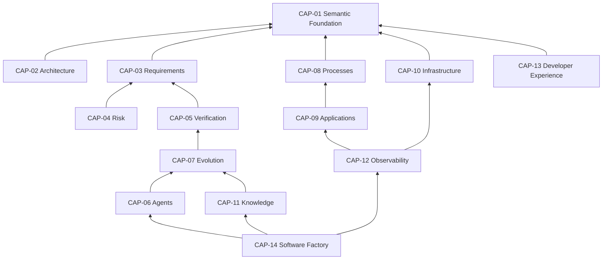

# Capability map

Telos is meant to grow into the subsystems below. This map separates what exists after the semantic foundation rebuild, named by module path, from what is direction only. A capability marked "Not built in this mission" has no code and no placeholder; its entry in the [roadmap](../roadmap/README.md) is direction, not a plan of record ([principle P16](../principles/P16-no-speculative-implementation.md)).

Maturity uses the [foundation vocabulary](../README.md#maturity-vocabulary): `vision` (direction only), `proposed` (designed, not yet implemented), `implemented` (code exists on this branch).

## Overview

| ID     | Capability                 | Maturity | Depends on |
| ------ | -------------------------- | -------- | ---------- |
| CAP-01 | Semantic Foundation        | proposed | —          |
| CAP-02 | Architecture               | proposed | 01         |
| CAP-03 | Requirements               | vision   | 01         |
| CAP-04 | Risk                       | vision   | 01, 03     |
| CAP-05 | Verification and Assurance | proposed | 01, 03     |
| CAP-06 | Agents                     | proposed | 01, 05, 07 |
| CAP-07 | Evolution                  | vision   | 01, 05     |
| CAP-08 | Processes                  | vision   | 01         |
| CAP-09 | Applications               | proposed | 01, 08     |
| CAP-10 | Infrastructure             | vision   | 01         |
| CAP-11 | Knowledge                  | vision   | 01, 05, 07 |
| CAP-12 | Observability              | vision   | 01, 09, 10 |
| CAP-13 | Developer Experience       | proposed | 01         |
| CAP-14 | Software Factory           | vision   | all        |

## CAP-01 Semantic Foundation

- **Purpose**: Loci, identity, containment, relations, capabilities, contracts, semantic extensions, composition, Archetype rules, diagnostics, the semantic model and Semantic Closure.
- **Relation to Locus**: defines it.
- **In this mission**: built. `Locus.make` in `packages/kernel/src/locus.ts`; identity in `packages/kernel/src/identity.ts`; containment in `packages/kernel/src/model.ts`; relations in `packages/kernel/src/relation.ts`; capabilities and contracts in `packages/kernel/src/capability.ts`; extensions in `packages/kernel/src/extension.ts` and composition in `packages/kernel/src/locus.ts`; `buildModel` in `packages/kernel/src/model.ts`; Semantic Closure in `packages/kernel/src/closure.ts`.
- **Not built in this mission**: revisions, history and diff. See [future semantic evolution](../future-semantic-evolution.md).
- **Maturity**: `proposed` until the rebuild merges; then `implemented`.
- **Research questions**: OQ-001 to OQ-013.
- **Contribution to Evolution of Determinism**: makes "what is this and what does it touch" a deterministic question.

## CAP-02 Architecture

- **Purpose**: Archetypes, structural diagnostics, composition rules and checks of how Loci depend on one another.
- **Relation to Locus**: constrains the Loci of a semantic model and their relations.
- **In this mission**: partly built. Archetypes and rules in `packages/kernel/src/archetype.ts` and `packages/kernel/src/verify.ts`; structural diagnostics in `packages/kernel/src/diagnostic.ts`. The calculator declares its own Archetype.
- **Not built in this mission**: migration between Archetype versions; import-graph extractors for drift detection. See the [roadmap](../roadmap/README.md).
- **Maturity**: `proposed`.
- **Research questions**: OQ-005, OQ-013, OQ-017.
- **Contribution**: turns architectural intent into executable constraints.

## CAP-03 Requirements

- **Purpose**: functional and non-functional requirements as declared definitions, with traceability to verification.
- **Relation to Locus**: a requirements extension on Loci, not yet defined.
- **In this mission**: not built. The `telos.purpose` extension in `packages/kernel/src/extensions/purpose.ts` holds purpose, responsibilities and excluded scope as narrative properties only.
- **Not built in this mission**: a requirements model. See the [roadmap](../roadmap/README.md).
- **Maturity**: `vision`.
- **Research questions**: OQ-008.
- **Contribution**: makes "what must hold" explicit and checkable, once built.

## CAP-04 Risk

- **Purpose**: risk scenarios, uncertainty, risk models and change impact evaluation.
- **Relation to Locus**: a risk extension on Loci; risk would propagate along relations.
- **In this mission**: not built. [Impact](../terminology/impact.md) is computed from the model in `packages/kernel/src/impact.ts`, which is an input to risk, not a risk model.
- **Not built in this mission**: risk scoring and risk models. See the [roadmap](../roadmap/README.md).
- **Maturity**: `vision`.
- **Research questions**: which risk signals predict defects; how to combine qualitative and quantitative risk honestly.
- **Contribution**: lets verification depth follow risk ([P07](../principles/P07-no-universal-correctness.md)).

## CAP-05 Verification and Assurance

- **Purpose**: Archetype rules, findings, knowledge statuses and evidence about the system.
- **Relation to Locus**: Archetypes apply to Loci; findings are recorded per Locus and rule.
- **In this mission**: built in part. `verify` in `packages/kernel/src/verify.ts` runs rules and records findings with knowledge statuses of the type `Knowledge` in `packages/kernel/src/describe.ts`. The documentation site shows verification results in `apps/docs`.
- **Not built in this mission**: evidence records with provenance, acceptance policies and assurance-case views. See [future semantic evolution](../future-semantic-evolution.md).
- **Maturity**: `proposed`.
- **Research questions**: OQ-015; assurance cases as Telos structures.
- **Contribution**: the verification step of the cycle, with its result stated as a finding and not as a guarantee ([P13](../principles/P13-no-unverified-guarantees.md)).

## CAP-06 Agents

- **Purpose**: agent access to the model through typed tools, and grants that limit what an agent may invoke.
- **Relation to Locus**: agent tools are interface Loci over the kernel's capabilities.
- **In this mission**: built in part. Typed introspection tools in `packages/agent/src/tools.ts`; invocation with grants in `packages/kernel/src/invoke.ts`, which returns `NotGranted` when no grant exists.
- **Not built in this mission**: model providers, memory, delegation and run records. The kernel calls no model provider ([P14](../principles/P14-no-ai-in-the-kernel.md)).
- **Maturity**: `proposed`.
- **Research questions**: OQ-016.
- **Contribution**: lets agents read the model and act within declared grants ([P05](../principles/P05-agents-use-semantic-apis.md), [P15](../principles/P15-no-arbitrary-agent-privileges.md)).

## CAP-07 Evolution

- **Purpose**: governed change of a semantic model over time, with revisions, history and review.
- **Relation to Locus**: changes to Loci would be recorded as revisions.
- **In this mission**: not built. Spec Kitty fills the change-lifecycle role for Telos development today ([ADR-0011](../../decisions/ADR-0011-temporary-engineering-tools.md)).
- **Not built in this mission**: revisions and evolution records. See [future semantic evolution](../future-semantic-evolution.md).
- **Maturity**: `vision`.
- **Research questions**: OQ-009, OQ-018.
- **Contribution**: the cycle itself, once built.

## CAP-08 Processes

- **Purpose**: state machines, business processes, durable workflows and their checks.
- **Relation to Locus**: a process extension on Loci, not yet defined.
- **In this mission**: not built.
- **Not built in this mission**: state machine definitions and durable execution. See the [roadmap](../roadmap/README.md).
- **Maturity**: `vision`.
- **Research questions**: how statecharts can be Telos values; mapping to durable execution engines.
- **Contribution**: would make process behaviour checkable.

## CAP-09 Applications

- **Purpose**: applications made of Loci, with their capabilities and interfaces.
- **Relation to Locus**: application parts are Loci with capabilities.
- **In this mission**: the calculator in `apps/calculator` is the proof application. It is declared as Loci with capabilities, an Archetype and interface Loci for the command line and the Web.
- **Not built in this mission**: applications beyond the calculator, and generated API layers.
- **Maturity**: `proposed`.
- **Research questions**: how much of an application's structure can be derived from its Loci.
- **Contribution**: keeps running code tied to its meaning.

## CAP-10 Infrastructure

- **Purpose**: resources, deployment definitions, reconciliation and environments.
- **Relation to Locus**: resources would be Loci with infrastructure extensions.
- **In this mission**: not built.
- **Not built in this mission**: all of it. Existing infrastructure-as-code engines would be used behind an interface, not replaced. See the [roadmap](../roadmap/README.md).
- **Maturity**: `vision`.
- **Research questions**: reversibility of infrastructure effects ([P13](../principles/P13-no-unverified-guarantees.md)).
- **Contribution**: would put infrastructure under the same evidence rules as code.

## CAP-11 Knowledge

- **Purpose**: persistent knowledge about a system, with its source, scope and validity.
- **Relation to Locus**: knowledge would be scoped to Loci and Archetypes.
- **In this mission**: not built.
- **Not built in this mission**: knowledge records and their retrieval. See the [roadmap](../roadmap/README.md).
- **Maturity**: `vision`.
- **Research questions**: OQ-017; how knowledge expires.
- **Contribution**: would hold what the model cannot yet compute.

## CAP-12 Observability

- **Purpose**: traces, metrics, logs and operational evidence attributed to Loci.
- **Relation to Locus**: signals would be attributed to Loci and capabilities.
- **In this mission**: not built. The documentation site records origin, runtime, revision and time for each displayed result.
- **Not built in this mission**: telemetry attribution and health views. See the [roadmap](../roadmap/README.md).
- **Maturity**: `vision`.
- **Research questions**: OQ-006; which operational evidence is valid acceptance evidence.
- **Contribution**: would close the loop from operation back to the model.

## CAP-13 Developer Experience

- **Purpose**: the command line, the documentation site, the playground and the inspector that present the model.
- **Relation to Locus**: every tool reads and presents the model.
- **In this mission**: built in part. The command line in `packages/cli/src/index.ts` with `bun run telos inspect` and `bun run telos check`; the documentation site and playground in `apps/docs`, which render data produced from the model.
- **Not built in this mission**: editor integrations and visual representations of the model beyond the site.
- **Maturity**: `proposed`.
- **Research questions**: OQ-014, OQ-020.
- **Contribution**: makes the model visible and usable.

## CAP-14 Software Factory

- **Purpose**: an application of Telos that coordinates software engineering under established constraints.
- **Relation to Locus**: a factory would be a model of Loci (agents, processes, verification), governed like any other.
- **In this mission**: not built, and out of scope for this mission (constraint C-008 of the mission spec).
- **Not built in this mission**: all of it. See the [open questions](../open-questions.md) entry OQ-024.
- **Maturity**: `vision`.
- **Research questions**: OQ-018; the limits of autonomy ([P15](../principles/P15-no-arbitrary-agent-privileges.md)).
- **Contribution**: would run the whole cycle continuously, once the foundations exist.
