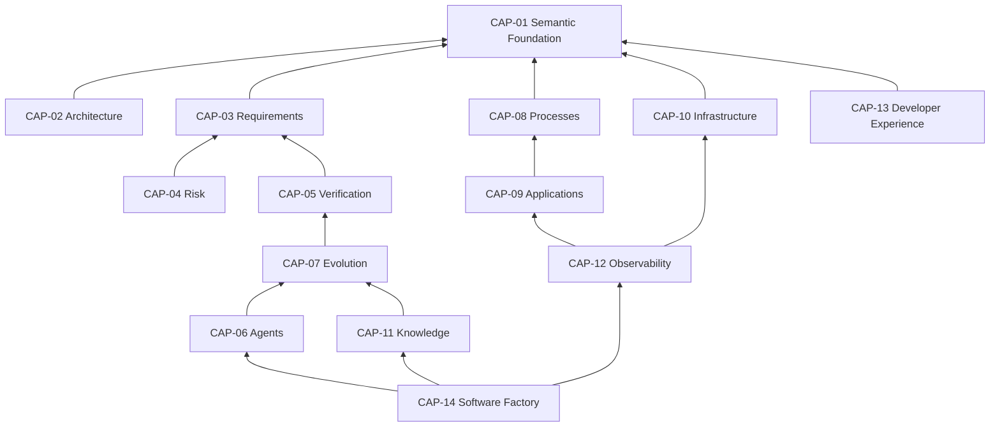

# Capability map

Telos is meant to grow into the subsystems below. This map is a direction, not a plan of record. Nothing here is implemented except where the maturity column says so, and no subsystem gets placeholder code before its own mission.

Maturity uses the [foundation vocabulary](../README.md#maturity-vocabulary): `vision` (direction only), `proposed` (designed), `implemented`.

## Overview

| ID     | Capability                 | Maturity | Depends on |
| ------ | -------------------------- | -------- | ---------- |
| CAP-01 | Semantic Foundation        | proposed | —          |
| CAP-02 | Architecture               | vision   | 01         |
| CAP-03 | Requirements               | vision   | 01         |
| CAP-04 | Risk                       | vision   | 01, 03     |
| CAP-05 | Verification and Assurance | vision   | 01, 03     |
| CAP-06 | Agents                     | vision   | 01, 05, 07 |
| CAP-07 | Evolution                  | vision   | 01, 05     |
| CAP-08 | Processes                  | vision   | 01         |
| CAP-09 | Applications               | vision   | 01, 08     |
| CAP-10 | Infrastructure             | vision   | 01         |
| CAP-11 | Knowledge                  | vision   | 01, 05, 07 |
| CAP-12 | Observability              | vision   | 01, 09, 10 |
| CAP-13 | Developer Experience       | vision   | 01         |
| CAP-14 | Software Factory           | vision   | all        |

## CAP-01 Semantic Foundation

- **Purpose**: Locus identity, ownership, Relations, composition, metadata, semantic analysis, Revisions and change detection.
- **Relation to Locus**: defines it.
- **Expected interfaces**: definition constructors; Fabric validation with diagnostics; Revision creation, history and diff; later graph queries and impact analysis.
- **Likely engines**: none external; a graph store later if in-memory analysis stops scaling.
- **Maturity**: `proposed`. The Stage 0 mission implemented the first slice, `@telos/locus`.
- **Research questions**: OQ-001 to OQ-013.
- **Contribution to Evolution of Determinism**: makes "what is this and what does it touch" a deterministic question.

## CAP-02 Architecture

- **Purpose**: Archetypes, architectural Laws, dependency validation, composition rules, architecture evolution.
- **Relation to Locus**: constrains Fabrics of Loci and their Relations.
- **Expected interfaces**: Archetype definitions; `check(fabric, archetype) → violations`; migration support between Archetype versions.
- **Likely engines**: in-process graph checks; import-graph extractors for drift detection.
- **Maturity**: `vision`.
- **Research questions**: OQ-005, OQ-013, OQ-017; composing Archetypes.
- **Contribution**: turns architectural intent into executable constraints.

## CAP-03 Requirements

- **Purpose**: functional and non-functional requirements as code, behavioural contracts, traceability, applicability, integration with external requirement catalogues.
- **Relation to Locus**: a requirements Facet on Loci, or requirements Loci related by `satisfies`.
- **Expected interfaces**: requirement definitions with ids, status and acceptance criteria; trace queries; import adapters.
- **Likely engines**: catalogue connectors; specification runners.
- **Maturity**: `vision`.
- **Research questions**: OQ-008; mapping to standards such as SysML v2 requirement elements.
- **Contribution**: makes "what must hold" explicit and checkable.

## CAP-04 Risk

- **Purpose**: risk scenarios, uncertainty, risk models, change impact evaluation, adaptive verification selection.
- **Relation to Locus**: a risk Facet on Loci; risk propagates along Relations.
- **Expected interfaces**: risk scenario definitions; `assess(change) → risk profile`; verification policy inputs.
- **Likely engines**: rule-based scoring first; quantitative models only with evidence they help.
- **Maturity**: `vision`.
- **Research questions**: which risk signals predict defects; how to combine qualitative and quantitative risk honestly.
- **Contribution**: lets verification depth follow risk ([P11](../principles/P11-verification-is-contextual.md)).

## CAP-05 Verification and Assurance

- **Purpose**: tests, formal analysis, evidence, acceptance policies, audits, verification provenance.
- **Relation to Locus**: a verification Facet; verification Loci related by `verifies`; Witnesses about Revisions.
- **Expected interfaces**: verification procedure definitions; adapters to runners; Witness records; acceptance policies; assurance-case views.
- **Likely engines**: `bun test` and other test runners; property-based testing; model checkers; browser automation.
- **Maturity**: `vision`. Stage 0 builds temporary executable specifications designed to be absorbed later ([ADR-0013](../../decisions/ADR-0013-temporary-executable-specifications.md)).
- **Research questions**: OQ-015; assurance cases (GSN, SACM) as Telos structures.
- **Contribution**: the Verification step of the cycle.

## CAP-06 Agents

- **Purpose**: agent definitions, capabilities, permissions, scoped context, memory, delegation, lifecycle.
- **Relation to Locus**: an agent is a Locus with an agent Facet; it acts through Acts under Mandates and sees through Lenses.
- **Expected interfaces**: agent definitions; Lens computation; Mandate issue and check; run records.
- **Likely engines**: model providers behind an interface; sandboxed runtimes.
- **Maturity**: `vision`.
- **Research questions**: OQ-016; how much bounded capability costs exploration ([assumption A5](../philosophy/evolution-of-determinism.md#4-assumptions)).
- **Contribution**: the Exploration and Hypothesis steps, under governance.

## CAP-07 Evolution

- **Purpose**: baseline-to-Variant transitions, task orchestration, investigations, implementation loops, governance, acceptance.
- **Relation to Locus**: Evolutions change Loci through Variants and Revisions.
- **Expected interfaces**: open, step and conclude an Evolution; Variant workspaces; Verdict recording.
- **Likely engines**: durable workflow engine; version control as byte storage.
- **Maturity**: `vision`. Spec Kitty fills this role for Telos development today.
- **Research questions**: OQ-009, OQ-018; minimum overhead for small changes.
- **Contribution**: the cycle itself.

## CAP-08 Processes

- **Purpose**: state machines, business processes, durable workflows, dependencies, distributed orchestration.
- **Relation to Locus**: a process Facet on Loci whose Charter is a process.
- **Expected interfaces**: state machine definitions; durable execution; process instance records.
- **Likely engines**: Effect for in-process orchestration; external durable workflow engines.
- **Maturity**: `vision`.
- **Research questions**: statecharts as Telos values; mapping to durable execution engines.
- **Contribution**: makes process behaviour checkable (reachability, invariants).

## CAP-09 Applications

- **Purpose**: frontend, backend, APIs, domain logic, data access, integrations.
- **Relation to Locus**: application parts are Loci with behaviour Facets and Acts.
- **Expected interfaces**: Act implementations as Effect programs; API generation from Act contracts; UI bindings.
- **Likely engines**: Effect platform; web frameworks such as TanStack Start; databases.
- **Maturity**: `vision`.
- **Research questions**: how much of an application's structure can be derived from its Loci.
- **Contribution**: keeps running code tied to its meaning.

## CAP-10 Infrastructure

- **Purpose**: resources, deployment definitions, reconciliation, environments, providers.
- **Relation to Locus**: resources are Loci with infrastructure Facets.
- **Expected interfaces**: resource definitions; plan and apply through providers; drift reports.
- **Likely engines**: existing infrastructure-as-code engines (for example Pulumi) behind an interface, not replaced.
- **Maturity**: `vision`.
- **Research questions**: reversibility of infrastructure effects ([P08](../principles/P08-preserve-the-baseline.md)).
- **Contribution**: puts infrastructure under the same evidence and authority rules as code.

## CAP-11 Knowledge

- **Purpose**: persistent verified knowledge, architectural facts, external sources, assumptions, knowledge evolution.
- **Relation to Locus**: knowledge is scoped to Loci, Fabrics or Archetypes and backed by Witnesses.
- **Expected interfaces**: fact records with scope, provenance and validity; invalidation on change; retrieval for Lenses.
- **Likely engines**: the semantic graph; retrieval engines for unstructured sources.
- **Maturity**: `vision`.
- **Research questions**: OQ-017; how knowledge expires.
- **Contribution**: the Reusable Knowledge step.

## CAP-12 Observability

- **Purpose**: traces, metrics, logs, operational evidence, health, feedback into risk and evolution.
- **Relation to Locus**: signals are attributed to Loci and Acts; operational evidence becomes Witnesses.
- **Expected interfaces**: attribution of telemetry to Loci; health views; feedback into risk models.
- **Likely engines**: OpenTelemetry and Effect's tracing; external backends.
- **Maturity**: `vision`.
- **Research questions**: OQ-006; which operational evidence is valid acceptance evidence.
- **Contribution**: closes the loop from production back to the model.

## CAP-13 Developer Experience

- **Purpose**: CLI, language tooling, visual representations, debugging, documentation, interactive examples, IDE integration.
- **Relation to Locus**: every tool reads and presents the model.
- **Expected interfaces**: CLI commands; documentation generation; playground; editor integrations.
- **Likely engines**: TypeScript language service; the documentation site.
- **Maturity**: `vision`. The Stage 0 documentation site and playground are the first piece.
- **Research questions**: OQ-014, OQ-020.
- **Contribution**: makes the model visible and usable.

## CAP-14 Software Factory

- **Purpose**: an application of Telos that autonomously coordinates software engineering under established constraints.
- **Relation to Locus**: the factory is itself a Fabric of Loci (agents, processes, verification), governed like any other.
- **Expected interfaces**: objectives in, governed Evolutions out.
- **Likely engines**: everything above.
- **Maturity**: `vision`.
- **Research questions**: OQ-018; the limits of autonomy ([P13](../principles/P13-human-as-strategic-authority.md)).
- **Contribution**: runs the whole cycle continuously.
