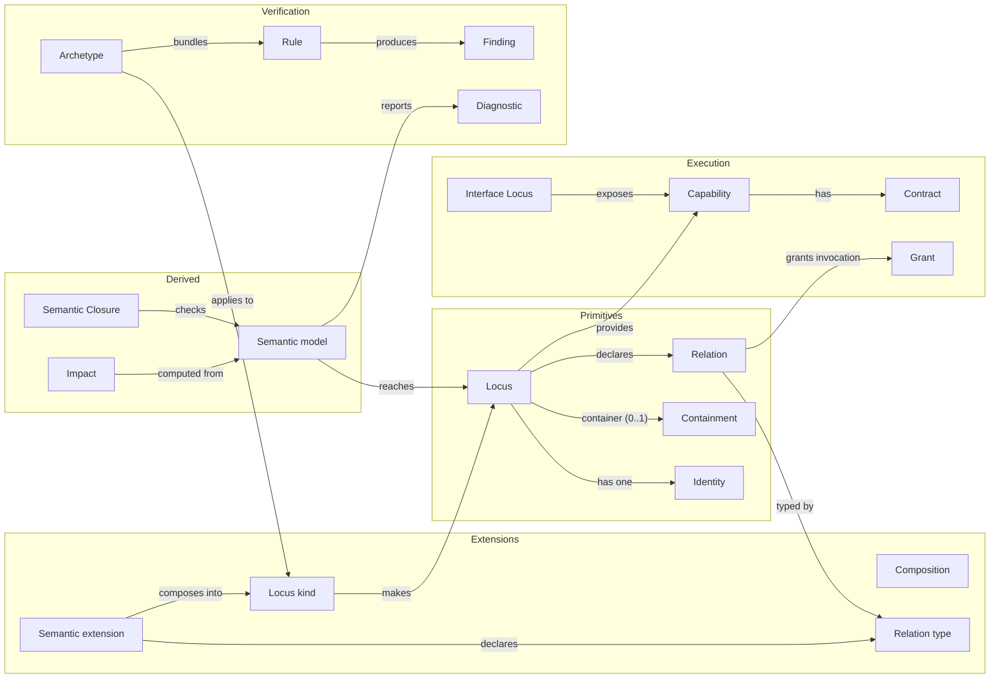
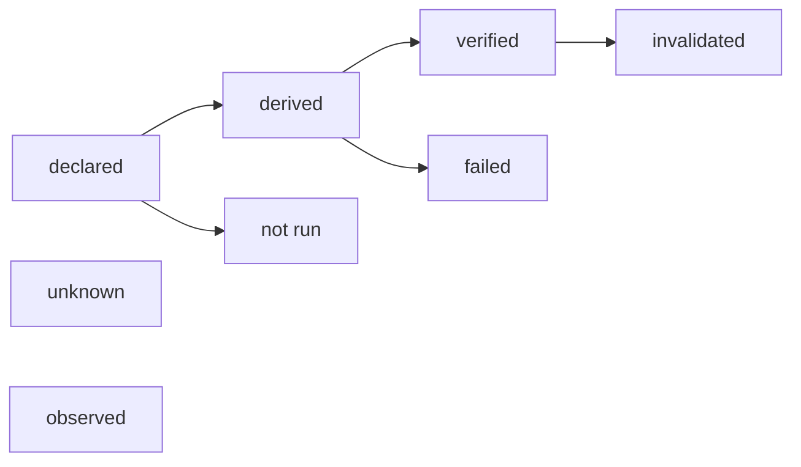
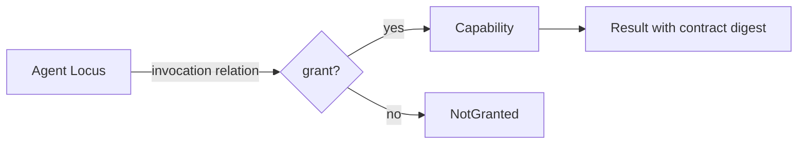

# Conceptual model

This document relates the [terms](../terminology/README.md) to one another, tests the minimal-model hypothesis against representative cases, and lists the invariants that the kernel is meant to enforce. It records what is decided, what is provisional and what is open. It does not invent answers to make the model look complete.

## 1. Concept map

Loci are the only fundamental entity ([P01](../principles/P01-one-fundamental-entity.md)). Everything else is declared by an extension, expressed as a relation or capability, or derived from Loci.



## 2. Classification

| Concept            | Class               | Fundamental | Needs an engine     | Status after the rebuild |
| ------------------ | ------------------- | ----------- | ------------------- | ------------------------ |
| Locus              | Semantic primitive  | Yes         | No                  | In the kernel            |
| Identity           | Semantic primitive  | No          | No                  | In the kernel            |
| Containment        | Semantic primitive  | No          | No                  | In the kernel            |
| Relation           | Semantic primitive  | No          | No                  | In the kernel            |
| Semantic extension | Extension model     | No          | No                  | In the kernel            |
| Composition        | Extension model     | No          | No                  | In the kernel            |
| Locus kind         | Extension model     | No          | No                  | In the kernel            |
| Relation type      | Extension model     | No          | No                  | In the kernel            |
| Pack               | Extension model     | No          | No                  | Pattern only, by example |
| Capability         | Execution model     | No          | Runtime for effects | In the kernel            |
| Contract           | Execution model     | No          | No                  | In the kernel            |
| Grant              | Execution model     | No          | No                  | In the kernel            |
| Interface Locus    | Execution model     | No          | Medium adapters     | Calculator and packages  |
| Archetype          | Verification model  | No          | Execution rules     | In the kernel            |
| Rule               | Verification model  | No          | Execution rules     | In the kernel            |
| Finding            | Verification model  | No          | No                  | In the kernel            |
| Diagnostic         | Verification model  | No          | No                  | In the kernel            |
| Knowledge status   | Verification model  | No          | No                  | In the kernel            |
| Semantic model     | Derived composition | No          | No                  | In the kernel            |
| Semantic Closure   | Derived composition | No          | No                  | In the kernel            |
| Impact             | Derived composition | No          | No                  | In the kernel            |

Metadata such as display names, tags and source locations is not a concept. It is attached to definitions and is not part of their meaning.

## 3. The minimal-model hypothesis

The hypothesis is that the minimum foundation is **Identity + Locus + Containment + Relation**, with semantic extensions as the way to add meaning. It is tested here rather than assumed.

### 3.1 Representative cases

Each case is written as a conceptual definition. The syntax is illustrative, not the kernel API.

**Pure computation.** A tax calculation.

```text
Locus  fin:vat-calculation
  purpose: Compute value-added tax for an order line.
  relation depends-on fin:vat-rate-table
```

Represented: identity, purpose, dependency. Not represented: the function's contract, which is a capability, and its algebraic properties, which an Archetype can check. Adequate for identity and ownership.

**Business process.** Order fulfilment.

```text
Locus  shop:order-fulfilment
  purpose: Get every confirmed order to the customer.
  relation depends-on shop:inventory, shop:shipping, shop:notifications
```

Represented: purpose and dependencies. Not represented: the state machine and its timing. Those need a process extension that the kernel does not yet define.

**UI component.** The checkout page.

```text
Locus  shop:checkout-page
  container shop:storefront
  purpose: Let a customer review and pay for their basket.
  excluded: Calculating prices.
  relation depends-on shop:pricing, shop:payment-authorization
```

Represented: purpose, boundary, nesting under the storefront and dependencies. Not represented: rendering and accessibility requirements, which need a requirements extension.

**Agent.** A release-notes writer.

```text
Locus  agents:release-notes-writer
  purpose: Draft release notes from accepted changes.
  excluded: Publishing release notes.
  relation invokes-with-grant shop:changelog-read
```

Represented: purpose, boundary and the one capability it may invoke. The grant comes from the relation, so the agent is identified, bounded and limited. What the agent may do beyond its granted capabilities is not described, and the model does not govern its behaviour.

**Verification component.** The payment test suite.

```text
Locus  shop:payment-tests
  purpose: Produce evidence that payment authorisation behaves as specified.
  relation verifies shop:payment-authorization
```

Represented: what it verifies and why. Not represented: the results it produces, which are findings only when an Archetype rule runs them.

### 3.2 Findings

1. **Five primitives are enough to identify, bound and connect the cases.** Identity, Locus, containment and relation are the minimum. Each case gets a stable identity, a purpose and typed links.
2. **Extensions add the rest of the meaning, and they are not primitives.** Process logic, requirement entries and agent scope are added by semantic extensions, so the kernel does not hard-code them.
3. **Containment is structural, not a relation.** Expressed as a general relation, ownership could be declared twice, breaking [P01](../principles/P01-one-fundamental-entity.md). The kernel makes it a single optional container of a Locus ([ADR-0007](../../decisions/ADR-0007-ownership-is-structural.md)).
4. **Relation types must be distinguished from the start.** The cases use `depends-on`, `verifies` and an invocation relation, which have different meanings and rules. A relation type that grants invocation is the only source of a grant between two different Loci ([ADR-0008](../../decisions/ADR-0008-typed-relations.md), [P15](../principles/P15-no-arbitrary-agent-privileges.md)).

**Conclusion.** The hypothesis holds as the minimal semantic foundation, with containment as a structural property and the semantic extension as the mechanism for meaning. It does not hold as a minimal operational foundation for processes, requirements or evidence, which need extensions the kernel does not define yet. This conclusion is provisional and is revisited when the first extension beyond the calculator is designed.

## 4. The model in the kernel

What the kernel holds. Exact types, names and error codes are fixed in the code and in the mission contracts, not here.

```text
Locus
  identity: Identity                   -- required
  container: Identity?                 -- at most one
  relations: set of Relation           -- possibly empty
  capabilities: set of Capability      -- possibly empty
  properties: from its composition     -- typed by extensions

SemanticExtension
  properties: named, typed
  relationTypes: named, with rules; some grant invocation
  archetypes: named Archetypes it brings

Composition(extensions)
  -> LocusKind | Diagnostic[]          -- conflicts are reported, never overwritten

Relation
  type: RelationType
  source: Identity
  target: Identity or capability

Archetype
  applies to: LocusKind whose composition includes its extensions
  rules: named, each static or execution

Finding
  rule, locus, outcome: passed | failed | error, knowledge status
```

## 5. Invariants

The invariants below are what the kernel is meant to enforce, with executable specifications where they exist. The others are commitments.

| ID      | Invariant                                                                                                                               | Principle | Enforced                       |
| ------- | --------------------------------------------------------------------------------------------------------------------------------------- | --------- | ------------------------------ |
| INV-001 | Every Locus has a well-formed identity in the `namespace:name` grammar.                                                                 | P01       | Yes                            |
| INV-002 | Identities are unique within one semantic model.                                                                                        | P01       | Yes                            |
| INV-003 | Identity does not depend on where a definition is stored, nor on its container.                                                         | P01       | Yes                            |
| INV-004 | A Locus requires no field beyond its identity.                                                                                          | P01       | Yes                            |
| INV-005 | A Locus has at most one container; the container exists, is not the Locus itself, and containment is acyclic.                           | P01       | Yes                            |
| INV-006 | Every relation has a type declared by an extension composed into its source, a target that exists, and is not duplicated on its source. | P02       | Yes                            |
| INV-007 | Composition reports conflicting definitions as diagnostics and never overwrites one definition with another.                            | P02       | Yes                            |
| INV-008 | A Locus is made only from a composed kind; a kind with conflicts makes no Locus.                                                        | P02       | Yes                            |
| INV-009 | An Archetype rule applies only to Loci whose composition includes the extensions the Archetype names.                                   | P06       | Yes                            |
| INV-010 | Kernel results are deterministic: the same input gives the same diagnostics in the same order, and all violations are reported.         | P14       | Yes                            |
| INV-011 | The kernel imports only `effect` and calls no model provider.                                                                           | P14       | Yes                            |
| INV-012 | Every managed code file belongs to a Locus owner, or it is reported as a finding (Semantic Closure).                                    | P03       | Yes                            |
| INV-013 | `invoke` returns `NotGranted` unless the caller owns the capability or a grant derived from an invocation relation exists.              | P15       | Yes                            |
| INV-014 | A finding carries a knowledge status; "verified" is used only for a rule result produced by a real execution in this repository.        | P13       | Yes                            |
| INV-015 | Displayed verification results name their origin; anything not executed is shown as not run.                                            | P13       | Yes, in the documentation site |
| INV-016 | A capability's contract digest changes when any of its schemas changes.                                                                 | P04       | Yes                            |
| INV-017 | Verification results are never written into a definition as a claim about it.                                                           | P13       | No, by convention              |

## 6. Key questions

Answers marked **provisional** are working positions. Questions without a defensible answer are in the [open questions](../open-questions.md).

**What constitutes a Locus boundary?** Provisional: a responsibility that can be stated as one purpose, owned by one party and changed with limited effect on others. That is a heuristic, not a test. [OQ-001](../open-questions.md#oq-001).

**Can a Locus belong to more than one semantic model?** Conceptually yes, for example a shared database used by two systems. The kernel builds one model from one root and says nothing about membership elsewhere. [OQ-002](../open-questions.md#oq-002).

**How are semantic identity and filesystem ownership related?** They are independent. A definition may live in any file; its identity is declared, not derived. Tools may map files to Loci, but the map is metadata. Provisional, [ADR-0003](../../decisions/ADR-0003-identity-independent-of-paths.md).

**What is the identity of a nested Locus?** Its own declared identity, not a path built from its container. Nesting is the container property. Re-parenting does not rename. Whether names should also be hierarchical is [OQ-003](../open-questions.md#oq-003).

**How are relations typed and validated?** By relation types that extensions declare, each with rules, checked per model. Provisional, [ADR-0008](../../decisions/ADR-0008-typed-relations.md); the extension mechanism is what makes the set extensible, see [OQ-013](../open-questions.md#oq-013).

**How are circular relationships handled?** Containment cycles are errors, because they contradict the meaning of containment. Cycles of other relation types are reported; whether they are forbidden is a policy that an Archetype may state. [OQ-005](../open-questions.md#oq-005).

**Can an extension own independent state?** Unknown. [OQ-006](../open-questions.md#oq-006).

**Is a semantic model a separate entity or a derived composition?** A derived composition: it is computed from the Loci reachable from a root and has no history of its own. [OQ-007](../open-questions.md#oq-007).

**What distinguishes a purpose from a requirement?** A purpose states why the Locus exists and what it is accountable for; it is narrative. Requirements are individually addressable, testable obligations. Provisional, [OQ-008](../open-questions.md#oq-008).

**What is immutable in a revision?** Revisions are future direction; see [future semantic evolution](../future-semantic-evolution.md) and [OQ-009](../open-questions.md#oq-009).

**What makes a Locus well formed beyond the kernel checks?** Extension validity and Archetype conformance, which are not yet defined beyond the calculator's proof. [OQ-010](../open-questions.md#oq-010).

**How is semantic drift between the model and code detected?** Partly: Semantic Closure reports unowned files. Declared capabilities that no longer match their code are not detected yet. [OQ-012](../open-questions.md#oq-012).

## 7. Knowledge statuses

A fact in the model has one of eight knowledge statuses. Two of them are reserved and not produced by the current kernel.



A declared fact is written by a person or a definition. A derived fact is computed from declarations. A verified fact is a rule result produced by a real execution in this repository. Observed and invalidated are reserved for future evidence records ([knowledge status](../terminology/knowledge-status.md)).

## 8. Capability invocation



An agent reaches a capability only through a grant. The grant comes from an invocation relation declared in the model, which keeps the permission visible and removable ([P15](../principles/P15-no-arbitrary-agent-privileges.md)).
