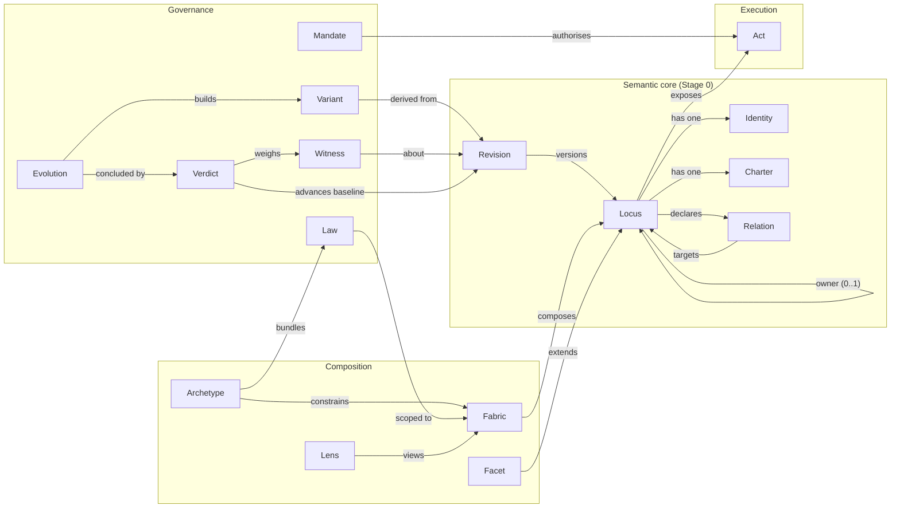

# Conceptual model

This document relates the [terms](../terminology/README.md) to one another, tests the minimal-model hypothesis against representative cases, and lists the invariants the Stage 0 implementation is meant to enforce. It records what is decided, what is provisional and what is open. It does not invent answers to make the model look complete.

## 1. Concept map



## 2. Classification

The directive asks which concepts are primitives, which are derived, which belong to execution or governance, which are Facets or metadata, which need engines and which Stage 0 does without.

| Concept   | Class               | Fundamental | Needs an engine      | Stage 0                   |
| --------- | ------------------- | ----------- | -------------------- | ------------------------- |
| Identity  | Semantic primitive  | Yes         | No                   | In scope                  |
| Locus     | Semantic primitive  | Yes         | No                   | In scope                  |
| Charter   | Semantic primitive  | Yes         | No                   | In scope                  |
| Relation  | Semantic primitive  | Yes         | No (analysis later)  | In scope                  |
| Revision  | Semantic primitive  | Yes         | No                   | In scope                  |
| Fabric    | Derived composition | No          | No                   | Minimal: validation scope |
| Lens      | Derived composition | No          | Context engine       | Deferred                  |
| Facet     | Facet mechanism     | No          | One per Facet type   | Deferred                  |
| Archetype | Governance model    | No          | Architecture checker | Deferred                  |
| Law       | Governance model    | No          | Enforcement engines  | Deferred                  |
| Mandate   | Governance model    | No          | Authority engine     | Deferred                  |
| Variant   | Governance model    | No          | Workspace isolation  | Deferred                  |
| Witness   | Governance model    | No          | Verification engines | Deferred                  |
| Verdict   | Governance model    | No          | Policy evaluator     | Deferred                  |
| Evolution | Governance model    | No          | Orchestrator         | Deferred                  |
| Act       | Execution model     | No          | Runtime              | Deferred                  |

Metadata such as display names, tags and source locations is not a concept. It is attached to definitions and excluded from their semantic identity and Revision digest.

## 3. The minimal-model hypothesis

The directive proposes that the minimum foundation is **Identity + Locus + Charter + Relation + Revision**. The hypothesis is tested here rather than assumed.

### 3.1 Representative cases

Each case is written as a conceptual definition. The syntax is illustrative, not the Stage 0 API.

**Pure computation.** A tax calculation.

```text
Locus  fin:vat-calculation
Charter
  purpose: Compute value-added tax for an order line.
  responsibilities: Apply the rate for the line's jurisdiction and product class.
Relations
  depends-on fin:vat-rate-table
```

Represented: identity, purpose, dependency. Not represented: the function's contract (an Act or behaviour Facet), its algebraic properties (Laws). Adequate for identity and ownership.

**Business process.** Order fulfilment.

```text
Locus  shop:order-fulfilment
Charter
  purpose: Get every confirmed order to the customer.
  responsibilities: Reserve stock, Hand over to shipping, Notify the customer.
  success: Every confirmed order is shipped or explicitly cancelled.
Relations
  depends-on shop:inventory, shop:shipping, shop:notifications
```

Represented: purpose, steps as responsibilities, dependencies. Not represented: the state machine, its durability, its timing. Those need a process Facet and an engine.

**UI component.** The checkout page.

```text
Locus  shop:checkout-page
owner  shop:storefront
Charter
  purpose: Let a customer review and pay for their basket.
  responsibilities: Show basket totals, Collect payment details, Report payment outcome.
  excluded: Calculating prices.
Relations
  depends-on shop:pricing, shop:payment-authorization
```

Represented: purpose, boundary (prices are not its job), nesting under the storefront, dependencies. Not represented: rendering, accessibility requirements (requirements Facet).

**Infrastructure resource.** The orders database.

```text
Locus  ops:orders-database
Charter
  purpose: Durably store orders.
  responsibilities: Keep order records, Provide point-in-time recovery.
```

with `shop:order-fulfilment depends-on ops:orders-database`. Represented: identity independent of the cloud provider, purpose, who relies on it. Not represented: the resource specification, reconciliation and cost (infrastructure Facet and engine).

**AI agent.** A release-notes writer.

```text
Locus  agents:release-notes-writer
Charter
  purpose: Draft release notes from accepted changes.
  responsibilities: Summarise accepted Evolutions, Flag breaking changes.
  excluded: Publishing release notes.
Relations
  depends-on docs:changelog
```

Represented: purpose and boundary (it drafts, it does not publish). Not represented, and essential for agents: its Acts, its Mandate, its Lens, its model and budget. The hypothesis can **identify and bound** an agent but cannot **govern** it.

**Verification component.** The payment test suite.

```text
Locus  shop:payment-tests
Charter
  purpose: Produce evidence that payment authorisation behaves as specified.
  responsibilities: Exercise authorisation outcomes, Exercise provider failures.
Relations
  verifies shop:payment-authorization
```

Represented: what it verifies and why. Not represented: the Witnesses it produces.

**Requirements subsystem.** Payment requirements as a body of knowledge.

```text
Locus  shop:payment-requirements
Charter
  purpose: State what payment handling must guarantee.
  responsibilities: Hold payment requirements, Keep them traceable to regulation.
Relations
  satisfies relation from shop:payment-authorization to shop:payment-requirements
```

Represented: the requirements body as an owned unit, and which Locus satisfies it. Not represented: individual requirement entries, their ids and status. That needs a requirements Facet.

### 3.2 Findings

1. **The five concepts are enough to identify, bound and connect all seven cases.** Every case gets a stable identity, a purpose, responsibilities and typed links. This is the job Stage 0 sets itself.
2. **The five concepts are not enough to specify behaviour, authority or evidence.** Process logic, agent capabilities, infrastructure specs and requirement entries all need Facets and Acts; agents need Mandates and Lenses. This is expected, and it is why those concepts exist.
3. **Two additions are needed even for identity and ownership.**
   - **Ownership** needs a place. Expressed as a general Relation it could be declared twice, breaking [P03](../principles/P03-semantic-ownership.md). Stage 0 makes it a single optional `owner` property of a Locus ([ADR-0007](../../decisions/ADR-0007-ownership-is-structural.md)).
   - **A validation scope** is needed. "Unique" and "the target exists" only mean something relative to a set of Loci. Stage 0 uses a minimal [Fabric](../terminology/fabric.md) for that ([ADR-0006](../../decisions/ADR-0006-locus-and-fabric-are-distinct.md)).
4. **Relation kinds must be distinguished from the start.** The cases use `depends-on`, `refines`, `satisfies` and `verifies`, which have different meanings and rules ([ADR-0008](../../decisions/ADR-0008-typed-relations.md)).

**Conclusion.** The hypothesis holds as the minimal **semantic** foundation, with ownership as a structural property and a minimal Fabric as the validation scope. It does not hold as a minimal **operational** foundation; that needs Facets, Acts and the governance concepts, which later stages add. This conclusion is provisional and should be revisited when the first Facet is designed.

## 4. Stage 0 model

What the Stage 0 mission is expected to implement. Exact types, names and error codes are fixed in the mission's plan and contracts, not here.

```text
Fabric
  id: Identity
  loci: set of LocusDefinition

LocusDefinition
  id: Identity                         -- required
  charter: Charter                     -- required
  owner: Identity?                     -- at most one
  relations: set of Relation           -- possibly empty
  (source location, display metadata)  -- allowed, not semantic

Charter
  purpose: text                        -- required, not blank
  responsibilities: set of text        -- at least one
  excluded: set of text                -- optional
  successConditions: set of text       -- optional

Relation
  kind: depends-on | refines | satisfies | verifies
  target: Identity

Revision
  id: digest of canonical semantic definition
  locus: Identity
  definition: LocusDefinition (semantic part, frozen)

History (per Locus)
  entries: append-only list of Revision ids; last = head (baseline)
  advance(expectedHead, newRevision) -- compare-and-set
```

## 5. Invariants

`Stage 0` marks the invariants the Stage 0 mission is meant to enforce with executable specifications. The others are commitments.

| ID      | Invariant                                                                                                                                                                                     | Principle | Stage 0               |
| ------- | --------------------------------------------------------------------------------------------------------------------------------------------------------------------------------------------- | --------- | --------------------- |
| INV-001 | Every Locus has a well-formed Identity.                                                                                                                                                       | P02       | Yes                   |
| INV-002 | Identities are unique within a Fabric.                                                                                                                                                        | P02, P03  | Yes                   |
| INV-003 | Identity and Revision id do not depend on where a definition is stored.                                                                                                                       | P02       | Yes                   |
| INV-004 | Every Locus has a Charter with a non-blank purpose and at least one non-blank responsibility, and no part contains duplicates.                                                                | P02       | Yes                   |
| INV-005 | A Locus has at most one owner; a declared owner exists in the Fabric and is not the Locus itself.                                                                                             | P03       | Yes                   |
| INV-006 | Ownership is acyclic: the owner chain of every Locus ends.                                                                                                                                    | P03       | Yes                   |
| INV-007 | Every Relation has a known kind, a target that exists in the Fabric, is not a self-relation, and is not duplicated (same kind and target) on its source.                                      | P04       | Yes                   |
| INV-008 | `refines` Relations are acyclic.                                                                                                                                                              | P04       | Yes                   |
| INV-009 | Validation is deterministic: the same input always yields the same result and the same diagnostics in the same order, and reports all violations, not only the first.                         | P10, P15  | Yes                   |
| INV-010 | A Revision's content and id never change after creation.                                                                                                                                      | P08       | Yes                   |
| INV-011 | A history accepts a new head only when the caller's expected baseline equals the current head.                                                                                                | P08       | Yes                   |
| INV-012 | Definitions that differ only in non-semantic ways (set order, source location, metadata) have the same Revision id; any semantic difference yields a different id and a non-empty change set. | P07, P08  | Yes                   |
| INV-013 | Displayed verification results are derived from an actual execution and name its origin; anything not executed is shown as not run.                                                           | P09, P10  | Yes, in the docs site |
| INV-014 | The Locus core does not depend on its temporary specification adapters or on any test runner.                                                                                                 | P15       | Yes                   |
| INV-015 | Every protected operation is authorised by a Mandate.                                                                                                                                         | P06       | No                    |
| INV-016 | Acceptance references Witnesses bound to the accepted Revision.                                                                                                                               | P09       | No                    |

## 6. Key questions

Answers marked **provisional** are Stage 0 working positions. Questions without a defensible answer are in the [open questions](../open-questions.md).

**What constitutes a Locus boundary?** Provisional: a responsibility that can be stated as one purpose, owned by one party and changed with limited effect on others. That is a heuristic, not a test. [OQ-001](../open-questions.md#oq-001).

**Can a Locus belong to more than one Fabric?** Conceptually yes, for example a shared database used by two systems. Stage 0 validates one Fabric at a time and says nothing about membership elsewhere. [OQ-002](../open-questions.md#oq-002).

**How are semantic identity and filesystem ownership related?** They are independent. A definition may live in any file; its Identity is declared, not derived. Tools may map files to Loci, but the map is metadata. Provisional, [ADR-0003](../../decisions/ADR-0003-identity-independent-of-paths.md).

**What is the identity of a nested Locus?** Its own declared Identity, not a path built from its owner. Nesting is the `owner` property. Re-parenting does not rename. Provisional; whether names should also be hierarchical is [OQ-003](../open-questions.md#oq-003).

**How are Relations typed and validated?** By a closed set of kinds, each with rules, checked per Fabric. Provisional, [ADR-0008](../../decisions/ADR-0008-typed-relations.md); extensibility is [OQ-013](../open-questions.md#oq-013).

**How are circular relationships handled?** Ownership cycles and `refines` cycles are errors, because they contradict the meaning of those relations. Cycles of other kinds are allowed by the core; forbidding them is an architecture choice for Archetype Laws. Provisional, [OQ-005](../open-questions.md#oq-005).

**Can Facets own independent state?** Unknown. [OQ-006](../open-questions.md#oq-006).

**Is Fabric a separate entity or a derived composition?** Stage 0: a value with an Identity and members, validated on demand, without history. Whether it becomes a versioned entity is [OQ-007](../open-questions.md#oq-007).

**What distinguishes Charter from Requirements?** A Charter states why the Locus exists and what it is accountable for; it is required and narrative. Requirements are individually addressable, testable obligations with their own lifecycle. Provisional, [OQ-008](../open-questions.md#oq-008).

**What is immutable in a Revision?** In Stage 0, everything in it: the Locus Identity and the canonical semantic definition, and therefore its id. Author, time and reason are not in the Revision, so ids stay deterministic; they belong to history entries or Evolutions later. [OQ-009](../open-questions.md#oq-009).

**What makes a Locus well formed?** In Stage 0: INV-001 to INV-008 hold for it within its Fabric. Later stages add Facet validity and Archetype conformance. [OQ-010](../open-questions.md#oq-010).

**How is semantic drift between definitions and code detected?** Not in Stage 0. Candidate approaches: comparing declared Relations with observed imports; GRACE-style markup linking code to Loci; Act contracts compiled from types. [OQ-012](../open-questions.md#oq-012).
