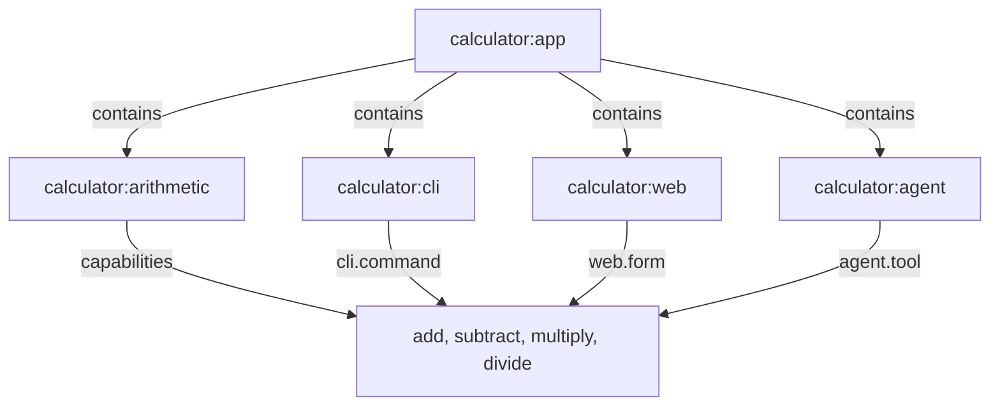

# Examples

The calculator is the reference implementation of Telos in this repository. It is one arithmetic Locus with four capabilities, and three interfaces that present those capabilities. Every interface calls the same capability, so the command line, the web forms and the agent tools report the same results and the same errors.

## The model

The application Locus `calculator:app` contains the arithmetic Locus and the three interface Loci. Each interface points at the capabilities that it presents.



## The arithmetic Locus

The arithmetic Locus is defined once. Its four capabilities take two finite numbers, and `divide` fails with `DivisionByZero` when the divisor is zero.

```ts source=apps/calculator/src/arithmetic.ts#ARITHMETIC_LOCUS
export const Operands = Schema.Struct({
  a: Schema.Finite,
  b: Schema.Finite,
});

export const Result = Schema.Struct({
  result: Schema.Finite,
});

export const Arithmetic = Extension.make("calculator.arithmetic", {
  description:
    "Marks a Locus that performs binary arithmetic on finite numbers.",
  archetypes: [ArithmeticBehavior],
});

export const add = Capability.make({
  description: "Adds b to a.",
  input: Operands,
  output: Result,
  errors: [NonFiniteResult],
  effect: "pure",
  handler: ({ a, b }) => finite(a + b),
});

export const subtract = Capability.make({
  description: "Subtracts b from a.",
  input: Operands,
  output: Result,
  errors: [NonFiniteResult],
  effect: "pure",
  handler: ({ a, b }) => finite(a - b),
});

export const multiply = Capability.make({
  description: "Multiplies a by b.",
  input: Operands,
  output: Result,
  errors: [NonFiniteResult],
  effect: "pure",
  handler: ({ a, b }) => finite(a * b),
});

export const divide = Capability.make({
  description: "Divides a by b.",
  input: Operands,
  output: Result,
  errors: [DivisionByZero, NonFiniteResult],
  effect: "pure",
  handler: ({ a, b }) =>
    b === 0
      ? Effect.fail(new DivisionByZero({ message: DIVISION_BY_ZERO_MESSAGE }))
      : finite(a / b),
});

export const arithmetic = Locus.extend(Purpose, Arithmetic).make({
  id: "calculator:arithmetic",
  description: "The single arithmetic implementation of the calculator.",
  properties: {
    purpose: "Performs the four basic arithmetic operations on finite numbers.",
    responsibilities: [
      "add",
      "subtract",
      "multiply",
      "divide",
      "report division by zero and non-finite results",
    ],
    excluded: ["parsing text input", "presentation"],
  },
  capabilities: { add, subtract, multiply, divide },
});
```

## The application and its interfaces

The application Locus groups the arithmetic Locus with its three interfaces, and builds the model that the interfaces and the site use.

```ts source=apps/calculator/src/app.ts#CALCULATOR_APP
export const CalculatorApp = Extension.make(APP_EXTENSION_ID, {
  description:
    "Marks the calculator application that groups the arithmetic Locus and its interfaces.",
  archetypes: [CalculatorInterfaces],
});

export function makeApp(
  contains: ReadonlyArray<LocusDefinition>,
): LocusDefinition {
  return Locus.extend(Purpose, CalculatorApp).make({
    id: "calculator:app",
    description: "The calculator application.",
    properties: { purpose: APP_PURPOSE },
    contains,
  });
}

export const app = makeApp([
  arithmetic,
  calculatorCli,
  calculatorWeb,
  calculatorAgent,
]);

export const calculatorModel = buildModel(app);
```

## Command line

The command line is the `calculator:cli` interface. Each capability is a command, and its inputs are flags. The output of a successful command is the output of the capability.

```sh
bun run calculator add --a 2 --b 3
```

```text
{"result":5}
```

A division by zero writes the error to standard error and exits with status 1.

```sh
bun run calculator divide --a 1 --b 0
```

```text
{"tag":"DivisionByZero","message":"Division by zero is not defined.","issues":[]}
```

## Web

The web interface is the `calculator:web` Locus. Its forms are derived from the capability contracts of the arithmetic Locus, and each form submits through the same capability. The [calculator page](/calculator) runs the forms in your browser and shows the outcome of each submit.

## Agent tools

The agent interface is the `calculator:agent` Locus. It exposes each capability as a tool of the Model Context Protocol.

```sh
bun run calculator:mcp
bun run calculator:agent-demo
```

`calculator:mcp` starts the tool server on standard input and output. `calculator:agent-demo` starts that server, lists its tools, reads the capabilities through `telos_capabilities`, calls `add`, calls `divide` with a zero divisor, sends an invalid input, and asks for the impact of `calculator:arithmetic#add`. It needs no network and no credentials, and it ends by reporting that it completed.

## Archetypes and verification

The arithmetic Locus has the archetype `calculator.arithmetic-behavior`. Its rules are named `arithmetic.*` and check the four operations, the purity of the capabilities, division by zero, non-finite results and the examples. The application has the archetype `calculator.interfaces`, whose rules are named `interfaces.*`. They check that every interface is present, that each capability has one implementation, and that the interfaces give the same results. The Packs check their own interfaces with `telos.cli.interface`, `telos.web.interface` and `telos.agent.interface`.

Run the verification of the repository model with:

```sh
bun run telos verify
```

## Change impact

The impact of a change to a capability lists the Loci that depend on it, with the checks that apply to them.

```sh
bun run telos impact calculator:arithmetic#add
```

The impact of `calculator:arithmetic#add` lists `calculator:cli` through `cli.command`, `calculator:web` through `web.form` and `calculator:agent` through `agent.tool`. Each is at distance 1. The report also lists the Archetype checks that apply to those Loci, and its knowledge status is `derived`.

## Invalid definitions

The kernel reports a definition that breaks a rule as a diagnostic. Two of the playground examples show this. A relation whose target does not exist gives `relation.target-missing`:

```json playground=missing-target
{
  "id": "demo:flow",
  "extensions": ["demo.flow"],
  "description": "Flows nowhere.",
  "relations": [
    {
      "type": "demo.flows-to",
      "target": "demo:nowhere"
    }
  ]
}
```

Two Loci that relate to each other in a cycle give `relation.cycle`:

```json playground=cycle
{
  "id": "demo:loop",
  "contains": [
    {
      "id": "demo:a",
      "extensions": ["demo.flow"],
      "description": "First step.",
      "relations": [
        {
          "type": "demo.flows-to",
          "target": "demo:b"
        }
      ]
    },
    {
      "id": "demo:b",
      "extensions": ["demo.flow"],
      "description": "Second step.",
      "relations": [
        {
          "type": "demo.flows-to",
          "target": "demo:a"
        }
      ]
    }
  ]
}
```
