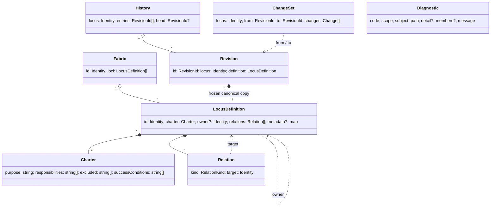
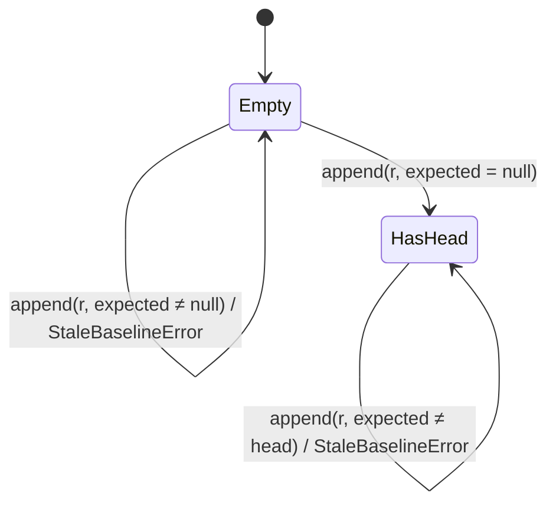

# Data Model: Locus Foundation

Entities of the Stage 0 model as implemented by this mission. Exact TypeScript signatures are in [contracts/locus-api.md](contracts/locus-api.md). Invariant ids refer to the [conceptual model](../../docs/foundation/conceptual-model/README.md#5-invariants).

## Value objects

### Identity

- String `<namespace>:<name>`. Each part matches `[a-z][a-z0-9]*(-[a-z0-9]+)*`. Total length is at most 128 characters.
- Valid examples: `shop:checkout`, `telos:locus-core`, `a1:b2-c3`.
- Invalid: `checkout` (no namespace), `Shop:checkout` (uppercase), `shop:check out` (space), `shop:` (empty part), `shop:-x` (leading hyphen), `shop:x--y` (double hyphen), `shop:a:b` (three parts).
- Rule: INV-001. Checked by validation, not by decoding.

### Charter

| Field | Type | Rule |
| --- | --- | --- |
| `purpose` | string | not blank after trimming whitespace (INV-004) |
| `responsibilities` | set of string | at least one entry; no blank entry; no duplicates (INV-004) |
| `excluded` | set of string, default empty | no blank entry; no duplicates |
| `successConditions` | set of string, default empty | no blank entry; no duplicates |

- Duplicates are compared by exact string value. No trimming or Unicode normalisation is applied.
- Blank means empty or whitespace only (`/^\s*$/u`).

### Relation

| Field | Type | Rule |
| --- | --- | --- |
| `kind` | `depends-on` \| `refines` \| `satisfies` \| `verifies` | closed set; unknown kinds are rejected when decoding (INV-007) |
| `target` | Identity | exists in the Fabric; not the source; `(kind, target)` unique per source (INV-007) |

`refines` must be acyclic (INV-008). Other kinds may form cycles.

## Entities

### LocusDefinition

| Field | Type | Semantic | Rule |
| --- | --- | --- | --- |
| `id` | Identity | yes | INV-001; unique in its Fabric (INV-002) |
| `charter` | Charter | yes | INV-004 |
| `owner` | Identity, optional | yes | exists in the Fabric, not `id`, no cycle (INV-005, INV-006) |
| `relations` | set of Relation, default empty | yes | INV-007, INV-008 |
| `metadata` | string-to-string map, optional | **no** | free; excluded from validation and from the Revision digest (INV-003) |

A definition is created by `defineLocus` and is deeply frozen (INV-010). There is no update operation. A change is a new definition.

### Fabric

| Field | Type | Rule |
| --- | --- | --- |
| `id` | Identity | INV-001 |
| `loci` | list of LocusDefinition | identities unique (INV-002); order has no meaning |

A Fabric is the scope of validation. It has no Charter, no owner and no history (ADR-0006).

### Diagnostic

| Field | Type | Meaning |
| --- | --- | --- |
| `code` | DiagnosticCode | stable machine code (see contracts) |
| `scope` | `fabric` \| `locus` | what the subject identifies |
| `subject` | string | the Fabric or Locus identity (raw string, even if malformed) |
| `path` | string | the part concerned, e.g. `charter.responsibilities`, `owner`, `relations` |
| `detail` | string, optional | the offending value, e.g. the duplicated entry or `refines shop:x` |
| `members` | list of Identity, optional | cycle members in cycle order, starting at the smallest |
| `message` | string | human-readable explanation; not part of any contract |

Order: by `subject`, then `code`, then `path`, then `detail`, then `members` joined. All comparisons are by UTF-16 code unit.

### ValidationReport

`{ valid: boolean; diagnostics: readonly Diagnostic[] }`. `valid` is true exactly when `diagnostics` is empty.

### Revision

| Field | Type | Meaning |
| --- | --- | --- |
| `id` | RevisionId `sha256:<64 lowercase hex>` | digest of the canonical form |
| `locus` | Identity | the definition's `id` |
| `definition` | LocusDefinition | the canonical semantic definition (sorted, de-duplicated, without metadata), deeply frozen |

INV-010: neither field ever changes. INV-012: equal canonical forms give equal ids.

### History (per Locus)

State: an ordered list of RevisionIds; `head` is the last one, or `null` when the list is empty.

Rules:

1. The stale check comes first. If `expected` differs from the current head, the call fails with `StaleBaselineError`, whatever the Revision.
2. After the stale check, a Revision equal to the head is a no-op.
3. The Revision's `locus` selects the history. One service instance holds the histories of many Loci.
4. Earlier Revisions may reappear (a revert): `A, B, A` is a valid history.
5. Append is atomic within a runtime.

### ChangeSet

| Field | Type |
| --- | --- |
| `locus` | Identity |
| `from`, `to` | RevisionId |
| `changes` | list of Change |

Change kinds:

| `part` | `kind` | Value fields |
| --- | --- | --- |
| `charter.purpose` | `changed` | `from`, `to` (strings) |
| `owner` | `changed` | `from`, `to` (Identity or `null`) |
| `charter.responsibilities`, `charter.excluded`, `charter.successConditions` | `added` \| `removed` | `value` (string) |
| `relations` | `added` \| `removed` | `value` (`"<kind> <target>"`) |

Order: by the fixed part order above, then `removed` before `added`, then `value`. `changes` is empty exactly when `from === to`.

### Specification and result

These are defined in [contracts/specifications.md](contracts/specifications.md).

### Content document (docs site)

These are defined in [contracts/docs-site.md](contracts/docs-site.md). Front matter is: `id`, `title`, `kind`, `status`, `maturity`, `summary`, `related`, plus fields that depend on the kind.

### Provenance

`{ origin: "browser" | "bun-build" | "ci" | "historical"; at?: ISO time; runtime?: string; packages: { "@telos/locus": version, "@telos/locus-specs": version }; commit?: string; dirty?: boolean }`. Rules for each origin are in [research.md R-06](research.md#r-06-provenance-model).
