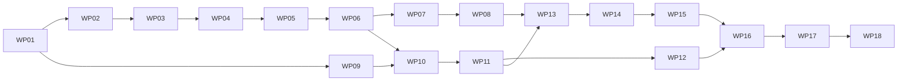

# Work Packages: Locus Foundation — Semantic Identity and Ownership

**Inputs**: `kitty-specs/locus-foundation-01M5EWDR/` (spec.md, plan.md, research.md, data-model.md, contracts/, quickstart.md)
**Routing (owner decision, 2026-10-21)**: every WP is implemented by Claude Haiku (`claude-haiku-5-5`) at high effort, in its own subagent. Every WP is reviewed by `reviewer-renata` on Claude Sonnet. The mission review after merge runs on Claude Opus at high effort. After two rejections of one WP, the owner is asked before a stronger model is used.
**Rule**: each WP prompt is self-sufficient. It quotes the exact APIs (Effect 4.0.4, TanStack Start 1.169.2, Bun 1.4.4), file contents and acceptance tests it needs. The contracts in `contracts/` are authoritative; where a prompt and a contract disagree, the contract wins and the implementer reports the conflict.
**Branches**: planning base and merge target are both `feat/locus-foundation`. Execution worktrees come from `lanes.json`.

## Shared files

The ownership rule is no overlapping `owned_files`. A few files must be touched by more than one WP. Each one has a single owner, and the other WPs make a small, sanctioned edit that they name in their commit body.

| File | Owner | Sanctioned edits by | Edit allowed |
| --- | --- | --- | --- |
| `packages/locus/src/index.ts` | WP01 (creates the entry module) | WP02–WP06 | append `export … from "./<module>"` lines for the WP's own modules |
| `packages/locus-specs/src/index.ts` | WP01 | WP07, WP08 | append export lines |
| `apps/docs/src/routeTree.gen.ts` | WP11 | WP13, WP14 | regenerate with `bun run --cwd apps/docs build:site` after adding a route file; never hand-edit |
| `apps/docs/src/playground/registry.ts` | WP14 | WP15 | add the D and E entries |
| `apps/docs/src/lib/prerender.ts` | WP11 | WP13, WP14, WP15 | append to `APP_PAGES` the routes the WP creates: WP13 `/verification`; WP14 `/playground`, `/playground/a`, `/playground/b`, `/playground/c`; WP15 `/playground/d`, `/playground/e`. Prerendering runs with `failOnError`, so a page listed before its route or scenario exists fails the build (checked in planning). |
| `apps/docs/src/lib/generated.ts` | WP11 | WP13 | add `"../generated/build-info.json"` to the eager glob list and export `buildInfoJson`, exactly as WP13's T073 shows |
| `apps/docs/src/routes/__root.tsx` | WP11 | WP12 | add the pre-paint theme script to `head().scripts`, add `suppressHydrationWarning` to `<html>`, and mount the Mermaid renderer at the `{/* site-wide widgets: WP12 */}` seam |
| `apps/docs/src/components/site-header.tsx` | WP11 | WP12 | put `<SearchDialog />` (its own trigger button) and `<ThemeToggle />` inside the `data-slot="header-actions"` seam |

**Deviation from plan.md, IC-11** (recorded here on purpose): the plan says each concern adds the GRACE entries for its own modules. GRACE lint fails when `.grace/graph/index.xml` lists a module that is missing from a graph document. It also fails when a graph module has no verification entry, and when a verification entry names a test file that does not exist yet (experiments, 2026-10-21). Parallel lanes would also all edit the same three XML files. So each code WP writes only the **file-level markup** (`START_MODULE_CONTRACT`, `START_CONTRACT`, `START_BLOCK_`), which lint does not cross-check against the graph. WP17 then registers all ten modules in `.grace/` at once, after every file exists. The same experiments (grace 4.2.1) showed what lint does and does not enforce. It requires a `START_MODULE_MAP` that lists every export, `.tsx` files included, and a non-empty `MAP_MODE: LOCALS` map in test files; every code WP prompt states this. It does not check that a graph `<Path>` exists, that a dependency child names a known module, or that a file's `LINKS` names a registered module. WP17 checks these with a scan.

## Subtask Index

| ID | Description | WP | Parallel |
|----|-------------|----|----------|
| T001 | Write the three package manifests with exact pins | WP01 | |
| T002 | Create the TypeScript projects, entry modules and root references | WP01 | |
| T003 | Extend `bunfig.toml` ignores and `.gitignore` | WP01 | [P] |
| T004 | Install dependencies and Playwright Chromium | WP01 | |
| T005 | Write the manifest tests | WP01 | |
| T006 | Prove the type-check wiring and run `verify` | WP01 | |
| T007 | Write failing tests for identity, Locus and Fabric | WP02 | |
| T008 | Implement `identity.ts` (`isIdentity`) | WP02 | |
| T009 | Implement `charter.ts` and `relation.ts` | WP02 | |
| T010 | Implement `freeze.ts` and `locus.ts` (`defineLocus`) | WP02 | |
| T011 | Implement `fabric.ts` (`defineFabric`) | WP02 | |
| T012 | Export, document and mark up the model | WP02 | |
| T013 | Implement `diagnostic.ts` (types, codes, ordering) | WP03 | |
| T014 | Write failing validation tests | WP03 | |
| T015 | Identity and Charter checks | WP03 | |
| T016 | Owner checks and ownership cycles (iterative) | WP03 | |
| T017 | Relation checks and `refines` cycles (iterative SCC) | WP03 | |
| T018 | Determinism and performance tests, exports, markup | WP03 | |
| T019 | Implement `errors.ts` (tagged errors) | WP04 | |
| T020 | Implement `canonical.ts` test-first | WP04 | |
| T021 | Implement `revision.ts` (`createRevision`) test-first | WP04 | |
| T022 | Implement `diff.ts` (`diffRevisions`) test-first | WP04 | |
| T023 | Export, document and mark up the revision modules | WP04 | |
| T024 | Write failing history tests | WP05 | |
| T025 | Declare the `RevisionHistory` service | WP05 | |
| T026 | Implement the `RevisionHistoryInMemory` layer | WP05 | |
| T027 | Export, document, mark up; atomicity test | WP05 | |
| T028 | Write failing decode tests | WP06 | |
| T029 | Define the wire-format schemas | WP06 | |
| T030 | Turn schema issues into sorted `{ path, message }` lists | WP06 | |
| T031 | Implement `decodeFabric`, `decodeLocus`, `decodeFabricJson` | WP06 | |
| T032 | Export, document, mark up; public-surface test | WP06 | |
| T033 | Write `model.ts` (Specification, checks, results) | WP07 | |
| T034 | Write the canonical-JSON comparison helper | WP07 | |
| T035 | Runner: `validate`, `validate-stable`, `decode` | WP07 | |
| T036 | Runner: `revision-compare`, `revision-immutable`, `history`, `diff` | WP07 | |
| T037 | Runner meta-tests | WP07 | |
| T038 | Core-independence and portability tests | WP07 | |
| T039 | Catalogue LOC-001 to LOC-014 (identity, Charter, INV-003) | WP08 | |
| T040 | Catalogue LOC-015 to LOC-020 (ownership) | WP08 | |
| T041 | Catalogue LOC-021 to LOC-029 (Relations) | WP08 | |
| T042 | Catalogue LOC-030 to LOC-044 (completeness, Revisions, history, decode) | WP08 | |
| T043 | Write `examples.ts` (playground starting inputs) | WP08 | |
| T044 | Bun adapter, catalogue integrity, mutation pass, determinism goldens | WP08 | |
| T045 | Build the fixture tree and failing content tests | WP09 | |
| T046 | Front-matter schemas per kind | WP09 | |
| T047 | Markdown rendering, GitHub-style heading ids, outline | WP09 | |
| T048 | Link rewriting and link checks | WP09 | |
| T049 | Forbidden verification-claim check | WP09 | |
| T050 | Routes, `content.json` and `search.json` | WP09 | |
| T051 | `llms.txt`, `index.json`, CLI entry and error report | WP09 | |
| T052 | Guide: introduction | WP10 | [P] |
| T053 | Guide: first Locus tutorial | WP10 | [P] |
| T054 | Guide: examples | WP10 | [P] |
| T055 | Guide: agent reference | WP10 | [P] |
| T056 | Guide tests (examples decode and validate; commands exist) | WP10 | |
| T057 | Vite config, router and root document | WP11 | |
| T058 | shadcn/ui setup and components | WP11 | |
| T059 | Layout, navigation, badges, document page | WP11 | |
| T060 | Section routes for single documents | WP11 | |
| T061 | Index routes (principles, terminology, architecture, decisions) | WP11 | |
| T062 | 404, related documents, source link | WP11 | |
| T063 | Build, prerender check, route-tree commit | WP11 | |
| T064 | Theme: pre-paint script, toggle, storage fallback | WP12 | |
| T065 | Search dialog over `search.json` | WP12 | |
| T066 | Keyboard shortcuts `/` and Ctrl/⌘+K | WP12 | |
| T067 | Mermaid: lazy, strict, source shown without JavaScript | WP12 | |
| T068 | Unit tests for theme and search helpers; build check | WP12 | |
| T069 | Provenance types and helpers | WP13 | |
| T070 | `scripts/spec-report.ts` | WP13 | |
| T071 | Spec-report tests | WP13 | |
| T072 | `ProvenanceLabel` and `SpecReportTable` components | WP13 | |
| T073 | Verification page and route | WP13 | |
| T074 | Verification render tests (report present, absent, failing) | WP13 | |
| T075 | Playground run state (provenance, historical marking) | WP14 | |
| T076 | Playground routes and scenario registry | WP14 | |
| T077 | Scenario A — Define | WP14 | |
| T078 | Scenario B — Invalid | WP14 | |
| T079 | Scenario C — Relations | WP14 | |
| T080 | No-JavaScript fallback | WP14 | |
| T081 | Playground safety scan test | WP14 | |
| T082 | Scenario D — Revisions and change set | WP15 | |
| T083 | Scenario D — history panel | WP15 | |
| T084 | Scenario E — run the specifications | WP15 | |
| T085 | Register D and E; build and safety check | WP15 | |
| T086 | Static server and Playwright config | WP16 | |
| T087 | Navigation, no-JavaScript and 404 suite | WP16 | |
| T088 | Search and theme suites | WP16 | |
| T089 | Machine-readable files suite | WP16 | |
| T090 | Playground A–E and keyboard suites | WP16 | |
| T091 | Bun/browser id equality and provenance coverage | WP16 | |
| T092 | Accessibility suite (axe, both themes) | WP16 | |
| T093 | Root scripts `docs:build`, `docs:preview`, `test:e2e`, `verify` | WP17 | |
| T094 | Review-gate steps and tests | WP17 | |
| T095 | GRACE graph: ten modules | WP17 | |
| T096 | GRACE verification entries | WP17 | |
| T097 | Full `verify` and gate run | WP17 | |
| T098 | `AGENTS.md` foundation pointer | WP18 | |
| T099 | Charter and glossary wording | WP18 | |
| T100 | `path_conventions` in `.kittify/config.yaml` | WP18 | |
| T101 | Foundation maturity follow-through (FR-026) | WP18 | |
| T102 | `docs/tooling.md` and final consistency pass | WP18 | |

## Phase 1 – Setup

### WP01 – Workspace and dependencies

**Prompt**: `tasks/WP01-workspace-and-dependencies.md`
**Goal**: Three workspace projects exist with exact-pinned, owner-approved dependencies. TypeScript references enforce portability, ignores are in place, Chromium is installed, and `bun run verify` is green.
**Priority**: P1. **Dependencies**: none. **Requirements**: NFR-003, C-001, C-004, C-005.
**Estimated prompt size**: ~500 lines.

T001 Write the three package manifests with exact pins (WP01)
T002 Create the TypeScript projects, entry modules and root references (WP01)
T003 Extend `bunfig.toml` ignores and `.gitignore` (WP01)
T004 Install dependencies and Playwright Chromium (WP01)
T005 Write the manifest tests (WP01)
T006 Prove the type-check wiring and run `verify` (WP01)

**Risks**: non-composite references under `bun check -b`; `bun install` rewriting pins; a project with no input files fails with TS18003.

## Phase 2 – Core package `@telos/locus` (one lane, in order)

The core WPs form a chain so that only one lane edits `packages/locus/src/index.ts` at a time.

### WP02 – Model: identity, Charter, Relation, Locus, Fabric

**Prompt**: `tasks/WP02-model.md`
**Goal**: The plain, deeply frozen value types and constructors from `contracts/locus-api.md`.
**Priority**: P1. **Dependencies**: WP01. **Requirements**: FR-001, FR-002, FR-003, FR-004, NFR-006.
**Estimated prompt size**: ~380 lines.

T007 Write failing tests for identity, Locus and Fabric (WP02)
T008 Implement `identity.ts` (`isIdentity`) (WP02)
T009 Implement `charter.ts` and `relation.ts` (WP02)
T010 Implement `freeze.ts` and `locus.ts` (`defineLocus`) (WP02)
T011 Implement `fabric.ts` (`defineFabric`) (WP02)
T012 Export, document and mark up the model (WP02)

### WP03 – Validation

**Prompt**: `tasks/WP03-validation.md`
**Goal**: `validateFabric`, which is pure, total and deterministic, reports every INV-001 to INV-008 violation with the stable codes, and handles deep chains iteratively.
**Priority**: P1. **Dependencies**: WP02. **Requirements**: FR-005, FR-006, FR-007, NFR-001, NFR-002.
**Estimated prompt size**: ~380 lines.

T013 Implement `diagnostic.ts` (types, codes, ordering) (WP03)
T014 Write failing validation tests (WP03)
T015 Identity and Charter checks (WP03)
T016 Owner checks and ownership cycles (iterative) (WP03)
T017 Relation checks and `refines` cycles (iterative SCC) (WP03)
T018 Determinism and performance tests, exports, markup (WP03)

**Risks**: order dependence; reporting a cycle twice; recursion on 200-level chains.

### WP04 – Revisions and change sets

**Prompt**: `tasks/WP04-revisions-and-change-sets.md`
**Goal**: the canonical form v1, content-addressed `createRevision` via Web Crypto, and `diffRevisions`.
**Priority**: P1. **Dependencies**: WP03. **Requirements**: FR-009, FR-011, NFR-001.
**Estimated prompt size**: ~350 lines.

T019 Implement `errors.ts` (tagged errors) (WP04)
T020 Implement `canonical.ts` test-first (WP04)
T021 Implement `revision.ts` (`createRevision`) test-first (WP04)
T022 Implement `diff.ts` (`diffRevisions`) test-first (WP04)
T023 Export, document and mark up the revision modules (WP04)

### WP05 – History service

**Prompt**: `tasks/WP05-history-service.md`
**Goal**: `RevisionHistory` (an Effect service) and `RevisionHistoryInMemory`, with compare-and-set append (stale check first, then no-op).
**Priority**: P1. **Dependencies**: WP04. **Requirements**: FR-010.
**Estimated prompt size**: ~230 lines.

T024 Write failing history tests (WP05)
T025 Declare the `RevisionHistory` service (WP05)
T026 Implement the `RevisionHistoryInMemory` layer (WP05)
T027 Export, document, mark up; atomicity test (WP05)

### WP06 – Decoding

**Prompt**: `tasks/WP06-decoding.md`
**Goal**: the JSON wire format with Effect Schema, located and sorted decode errors, and the 1 MB limit. A public-surface test fixes the exact export list.
**Priority**: P1. **Dependencies**: WP05. **Requirements**: FR-008.
**Estimated prompt size**: ~270 lines.

T028 Write failing decode tests (WP06)
T029 Define the wire-format schemas (WP06)
T030 Turn schema issues into sorted `{ path, message }` lists (WP06)
T031 Implement `decodeFabric`, `decodeLocus`, `decodeFabricJson` (WP06)
T032 Export, document, mark up; public-surface test (WP06)

## Phase 3 – Executable specifications `@telos/locus-specs`

### WP07 – Specification model, runner and package checks

**Prompt**: `tasks/WP07-spec-runner.md`
**Goal**: the record model, a runner for all seven check kinds, meta-tests that prove wrong expectations fail, and the INV-014 and portability checks.
**Priority**: P1. **Dependencies**: WP06. **Requirements**: FR-012, NFR-003, C-004.
**Estimated prompt size**: ~340 lines.

T033 Write `model.ts` (Specification, checks, results) (WP07)
T034 Write the canonical-JSON comparison helper (WP07)
T035 Runner: `validate`, `validate-stable`, `decode` (WP07)
T036 Runner: `revision-compare`, `revision-immutable`, `history`, `diff` (WP07)
T037 Runner meta-tests (WP07)
T038 Core-independence and portability tests (WP07)

**Note**: the contract says the meta-tests "take a catalogue record". The catalogue arrives in WP08, so WP07's meta-tests use one inline record per check kind. WP08 then adds a stronger pass that mutates **every** catalogue record and asserts that each mutation fails.

### WP08 – Catalogue, examples and Bun adapter

**Prompt**: `tasks/WP08-catalogue-and-adapter.md`
**Goal**: records LOC-001 to LOC-044 exactly as in the contract table, the playground examples, the `bun test` adapter, the integrity and coverage checks, the mutation pass and the determinism goldens.
**Priority**: P1. **Dependencies**: WP07. **Requirements**: FR-012, NFR-001, NFR-007.
**Estimated prompt size**: ~370 lines.

T039 Catalogue LOC-001 to LOC-014 (identity, Charter, INV-003) (WP08)
T040 Catalogue LOC-015 to LOC-020 (ownership) (WP08)
T041 Catalogue LOC-021 to LOC-029 (Relations) (WP08)
T042 Catalogue LOC-030 to LOC-044 (completeness, Revisions, history, decode) (WP08)
T043 Write `examples.ts` (playground starting inputs) (WP08)
T044 Bun adapter, catalogue integrity, mutation pass, determinism goldens (WP08)

**Risks**: the implementer fitting expectations to observed output. The prompt fixes the hard expectations, and any other change to an expectation must cite a contract rule.

## Phase 4 – Documentation content (parallel lane from WP01)

### WP09 – Content pipeline

**Prompt**: `tasks/WP09-content-pipeline.md`
**Goal**: `apps/docs/scripts/content.ts` compiles `docs/` into `content.json`, `search.json`, `llms.txt` and `index.json`, and fails with `<file>: <problem>` on every NS-020 case.
**Priority**: P1. **Dependencies**: WP01. **Requirements**: FR-014, FR-017, FR-018, C-003.
**Estimated prompt size**: ~790 lines. Over the 700-line guide with 7 subtasks: most of the length is the exact fixture tree and the expected error report (NS-020), which the tests compare literally. Splitting them away from the compiler would put tests and code in different lanes.

T045 Build the fixture tree and failing content tests (WP09)
T046 Front-matter schemas per kind (WP09)
T047 Markdown rendering, GitHub-style heading ids, outline (WP09)
T048 Link rewriting and link checks (WP09)
T049 Forbidden verification-claim check (WP09)
T050 Routes, `content.json` and `search.json` (WP09)
T051 `llms.txt`, `index.json`, CLI entry and error report (WP09)

### WP10 – Guides

**Prompt**: `tasks/WP10-guides.md`
**Goal**: the four `docs/guides/` documents (introduction, first Locus tutorial, examples, agent reference), with tests that every JSON example decodes and validates as stated and every listed command exists.
**Priority**: P2. **Dependencies**: WP09, WP06. **Requirements**: FR-013, FR-023.
**Estimated prompt size**: ~330 lines.

T052 Guide: introduction (WP10)
T053 Guide: first Locus tutorial (WP10)
T054 Guide: examples (WP10)
T055 Guide: agent reference (WP10)
T056 Guide tests (examples decode and validate; commands exist) (WP10)

## Phase 5 – Documentation site

### WP11 – Site shell

**Prompt**: `tasks/WP11-site-shell.md`
**Goal**: TanStack Start routes for every section, with layout, navigation, maturity and status badges, related documents, source links and a 404 page, all prerendered to static HTML.
**Priority**: P1. **Dependencies**: WP09, WP10 (the `/`, `/first-locus`, `/examples` and `/agent-reference` routes render the guides). **Requirements**: FR-013, FR-018, NFR-005.
**Estimated prompt size**: ~760 lines. Over the 700-line guide with 7 subtasks: the length is the exact file designs (`generated.ts`, `prerender.ts`, shadcn setup) that WP12 to WP15 build on through the shared-file seams. Splitting would make those seams cross a WP boundary twice.

T057 Vite config, router and root document (WP11)
T058 shadcn/ui setup and components (WP11)
T059 Layout, navigation, badges, document page (WP11)
T060 Section routes for single documents (WP11)
T061 Index routes (principles, terminology, architecture, decisions) (WP11)
T062 404, related documents, source link (WP11)
T063 Build, prerender check, route-tree commit (WP11)

### WP12 – Theme, search and diagrams

**Prompt**: `tasks/WP12-theme-search-diagrams.md`
**Goal**: light, dark and system themes with no flash and safe storage; a search dialog with keyboard shortcuts; lazy, strict Mermaid rendering.
**Priority**: P2. **Dependencies**: WP11. **Requirements**: FR-015, FR-016.
**Estimated prompt size**: ~370 lines.

T064 Theme: pre-paint script, toggle, storage fallback (WP12)
T065 Search dialog over `search.json` (WP12)
T066 Keyboard shortcuts `/` and Ctrl/⌘+K (WP12)
T067 Mermaid: lazy, strict, source shown without JavaScript (WP12)
T068 Unit tests for theme and search helpers; build check (WP12)

### WP13 – Spec report, provenance and Verification page

**Prompt**: `tasks/WP13-spec-report-and-verification.md`
**Goal**: the build-time Bun spec report with `bun-build` provenance, one provenance model and label, and `/verification` (including "Not run", NS-018).
**Priority**: P1. **Dependencies**: WP08, WP11. **Requirements**: FR-021, FR-022.
**Estimated prompt size**: ~490 lines.

T069 Provenance types and helpers (WP13)
T070 `scripts/spec-report.ts` (WP13)
T071 Spec-report tests (WP13)
T072 `ProvenanceLabel` and `SpecReportTable` components (WP13)
T073 Verification page and route (WP13)
T074 Verification render tests (report present, absent, failing) (WP13)

### WP14 – Playground infrastructure and scenarios A–C

**Prompt**: `tasks/WP14-playground-a-c.md`
**Goal**: playground routes, the run-state model with provenance and historical marking, and scenarios A, B and C on the real package. Also a no-JavaScript fallback and a source scan that enforces C-002.
**Priority**: P1. **Dependencies**: WP13. **Requirements**: FR-019, FR-020, FR-021, C-002.
**Estimated prompt size**: ~510 lines.

T075 Playground run state (provenance, historical marking) (WP14)
T076 Playground routes and scenario registry (WP14)
T077 Scenario A — Define (WP14)
T078 Scenario B — Invalid (WP14)
T079 Scenario C — Relations (WP14)
T080 No-JavaScript fallback (WP14)
T081 Playground safety scan test (WP14)

### WP15 – Playground scenarios D–E

**Prompt**: `tasks/WP15-playground-d-e.md`
**Goal**: Scenario D shows Revisions, the change set and a history panel with compare-and-set append. Scenario E runs the specifications in the browser next to the build report.
**Priority**: P1. **Dependencies**: WP14. **Requirements**: FR-019, FR-021.
**Estimated prompt size**: ~390 lines.

T082 Scenario D — Revisions and change set (WP15)
T083 Scenario D — history panel (WP15)
T084 Scenario E — run the specifications (WP15)
T085 Register D and E; build and safety check (WP15)

## Phase 6 – Browser tests, gates, governance

### WP16 – Browser tests

**Prompt**: `tasks/WP16-browser-tests.md`
**Goal**: Playwright (Chromium) suites against the static build: navigation, no-JavaScript reading, search, theme, machine files, playground A–E, keyboard use, Bun/browser id equality, provenance coverage, and axe in both themes.
**Priority**: P1. **Dependencies**: WP12, WP15. **Requirements**: FR-013, FR-015, FR-016, FR-017, FR-019, NFR-001, NFR-004, NFR-005.
**Estimated prompt size**: ~410 lines.

T086 Static server and Playwright config (WP16)
T087 Navigation, no-JavaScript and 404 suite (WP16)
T088 Search and theme suites (WP16)
T089 Machine-readable files suite (WP16)
T090 Playground A–E and keyboard suites (WP16)
T091 Bun/browser id equality and provenance coverage (WP16)
T092 Accessibility suite (axe, both themes) (WP16)

### WP17 – Gate wiring and GRACE registration

**Prompt**: `tasks/WP17-gates-and-grace.md`
**Goal**: `docs:build` and `test:e2e` in `verify` and in the review gate, as the owner approved, with gate tests extended. All ten modules are registered in `.grace/`, and `grace lint` is clean.
**Priority**: P1. **Dependencies**: WP16. **Requirements**: FR-025, NFR-006, C-007.
**Estimated prompt size**: ~280 lines.

T093 Root scripts `docs:build`, `docs:preview`, `test:e2e`, `verify` (WP17)
T094 Review-gate steps and tests (WP17)
T095 GRACE graph: ten modules (WP17)
T096 GRACE verification entries (WP17)
T097 Full `verify` and gate run (WP17)

### WP18 – Governance sync

**Prompt**: `tasks/WP18-governance-sync.md`
**Goal**: the approved `AGENTS.md` pointer, the charter and glossary wording, and the `path_conventions` change, plus foundation maturity that matches the evidence and `docs/tooling.md` updated.
**Priority**: P2. **Dependencies**: WP17. **Requirements**: FR-024, FR-026.
**Estimated prompt size**: ~270 lines.

T098 `AGENTS.md` foundation pointer (WP18)
T099 Charter and glossary wording (WP18)
T100 `path_conventions` in `.kittify/config.yaml` (WP18)
T101 Foundation maturity follow-through (FR-026) (WP18)
T102 `docs/tooling.md` and final consistency pass (WP18)

## Dependency graph

Parallel opportunities after WP01: WP09 runs in parallel with the core chain WP02–WP06. After WP06, the docs chain (WP10, WP11, WP12) runs in parallel with WP07–WP08. Both paths are three WPs long and join at WP13, so waiting for WP06 before the guides costs no time on the critical path.

**MVP**: WP01 to WP08 deliver User Stories 1 and 2 (the executable core with its specifications). WP09 to WP16 deliver User Stories 3 and 4, and WP17 and WP18 deliver User Story 5 and the gates.
