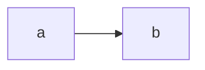

# Work Package Prompt: WP09 – Content pipeline

## ⚡ Do This First: Load Agent Profile

Use the `/ad-hoc-profile-load` skill to load the agent profile named in the frontmatter, and follow its guidance before you read the rest of this prompt.

- **Profile**: `implementer-ivan`
- **Role**: `implementer`
- **Agent/tool**: `claude` (Haiku-class model, high effort)

If the profile cannot be loaded, run `spec-kitty agent profile list` and pick the closest implementer profile.

---

## ⚠️ IMPORTANT: Review Feedback

Check the Activity Log and `spec-kitty agent tasks status --mission locus-foundation-01M5EWDR` for review feedback. Address all of it before you treat the work as complete.

---

## Objectives & Success Criteria

Write the build-time content compiler `apps/docs/scripts/content.ts`. It reads every Markdown file under `docs/foundation/`, `docs/decisions/`, `docs/research/` and `docs/guides/`, checks it, and writes four files: `src/generated/content.json`, `src/generated/search.json`, `public/llms.txt` and `public/index.json`. The site (WP11 onwards) reads only these files, so `docs/` stays the single source of content (C-003, ADR-0012).

Done means:

1. Every NS-020 case fails the compile. The CLI exits with code 1 and prints one `<file>: <problem>` line per problem, using the exact messages in the table in T045.
2. The real repository `docs/` tree compiles with **zero** problems. (Planning checked this on 2026-10-21 against the rules below: all links and fragments resolve, and the only Status/Maturity-column hit is the exempt vocabulary table.)
3. Heading ids follow GitHub's slug rule, so `#fragment` links written for GitHub also work on the site.
4. `llms.txt` and `index.json` for the fixture tree equal the exact texts given in T051 (FR-017).
5. Searching the real docs for "baseline" finds `/principles/P08-preserve-the-baseline` and `/terminology/revision` (User Story 3, scenario 3).
6. The tests were written first and seen failing. `bun run verify` passes.

## Context & Constraints

Read first:

- `kitty-specs/locus-foundation-01M5EWDR/contracts/docs-site.md`: **Content sources**, **Routes and sections**, **Generated artifacts**. This is the authoritative contract.
- `kitty-specs/locus-foundation-01M5EWDR/research.md`: R-04.
- `kitty-specs/locus-foundation-01M5EWDR/spec.md`: User Story 3, NS-020, FR-014, FR-017, FR-018.
- `apps/docs/package.json` (WP01): the `content` script is `bun scripts/content.ts`. `minisearch` 7.2.0 and `effect` 4.0.4 are already dependencies.
- `bunfig.toml` (WP01): `apps/docs/test/fixtures/**` is ignored by lint and tests, because fixture content may be deliberately broken.

### Facts verified in planning (Bun 1.4.4, Effect 4.0.4, MiniSearch 7.2.0)

**Markdown.** `Bun.markdown.html(src)` renders GitHub-flavoured Markdown:

- Headings come out as `<h2>…</h2>` **without ids**. Bun's own `headings: { ids: true }` option is **not** GitHub-compatible: it drops non-ASCII letters and collapses dashes. Do not use it.
- Tables come out as `<table>\n<thead>\n<tr><th align="left">A</th>…</tr>\n</thead>\n<tbody>\n<tr><td align="left">x</td>…</tr>…</tbody>\n</table>`. `th` and `td` may carry an `align` attribute.
- Inline code is `<code>…</code>`. `&`, `<` and `>` in text are escaped as `&amp;`, `&lt;` and `&gt;`.
- Links are `<a href="…">`, with `&` in the URL escaped as `&amp;`.
- A ```` ```mermaid ```` block becomes `<pre><code class="language-mermaid">…</code></pre>` with its text escaped. Keep it unchanged; WP12 renders it in the browser.
- Do **not** use `Bun.markdown.render` with callbacks. Elements without a callback lose their tags and their escaping.

**YAML.** `Bun.YAML.parse(text)` parses front matter. On `id: [` it throws `YAML Parse error: Unexpected token`. On `- a` it returns `["a"]`, on an empty string `null`, and on `just text` the string `"just text"`. It returns `date: 2026-10-21` as the **string** `"2026-10-21"`, and handles multi-line flow sequences such as `related: [a,\n  b]`.

**GitHub slug rule** (github-slugger). Apply it to the heading's plain text, meaning the tags stripped and the entities decoded:

```ts
export const slugify = (text: string): string =>
  text
    .trim()
    .toLowerCase()
    .replace(/[^\p{L}\p{M}\p{N}\p{Pc}\- ]/gu, "")
    .replace(/ /g, "-");
```

When two headings in one document produce the same slug, the second gets `-1`, the third `-2`, and so on. Verified outputs:

| Heading text | Slug |
| --- | --- |
| `P08 — Preserve the baseline` | `p08--preserve-the-baseline` |
| `Commitment vs. current invariant` | `commitment-vs-current-invariant` |
| `Café ☕ für alle` | `café--für-alle` |
| `5. Invariants` | `5-invariants` |
| `CAP-07 Evolution` | `cap-07-evolution` |
| `A & B` (rendered `A &amp; B`) | `a--b` |
| `snake_case and <code>code</code>` | `snake_case-and-code` |
| `  Trim me  ` | `trim-me` |

**Effect Schema** (front matter). This code was run against Effect 4.0.4:

```ts
import { Effect, Schema, SchemaIssue } from "effect";

const NonBlank = Schema.String.check(
  Schema.makeFilter((s: string) => s.trim().length > 0 || "Expected a non-blank string"),
);
// Schema.Literal("principle"), Schema.Literals([...]), Schema.Array(Schema.String), Schema.Boolean,
// Schema.Number, Schema.Int.check(Schema.isBetween({ minimum: 1, maximum: 16 })),
// Schema.String.check(Schema.isPattern(/^P(0[1-9]|1[0-6])$/))

const formatter = SchemaIssue.makeFormatterStandardSchemaV1();
const decode = (schema: Schema.Codec<unknown, unknown, never, never>, input: unknown): ReadonlyArray<string> => {
  const result = Effect.runSync(
    Effect.result(Schema.decodeUnknownEffect(schema)(input, { onExcessProperty: "error", errors: "all" })),
  );
  if (result._tag === "Success") return [];
  return formatter(result.failure.issue).issues.map(
    (i) => `${(i.path ?? []).map(String).join(".")}: ${i.message}`,
  );
};
```

The parameter type `Schema.Codec<unknown, unknown, never, never>` was type-checked with `bun check -b` under the repository's `tsconfig.base.json`. `Schema.Top` does **not** type-check there: its decoding services are `unknown`, and `Effect.runSync` needs `never`. Every `Schema.Struct` of the plain schemas below is assignable to it. Do not use `any`.

Observed messages: `title: Missing key`, `fundamental: Expected boolean`, `order: Expected number`, `kind: Expected "term"`, `title: Expected a non-blank string`, `extra: Expected no excess property`, `status: Expected "provisional" | "proposed" | "accepted" | "open" | "superseded" | "deprecated"`, `related: Expected array`, `related.0: Expected string`, `number: Expected an integer`, `number: Expected a value between 1 and 16`, `code: Expected a string matching the RegExp ^P(0[1-9]|1[0-6])$`.

**MiniSearch.** This code was run against MiniSearch 7.2.0:

```ts
import MiniSearch, { type Options } from "minisearch";
const index = new MiniSearch<SearchSection>(SEARCH_OPTIONS);
index.addAll(sections);
const json = JSON.stringify(index); // what search.json contains
const loaded = MiniSearch.loadJSON<SearchSection>(json, SEARCH_OPTIONS); // same options, or loading fails
loaded.search("baseline"); // [{ id, score, terms, match, ...storeFields }]
```

Over the real docs this gives about 520 sections and roughly 320 KB of JSON, which is fine. `prefix: true` makes "baseline" match "baselines".

### Real docs facts (2026-10-21)

- There are 64 files: 15 ADRs, the decisions README, foundation (README, 2 architecture files, conceptual model, open questions, philosophy, principles README plus 16 principles, roadmap, terminology README plus 16 terms) and research (README plus 2). `docs/guides/` does not exist yet. WP10 adds it, and the pipeline must work with or without it.
- Kinds in use: `decision`, `index`, `questions`, `principle`, `doctrine`, `capability-map`, `direction`, `model`, `roadmap`, `term`, `research`.
- The only link to a non-content file is `docs/foundation/architecture/technical-direction.md` → `../../tooling.md`. It must become `https://github.com/unknownlab/telos/blob/main/docs/tooling.md`.
- There are no external links, images or raw HTML.
- `docs/foundation/README.md` has a table under `## Maturity vocabulary` whose first column is headed **Maturity**, and one of its rows is `` `verified` ``. This table **defines** the word, it does not claim a result. It is the single exemption to the forbidden-claim check (contract, task-phase clarification).
- `docs/foundation/philosophy/evolution-of-determinism.md` writes real maturity claims as code spans (`` `proposed`; Stage 0 mission ``). For that reason a code span must **not** exempt a cell.

## Rules (all WPs of this mission)

- Work only inside the worktree that `spec-kitty agent action implement WP09 --agent claude` gives you. Run `bun install --frozen-lockfile` there first if `node_modules/` is missing.
- Stay inside `owned_files`. This WP has no sanctioned shared edits. **Do not edit `docs/`.** If the real docs do not compile with zero problems under these rules, stop and report the exact problem lines instead of changing content or loosening a rule.
- Do not add dependencies.
- **Never edit or delete anything under `kitty-specs/`** in your lane worktree.
- Write tests first, and no fake tests.
- Style: double quotes, semicolons, trailing commas, extensionless imports. Run `bun run format`.
- Never use `--no-verify`, `--force`, `--skip-*` or `*_DISABLE` variables. Do not push. Do not touch `.grace/`, `AGENTS.md`, `CLAUDE.md` or `.kittify/`.
- Commit messages follow Conventional Commits, for example `feat(docs): add content pipeline for the documentation site`. No AI names and no `Co-Authored-By` line.
- GRACE markup, in the style of `scripts/check-bun-version.ts`:
  - `content.ts` gets `LINKS: M-DOCS-CONTENT` and `DEPENDS: none`, a `START_CONTRACT` block on every export, and `START_BLOCK_*` blocks around the phases of `compileContent` and the CLI.
  - The two `src/lib` files get `LINKS: M-DOCS-SITE`.
  - **Lint rule (checked in planning with grace 4.2.1).** Every source file with markup also needs `ROLE: RUNTIME`, `MAP_MODE: EXPORTS` and a `START_MODULE_MAP` that lists **every** export, `.tsx` files included. A missing or extra name fails `grace lint` with `MODULE_MAP EXPORTS mismatch`. A test file with markup needs `ROLE: TEST`, `MAP_MODE: LOCALS` and a **non-empty** map of its top-level helpers and constants, as in `scripts/review-gate.test.ts`. Run `grace lint --path . --assertions current` before review.

## Branch Strategy

- **Planning base branch**: `feat/locus-foundation`
- **Merge target branch**: `feat/locus-foundation`

Execution worktrees are allocated per computed lane from `lanes.json`. Start with `spec-kitty agent action implement WP09 --agent claude`.

## Design

### Types: `apps/docs/src/lib/content-types.ts`

The site imports these types, so they live in `src/` and contain no Bun or Node code.

```ts
export type Kind =
  | "index" | "doctrine" | "principle" | "term" | "model" | "capability-map" | "direction"
  | "roadmap" | "questions" | "decision" | "research" | "guide";
export type Status = "provisional" | "proposed" | "accepted" | "open" | "superseded" | "deprecated";
export type Maturity = "vision" | "proposed" | "implemented";
export type NavSectionId =
  | "introduction" | "philosophy" | "principles" | "terminology" | "architecture" | "first-locus"
  | "examples" | "playground" | "verification" | "roadmap" | "decisions" | "agent-reference";

/** Navigation order of the site (FR-013); llms.txt uses the same order. */
export const NAV_SECTIONS: ReadonlyArray<{ readonly id: NavSectionId; readonly title: string; readonly route: string }> = [
  { id: "introduction", title: "Introduction", route: "/" },
  { id: "philosophy", title: "Philosophy", route: "/philosophy" },
  { id: "principles", title: "Principles", route: "/principles" },
  { id: "terminology", title: "Terminology", route: "/terminology" },
  { id: "architecture", title: "Architecture", route: "/architecture" },
  { id: "first-locus", title: "First Locus", route: "/first-locus" },
  { id: "examples", title: "Examples", route: "/examples" },
  { id: "playground", title: "Playground", route: "/playground" },
  { id: "verification", title: "Verification", route: "/verification" },
  { id: "roadmap", title: "Roadmap", route: "/roadmap" },
  { id: "decisions", title: "Decisions", route: "/decisions" },
  { id: "agent-reference", title: "Agent Reference", route: "/agent-reference" },
];

/** Routes the app renders without a source document. Absolute content links may target them. */
export const APP_ROUTES: ReadonlyArray<string> = [
  "/architecture", "/playground", "/playground/a", "/playground/b", "/playground/c",
  "/playground/d", "/playground/e", "/verification",
];

export interface Heading { readonly level: number; readonly id: string; readonly text: string }

export interface ContentDocument {
  readonly id: string;
  readonly title: string;
  readonly kind: Kind;
  readonly status: Status;
  readonly maturity: Maturity;
  readonly summary: string;
  readonly related: ReadonlyArray<string>;
  readonly route: string;
  readonly navSection: NavSectionId;
  /** Repository-relative path, e.g. "docs/foundation/principles/P08-preserve-the-baseline.md". */
  readonly source: string;
  /** Rendered body with heading ids and rewritten links. */
  readonly html: string;
  readonly outline: ReadonlyArray<Heading>;
  // kind-specific front matter, present only for that kind
  readonly number?: number;            // principle
  readonly code?: string;              // principle
  readonly order?: number;             // term, guide
  readonly classification?: string;    // term
  readonly fundamental?: boolean;      // term
  readonly engine?: boolean;           // term
  readonly stage0?: "in-scope" | "minimal" | "deferred"; // term
  readonly date?: string;              // decision
  readonly section?: "introduction" | "first-locus" | "examples" | "agent-reference"; // guide
}

export interface ContentFile { readonly version: 1; readonly documents: ReadonlyArray<ContentDocument> }

export interface SearchSection {
  readonly id: string;       // route, or route#anchor for a sub-section
  readonly title: string;    // document title on the top section, "" otherwise
  readonly heading: string;  // "" on the top section, heading text otherwise
  readonly summary: string;  // document summary on the top section, "" otherwise
  readonly text: string;     // plain text of the section
  readonly docTitle: string; // document title (stored for display)
  readonly route: string;    // document route (stored, used to group results)
}
```

With `exactOptionalPropertyTypes`, set an optional field only when its value exists. Never write `number: undefined`.

### Search options: `apps/docs/src/lib/search-options.ts`

WP12 imports this file to load the index, so it is shared. Use it exactly:

```ts
import type { Options } from "minisearch";
import type { SearchSection } from "./content-types";

export const SEARCH_OPTIONS: Options<SearchSection> = {
  idField: "id",
  fields: ["title", "heading", "summary", "text"],
  storeFields: ["docTitle", "heading", "route"],
  searchOptions: { prefix: true, fuzzy: 0.2, boost: { title: 3, heading: 2, summary: 2 } },
};
```

### Routes and nav sections

| Document | Route | `navSection` |
| --- | --- | --- |
| `guide`, `section: introduction` | `/` | `introduction` |
| `guide`, any other section `s` | `/s` | `s` |
| `doctrine` | `/philosophy` | `philosophy` |
| `index` with id `principles` | `/principles` | `principles` |
| `principle` | `/principles/<id>` | `principles` |
| `index` with id `terminology` | `/terminology` | `terminology` |
| `term` | `/terminology/<id>` | `terminology` |
| `index` with id `decisions` | `/decisions` | `decisions` |
| `decision` | `/decisions/<id>` | `decisions` |
| `roadmap` | `/roadmap` | `roadmap` |
| any other `index`, and `model`, `capability-map`, `direction`, `questions`, `research` | `/architecture/<id>` | `architecture` |

So the foundation README is `/architecture/foundation` and the research README is `/architecture/research`. `/architecture` itself is an app route that WP11 generates as a listing. When two documents get the same route, that is a problem (see T045).

**Order within a nav section**, used by `llms.txt` and by the site (WP11). Export it as `compareInSection(a: ContentDocument, b: ContentDocument): number` from `src/lib/content-types.ts`, which holds no Bun or Node code, so the client bundle can import it. `scripts/content.ts` imports it from there: `index` documents first, then `principle` by `number`, `term` and `guide` by `order`, and everything else by `id`. Break ties by `id`. Compare strings by code unit (`a < b`), never with `localeCompare`, because the output must not depend on locale.

### Problems and their exact messages

A problem is `{ file: string; message: string }`, where `file` is repository-relative. The CLI prints `${file}: ${message}`. Problems are sorted by `file`, then by `message`, and **all** problems are reported, not just the first.

## Subtasks & Detailed Guidance

### Subtask T045 – Fixture tree and failing tests

Create the fixture tree `apps/docs/test/fixtures/valid/`. It is a miniature repository root, and every case below must compile with zero problems. Write each file exactly as shown.

`docs/tooling.md`:

```markdown
# Tooling

Not site content.
```

`docs/foundation/README.md`:

```markdown
---
id: foundation
title: Foundation
kind: index
status: provisional
maturity: proposed
summary: Entry point of the fixture foundation.
related: [principles]
---

# Foundation

Read the [principles](principles/README.md) and the [tooling notes](../tooling.md).

## Maturity vocabulary

| Maturity   | Meaning                |
| ---------- | ---------------------- |
| `vision`   | Intended direction.    |
| `verified` | Never written by hand. |
```

`docs/foundation/philosophy/evolution-of-determinism.md`:

```markdown
---
id: evolution-of-determinism
title: Evolution of determinism
kind: doctrine
status: provisional
maturity: vision
summary: Why determinism grows.
related: []
---

# Evolution of determinism

See [P01](../principles/P01-everything-is-code.md#definition).
```

`docs/foundation/principles/README.md`:

```markdown
---
id: principles
title: Principles
kind: index
status: provisional
maturity: proposed
summary: The fixture principles.
related: [P01-everything-is-code]
---

# Principles

- [P01](P01-everything-is-code.md)
```

`docs/foundation/principles/P01-everything-is-code.md`:

```markdown
---
id: P01-everything-is-code
title: P01 — Everything is code
kind: principle
number: 1
code: P01
status: provisional
maturity: proposed
summary: Every artifact is code.
related: [locus]
---

# P01 — Everything is code

## Definition

Everything is code.

## Notes

First.

## Notes

Second.
```

`docs/foundation/terminology/locus.md`:

````markdown
---
id: locus
title: Locus
kind: term
order: 1
classification: semantic-primitive
fundamental: true
engine: false
stage0: in-scope
status: provisional
maturity: proposed
summary: The unit of meaning and ownership.
related: [P01-everything-is-code]
---

# Locus

## Café ☕ für alle


````

`docs/decisions/ADR-0001-record-architecture-decisions.md`:

```markdown
---
id: ADR-0001
title: "ADR-0001: Record architecture decisions"
kind: decision
status: accepted
maturity: implemented
date: 2026-10-21
summary: Decisions are recorded as ADRs.
related: []
---

# ADR-0001: Record architecture decisions

| ID       | Status   |
| -------- | -------- |
| ADR-0001 | accepted |
```

`docs/research/prior-art.md`:

```markdown
---
id: prior-art
title: Prior art
kind: research
status: provisional
maturity: vision
summary: What exists already.
related: [foundation]
---

# Prior art

See the [vocabulary](../foundation/README.md#maturity-vocabulary), [scenario A](/playground/a) and [an external page](https://example.org/x?a=1&b=2).
```

`docs/guides/introduction.md`:

```markdown
---
id: introduction
title: Introduction
kind: guide
order: 1
section: introduction
status: provisional
maturity: proposed
summary: Start here.
related: [foundation]
---

# Introduction

Welcome.
```

**Test helper.** `withFixture(changes: Record<string, string | null>)` copies `fixtures/valid` into a fresh directory from `mkdtemp(join(tmpdir(), "telos-content-"))`. It then writes each changed file (`null` deletes it) and returns the root. Delete the directory in `afterEach`. Fixtures are never edited in place.

**Failure cases** (NS-020 plus the contract's body rules). Each case applies one change to the valid tree. The test asserts the **exact** list of problems:

| # | Change | Expected problems |
| --- | --- | --- |
| 1 | `docs/research/prior-art.md` with no front matter (`# Prior art\n`) | exactly `docs/research/prior-art.md: missing front matter`. The document is dropped, and nothing relates or links to it. |
| 2 | prior-art front matter replaced by `id: [` | `docs/research/prior-art.md: front matter is not valid YAML: YAML Parse error: Unexpected token` |
| 3 | prior-art front matter replaced by `- a` | `docs/research/prior-art.md: front matter must be a mapping` |
| 4 | P01 with `kind: principal` | exactly three problems, in this order: `docs/foundation/principles/P01-everything-is-code.md: front matter: kind: Expected "index" \| "doctrine" \| "principle" \| "term" \| "model" \| "capability-map" \| "direction" \| "roadmap" \| "questions" \| "decision" \| "research" \| "guide"`, then `docs/foundation/principles/README.md: related id "P01-everything-is-code" does not resolve to a document`, then `docs/foundation/terminology/locus.md: related id "P01-everything-is-code" does not resolve to a document`. The links to P01's file are **not** problems: the file exists on disk, so rule L3 turns them into GitHub links. The point of this case is that every consequence is reported. |
| 5 | P01 with `title` removed | `…P01-everything-is-code.md: front matter: title: Missing key` |
| 6 | P01 with `status: verified` and `maturity: done` | two problems: `front matter: maturity: Expected "vision" \| "proposed" \| "implemented"` and `front matter: status: Expected "provisional" \| …` (sorted by message) |
| 7 | P01 with an extra `owner: me` | `…: front matter: owner: Expected no excess property` |
| 8 | term with `fundamental: "yes"` | `docs/foundation/terminology/locus.md: front matter: fundamental: Expected boolean` |
| 9 | principle with `number: 17` | `…: front matter: number: Expected a value between 1 and 16` |
| 10 | `docs/research/prior-art.md` with `id: foundation` | `docs/research/prior-art.md: duplicate id "foundation" (also in docs/foundation/README.md)`. The later path in sort order is the one reported. |
| 11 | prior-art with `related: [foundation, nope]` | `docs/research/prior-art.md: related id "nope" does not resolve to a document` |
| 12 | prior-art links `../foundation/missing.md` | `docs/research/prior-art.md: broken link "../foundation/missing.md": no such file docs/foundation/missing.md` |
| 13 | prior-art links `../foundation/README.md#nope` | `docs/research/prior-art.md: broken link "../foundation/README.md#nope": no heading "nope" in docs/foundation/README.md` |
| 14 | prior-art links `../../scripts/missing.ts` | `docs/research/prior-art.md: broken link "../../scripts/missing.ts": no such file scripts/missing.ts` |
| 15 | prior-art links `../../../outside.md` | `docs/research/prior-art.md: broken link "../../../outside.md": points outside the repository` |
| 16 | prior-art links `/playground/z` | `docs/research/prior-art.md: unknown site route "/playground/z"` |
| 17 | a second doctrine file `docs/foundation/philosophy/second.md` (id `second`, otherwise valid) | `docs/foundation/philosophy/second.md: route "/philosophy" is also used by docs/foundation/philosophy/evolution-of-determinism.md` |
| 18 | ADR table row `\| ADR-0001 \| verified \|` | `docs/decisions/ADR-0001-record-architecture-decisions.md: forbidden verification claim "verified" in the Status column` |
| 19 | prior-art body gains the foundation README's vocabulary table (same heading `## Maturity vocabulary`) | `docs/research/prior-art.md: forbidden verification claim "verified" in the Maturity column`. The exemption is tied to the file **and** the heading. |
| 20 | foundation README table moved under a new heading `## Other` | `docs/foundation/README.md: forbidden verification claim "verified" in the Maturity column` |
| 21 | prior-art `summary: All tests pass.` | `docs/research/prior-art.md: forbidden verification claim "All tests pass" in front matter field "summary"` |
| 22 | prior-art cell in a column headed `Notes` that says `passing` | no problem: only Status and Maturity columns are checked |
| 23 | P01 with both `title` removed and `owner: me` | both problems are listed (errors are collected, not stopped at the first) |

Every expected list is written out literally. Never weaken an assertion to `toContain`. If a message you observe differs from this table only because Effect words it differently, pin the observed message and report the difference.

Also write these tests now, against the not-yet-written API, and watch them fail:

- the slug table above, plus duplicate headings (`notes`, `notes-1`);
- valid-fixture compile output (T047, T048, T050);
- `llms.txt` and `index.json` exact text (T051);
- the CLI (T051);
- the real docs compile (T050).

### Subtask T046 – Front-matter schemas per kind

The front matter is the text between a first line `---` and the next line `---`. Match it with `/^---\r?\n([\s\S]*?)\r?\n---\r?\n/`. Parse it with `Bun.YAML.parse` inside try/catch:

- no match gives `missing front matter`;
- a parse throw gives `front matter is not valid YAML: <error message>`;
- a result that is not a plain object (an array, a scalar or `null`) gives `front matter must be a mapping`.

Then check `kind` alone with `Schema.Struct({ kind: KindSchema })`, and pass `onExcessProperty: "ignore"` for this one step. If that fails, report `front matter: kind: <message>` and drop the document. Otherwise decode the full object with that kind's struct (`onExcessProperty: "error"`, `errors: "all"`), and report each issue as `front matter: <path>: <message>`.

| Field | Schema |
| --- | --- |
| `id`, `title`, `summary` | `NonBlank` |
| `kind` | `Schema.Literal(<the kind>)` in the per-kind struct; for the first check, `Schema.Literals([...])` with all 12 kinds in the order of the `Kind` type, which is the order of the message in case 4 |
| `status` | `Schema.Literals(["provisional", "proposed", "accepted", "open", "superseded", "deprecated"])` |
| `maturity` | `Schema.Literals(["vision", "proposed", "implemented"])` |
| `related` | `Schema.Array(Schema.String)` |
| principle `number` | `Schema.Int.check(Schema.isBetween({ minimum: 1, maximum: 16 }))` |
| principle `code` | `Schema.String.check(Schema.isPattern(/^P(0[1-9]\|1[0-6])$/))` |
| term `order` | `Schema.Number` |
| term `classification` | `NonBlank` |
| term `fundamental`, `engine` | `Schema.Boolean` |
| term `stage0` | `Schema.Literals(["in-scope", "minimal", "deferred"])` |
| decision `date` | `Schema.String.check(Schema.isPattern(/^\d{4}-\d{2}-\d{2}$/))` |
| guide `order` | `Schema.Number` |
| guide `section` | `Schema.Literals(["introduction", "first-locus", "examples", "agent-reference"])` |

All other kinds take only the common fields. Build the structs from one `common` object spread into each, so the common rules exist exactly once.

### Subtask T047 – Rendering, heading ids, outline

For each parsed document:

1. `html = Bun.markdown.html(body)`, where `body` is everything after the front matter.
2. Replace every `/<h([1-6])>([\s\S]*?)<\/h\1>/g` with `<hN id="SLUG">INNER</hN>`. `SLUG` is `slugify(decodeEntities(stripTags(INNER)))` with the duplicate suffix. Escape `"` and `&` in the id when writing the attribute.
3. The outline is every heading in order, `{ level, id, text }`, where `text` is the stripped and decoded heading text.

Helpers (export them for tests):

- `stripTags(html)`: remove `<[^>]+>`.
- `decodeEntities(s)`: decode `&amp; &lt; &gt; &quot; &#39;`, plus decimal `&#NN;` and hex `&#xHH;`.
- `plainText(html)`: tags replaced by a space, decoded, whitespace collapsed to single spaces, trimmed.

Tests on the valid fixture:

- P01's outline is `[{1,"p01--everything-is-code","P01 — Everything is code"},{2,"definition","Definition"},{2,"notes","Notes"},{2,"notes-1","Notes"}]`.
- The locus term's html contains `<h2 id="café--für-alle">` and `<pre><code class="language-mermaid">graph LR\n  a --&gt; b\n</code></pre>`.

### Subtask T048 – Link rewriting and link checks

Find links with `/<a href="([^"]*)"/g`, decode the href, and classify it:

- **L1, external**: matches `/^[a-z][a-z0-9+.-]*:/i` (`https:`, `mailto:` and so on). Keep it unchanged.
- **L2, site-absolute**: starts with `/`. The path part (before `?` or `#`) must be the route of a parsed document or an entry of `APP_ROUTES`. Otherwise report `unknown site route "<href>"`. Keep it unchanged.
- **L3, relative**: split off `#fragment`. An empty path means the same file. Resolve against the source file's directory with `node:path` `posix.join` and `posix.normalize`, relative to the repository root.
  - If the result starts with `..`, it is `broken link "<href>": points outside the repository`.
  - If the target is a **parsed document**, rewrite the link to `route` or `route#fragment`. A fragment must equal an outline id of the target after `decodeURIComponent`, otherwise `broken link "<href>": no heading "<fragment>" in <target>`.
  - Otherwise, if the target exists on disk under the root, rewrite it to a GitHub URL and keep any fragment. Use `statSync` from `node:fs` inside try/catch, because `Bun.file(...).exists()` is false for directories. A file becomes `https://github.com/unknownlab/telos/blob/main/<target>`. A directory becomes `https://github.com/unknownlab/telos/tree/main/<target>`, with any trailing `/` removed from the target. A content file that failed to parse also exists on disk, so links to it become GitHub links. Its own problem already fails the build.
  - Otherwise it is `broken link "<href>": no such file <target>`.
- **L4**: `related` ids are checked against the ids of parsed documents: `related id "<id>" does not resolve to a document`.

When writing a rewritten href back, escape `&` as `&amp;` and `"` as `&quot;`.

Tests on the valid fixture:

- the foundation README html has `href="/principles"` and `href="https://github.com/unknownlab/telos/blob/main/docs/tooling.md"`;
- doctrine html has `href="/principles/P01-everything-is-code#definition"`;
- prior-art html has `href="/architecture/foundation#maturity-vocabulary"`, `href="/playground/a"` and `href="https://example.org/x?a=1&amp;b=2"`.
- with prior-art changed to also link `../foundation/` (a directory), its html has `href="https://github.com/unknownlab/telos/tree/main/docs/foundation"` and there are no problems.

### Subtask T049 – Forbidden verification claims

`const CLAIM = /\b(verified|passing|all tests pass)\b/i;` The reported word is the matched text as it appears in the source.

- **Front matter**: every string value, and every string inside an array value, of a parsed document. The message is `forbidden verification claim "<match>" in front matter field "<key>"`.
- **Tables**: walk the rendered html with `/<h([1-6])[^>]*>([\s\S]*?)<\/h\1>|<table>([\s\S]*?)<\/table>/g`, remembering the slug of the last heading seen. For each table:
  - take the header cells from `<thead>` (`/<th[^>]*>([\s\S]*?)<\/th>/g`);
  - the watched columns are those whose `plainText` lower-cased is exactly `status` or `maturity`;
  - for each `<tbody>` row, test each watched cell's `plainText` against `CLAIM`;
  - report `forbidden verification claim "<match>" in the <Header> column`, where `<Header>` is the header text as written.
- **Exemption**, exported as a named constant: `VOCABULARY_DEFINITION = { source: "docs/foundation/README.md", heading: "maturity-vocabulary" }`. Tables whose last heading is that slug, in that source file, are not checked. Add a comment that cites the contract and explains that this table defines the word rather than claiming it.

Cases 18–22 cover this. Prose is never checked: `docs/foundation/terminology/witness.md` says "all tests pass" in prose, and that is allowed.

### Subtask T050 – Routes, `content.json`, `search.json`

Export:

```ts
export interface CompileOptions {
  readonly root: string;                        // repository root (absolute)
  readonly git: () => { readonly commit: string; readonly dirty: boolean };
}
export interface CompileOutput {
  readonly content: ContentFile;
  readonly search: string;    // JSON.stringify of the MiniSearch index
  readonly llms: string;
  readonly index: string;     // JSON.stringify(indexJson, null, 2) + "\n"
}
export type CompileResult =
  | { readonly ok: true; readonly output: CompileOutput }
  | { readonly ok: false; readonly problems: ReadonlyArray<{ readonly file: string; readonly message: string }> };
export function compileContent(options: CompileOptions): Promise<CompileResult>;
```

Scan the files with `new Bun.Glob("docs/{foundation,decisions,research,guides}/**/*.md").scan({ cwd: root })`. Sort the paths so that the output and the problem order never depend on the file system. `content.documents` is sorted by `id` in code-unit order.

Search sections, for each document in id order:

- The **top section** is all html before the first `<h2>`–`<h6>`, the `<h1>` included. Its fields are `id: route`, `title: doc.title`, `heading: ""`, `summary: doc.summary`, `text: plainText(...)`, `docTitle`, `route`.
- Each later `<h2>`–`<h6>` starts a section with `id: route#<heading id>`, `title: ""`, `heading: <text>`, `summary: ""`, and the plain text up to the next heading.

Build `new MiniSearch<SearchSection>(SEARCH_OPTIONS)`, `addAll`, then `JSON.stringify`.

Tests:

- **Valid fixture**: `ok` is true. The routes by id are exactly:

  | id | route |
  | --- | --- |
  | `ADR-0001` | `/decisions/ADR-0001` |
  | `P01-everything-is-code` | `/principles/P01-everything-is-code` |
  | `evolution-of-determinism` | `/philosophy` |
  | `foundation` | `/architecture/foundation` |
  | `introduction` | `/` |
  | `locus` | `/terminology/locus` |
  | `principles` | `/principles` |
  | `prior-art` | `/architecture/prior-art` |

  The locus document carries `order: 1`, `classification`, `fundamental: true`, `engine: false` and `stage0: "in-scope"`. It has no `number` key (`"number" in doc` is false).
- **Search on the fixture**: `MiniSearch.loadJSON(search, SEARCH_OPTIONS).search("determinism")` includes id `/philosophy`. `search("vocabulary")` includes `/architecture/foundation#maturity-vocabulary`, with stored `route: "/architecture/foundation"`.
- **Real docs**: `compileContent({ root: <repo root>, git })` gives `ok: true` and zero problems. If it is not ok, print the problems in the assertion message. Further checks:
  - the document count equals the number of `.md` files that the same glob finds;
  - there are 16 principles with numbers 1 to 16;
  - there are 16 terms;
  - 15 decisions;
  - `technical-direction`'s html contains `https://github.com/unknownlab/telos/blob/main/docs/tooling.md`;
  - `search("baseline")` includes ids starting with `/principles/P08-preserve-the-baseline` and `/terminology/revision`.

  Find the repository root with `resolve(import.meta.dir, "../../..")`.

### Subtask T051 – `llms.txt`, `index.json`, CLI

**`llms.txt`.** Write the H1, a blank line, the blockquote, then for each nav section in `NAV_SECTIONS` order that has at least one document a blank line, `## <title>`, a blank line, and one `- [title](route): summary` line per document in `compareInSection` order. Playground and Verification always get one fixed line each, in their nav positions. The file ends with a single `\n`.

Expected `llms.txt` for the valid fixture, exactly:

```text
# Telos by UnknownLab

> Telos by UnknownLab is a framework in which software systems are described, verified and evolved as code. This file lists the pages of the local documentation site, which is generated from docs/ in the repository.

## Introduction

- [Introduction](/): Start here.

## Philosophy

- [Evolution of determinism](/philosophy): Why determinism grows.

## Principles

- [Principles](/principles): The fixture principles.
- [P01 — Everything is code](/principles/P01-everything-is-code): Every artifact is code.

## Terminology

- [Locus](/terminology/locus): The unit of meaning and ownership.

## Architecture

- [Foundation](/architecture/foundation): Entry point of the fixture foundation.
- [Prior art](/architecture/prior-art): What exists already.

## Playground

- [Playground](/playground): Scenarios A to E run the real @telos/locus package in your browser.

## Verification

- [Verification](/verification): The specification report from the build-time Bun run, with its provenance.

## Decisions

- [ADR-0001: Record architecture decisions](/decisions/ADR-0001): Decisions are recorded as ADRs.
```

**`index.json`** is `{ version: 1, generatedFrom: { commit, dirty }, documents }`. `documents` holds one `{ id, title, kind, status, maturity, summary, related, url, source }` per document, sorted by id, where `url` is the route. It is serialised with `JSON.stringify(value, null, 2) + "\n"`. The fixture test passes `git: () => ({ commit: "0123abc", dirty: true })` and asserts the parsed object deeply. The first document is `{ id: "ADR-0001", title: "ADR-0001: Record architecture decisions", kind: "decision", status: "accepted", maturity: "implemented", summary: "Decisions are recorded as ADRs.", related: [], url: "/decisions/ADR-0001", source: "docs/decisions/ADR-0001-record-architecture-decisions.md" }`. Assert all eight entries.

**CLI** (`if (import.meta.main)`). It takes the arguments `--root <dir>` (default: the repository root, `resolve(import.meta.dir, "../../..")`) and `--out <dir>` (default: `apps/docs`, `resolve(import.meta.dir, "..")`).

- The real `git` reads `git rev-parse HEAD` and `git status --porcelain` with `Bun.spawnSync({ cmd: [...], cwd: root })`, and `dirty` is a non-empty status. If git fails, use `commit: "unknown"` and `dirty: true` rather than crashing.
- On problems, print each `<file>: <problem>` line to stderr, then `content: N problem(s)`, then exit with code 1.
- Otherwise write `<out>/src/generated/content.json` (`JSON.stringify(content)`), `<out>/src/generated/search.json`, `<out>/public/llms.txt` and `<out>/public/index.json`. Create the directories with `mkdir(..., { recursive: true })`. Print `content: N documents`.

CLI tests run `Bun.spawnSync({ cmd: [process.execPath, "scripts/content.ts", "--root", r, "--out", o], cwd: <apps/docs> })`:

- on the valid fixture with a temporary `--out`, it exits 0 and all four files exist. `llms.txt` there equals the expected text. Commit and dirty come from real git, and the fixture copy is not a repository, so this exercises the fallback.
- on case 11, it exits 1, and stderr contains the exact problem line and `content: 1 problem(s)`.

Finally run `bun run content` in `apps/docs` once against the real docs. Confirm that it prints the document count and that the four outputs are gitignored: `git status` stays clean.

## Definition of Done

- [ ] All 23 failure cases assert exact problem lists and pass. They were seen failing first.
- [ ] Slug, outline, link and claim tests pass.
- [ ] The real `docs/` compiles with zero problems, and "baseline" search finds P08 and Revision.
- [ ] `llms.txt` and `index.json` match the exact expected values.
- [ ] The CLI exit codes and output files are tested.
- [ ] GRACE markup and TSDoc are on every export.
- [ ] `bun run verify` passes.

## Risks

- **Case 4 expectations**: a content file that fails to parse still exists on disk, so links to it become GitHub links, and only `related` references to it fail.
- **Locale-dependent sorting**: never use `localeCompare`.
- **Growth of `search.json`**: about 320 KB for the current docs. Do not store `text` in `storeFields`.
- **Bun.markdown changes**: if the heading or table HTML differs from what is quoted here, stop and report the actual output. Do not guess.

## Reviewer Guidance

- Run `bun test apps/docs/test/content.test.ts` and `bun run content`.
- Check that every NS-020 message matches the contract and the table above, that problems are sorted, and that all of them are reported.
- Check that the exemption is narrow (file plus heading), named, commented and tested both ways (cases 19 and 20).
- Check that no output depends on file-system order or locale.
- Check that nothing under `docs/` changed.
