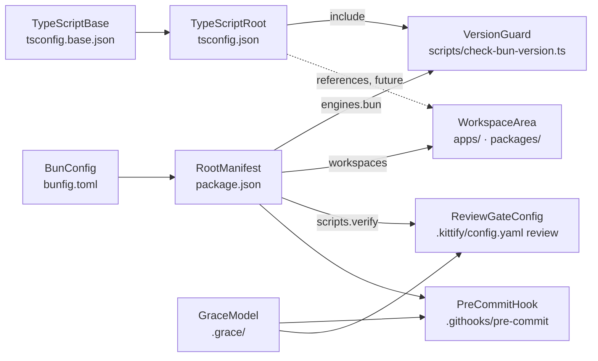

# Data Model: Bun Monorepo Toolchain

The mission stores no application data. Its "data" is the set of configuration documents that define the toolchain. Each entity below is one file at the repository root, with the fields this mission owns, their validation rules, and the invariants that tie them together.

## RootManifest (`package.json`)

| Field | Value / rule |
|-------|--------------|
| `name` | `"telos"` |
| `private` | `true` (the root is never published) |
| `type` | `"module"` |
| `workspaces` | exactly `["apps/*", "packages/*"]` |
| `engines.bun` | `">=1.4.4-canary.1"`; the single source of the minimum version |
| `packageManager` | `"bun@1.4.4-canary.1"` (informational; Bun does not enforce it) |
| `scripts` | exactly the names in [contracts/commands.md](contracts/commands.md) |
| `devDependencies` | exactly `{ "@types/bun": "1.4.3" }` (exact pin, no range) |
| `dependencies` | absent |

Invariants: `engines.bun` must be `>=<version>`; the guard reads it and fails on any other shape. No lifecycle script except `preinstall`.

## Lockfile (`bun.lock`)

Generated by `bun install`, committed. A fresh `bun install` on a clean clone leaves it byte-identical (`bun install --frozen-lockfile` passes).

## BunConfig (`bunfig.toml`)

| Section | Rule |
|---------|------|
| `[lint]` | present; default rule set (ESLint + typescript-eslint recommended); `ignorePatterns` covers `node_modules`, `.worktrees`, `kitty-specs`, `.kittify`, `.grace` |
| `[fmt]` | present; Bun defaults (Prettier-compatible: `printWidth 80`, `tabWidth 2`, double quotes, semicolons, trailing commas); `ignorePatterns` as `[lint]` plus `bun.lock` |

Invariant: no option is set that only restates a default.

## TypeScriptBase (`tsconfig.base.json`)

Required `compilerOptions`: `strict: true`, `noUncheckedIndexedAccess: true`, `noImplicitOverride: true`, `exactOptionalPropertyTypes: true`, `verbatimModuleSyntax: true`, `isolatedModules: true`, `module: "Preserve"`, `moduleResolution: "bundler"`, `target: "ESNext"`, `lib: ["ESNext"]`, `types: ["bun"]`, `skipLibCheck: true`, `noEmit: true`, `resolveJsonModule: true`.

Invariant: no `include`, `files` or `references`. It is only a base that others extend.

## TypeScriptRoot (`tsconfig.json`)

`extends: "./tsconfig.base.json"`, `include: ["scripts"]`, `references: []`.

Invariant: never an empty `files`/`include` (TS18002). Each future workspace package adds `{ "path": "<area>/<name>" }` to `references` and its own `tsconfig.json` extending the base with `composite: true`.

## WorkspaceArea (`apps/`, `packages/`)

Each holds only `.gitkeep` in this mission. Rule: a directory directly under an area is a workspace package and must have its own `package.json`.

## VersionGuard (`scripts/check-bun-version.ts`)

Input: `Bun.version` and `engines.bun` from `package.json`. Output: exit 0, or exit 1 with the exact message in [contracts/version-guard.md](contracts/version-guard.md). Comparison uses `Bun.semver.order`, not `satisfies`.

## PreCommitHook (`.githooks/pre-commit`)

POSIX `sh`, executable bit set. Ordered steps and failure semantics are in [contracts/pre-commit-hook.md](contracts/pre-commit-hook.md).

## ReviewGateConfig (`.kittify/config.yaml`, `review:` section only)

| Key | Value |
|-----|-------|
| `test_command` | `bun run verify && bun test --pass-with-no-tests --reporter=junit --reporter-outfile={output_file}` |
| `test_output_format` | `junit_xml` |
| `fail_on_pre_review_regression` | `true` |

Invariant: no other key in `.kittify/config.yaml` changes.

## GraceModel (`.grace/`)

Created by `grace-init`. It describes only what exists: root tooling and the two empty workspace areas. `grace lint --path . --assertions current` exits 0.
