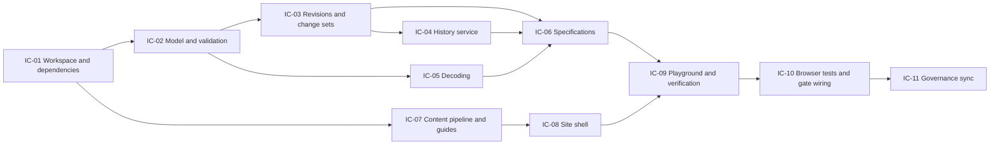

# Implementation Plan: Locus Foundation — Semantic Identity and Ownership

**Branch**: `feat/locus-foundation` (planning base and merge target) | **Date**: 2026-10-21 | **Spec**: [spec.md](spec.md)
**Input**: Feature specification from `kitty-specs/locus-foundation-01M5EWDR/spec.md`

## Summary

Deliver the first executable slice of the Telos Semantic Foundation and a documentation site that presents the doctrine and runs that slice for real.

- **`@telos/locus`** (`packages/locus`): plain, frozen Locus and Fabric definitions; one pure validation function that reports every rule violation in a fixed order; content-addressed Revisions (SHA-256 over a canonical JSON form, through Web Crypto); a Revision history as an Effect service with an in-memory layer and compare-and-set append; change sets; Effect Schema decoding of external JSON.
- **`@telos/locus-specs`** (`packages/locus-specs`): the Stage 0 executable specifications as data (`LOC-001`…), a runner with no test-framework dependency, the `bun test` adapter, example Fabrics, and the core-independence check (INV-014).
- **`@telos/docs`** (`apps/docs`): a TanStack Start + React + shadcn/ui + Tailwind site.
  - Content is compiled at build time from `docs/` by a Bun script that validates front matter, links and ids.
  - The build also produces `/llms.txt` and `/index.json`.
  - The build runs the specifications in Bun and stores the report with its provenance.
  - Pages are prerendered to static files.
  - The playground imports the real packages and works on structured input only.
- **Browser tests**: Playwright (Chromium only) and axe, wired into `verify` and the review gate.

Engineering alignment is recorded under [Planning answers](#planning-answers). Design details are in [research.md](research.md), [data-model.md](data-model.md) and [contracts/](contracts/).

## Planning answers

| # | Question | Answer | Source |
| --- | --- | --- | --- |
| 1 | Is the spec confirmed? | Yes, as presented | Owner, decision 01M5EWEZHJW4BC27XK6VRAKAF4 |
| 2 | Real-browser tests? | Playwright with Chromium only | Owner, decision 01M5EWF1EAZ6V0FFMXCZ3027D3 |
| 3 | Planning questions beyond the directive? | None asked: the owner said "let start like this", the directive asks for documented assumptions instead of repeated questions | Owner message; directive |
| 4 | Is validation an `Effect`? | No. It is a total pure function returning a report; diagnostics are data, not failures ([technical direction](../../docs/foundation/architecture/technical-direction.md#computational-foundation-effect)) | Doctrine |
| 5 | Where do the specs live? | A separate workspace package, so that "core does not depend on specs" is enforced by `package.json` and a test (INV-014) | ADR-0013 |
| 6 | Markdown rendering | Bun's built-in `Bun.markdown.html` at build time; no Markdown library | research.md R-04 |
| 7 | Tutorial, introduction, examples and agent reference content | New canonical Markdown files under `docs/guides/` with `kind: guide` (C-003 keeps all prose in `docs/`) | Spec C-003 |

Items that need the owner's decision before implementation are listed in [Owner approvals required](#owner-approvals-required).

## Technical Context

**Language/Version**: TypeScript (strict, repository `tsconfig.base.json`), type-checked with `bun check -b`; Bun 1.4.4 (`engines.bun >=1.4.4-canary.1`)
**Primary Dependencies**: `effect` 4.0.4 (core); TanStack Start 1.169.2 + React 19.3.1 + Vite 8.3.4 + Tailwind 4.3.3 + shadcn/ui (Radix UI 1.8.1) + MiniSearch 7.2.0 + Mermaid 12.2.0 (docs app); Playwright 1.64.1 + `@axe-core/playwright` 4.13.0 (browser tests). Full pinned list with supply-chain checks: [research.md R-01](research.md#r-01-dependencies-and-supply-chain)
**Storage**: N/A. Revision histories are in memory (Stage 1 adds persistence). The docs build writes generated JSON under `apps/docs/src/generated/` (git-ignored).
**Testing**: `bun test` for both packages and the docs content pipeline, test-first. Specifications are data, run through the `bun test` adapter. A runner meta-test proves that a wrong expectation fails. Playwright (Chromium) runs end-to-end and accessibility tests against the built static site.
**Target Platform**: `@telos/locus` and `@telos/locus-specs` run on any web-standard runtime (Bun, browsers). The docs site is static files served locally.
**Project Type**: Bun workspaces monorepo: two library packages and one web app
**Performance Goals**: validate 1,000 Loci with 3 Relations each in under 1 s in Bun (NFR-002); docs build under 60 s (NFR-005)
**Constraints**: no runtime-specific APIs in the packages (NFR-003, C-004); no code evaluation in the site (C-002); `docs/` is the only content source (C-003); exact-pinned, owner-approved dependencies (C-005); deterministic output (NFR-001)
**Scale/Scope**: about 13 core modules, about 44 specification records, about 65 content documents, about 20 site routes, 5 playground scenarios

## Charter Check

*GATE: Must pass before Phase 0 research. Re-checked after Phase 1 design.*

| Charter rule | How the plan satisfies it | Status |
| --- | --- | --- |
| Test-first, no fake tests | Every work package starts from failing `bun test` or Playwright tests that encode its acceptance criteria. The spec runner has meta-tests: a specification with a deliberately wrong expectation must be reported as failed. No snapshot-only or always-true assertions. | Pass |
| Blocking gates (`bun run verify`) | `verify` and the review gate gain `docs:build` and `test:e2e`. The pre-commit hook keeps its current fast set (no browser). | Pass (owner approved 2026-10-21) |
| Bun only; dependencies are owner decisions with supply-chain checks | Bun stays the only toolchain. Vite runs under Bun (`bun --bun vite`). Every dependency is pinned exactly, at least 7 days old, and has no install scripts (R-01). | Pass (owner approved 2026-10-21) |
| Small, faithful changes; record decisions | Work packages map to implementation concerns below. Decisions are in `research.md`. Deviations need review before acceptance. | Pass |
| One vocabulary (Spec Kitty glossary canonical) | ADR-0012 makes `docs/foundation/terminology` canonical for product terms. The owner approved rewording the charter line and the glossary `telos` entry (2026-10-21); applied in IC-11. | Pass |
| Implementation on Haiku-class models | Every work package is implemented on Haiku (owner decision, 2026-10-21). Because Effect 4 and TanStack Start 1.169 are newer than small models' training data, each WP prompt quotes the exact APIs from [research.md R-02](research.md#r-02-effect-4-usage) and the contracts. | Pass |
| WP review on Sonnet; mission planning and mission review on Opus, high effort | Unchanged (owner confirmed 2026-10-21) | Pass |
| No CI (current exception) | Unchanged. The site shows CI provenance as "unavailable". | Pass |
| Directive 051 supply-chain install safety | R-01: registry authenticity, freshness cutoff, no lifecycle scripts, empty `trustedDependencies`, lockfile committed. The Playwright browser download is listed as an explicit owner approval. | Pass (owner approved 2026-10-21) |
| Directive 036 black-box integration testing | Specifications use only the public API. Playwright treats the site as a black box. | Pass |
| Directive 037 living documentation sync | The docs are compiled from `docs/`. Foundation maturity is updated after merge (FR-026). | Pass |

Post-design re-check: no new violations. The two rows that needed an owner decision were resolved on 2026-10-21; see [Owner approvals required](#owner-approvals-required).

## Project Structure

### Documentation (this mission)

```
kitty-specs/locus-foundation-01M5EWDR/
├── spec.md
├── plan.md                    # This file
├── research.md                # Phase 0: decisions, dependencies, risks, challenge pass
├── data-model.md              # Phase 1: entities, invariants, state transitions
├── quickstart.md              # Phase 1: how to build, test and try it
├── contracts/
│   ├── locus-api.md           # Public API of @telos/locus, diagnostic codes, canonical form, wire format
│   ├── specifications.md      # Spec record shape, runner, adapters, catalogue LOC-001…LOC-044
│   └── docs-site.md           # Content schema, routes, generated artefacts, provenance, playground rules
├── checklists/requirements.md
└── tasks.md                   # Phase 2, created by /spec-kitty.tasks
```

### Source Code (repository root)

```
packages/
├── locus/                         # @telos/locus — depends only on effect
│   ├── package.json
│   ├── tsconfig.json
│   ├── src/
│   │   ├── index.ts               # public exports only
│   │   ├── identity.ts            # grammar, isIdentity
│   │   ├── charter.ts             # Charter type
│   │   ├── relation.ts            # RelationKind, Relation
│   │   ├── locus.ts               # LocusDefinition, defineLocus (deep freeze, defaults)
│   │   ├── fabric.ts              # Fabric, defineFabric
│   │   ├── diagnostic.ts          # Diagnostic, codes, ordering
│   │   ├── validate.ts            # validateFabric (pure, collects all diagnostics)
│   │   ├── canonical.ts           # canonical semantic form + JSON serialisation
│   │   ├── revision.ts            # createRevision (Effect, Web Crypto)
│   │   ├── diff.ts                # diffRevisions
│   │   ├── history.ts             # RevisionHistory service + in-memory layer
│   │   ├── decode.ts              # Effect Schema wire format, decodeFabric(Json)
│   │   └── errors.ts              # tagged errors
│   └── test/                      # unit tests per module (bun test)
└── locus-specs/                   # @telos/locus-specs — depends on @telos/locus and effect
    ├── package.json
    ├── tsconfig.json
    ├── src/
    │   ├── index.ts
    │   ├── model.ts               # Specification, SpecCheck, SpecResult types
    │   ├── catalogue.ts           # LOC-001… records (data only)
    │   ├── examples.ts            # example Fabrics used by docs and playground
    │   └── runner.ts              # runSpecification, runCatalogue
    └── test/
        ├── specifications.test.ts # bun test adapter: one test per record
        ├── runner.meta.test.ts    # wrong expectations must fail
        ├── determinism.test.ts    # NFR-001 (Bun side), NFR-002 benchmark
        ├── portability.test.ts    # NFR-003: browser-target bundle, no runtime-specific imports
        └── core-independence.test.ts  # INV-014 / NS-019
apps/
└── docs/                          # @telos/docs
    ├── package.json
    ├── tsconfig.json
    ├── vite.config.ts
    ├── playwright.config.ts
    ├── components.json            # shadcn/ui configuration
    ├── scripts/
    │   ├── content.ts             # compile docs/ → src/generated/content.json, public llms.txt, index.json
    │   └── spec-report.ts         # run catalogue in Bun → src/generated/spec-report.json with provenance
    ├── src/
    │   ├── routes/                # TanStack Router file routes (see contracts/docs-site.md)
    │   ├── components/            # layout, nav, search, theme, maturity badge, provenance label, mermaid
    │   ├── components/ui/         # shadcn/ui components
    │   ├── playground/            # scenario A–E components and state
    │   ├── lib/                   # content access, search index, provenance helpers
    │   ├── styles.css
    │   └── generated/             # build output, git-ignored
    ├── test/                      # bun test: content compiler, spec report, provenance helpers
    └── e2e/                       # Playwright *.e2e.ts (ignored by bun test)
docs/
└── guides/                        # new canonical content: introduction, first-locus, examples, agent-reference
```

Root changes: `tsconfig.json` references the three projects; `bunfig.toml` ignores `apps/docs/e2e/**`, `apps/docs/src/generated/**` and Playwright output for test, lint and format; `.gitignore` covers generated output; `package.json` gains `docs:build`, `docs:preview` and `test:e2e`, and `verify` runs them.

**Structure Decision**: Two library packages and one app. The core/specs split makes the dependency direction of ADR-0013 structural. The app consumes both packages through workspace dependencies and never reimplements model logic.

## Complexity Tracking

| Violation | Why Needed | Simpler Alternative Rejected Because |
| --- | --- | --- |
| A second library package (`locus-specs`) | INV-014 must be enforceable: the core must not depend on its specs or runner | A `specs/` folder inside the core package cannot be kept out of the core's import graph by package boundaries |
| Browser test toolchain (Playwright + Chromium download) | The playground's claim that it runs the real package in a browser, and Bun/browser id equality (NFR-001), are otherwise unverified | Component tests under a DOM shim do not run Web Crypto or a real browser engine; owner chose Playwright |

## Implementation Concern Map

> Implementation concerns are not work packages. `/spec-kitty.tasks` turns them into WPs. Each concern lists the model routing the owner approved; see [Owner approvals](#owner-approvals-required).



### IC-01 — Workspace and dependencies

- **Purpose**: Create the three workspace projects, wire TypeScript references and ignores, install the approved pinned dependencies and the Chromium browser, so that later concerns start from a green `verify`.
- **Relevant requirements**: C-001, C-005, NFR-003
- **Affected surfaces**: `packages/locus/{package.json,tsconfig.json}`, `packages/locus-specs/{package.json,tsconfig.json}`, `apps/docs/{package.json,tsconfig.json,vite.config.ts,components.json}`, root `tsconfig.json`, `bunfig.toml`, `.gitignore`, `package.json`, `bun.lock`
- **Sequencing/depends-on**: none
- **Model**: Haiku (implementation), Sonnet (review)
- **Risks**: Vite plugins under Bun (`bun --bun vite`); TanStack Start's generated route tree must be ignored by lint and format; `bun check -b` must accept JSX and DOM libraries for the app project only.

### IC-02 — Model and validation

- **Purpose**: Implement identity, charter, relation, Locus, Fabric, diagnostic and `validateFabric` exactly as in [contracts/locus-api.md](contracts/locus-api.md), test-first against the spec's negative scenarios.
- **Relevant requirements**: FR-001 to FR-007, NFR-001, NFR-002, NFR-006
- **Affected surfaces**: `packages/locus/src/{identity,charter,relation,locus,fabric,diagnostic,validate,index}.ts`, `packages/locus/test/`
- **Sequencing/depends-on**: IC-01
- **Model**: Haiku (implementation), Sonnet (review)
- **Risks**: deterministic ordering (diagnostics must not depend on input order); cycle reporting (each cycle once, rotated to its smallest member); deep ownership chains must be handled iteratively, not recursively.

### IC-03 — Revisions and change sets

- **Purpose**: Implement the canonical form, `createRevision` (Web Crypto SHA-256, as an Effect) and `diffRevisions`.
- **Relevant requirements**: FR-009, FR-011, NFR-001, NFR-003
- **Affected surfaces**: `packages/locus/src/{canonical,revision,diff,errors}.ts`, tests
- **Sequencing/depends-on**: IC-02
- **Model**: Haiku (implementation), Sonnet (review)
- **Risks**: canonical-form stability is a contract (OQ-011); Unicode must not be normalised; string ordering by UTF-16 code units must be consistent across engines.

### IC-04 — History service

- **Purpose**: Implement the `RevisionHistory` Effect service and `RevisionHistoryInMemory` layer with compare-and-set append.
- **Relevant requirements**: FR-010
- **Affected surfaces**: `packages/locus/src/history.ts`, tests
- **Sequencing/depends-on**: IC-03
- **Model**: Haiku (implementation), Sonnet (review)
- **Risks**: atomicity of append within one runtime (use `Ref`/`SynchronizedRef`); order of the stale check before the no-op check is a contract.

### IC-05 — Decoding

- **Purpose**: Define the JSON wire format with Effect Schema and expose decoders that return located decode errors and enforce the 1 MB limit.
- **Relevant requirements**: FR-008
- **Affected surfaces**: `packages/locus/src/decode.ts`, tests
- **Sequencing/depends-on**: IC-02
- **Model**: Haiku (implementation), Sonnet (review)
- **Risks**: Effect 4 Schema API differs from Effect 3; implementers must read `node_modules/effect/dist/Schema.d.ts`. Shape errors versus rule diagnostics must stay separate (NS-001 versus NS-008).

### IC-06 — Executable specifications

- **Purpose**: Implement the spec model, the catalogue `LOC-001`…`LOC-044`, the runner, the `bun test` adapter, runner meta-tests, determinism, benchmark, portability and core-independence tests.
- **Relevant requirements**: FR-012, NFR-001, NFR-002, NFR-003, NFR-007, INV-014
- **Affected surfaces**: `packages/locus-specs/**`
- **Sequencing/depends-on**: IC-03, IC-04, IC-05
- **Model**: Haiku (implementation), Sonnet (review)
- **Risks**: a runner bug could make every spec pass; the meta-tests exist to catch that. The catalogue must use only the public API.

### IC-07 — Content pipeline and guides

- **Purpose**: Compile `docs/` into validated content data, `llms.txt` and `index.json`, failing on invalid content; write the four guide documents.
- **Relevant requirements**: FR-014, FR-017, FR-018, FR-023, NS-020, C-003
- **Affected surfaces**: `apps/docs/scripts/content.ts`, `apps/docs/test/content*.test.ts`, `apps/docs/test/fixtures/`, `docs/guides/*.md`
- **Sequencing/depends-on**: IC-01 (independent of IC-02 to IC-06, so it can run in parallel)
- **Model**: Haiku (implementation), Sonnet (review)
- **Risks**: heading-id generation must match the link anchors used in `docs/`; relative links to non-document repository files must map to repository URLs.

### IC-08 — Site shell

- **Purpose**: Build the routes, layout, navigation, maturity badges, theme handling, search and Mermaid rendering, prerendered to static files.
- **Relevant requirements**: FR-013, FR-015, FR-016, FR-018, NFR-004, NFR-005
- **Affected surfaces**: `apps/docs/src/{routes,components,lib,styles.css}`, `apps/docs/vite.config.ts`
- **Sequencing/depends-on**: IC-07
- **Model**: Haiku (implementation), Sonnet (review)
- **Risks**: TanStack Start static prerendering under Bun (spike first; fallback in R-05); theme flash before hydration; Mermaid bundle size (load lazily).

### IC-09 — Playground and verification

- **Purpose**: Implement playground scenarios A–E and the Verification page on the real packages, plus the build-time spec report, with provenance on every result.
- **Relevant requirements**: FR-019 to FR-022, NFR-001, C-002, INV-013
- **Affected surfaces**: `apps/docs/src/playground/**`, `apps/docs/src/routes/{playground,verification}*`, `apps/docs/scripts/spec-report.ts`, `apps/docs/test/spec-report*.test.ts`
- **Sequencing/depends-on**: IC-06, IC-08
- **Model**: Haiku (implementation), Sonnet (review)
- **Risks**: never render a result without a provenance label; mark results "historical" after the input changes; keep user text out of raw HTML.

### IC-10 — Browser tests and gate wiring

- **Purpose**: Playwright and axe tests for User Stories 3–5 and the playground scenarios, browser/Bun id equality, provenance coverage, keyboard operation; wire `docs:build` and `test:e2e` into `verify` and the review gate.
- **Relevant requirements**: NFR-001, NFR-004, NFR-005, FR-021, SC-002, SC-004, C-007
- **Affected surfaces**: `apps/docs/e2e/*.e2e.ts`, `apps/docs/playwright.config.ts`, root `package.json`, `scripts/review-gate.ts` and its tests
- **Sequencing/depends-on**: IC-09
- **Model**: Haiku (implementation), Sonnet (review)
- **Risks**: flaky timing (use web-first assertions, no sleeps); the review gate's existing tests must be extended, not weakened.

### IC-11 — Governance sync

- **Purpose**: Keep GRACE, agent instructions and doctrine consistent with what was built.
- **Relevant requirements**: FR-024, FR-025, FR-026, NFR-006
- **Affected surfaces**: `.grace/graph/main.xml`, `.grace/verification/main.xml`, `AGENTS.md` (approved wording only), `.kittify/config.yaml` `path_conventions` (if approved), charter and glossary wording (if approved), foundation `maturity` fields (after merge)
- **Sequencing/depends-on**: GRACE entries are added by each concern for its own modules. This concern does the final consistency pass after IC-10, and the maturity update after merge.
- **Model**: Haiku (implementation), Sonnet (review)
- **Risks**: the maturity update must reflect evidence, not intent.

### GRACE modules to add

| Module | Path | Depends on |
| --- | --- | --- |
| M-LOCUS-MODEL | `packages/locus/src/{identity,charter,relation,locus,fabric}.ts` | — |
| M-LOCUS-VALIDATION | `packages/locus/src/{diagnostic,validate}.ts` | M-LOCUS-MODEL |
| M-LOCUS-REVISION | `packages/locus/src/{canonical,revision,diff,errors}.ts` | M-LOCUS-MODEL |
| M-LOCUS-HISTORY | `packages/locus/src/history.ts` | M-LOCUS-REVISION |
| M-LOCUS-DECODE | `packages/locus/src/decode.ts` | M-LOCUS-MODEL |
| M-LOCUS-SPECS | `packages/locus-specs/src/*.ts` | all M-LOCUS-* |
| M-DOCS-CONTENT | `apps/docs/scripts/content.ts` | — |
| M-DOCS-SPEC-REPORT | `apps/docs/scripts/spec-report.ts` | M-LOCUS-SPECS |
| M-DOCS-SITE | `apps/docs/src/{routes,components,lib}` | M-DOCS-CONTENT |
| M-DOCS-PLAYGROUND | `apps/docs/src/playground` | M-LOCUS-*, M-LOCUS-SPECS, M-DOCS-SITE |

Each module gets a matching `V-M-*` verification entry naming its test files and commands.

## Owner approvals required

These are owner decisions under `AGENTS.md` and the charter. **All were answered on 2026-10-21**:

| # | Decision | Owner answer |
| --- | --- | --- |
| 1 | Spec, plan, ADR-0002 to ADR-0014 | Approved |
| 2 | Dependencies, Chromium download, shadcn CLI | Approved as listed |
| 3 | Model routing | Haiku implements every WP; Sonnet reviews every WP; Opus plans the mission and runs the mission review |
| 4 | Gate wiring | Approved: `docs:build` and `test:e2e` in `verify` and the review gate, not in pre-commit |
| 5 | `AGENTS.md` pointer | Approved as worded |
| 6 | Charter and glossary wording | Approved as worded |
| 7 | `path_conventions` | Approved. The schema takes one directory per key, so on 2026-10-21 the owner chose `packages/` for `workspace` and `tests` |

The items as originally put to the owner:

1. **Spec and plan**: approve [spec.md](spec.md) and this plan, including the proposed ADR-0002 to ADR-0014 as the design basis.
2. **Dependencies** (C-005): the pinned list in [research.md R-01](research.md#r-01-dependencies-and-supply-chain), the one-off Playwright Chromium download into `~/Library/Caches/ms-playwright`, and running the pinned `shadcn` CLI to generate components.
3. **Model routing**: proposed Sonnet for IC-02 to IC-10 and Haiku for IC-01 and IC-11 (charter default is Haiku). Owner chose Haiku for all implementation.
4. **Gate wiring**: add `docs:build` and `test:e2e` to `bun run verify` and the review gate (not to the pre-commit hook).
5. **`AGENTS.md` pointer** (FR-024), exact wording:

   > ## Telos foundation
   >
   > Telos by UnknownLab is defined in `docs/foundation/README.md` (doctrine, principles, terminology, conceptual model), `docs/decisions/` (architecture decision records) and `docs/research/`. Read the foundation README before product work. Product terms are defined in `docs/foundation/terminology/`; use them as defined there. The documentation site in `apps/docs` is generated from these files; never edit content in the app.

6. **Charter and glossary vocabulary** (discovery conflicts C2, C4): reword the charter's "One vocabulary" rule to "Product terms are defined in `docs/foundation/terminology/`; process terms live in the Spec Kitty glossary". Change the glossary's `telos` entry to "Telos by UnknownLab: a framework in which software systems are described, verified and evolved as code, see docs/foundation".
7. **`path_conventions`** (C5): `.kittify/config.yaml` currently points `workspace` and `tests` at `scripts/`, which matched mission 001. Widen them to cover `packages/` and `apps/`, in the exact form Spec Kitty's config schema accepts (checked during IC-01). That way Spec Kitty's path hints match the new layout.
