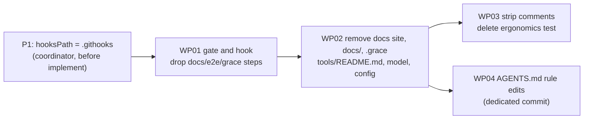

# Implementation Plan: M0 Cleanup

**Branch**: `feat/m0-cleanup` (planning base and merge target) | **Date**: 2026-10-25 | **Spec**: [spec.md](spec.md)
**Input**: Feature specification from `kitty-specs/m0-cleanup-01M5SPZC/spec.md` (approved by the owner on 2026-10-25)

## Summary

M0 removes the documentation site (`apps/docs`), the `docs/` folder, the GRACE knowledge layer (`.grace/`), every code comment except the 34 owner review notes and the 7 `@ts-expect-error` directives, and every check that exists only for them. The useful tooling text of `docs/tooling.md` moves to `tools/README.md`. Kernel, Pack and calculator behavior must not change.

The plan solves two problems:

1. **Keeping every commit green while the hook and the gate still check removed things.** The pre-commit hook runs `grace lint`, `verify` runs `docs:build`, `test:e2e` and `grace:lint`, and the docs tests read `AGENTS.md`, `package.json` and the `START_BLOCK` regions in code. The work packages remove these couplings in a fixed order: first the gate and the hook, then the docs and GRACE, then the comments and `AGENTS.md`.
2. **Proving behavior parity against a baseline taken before any change.** A mission-local harness (`kitty-specs/m0-cleanup-01M5SPZC/parity/`) captured a baseline at commit `f95ae8d`, whose code is identical to the owner's review commit `5fcb4dc`. It compares command outputs, public exports, model outputs, owner-note anchors and, file by file, the runtime output and the token stream of the code.

A full dry run in a throwaway clone applied the whole plan. `bun run verify` passed in 7.4 s with 522 tests, the parity check passed on 104 code files, the comment scan found exactly 34 / 7 / 0, and the lockfile diff removed 776 lines and added none.

## Technical Context

**Language/Version**: TypeScript (strict, `tsconfig.base.json`) on Bun 1.4.4-canary.1 (`engines.bun >=1.4.4-canary.1`)
**Primary Dependencies**: Effect 4.0.4 (kernel and Packs); after M0 no other runtime dependency remains in a kept workspace. M0 adds and upgrades nothing (C-003).
**Storage**: N/A (files in the repository)
**Testing**: `bun test` (unit and integration tests in `packages/*/test`, `apps/calculator/test`, `scripts/*.test.ts`); Spec Kitty review gate `bun scripts/review-gate.ts`; repository self-check `bun run telos:check`; the mission parity harness `bun kitty-specs/m0-cleanup-01M5SPZC/parity/parity.ts`
**Target Platform**: macOS arm64 (owner machine) with Bun canary; no CI by owner decision
**Project Type**: Bun workspaces monorepo (`apps/*`, `packages/*`)
**Performance Goals**: `bun run verify` under 60 s and no slower than the baseline (24.4 s before M0; 7.4 s in the dry run)
**Constraints**: no behavior change (C-001); no new or upgraded dependency (C-003); `CLAUDE.md`, `.kittify/config.yaml`, `human-notes.md` untouched (C-004); historical records untouched (C-006); no gate bypass, no `--no-verify`
**Scale/Scope**: 112 TypeScript files lose comments (about 3,180 comments); 3 folders deleted (`apps/docs`, `docs`, `.grace`); about 15 configuration and tooling files edited

## Charter Check

*GATE: Must pass before Phase 0 research. Re-checked after Phase 1 design: still passes.*

| Charter rule | How the plan meets it |
| --- | --- |
| Wrong behavior is the failure we fear most | Parity harness against a pre-change baseline; every WP runs it; WP03 also proves that only comments and formatting changed (`same-code`). |
| Test-first (034), tests as scaffold (041) | WP01 changes the review-gate tests to the new step list first (they fail), then the step list. Removed tests are deleted, never emptied (C-005). No test of kept behavior changes. |
| Blocking gates (030) | Every WP ends with `bun run verify` green and the review gate green. The hook and the gate drop only steps whose subject is removed. |
| Small, faithful changes (024, 010) | Four WPs, each with an exact file list. No WP acts on an owner review note (C-007). |
| Bulk-edit classification (035) | Not a bulk edit: no identifier, path or key is renamed. The comment removal is done by one reviewed tool, not by hand, and is proven code-neutral. |
| Targeted staging (033), agent commit signing (029) | Each WP names the paths it stages. Commits follow Conventional Commits without AI names. |
| Supply-chain install safety (051) | No install of a new package. `bun install` in WP02 only drops the docs workspace; NFR-006 is checked with `git diff --numstat`. |
| Decision documentation (003) | The hook-path precondition and the parity design are recorded in `research.md`. |
| Owner-only files | The charter edits are already committed (`f95ae8d`, `chore(charter)`). `AGENTS.md` edits come in WP04 as one dedicated commit. `CLAUDE.md` and `.kittify/config.yaml` are never edited. |

No violation needs justification.

## Commit-safety: hook, gate and test couplings

The removals must follow the order of the things that check them:

| Checker | What it needs | Removed by | So it must change first, in |
| --- | --- | --- | --- |
| pre-commit hook: `grace lint` | `.grace/` and all code markup that `.grace/` names, including `apps/docs` files | WP02, WP03 | WP01 |
| `verify` / review gate: `docs:build`, `test:e2e`, `grace:lint` | `apps/docs`, `docs/`, `.grace/` | WP02 | WP01 |
| `apps/docs/test/guides.test.ts` | `AGENTS.md` lines quoted in `docs/guides/agent-reference.md`; `package.json` script `grace:lint`; `START_BLOCK` regions in code | WP04, WP02, WP03 | goes away with `apps/docs` in WP02 |
| `apps/calculator/test/ergonomics.test.ts` | `START_BLOCK_ARITHMETIC_LOCUS` markers | WP03 | deleted in WP03, in the same commit as the strip |
| `scripts/review-gate.test.ts` (no-drift test) | `verify` and `CHECK_STEPS` list the same steps | WP01 | both changed in the same WP01 commit |
| `scripts/telos.test.ts` | `CLOSURE_SCOPE.aliases` names `apps/docs/src/` | WP02 | changed in the same WP02 commit |

**Hook path precondition (P1).** `core.hooksPath` is set to the absolute path `/Users/unknownhero/projects/unknownlab/telos/.githooks`. Every Spec Kitty lane worktree therefore runs the main checkout's hook, which stays at the `feat/m0-cleanup` version until the mission merges, and that version runs `grace lint`. A lane commit that deletes `.grace/` or `apps/docs` would then fail. Before implementation starts, the coordinator runs, in the main checkout:

```sh
git config core.hooksPath .githooks
```

With a relative path, each worktree runs the hook of its own branch (tested; see `research.md`, R1). The hook still runs on every commit, so no gate is bypassed. After the mission merges, the coordinator restores the documented setting: `git config core.hooksPath "$PWD/.githooks"`. Every WP prompt starts with a preflight that stops if `git config --get core.hooksPath` does not print `.githooks`.

**Charter edits** touch only `.kittify/charter/`, so the hook's bookkeeping exit applies. They are already committed on `feat/m0-cleanup` (`f95ae8d`), before the baseline.

**`AGENTS.md` edits** cannot land before WP02, because `guides.test.ts` checks that every `grace ...` line of the agent reference guide is a line of `AGENTS.md`. They come in WP04, after WP02.

## Work package sequence



WP03 and WP04 touch disjoint files and run in parallel. Each WP leaves `bun run verify` green on its own.

## Behavior parity strategy (NFR-001..003, FR-008)

The baseline lives in `kitty-specs/m0-cleanup-01M5SPZC/baseline/` and was captured at `f95ae8d` before any product change (`parity.ts capture`; capture refuses a dirty code tree). `parity.ts check` recomputes everything and compares:

| Evidence | Covers | Method |
| --- | --- | --- |
| `commands.json` | NFR-002 | 13 CLI and agent-demo runs (each operation, division by zero, non-finite result, invalid input, missing flag, unknown command, `--help`, `add --help`, `--version`, agent demo) plus the MCP `tools/list` through `McpStdioClient`. Exit code, stdout and stderr byte-identical. |
| `exports.json` | NFR-003 | Runtime export names of every package entry point (`exports` in each kept `package.json`). Type-only exports are covered by the token comparison. |
| `model.json` | US3 | Calculator model ids, diagnostics, `describeModel`, `verify` (fixed clock) and the web form model. |
| Code parity, per file | NFR-001, C-001 | For each baseline file in `packages/` and `apps/calculator/`, the Bun transpiler output (runtime code) and the comment-free token stream (type-level code, trailing commas ignored) must equal those of the file at the baseline commit. Only `apps/calculator/test/ergonomics.test.ts` may disappear; no file may appear. Identical test code means identical test names and assertions. |
| `owner-notes.json` | FR-008, US1 #3 | Each of the 34 notes, word for word, with its anchor: the code on the same line, or the next code line. |

Further proofs: `parity.ts same-code <WP base>` in WP03 (all 112 files, including `scripts/` and `telos.ts`, differ only in comments and formatting); `parity.ts scan --expect-clean` (NFR-004); `bun run verify` (all remaining tests pass); the NFR-005 search and the NFR-006 lockfile check in `quickstart.md`.

The harness and the baseline are planning artifacts. They live under `kitty-specs/`, which lint, format, test discovery, typecheck and the closure check all skip. They are records of this mission, not product code.

## Project Structure

### Documentation (this mission)

```
kitty-specs/m0-cleanup-01M5SPZC/
├── spec.md
├── plan.md              # this file
├── research.md          # decisions R1-R6
├── data-model.md        # comment classes, owner notes, baseline artifacts
├── quickstart.md        # the acceptance commands
├── contracts/
│   ├── check-suite.md   # verify, CHECK_STEPS and the pre-commit hook after M0
│   └── parity-harness.md
├── parity/              # lex.ts, parity.ts (the harness and the comment stripper)
├── baseline/            # captured at f95ae8d
└── tasks/               # WP prompts (tasks phase)
```

### Source Code (repository root), state after M0

```
apps/calculator/          # kept; comments stripped; ergonomics.test.ts deleted
packages/{kernel,cli,agent,web}/   # kept; comments stripped
scripts/                  # review-gate.ts (3 steps fewer), telos.ts (closure scope), tests
telos.ts                  # telos:docs-site Locus removed
tools/README.md           # new: setup, toolchain, commands, hook, review gate (from docs/tooling.md)
tools/agents/settings/README.md    # pointer to tools/README.md
.githooks/pre-commit      # no grace step; pointers to tools/README.md
package.json, bun.lock, tsconfig.json, bunfig.toml, .gitignore, README.md
.kittify/glossaries/team_domain.yaml
AGENTS.md                 # owner-approved edits 1-11 (WP04)
removed: apps/docs/, docs/, .grace/
```

**Structure Decision**: no new module, boundary or package. M0 only removes and edits.

## Implementation Concern Map

### IC-01 — Gate and hook decoupling

- **Purpose**: stop the hook, `verify` and the review gate from checking docs and GRACE before those are removed.
- **Relevant requirements**: FR-004 (step lists), FR-005
- **Affected surfaces**: `package.json` (`verify`), `scripts/review-gate.ts` (`CHECK_STEPS`), `scripts/review-gate.test.ts`, `.githooks/pre-commit`
- **Sequencing/depends-on**: P1 precondition
- **Risks**: the no-drift test requires `verify` and `CHECK_STEPS` to change together; the scripts `docs:build`, `test:e2e`, `grace:lint` stay until IC-02 because `guides.test.ts` reads `grace:lint`.

### IC-02 — Docs, docs site and GRACE removal

- **Purpose**: delete `apps/docs`, `docs/`, `.grace/` and every configuration, model and pointer entry that names them; move the tooling text to `tools/README.md`.
- **Relevant requirements**: FR-001, FR-002, FR-003, FR-004 (scripts), FR-006, FR-010, FR-011, FR-012, FR-013, FR-014
- **Affected surfaces**: see the WP02 file list in `tasks.md`
- **Sequencing/depends-on**: IC-01
- **Risks**: lockfile must only lose entries (NFR-006); `.gitignore` and `bunfig.toml` edits must keep the other entries; the repository self-report changes (docs-site Locus gone, closure warnings 5 to 3), which is expected.

### IC-03 — Comment removal

- **Purpose**: remove every comment except owner notes and `@ts-expect-error`, using the mission's stripper, and delete the ergonomics test with its markers.
- **Relevant requirements**: FR-007, FR-008, FR-009, NFR-004
- **Affected surfaces**: all tracked `.ts` files in `packages/`, `apps/calculator/`, `scripts/`, `telos.ts`
- **Sequencing/depends-on**: IC-02 (the docs build and the guide tests read the `START_BLOCK` regions)
- **Risks**: lexer mistakes (strings, templates, regex) are caught by `same-code` and `check`; the stripper refuses comments that look like notes or directives.

### IC-04 — Agent rules

- **Purpose**: apply `AGENTS.md` edits 1-11 from the spec in one dedicated commit.
- **Relevant requirements**: FR-015, US4
- **Affected surfaces**: `AGENTS.md` only
- **Sequencing/depends-on**: IC-02 (`guides.test.ts` reads `AGENTS.md`)
- **Risks**: none beyond exact text; `AGENTS.md` is excluded from the formatter.

## Complexity Tracking

No charter violations.
