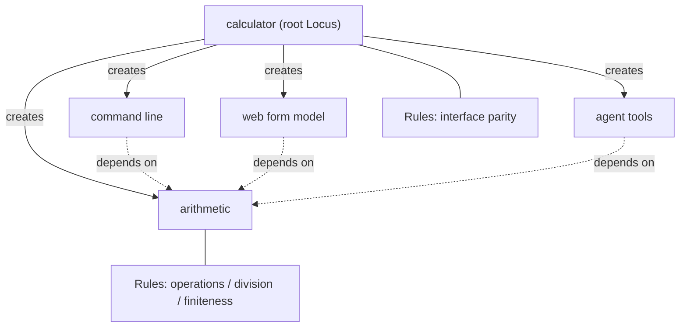

# Mission Specification: M1 Framework Rewrite

**Mission Branch**: `feat/m1-framework-rewrite`
**Created**: 2026-10-25
**Status**: Draft. Waiting for the owner's answers to Q1-Q14 and for spec approval. Requirements whose status says "Pending Qn" take their final form from that answer.
**Input**: Mission purpose (`meta.json`): "Rewrite the Locus framework and the calculator proof as a functional, single-root system that satisfies every owner review note left in the code."

## Intent Summary

M1 is the second mission of the owner's framework rewrite. The owner reviewed the kernel, the command-line, web and agent packages and the calculator, and left 34 inline review notes (`//@unknownhero`, all in `apps/calculator/src/`, baseline `kitty-specs/m0-cleanup-01M5SPZC/baseline/owner-notes.json`) and 6 global notes (`human-notes.md`, commit `5fcb4dc`). M1 rewrites the framework and the calculator so that every note is satisfied.

- **Primary actor**: the owner, as the author of Telos apps (today: the calculator) and of the framework itself. Secondary actors: a person using the calculator command line, a program using the calculator web form model, and an agent using the calculator tools.
- **Trigger**: the owner's review notes and the decisions given on 2026-10-25: use `effect-machine` for state machines, symbols are for internal identity only, Rules replace tests for the calculator only, Telos code is experimental and may change freely, TypeScript and Effect are fixed, Bun is the first target.
- **Outcome**: an app is built from one root Locus that creates every nested Locus. Loci gain behavior by named composition, not by extensions or archetypes. Identities and domain values are typed and branded. Outside input is decoded with Effect schemas. Branching uses pattern matching, and lifecycle flows are finite state machines. The calculator's tests are nested Rules inside the calculator app. The code has no comments and no global data.
- **Invariant**: the calculator keeps one arithmetic implementation, and its command line, web form model and agent tools all serve that implementation with the same results and errors as before M1 (exact external format: Q1).
- **Boundary**: the kernel and the interface packages keep plain tests, because until Telos is written by Telos the kernel is driven by Spec Kitty missions, not by its own Rules. M1 adds no product documentation.

The coordinator relayed the owner's purpose and decisions to this specify session. No discovery interview was held with the owner in this session; the open framework-design questions are batched under "Open Questions", each with a recommended answer.

### Target shape (product view)

Solid edges: the root creates each nested Locus. Dotted edges: dependencies that the model can inspect (for example for impact). Each Locus carries its own nested Rules.

## User Scenarios & Testing *(mandatory)*

### User Story 1 - Build an app from one root Locus (Priority: P1)

The owner writes the calculator by creating one root Locus at the top of the app. Every other Locus (arithmetic, command line, web form model, agent tools) is created through the root, or through a Locus that the root created, so each one has the context of the whole app. The owner refers to a nested Locus or capability through the value the root gave back, never by searching children or by spelling an id.

**Why this priority**: this is the core of the owner's design (inline note on `apps/calculator/src/interfaces.ts`, global notes 3 and 6). Every other story builds on it.

**Independent Test**: build the calculator, list its Loci and their containers through the root, and type-check a variant that tries to create a Locus outside the root.

**Acceptance Scenarios**:

1. **Given** the calculator app, **When** its Loci are listed through the root, **Then** there is exactly one root, and every other Locus has a container chain that ends at that root.
2. **Given** the framework's public API, **When** an author tries to create a Locus that does not come from a root or from a Locus created by it, **Then** the type checker rejects the code.
3. **Given** the calculator source, **When** it is searched, **Then** no code looks up a nested Locus or capability by marker, by id string or by capability name; references are values returned by the root.
4. **Given** the root Locus, **When** its semantic model (structure, dependencies, diagnostics) is requested, **Then** the root provides it itself, with no separate build step outside the root.

---

### User Story 2 - Compose instead of extending (Priority: P1)

The owner gives a Locus its behavior and data by applying named compositions (for example "command-line interface" composed onto a nested Locus that depends on arithmetic). There are no extensions, no archetypes and no `appliesTo` matching. A Rule belongs to the Locus it is composed into.

**Why this priority**: 9 inline notes reject extensions and archetypes (`app.ts` lines 32, 73, 152, 157, 273, 283 and others), and global notes 3 and 6 ask for functional composition.

**Independent Test**: search the framework and the calculator for the removed concepts, and build the calculator using only named compositions.

**Acceptance Scenarios**:

1. **Given** the M1 code, **When** the public exports of the kernel and the interface packages are listed, **Then** none of them offers an extension, an archetype or an `appliesTo` concept.
2. **Given** the calculator, **When** its Loci are described, **Then** each Locus lists the named compositions applied to it, and none was composed anonymously inline.
3. **Given** two compositions that define the same property, relation or rule for one Locus, **When** the app is type-checked or its model is built, **Then** the conflict is rejected with a message that names both compositions.

---

### User Story 3 - Typed and branded identities and values (Priority: P1)

The owner works with identities (Locus, capability, Rule, dependency kind, error kind) and domain values (operands, results, program name, page title, server name) that are distinct branded types. Inside the app, identity is a symbol. At the edges (JSON, command line, tool names, reports) each identity has a stable external name, and decoding an external name back to an identity goes through a schema.

**Why this priority**: inline note on `app.ts` line 28 ("Symbol > string", "All must be branded types"), line 161 ("symbol ?"), and the owner decision that symbols are internal only.

**Independent Test**: type-check code that passes one kind of identity where another is expected, and decode known and unknown external names.

**Acceptance Scenarios**:

1. **Given** two different identity kinds (for example a Locus identity and a capability identity), **When** one is passed where the other is expected, **Then** the type checker rejects it.
2. **Given** a raw string or number, **When** it is passed where a domain value is expected, **Then** the type checker rejects it; it must be decoded through the value's schema first.
3. **Given** the calculator's report or agent tool list, **When** it is produced twice from the same commit, **Then** every identity appears under the same external name both times.
4. **Given** an unknown external name (for example `telos_impact` with target `calculator:nothing`), **When** it is decoded, **Then** a typed "not found" error is returned and nothing is invoked.

---

### User Story 4 - The calculator's Rules are its tests (Priority: P1)

The owner verifies the calculator by running its Rules. Rules are nested and grouped by logic (for example arithmetic, then division, then division by zero), live with the Locus they check, and use full names. Every behavior that today's calculator test files check is checked by a Rule inside the app, and the calculator has no separate test files.

**Why this priority**: global note 2 ("Why we have splited tests if Rules is tests"), inline note on `app.ts` line 158, and the owner principle "all tests must be part of the App".

**Independent Test**: run the repository self-check; it runs every calculator Rule and fails when one fails. Then break one arithmetic operation on purpose and see the self-check fail on the right Rule.

**Acceptance Scenarios**:

1. **Given** the calculator, **When** its Rules are listed, **Then** they form a tree of named groups of any depth, and each Rule is shown with its full group path.
2. **Given** the M1 branch, **When** the calculator package is searched for test files, **Then** none exists, and every behavior in "Calculator behavior baseline" maps to at least one Rule.
3. **Given** a defect in one operation (for example `divide` without its zero check), **When** the check suite runs, **Then** it fails and names the Rule that found the defect.
4. **Given** the kernel and the interface packages, **When** their checks run, **Then** they are still plain tests, not Rules.

---

### User Story 5 - One arithmetic implementation through three interfaces (Priority: P1)

A person runs `bun run calculator add --a 2 --b 3`, a program submits the web form model for `add`, and an agent calls the `add` tool. All three get the result of the one arithmetic implementation, and all three report division by zero, non-finite results and invalid input the same way.

**Why this priority**: this is what the calculator proves (mission purpose). A rewrite that changes results would be the silent wrong behavior the charter fears most.

**Independent Test**: run every case in "Calculator behavior baseline" through direct invocation, the command line, the web form model and the agent tools, and compare.

**Acceptance Scenarios**:

1. **Given** each baseline case, **When** it is run through the four channels, **Then** all four give the result, error kind and invalid-input paths listed in the baseline, and the command line gives the listed exit code.
2. **Given** the calculator, **When** its Loci are inspected, **Then** only the arithmetic Locus implements arithmetic; the interface Loci only expose it.
3. **Given** the calculator entry points (`bun run calculator`, `bun run calculator:mcp`, `bun run calculator:agent-demo`), **When** they are started as before M1, **Then** they work, in the external format decided by Q1.

---

### User Story 6 - Framework operations live on the root Locus (Priority: P2)

The owner and agents describe, inspect, verify, check closure, compute impact and invoke capabilities through the root Locus of an app. The agent introspection tools (`telos_capabilities`, `telos_impact`, `telos_inspect`, `telos_list_loci`, `telos_relations`, `telos_verifications`) and the `bun run telos` commands use these root operations.

**Why this priority**: owner decision of 2026-10-25 ("Closure/impact/describe etc. stay, as capabilities of the root Locus, not outside it") and inline note on `app.ts` line 73 ("why its not in kernel ?").

**Independent Test**: call each operation through the calculator root and through the repository root, and compare with the baseline outputs.

**Acceptance Scenarios**:

1. **Given** the calculator root, **When** impact is computed for the `add` capability, **Then** exactly the three interface Loci are affected, each at distance 1.
2. **Given** the repository root, **When** `bun run telos check` runs, **Then** it builds the repository model, runs closure and all calculator Rules, and passes on the M1 branch.
3. **Given** the calculator agent tools, **When** the tool list is requested, **Then** it names the four calculator tools and the six introspection tools.

---

### User Story 7 - Code that reads as a functional domain model (Priority: P2)

The owner reads the framework and the calculator and finds code organized by domain slice, small named structs and state machines, pattern matching instead of tag checks, Effect schemas instead of hand-written validation, full names, no upper-case constants, no comments and no global data.

**Why this priority**: most inline notes are about this (`app.ts` lines 1, 28, 38, 51, 57, 65, 69, 91, 103, 114, 120, 166; `errors.ts` line 1) and global note 1.

**Independent Test**: run the source scans listed under Non-Functional Requirements.

**Acceptance Scenarios**:

1. **Given** the M1 sources, **When** they are scanned, **Then** they contain no comments except toolchain directives, and none of the 34 owner review notes is left.
2. **Given** the M1 sources, **When** they are scanned, **Then** no module holds data values or mutable state at module level other than what Q6 allows.
3. **Given** the calculator, **When** its modules are listed, **Then** they are named after domain slices (for example an operation or an interface), not technical layers such as "errors", "interfaces" or "archetypes".
4. **Given** an error such as division by zero, **When** its definition is looked up, **Then** it is defined together with the capability that raises it.

---

### User Story 8 - The repository self-check keeps working (Priority: P2)

An agent runs `bun run verify` and the Spec Kitty review gate. The repository model (`telos.ts`) is rewritten to the new design, and all steps pass.

**Why this priority**: the review gate and merge gate depend on it. Without it no work package can be reviewed.

**Independent Test**: run the full check suite and the review gate on the M1 branch.

**Acceptance Scenarios**:

1. **Given** the M1 branch, **When** the full check suite runs, **Then** all six steps (version guard, format check, lint, typecheck, tests, repository self-check) pass.
2. **Given** the M1 branch, **When** `bun run telos list`, `inspect`, `verify`, `closure`, `impact`, `check` and `report` run, **Then** each gives a well-formed result with the same meaning as at the baseline.

---

### Edge Cases

- **Negative zero**: dividing by `-0` fails with DivisionByZero, the same as dividing by `0`.
- **Zero by zero**: `0 / 0` fails with DivisionByZero, not NonFiniteResult.
- **Overflow**: `1e308 * 10` and an addition that overflows fail with NonFiniteResult.
- **Text that is not a number**: `--a x` is invalid input with path `a`; an empty operand is invalid input with its path.
- **Missing operand**: a call without `b` is invalid input with path `b`, in every interface.
- **Unknown command, form or tool**: the command line exits with a usage error (exit code 2); an unknown tool answers with the MCP error; nothing is invoked.
- **Unknown external name** in an introspection tool or `telos` command: a typed "not found" answer, not a crash.
- **Rule that raises an unexpected failure** (not a Rule violation): reported as an error outcome, separate from a failed Rule.
- **Deterministic order**: lists of Loci, capabilities, Rules and findings come out in the same order on every run.
- **Owner notes**: each of the 34 notes is removed only by the change that satisfies it; notes are not reworded or moved before that.

## Calculator behavior baseline

These are the observable calculator behaviors checked at the baseline by `apps/calculator/test/` (`cases.ts`, `arithmetic.test.ts`, `interfaces.test.ts`, `mcp.test.ts`, `cli-binary.test.ts`, `app.test.ts`, `archetypes.test.ts`, `impact.test.ts`, `verification.test.ts`, `agent-demo.test.ts`). After M1 each one is checked by at least one calculator Rule (FR-023).

| # | Operation | Text input | Expected | Exit code |
|---|-----------|------------|----------|-----------|
| B01 | add | a=2, b=3 | result 5 | 0 |
| B02 | subtract | a=5, b=3 | result 2 | 0 |
| B03 | multiply | a=4, b=2.5 | result 10 | 0 |
| B04 | divide | a=7, b=2 | result 3.5 | 0 |
| B05 | add | a=-1.5, b=0.5 | result -1 | 0 |
| B06 | divide | a=-6, b=3 | result -2 | 0 |
| B07 | subtract | a=0, b=0 | result 0 | 0 |
| B08 | divide | a=1, b=0 | DivisionByZero | 1 |
| B09 | divide | a=0, b=0 | DivisionByZero | 1 |
| B10 | divide | a=1, b=-0 | DivisionByZero | 1 |
| B11 | multiply | a=1e308, b=10 | NonFiniteResult | 1 |
| B12 | add | a=1e308, b=1e308 | NonFiniteResult | 1 |
| B13 | add | a=x, b=1 | InvalidInput, path a | 2 |
| B14 | add | a=1 | InvalidInput, path b | 2 |
| B15 | subtract | a="", b=1 | InvalidInput, path a | 2 |
| B16 | divide | a=10, b=4 | result 2.5 | 0 |

B10 and B12 are checked at the baseline through direct invocation only; their exit code is the one the command line gives for every DivisionByZero and NonFiniteResult outcome.

Further baseline behaviors:

- **B17**: each case B01-B16 gives the same outcome through direct invocation, the command line, the web form model and the agent tools.
- **B18**: every interface exposes exactly add, divide, multiply and subtract.
- **B19**: only the arithmetic Locus implements capabilities; every arithmetic capability is pure.
- **B20**: the command line `--help` exits 0, and a command with a missing required input exits 2 with InvalidInput. (An unknown command exits 2 with a usage error today, but no baseline test checks it; see Edge Cases.)
- **B21**: the MCP server is named `telos-calculator`; its tool list names the four calculator tools and the six introspection tools; each calculator tool's input schema equals its capability's input schema; an unknown tool answers with the MCP error; `telos_inspect` describes the arithmetic Locus.
- **B22**: impact of a change to `add` affects exactly the three interface Loci at distance 1, and a newly added interface is affected without any source change; a model diff reports one contract change when `add` changes its contract.
- **B23**: the calculator model builds with no diagnostics, and every Rule has a finding with no failure or error.
- **B24**: the agent demo exits 0, prints seven steps and ends with the success line.
- **B25**: each Rule detects the defect it exists for (baseline examples: an interface missing `divide`, a web Locus that declares a capability, a command line that disagrees on `divide`, an `add` that returns a wrong result, a `divide` without a zero check, a `multiply` without a finite check). How this is checked after M1: Q10.

## Requirements *(mandatory)*

### Functional Requirements

#### Root Locus and nesting

| ID | Title | User Story | Priority | Status |
|----|-------|------------|----------|--------|
| FR-001 | One root Locus per app | As the owner, I want each app to have exactly one root Locus, created once at the top level of the app, so that the whole app has one context. | High | Open |
| FR-002 | Nested Loci come from their parent | As the owner, I want every nested Locus to be created through the root or through a Locus the root created, and the framework to offer no way to create a Locus outside a root, so that every Locus has the context of the whole app. | High | Open |
| FR-003 | The root owns its model | As the owner, I want the root Locus to provide its semantic model (structure, dependencies, diagnostics) itself, with no separate model-building step outside it, so that the Locus contains its semantics instead of having them computed outside. | High | Open |
| FR-004 | Framework operations on the root | As the owner, I want list, inspect, describe, diagnostics, verify, closure, impact and invoke to be operations of the root Locus, and the agent introspection tools and `bun run telos` commands to use them, so that no framework operation lives outside the root. | High | Open |
| FR-005 | Direct references instead of lookups | As the owner, I want app code to refer to nested Loci and capabilities through the values the root returned, so that no app code searches children by marker, filters by kind, or builds a reference from an id string and a capability name. | High | Open |
| FR-006 | Dependencies form an inspectable graph | As the owner, I want every use or exposure of a capability by another Locus to be a typed dependency edge in the model, so that the model is a dependency graph that impact and describe read, not a set of extensions applied to everything. | High | Open |

#### Composition

| ID | Title | User Story | Priority | Status |
|----|-------|------------|----------|--------|
| FR-007 | No extensions | As the owner, I want the extension concept removed from the framework, so that a Locus gains data and behavior only by composition. | High | Open |
| FR-008 | No archetypes | As the owner, I want the archetype concept and `appliesTo` matching removed, so that the framework focuses on Loci only. | High | Open |
| FR-009 | Named compositions only | As the owner, I want every composition to have a name and to be defined once, so that no Locus is composed anonymously inline. | High | Open |
| FR-010 | Conflicting compositions are rejected | As the owner, I want two compositions that define the same property, dependency kind or Rule on one Locus to be rejected by the type checker or by a model diagnostic that names both compositions, so that a conflict cannot pass silently. | Medium | Open |
| FR-011 | Interfaces are compositions | As the owner, I want the command line, the web form model and the agent tools to be compositions applied to nested Loci that depend on the arithmetic Locus, and the set of capabilities each interface exposes to be declared as described in Q3, so that interfaces are composed, not extended. | High | Pending Q3 |

#### Identity and types

| ID | Title | User Story | Priority | Status |
|----|-------|------------|----------|--------|
| FR-012 | Branded identities | As the owner, I want each identity kind (Locus, capability, Rule, Rule group, dependency kind, error kind) to be its own branded type, so that the type checker rejects one kind where another is expected. | High | Open |
| FR-013 | Symbols inside, stable names outside | As the owner, I want identities to be symbols inside the app, and each identity to have a stable external name at the edges (JSON, command line, tool names, reports), decoded and encoded through a schema codec that rejects unknown names with a typed error, so that symbols never leak and outside text never becomes an identity unchecked. | High | Open |
| FR-014 | Branded domain values | As the owner, I want every domain value, primitive or struct (operands, results, program name, page title, server name, Rule examples), to be a branded schema type, so that no domain signature takes or returns a bare string or number. | High | Open |
| FR-015 | Effect schemas for outside input | As the owner, I want all outside input (command-line text, web form text, agent tool JSON, external names) decoded through Effect schemas, so that no code validates or converts input by hand. | High | Open |
| FR-016 | No hand-written outcome unions | As the owner, I want success and failure carried by Effect's success and typed error channels and by schema-defined types, so that no code defines its own `ok: true / ok: false` unions or keeps "normalized" copies of an outcome. | High | Open |
| FR-017 | Discriminator fields are hidden | As the owner, I want discriminator fields (`_tag`, `tag`) kept out of the developer-facing API, with callers branching on errors and outcomes through pattern matching, so that tags are an internal detail. What external output shows: Q1. | High | Pending Q1 |
| FR-018 | Errors live where they are raised | As the owner, I want each error defined together with the capability or Locus that can raise it, with its explanation named and owned by that error as described in Q2, so that there is no global errors module and no generic error field. | High | Pending Q2 |

#### Rules

| ID | Title | User Story | Priority | Status |
|----|-------|------------|----------|--------|
| FR-019 | Nested Rule groups | As the owner, I want a Locus's Rules to form a tree of named groups of any depth, structured by logic, so that Rules are not one flat list. | High | Open |
| FR-020 | Rules belong to their Locus by composition | As the owner, I want each Rule to belong to the Locus it is composed into, and Rules that an interface composition brings to be handled as described in Q8, so that no Rule is matched to Loci by marker. | High | Pending Q8 |
| FR-021 | Rule identity and path | As the owner, I want each Rule and Rule group to have a symbol identity and a stable external name, and reports to show each Rule with its full group path, so that a finding points at exactly one Rule. | High | Open |
| FR-022 | Rule outcomes | As the owner, I want each Rule run to end as passed, failed (a Rule violation with its explanation) or error (an unexpected failure), so that a broken Rule is not mistaken for a found defect. | High | Open |
| FR-023 | The calculator's Rules are its tests | As the owner, I want every behavior in "Calculator behavior baseline" (B01-B25) checked by at least one calculator Rule, and the calculator's separate test files removed, so that all calculator tests are part of the app. Process-level behaviors (B20, B21, B24): Q9. Defect-detection checks (B25): Q10. | High | Pending Q9, Q10 |
| FR-024 | Rules run in the check suite | As an agent, I want the repository self-check to run every calculator Rule and fail when any Rule fails or errors, so that the review and merge gates enforce the calculator's Rules. | High | Open |
| FR-025 | Rule data belongs to its Rule | As the owner, I want the examples a Rule uses to be produced by that Rule (a function or an effect) and named in domain terms, so that no example data sits in module scope under a generic name such as "parity input". | High | Open |
| FR-026 | No checks for impossible states | As the owner, I want states that the types already rule out (for example "the app contains no arithmetic Locus") to be impossible to construct instead of checked at run time, so that no Rule or message exists for them. | Medium | Open |

#### Control flow

| ID | Title | User Story | Priority | Status |
|----|-------|------------|----------|--------|
| FR-027 | Finite state machines for lifecycle flows | As the owner, I want the lifecycle flows named in Q4 modeled as finite state machines with `effect-machine`, holding only states, events and transitions, with all computation in pure functions outside the machine, so that no machine is Turing complete. | High | Pending Q4 |
| FR-028 | Pattern matching | As the owner, I want branching on outcomes, errors, states and exit codes written with Effect's pattern matching, so that no code branches by comparing tags or flags by hand. | High | Open |
| FR-029 | Effect CLI framework | As the owner, I want the command line defined and run with Effect's CLI framework, and Rules to drive the command line through that same definition, so that no code assembles command-line flags by string concatenation. | High | Open |
| FR-030 | Pure core, effects at the edges | As the owner, I want pure computations (arithmetic, model, derivation of commands, forms and tools) separated from side effects (process output, standard input and output, file reads, time), with side effects only in Effect services or entry points, so that data comes from functions and effects, not from module scope. | High | Open |
| FR-031 | Ordering belongs to the domain types | As the owner, I want the order of Loci, capabilities, Rules and findings defined by their identity types, so that no app code defines free comparison helpers with short names, and every listing is deterministic. | Medium | Open |

#### Calculator

| ID | Title | User Story | Priority | Status |
|----|-------|------------|----------|--------|
| FR-032 | One arithmetic implementation | As a calculator user, I want add, subtract, multiply and divide implemented once in the arithmetic Locus, and the command line, web form model and agent tools to invoke only that implementation, so that every interface computes the same thing. | High | Open |
| FR-033 | Calculator behavior kept | As a calculator user, I want every case B01-B16 to give the listed result or error, invalid-input paths and exit code through all four channels, so that the rewrite changes no arithmetic behavior. | High | Open |
| FR-034 | Entry points kept | As a calculator user, I want `bun run calculator`, `bun run calculator:mcp` and `bun run calculator:agent-demo` to keep working, with their external format decided by Q1, so that existing ways to use the calculator still work. | High | Pending Q1 |
| FR-035 | Interface parity Rule | As the owner, I want a calculator Rule that runs the baseline cases through every interface and the direct invocation and fails, naming the interface, when one disagrees, so that parity is part of the app. | High | Open |
| FR-036 | One description per Locus | As the owner, I want the separate purpose, responsibilities and excluded properties handled as described in Q5, so that a Locus does not describe itself twice or list what it excludes. | Medium | Pending Q5 |

#### Code hygiene

| ID | Title | User Story | Priority | Status |
|----|-------|------------|----------|--------|
| FR-037 | No comments | As the owner, I want the M1 sources to contain no comments except toolchain directives, and each of the 34 owner review notes removed by the change that satisfies it, so that no note is left once M1 is merged. | High | Open |
| FR-038 | No global data | As the owner, I want module scope to hold no data values and no mutable state beyond what Q6 allows, so that real data is returned by functions and effects. | High | Pending Q6 |
| FR-039 | No upper-case constants | As the owner, I want no identifier written in upper case as described in Q7, so that constants are not named in upper case. | Medium | Pending Q7 |
| FR-040 | Full names | As the owner, I want every identifier to be a full word or phrase (no `a`, `b`, `i`, `n`, `ctx`, `def` or similar), so that code reads without decoding abbreviations. External field names follow Q1. | Medium | Pending Q1 |
| FR-041 | Vertical slices | As the owner, I want code organized by domain slice (each operation, each interface, each framework operation), with small specific structs and no all-purpose structs, so that no module is named after a technical layer such as "errors", "interfaces", "archetypes" or "utils". | High | Open |
| FR-042 | Shallow, readable Rule bodies | As the owner, I want Rule bodies and app functions kept shallow (see NFR-007), with nested logic moved into named Rule groups or named functions, so that they are readable. | Medium | Open |

#### Repository and framework scope

| ID | Title | User Story | Priority | Status |
|----|-------|------------|----------|--------|
| FR-043 | Repository model rewritten | As an agent, I want the repository model (`telos.ts`) rewritten to the new design, with one repository root that creates the kernel, interface package, calculator and tooling Loci, and its source ownership and closure check kept, so that `bun run telos check` keeps checking the repository. | High | Open |
| FR-044 | `telos` commands kept | As an agent, I want `bun run telos list`, `inspect`, `verify`, `closure`, `impact`, `check` and `report` to keep their meaning and exit codes, built on the root operations, so that tooling and the review gate keep working. | High | Open |
| FR-045 | Agent introspection tools kept | As an agent, I want the six introspection tools to keep their names and meaning, built on the root operations, so that agents can still explore an app. | High | Open |
| FR-046 | Kernel feature set | As the owner, I want the kernel to keep the features listed in Q12 and drop the others, so that the rewrite carries no unused feature. | Medium | Pending Q12 |
| FR-047 | Package boundaries | As the owner, I want the kernel and the command-line, web and agent interfaces packaged as decided in Q11, so that the package boundary is an explicit decision. | Medium | Pending Q11 |
| FR-048 | Kernel and interface package tests rewritten | As an agent, I want the kernel and interface package tests rewritten to the new API as plain tests, every kept feature covered, and tests of removed concepts deleted, so that the framework stays checked without fake tests. | High | Open |

### Non-Functional Requirements

The **M1 source scope** is the tracked TypeScript in `packages/*/src`, `packages/*/test`, `apps/calculator/src`, `apps/calculator/bin`, `telos.ts` and `scripts/telos.ts`, adjusted by Q13.

| ID | Title | Requirement | Category | Priority | Status |
|----|-------|-------------|----------|----------|--------|
| NFR-001 | Arithmetic parity | 100% of cases B01-B16 give the baseline result or error kind and invalid-input paths through all four channels, and the baseline exit code on the command line. | Reliability | High | Open |
| NFR-002 | External format | For the fixed sample (each operation on the command line, B08, B13, `--help`, the MCP tool list, the agent demo), output and exit code match the baseline as decided by Q1 (byte-identical if Q1 keeps the format; otherwise matching a format table approved in the plan). | Reliability | High | Pending Q1 |
| NFR-003 | Rule coverage | 25 of 25 baseline behaviors (B01-B25) map to at least one named calculator Rule; the plan lists the mapping. | Reliability | High | Open |
| NFR-004 | No comments left | A comment scan of the M1 source scope finds 0 owner review notes and 0 comments other than toolchain directives (such as `@ts-expect-error`). | Maintainability | High | Open |
| NFR-005 | Name scan | A scan of the M1 source scope finds 0 identifiers that break FR-039 (as decided by Q7), 0 single-letter identifiers and 0 identifiers named `ctx` or `def`. | Maintainability | High | Pending Q7 |
| NFR-006 | Global data scan | A scan of the M1 source scope finds 0 module-level mutable bindings and 0 module-level data values beyond what Q6 allows. | Maintainability | High | Pending Q6 |
| NFR-007 | Nesting depth | No function or Rule body in the M1 source scope nests more than 2 levels of blocks (loops, conditionals, generator bodies inside them). | Maintainability | Medium | Open |
| NFR-008 | Removed concepts | A search of the public exports and of the M1 source scope finds 0 occurrences of the extension, archetype and `appliesTo` concepts. | Maintainability | High | Open |
| NFR-009 | Deterministic output | Two runs of `bun run telos report` on the same commit differ only in timestamps; two runs of the calculator Rules give identical findings in identical order. | Reliability | High | Open |
| NFR-010 | Fast checks | The full check suite finishes in under 60 seconds on the owner's machine (charter target). | Performance | Medium | Open |
| NFR-011 | Confined state machine library | `effect-machine` is the only added dependency, pinned to one exact version that supports the project's Effect version, and is imported by exactly one kernel module. | Security | High | Open |

### Constraints

| ID | Title | Constraint | Category | Priority | Status |
|----|-------|------------|----------|----------|--------|
| C-001 | Fixed stack | TypeScript (strict) and Effect are fixed; Bun is the first target. The project's Effect version does not change in M1. | Technical | High | Open |
| C-002 | State machine library | State machines use `effect-machine` (owner decision), pinned exactly and confined to one kernel module so that it can be replaced later. No other dependency is added or upgraded. | Technical | High | Open |
| C-003 | Rules as tests for the calculator only | Only the calculator replaces its tests with Rules. The kernel and the interface packages keep plain tests until Telos is written by Telos; kernel work stays governed by Spec Kitty missions. | Business | High | Open |
| C-004 | No product documentation | M1 adds no product documentation. `README.md` changes only to list workspaces and commands that exist. | Business | High | Open |
| C-005 | No comments | M1 writes no code comments (AGENTS.md rule). The owner review notes are the only comments M1 may find, and it removes each one when satisfied. | Technical | High | Open |
| C-006 | Experimental code | The current kernel and package APIs may change freely; M1 keeps no compatibility layer for removed concepts. | Business | High | Open |
| C-007 | Owner-only files | M1 does not edit `AGENTS.md`, `CLAUDE.md`, `.kittify/config.yaml`, the charter or `human-notes.md` unless the owner approves the exact edit (see Q14). | Business | High | Open |
| C-008 | Gates | The full check suite and the review gate pass before review, accept and merge; no gate is bypassed. | Technical | High | Open |
| C-009 | No fake tests or Rules | No removed test is replaced by a placeholder, and no Rule or test verifies nothing. Each removed calculator test is replaced by Rules that check the same behavior (FR-023). | Technical | High | Open |
| C-010 | Owner design constraints only | The spec names Effect schemas, Effect's pattern matching, Effect's CLI framework and `effect-machine` because the owner named them. Every other design choice belongs to the plan. | Business | Medium | Open |

### Out of scope

- **Global note 4** ("Plan and suggestions before any new mission creation"): a process rule for how missions start. It is honored by the workflow (this spec, its open questions and the plan go to the owner before implementation) and creates no product requirement.
- **Global note 5** ("drop docs"): done by M0. M1 only keeps it true (C-004).
- Rules as tests for the kernel and the interface packages (C-003).
- New calculator operations, a rendered web page or HTTP server, persistence, and Telos writing Telos.
- Repository tooling outside the M1 source scope (for example the review gate script), subject to Q13.

## Owner note traceability

Inline notes are numbered N01-N34 in the order of the baseline file. Line numbers are those at the start of M1 (commit `b45f644`).

| Note | Location | Note (short) | Covered by |
|------|----------|--------------|-----------|
| N01 | `apps/calculator/src/app.ts:1` | "just remove comments everywhere" | FR-037, NFR-004, C-005 |
| N02 | `app.ts:28` | no upper case, no strings, no global variables; structs and state machines, not all-purpose structs; symbol over string; all branded types; functional DDD with vertical slices; `effect-machine`, not Turing complete | FR-039, FR-014, FR-038, FR-041, FR-013, FR-012, FR-027, NFR-005, NFR-006 |
| N03 | `app.ts:32` | "its compositions, not extensions" | FR-007, FR-011 |
| N04 | `app.ts:38` | `NO_ARITHMETIC`: "why ???" | FR-026, FR-039 |
| N05 | `app.ts:41` | no OR constructions, normal branded types, not many variants | FR-016 |
| N06 | `app.ts:46` | do not use `tag` and `_tag`; hide them from the final interface | FR-017, Q1 |
| N07 | `app.ts:47` | `message`: too general a name | FR-018, Q2 |
| N08 | `app.ts:51` | `ParityInput`: too general a name | FR-025 |
| N09 | `app.ts:57` | real data from functions and effects, not global scope; split pure from side effects | FR-025, FR-030, FR-038 |
| N10 | `app.ts:65` | no `a`, `b`, `i`, `n` names; make the comparison part of a state machine or struct | FR-040, FR-031 |
| N11 | `app.ts:69` | `byId`: why not part of some state machine | FR-031 |
| N12 | `app.ts:73` | `hasExtension`: no extensions; why not in the kernel | FR-007, FR-005, FR-004 |
| N13 | `app.ts:76` | `namesOf`: bad | FR-005 |
| N14 | `app.ts:79` | `arithmeticOf`: bad | FR-005 |
| N15 | `app.ts:84` | `interfaceOf`: bad | FR-005 |
| N16 | `app.ts:91` | `normalize`: "wtf is that ?" | FR-016 |
| N17 | `app.ts:103` | use Effect schemas, not direct validation | FR-015 |
| N18 | `app.ts:114` | Effect has a CLI framework, use it | FR-029 |
| N19 | `app.ts:120` | use Effect's pattern matching | FR-028 |
| N20 | `app.ts:152` | remove the archetype system, focus on Locus only | FR-008 |
| N21 | `app.ts:157` | `appliesTo`: composition, not extension; think functional | FR-020, FR-007 |
| N22 | `app.ts:158` | not a plain array of plain Rules; no `ctx`, full names | FR-019, FR-040 |
| N23 | `app.ts:161` | Rule id: "symbol ?" | FR-021, FR-013 |
| N24 | `app.ts:166` | too much depth, not readable | FR-042, NFR-007 |
| N25 | `app.ts:273` | no more extensions | FR-007 |
| N26 | `app.ts:283` | anonymous extend, very bad | FR-009 |
| N27 | `app.ts:292` | `arithmetic` in the list: "its constructor, we can use it as direct usage" | FR-002, FR-005 |
| N28 | `app.ts:299` | `buildModel(app)`: the Locus must contain its semantics, not have them calculated outside | FR-003 |
| N29 | `apps/calculator/src/arithmetic.ts:74` | `purpose`: "wtf is this ?" | FR-036, Q5 |
| N30 | `arithmetic.ts:83` | `excluded`: we cannot describe all excludes | FR-036, Q5 |
| N31 | `arithmetic.ts:85` | capabilities too abstract; composition as a dependency graph, not extending everything | FR-006, FR-011 |
| N32 | `apps/calculator/src/errors.ts:1` | no global errors and no technical names like "errors"; errors belong where they are raised | FR-018, FR-041 |
| N33 | `apps/calculator/src/interfaces.ts:14` | one root `AppLocus`, nested Loci created by it, so every Locus has the app context | FR-001, FR-002 |
| N34 | `interfaces.ts:19` | `CliCommand.to(CapabilityRef.make(...))`: "do we need it ?" | FR-005, FR-011, Q3 |
| G1 | `human-notes.md` item 1 | functional DDD, branded types, state machines, vertical slices, Effect | FR-012, FR-014, FR-027, FR-041, FR-015, FR-028 |
| G2 | `human-notes.md` item 2 | why separate tests if Rules are tests; Rules nested and structured by logic | FR-019, FR-023, FR-024 |
| G3 | `human-notes.md` item 3 | one global Locus creates new Loci; archetypes dropped | FR-001, FR-002, FR-008 |
| G4 | `human-notes.md` item 4 | plan and suggestions before any new mission | Out of scope (process) |
| G5 | `human-notes.md` item 5 | drop docs | Out of scope (done by M0), C-004 |
| G6 | `human-notes.md` item 6 | one global Locus produces every deeper level, functional, not property-based extension | FR-001, FR-002, FR-007, FR-009 |

## Key Entities

- **Root Locus**: the one Locus at the top of an app. It creates every nested Locus, owns the app's semantic model and offers the framework operations.
- **Nested Locus**: a Locus created by the root or by another nested Locus. It knows its container chain up to the root.
- **Composition**: a named, reusable piece that gives a Locus data, dependencies, capabilities or Rules. Replaces extensions and archetypes.
- **Capability**: an operation of a Locus with an input schema, an output schema, the errors it can raise and its effect class (pure, read, write).
- **Dependency**: a typed edge from one Locus to a Locus or capability it uses or exposes. Together the dependencies form the app's dependency graph.
- **Interface**: a nested Locus composed as a command line, a web form model or agent tools, exposing capabilities of another Locus without implementing them.
- **Rule**: a named check that belongs to a Locus and ends as passed, failed or error. **Rule group**: a named node in the tree of a Locus's Rules.
- **Identity**: a symbol that identifies a Locus, capability, Rule, Rule group, dependency kind or error kind inside the app, with one stable **external name** for the edges.
- **Owner review note**: a `//@unknownhero` comment; 34 at the start of M1, 0 after it.

## Domain Language

| Term | Meaning in this spec | Avoid |
|------|----------------------|-------|
| Root Locus | See Key Entities. | "global Locus" in code names, "app model" as a separate thing |
| Composition | See Key Entities. | "extension", "archetype", "mixin", "plugin" |
| Rule | See Key Entities. In the calculator, Rules are the tests. | "test" for calculator checks, "assertion" |
| Interface | See Key Entities. | "Pack" for the Locus itself (the package name is decided by Q11) |
| External name | The stable text form of an identity at the edges. | "id string" inside the app |
| Channel | One of direct invocation, command line, web form model, agent tools. | "transport" |

## Success Criteria *(mandatory)*

### Measurable Outcomes

- **SC-001**: 40 of 40 owner notes (34 inline, 6 global) map to a requirement or an out-of-scope entry, and after M1 0 inline notes remain in the code.
- **SC-002**: 16 of 16 arithmetic cases give the baseline outcome through all four channels.
- **SC-003**: 25 of 25 baseline behaviors are checked by named calculator Rules, and the calculator has 0 separate test files.
- **SC-004**: 6 of 6 check suite steps and the review gate pass on the M1 branch.
- **SC-005**: the source scans find 0 comments other than toolchain directives, 0 removed-concept occurrences, and 0 name, global-data or nesting violations.
- **SC-006**: a deliberately broken operation makes the check suite fail and names the Rule that found it, in 3 of 3 sampled defects (wrong result, missing zero check, missing finite check).
- **SC-007**: the calculator source refers to nested Loci and capabilities only through values returned by the root (0 lookups by marker, id string or capability name).

## Assumptions

- The coordinator relayed the owner's purpose and the 2026-10-25 decisions faithfully; they are taken from `meta.json`, `human-notes.md`, the baseline note file and the coordinator's brief.
- "M1 source scope" excludes the historical records (`kitty-specs/`, `kitty-ops/`, `.kittify/archive/`, `tools/agents/experiments/`, `tools/agents/usage/ledgers/`), which stay unchanged.
- `@typeonce/effect-machine` 0.46.0 declares Effect `^4.0.0` as its peer dependency (checked on the npm registry on 2026-10-26), so it fits the project's Effect 4.0.4. The exact version is chosen in the plan.
- This is not a bulk-edit (rename) mission in the DIRECTIVE_035 sense. It replaces concepts and rewrites modules instead of changing one string in many files. The plan revisits this if a cross-file rename appears (for example external names under Q1).

## Open Questions

Framework-design questions for the owner. Each has a recommended answer. Requirements marked "Pending Qn" take their final form from the answer. No Decision Moment is recorded yet; the coordinator records the answers in the next specify pass.

- **Q1 - External calculator format.** The rewrite hides tags in the code (N06) and renames short names (N10). Should the outside world see the same output as today: stdout `{"result":5}`, stderr `{"tag":"DivisionByZero","message":"...","issues":[]}`, exit codes 0/1/2, flags `--a` and `--b`, MCP `structuredContent` with `ok`/`output`/`error`, Locus names such as `calculator:arithmetic`, server name `telos-calculator`?
  **Recommendation**: yes, keep the external format byte-identical. The codec layer maps internal symbols and full names to these external names. This gives the rewrite a hard regression baseline (NFR-002). Rename external names later, in their own mission, if wanted.
- **Q2 - Error explanation (N07, "message: to general name").** How should an error carry its human explanation?
  **Recommendation**: each error kind defines its own explanation as part of its definition (for example DivisionByZero explains "Division by zero is not defined."), with no generic `message` field in the developer-facing types. External output still prints it as `message` if Q1 keeps the format.
- **Q3 - What an interface exposes (N34, "do we need it ?").** Should an interface list each capability it exposes, or expose every capability of the Locus it depends on?
  **Recommendation**: an interface exposes every capability of the Locus it depends on by default, so the calculator declares no per-command relations. A narrower selection, when needed later, is a typed list of capability values, never ids and names.
- **Q4 - Which flows are state machines (N02).** Which framework flows should be finite state machines?
  **Recommendation**: the capability invocation lifecycle (resolve, authorize, decode, run, encode, then done or failed) and the Rule run lifecycle (pending, running, then passed, failed or error). The command-line run uses the invocation machine. Arithmetic itself stays pure functions.
- **Q5 - Purpose, responsibilities, excluded (N29, N30).** The arithmetic Locus has a description and also `purpose`, `responsibilities` and `excluded` properties.
  **Recommendation**: drop the purpose composition entirely, including `responsibilities` and `excluded`. Each Locus has one description.
- **Q6 - What may live at module scope (N02, N09).** "Global variables" and "real data ... not global scope" leave open whether the root Locus itself may be a module-level value.
  **Recommendation**: module scope holds only definitions: types, schemas, compositions, functions, and exactly one exported root Locus per app (the `AppLocus = Locus.create` the owner described). No other values (example data, messages, lists, constants) live at module scope.
- **Q7 - "Upper case is shit in any code" (N02).** Does this forbid only SCREAMING_CASE names, or every capital letter?
  **Recommendation**: forbid SCREAMING_CASE names only. PascalCase stays for types, schemas and compositions, as TypeScript and Effect use it.
- **Q8 - Rules that an interface composition brings.** Today the command-line, web and agent packages add checks to every interface Locus (for example "a command with a required field rejects missing input with exit code 2"). Without archetypes, should these become Rules that the interface composition brings into each Locus it is applied to?
  **Recommendation**: yes. A composition may carry Rules, and they become a named Rule group of each Locus it is composed into. This is product behavior of the interface, so it does not conflict with C-003; the package code itself keeps plain tests.
- **Q9 - Process-level calculator checks (B20, B21, B24).** The command-line binary, the MCP server over standard input and output, and the agent demo are tested today by starting real processes.
  **Recommendation**: these also become calculator Rules that start the real entry point, so the calculator has no test files at all ("every one"). They run in the repository self-check and must keep the check suite under 60 seconds (NFR-010).
- **Q10 - Checks that a Rule catches its defect (B25).** Today tests build a broken variant (for example a `divide` without its zero check) and assert that the Rule fails. With Rules as the tests, how is this kept?
  **Recommendation**: drop the checks whose broken variant can no longer be built because the types rule it out (for example an interface missing `divide` under Q3). Keep the rest as a calculator Rule group that builds the broken variant through the root and expects the target Rule to fail. Rules do not get their own test files.
- **Q11 - Package boundaries.** Should `@telos/kernel`, `@telos/cli`, `@telos/web` and `@telos/agent` stay four packages?
  **Recommendation**: keep the four packages and their names. Each interface package offers its composition instead of an extension. Merging or splitting packages is a separate decision.
- **Q12 - Kernel feature set.** Which current kernel features does M1 keep?
  **Recommendation**: keep model building with diagnostics, describe and inspect, digests, invoke with authorization by dependency, verify, impact and model diff, closure, and the introspection service. Drop the JSON Locus decoding (`decodeLocus`), which no app or tool uses (only its own tests).
- **Q13 - Design rules for repository tooling.** Do the code rules (no global data, full names, state machines and so on) also apply to the repository scripts?
  **Recommendation**: apply them to `telos.ts` and `scripts/telos.ts`, because they use the framework. Leave `scripts/review-gate.ts`, `scripts/check-bun-version.ts` and their tests unchanged, because they are tooling, not Telos code.
- **Q14 - Charter "test-first" rule.** The charter says every behavior change starts with a failing `bun test`. For the calculator, Rules replace tests.
  **Recommendation**: amend the charter to say "starts with a failing test, or, for the calculator, a failing Rule". This edits an owner-only file (C-007), so it needs the owner's approval of that exact wording.
