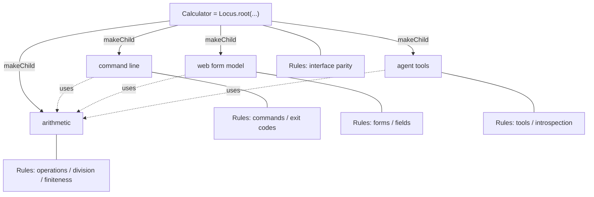

# Mission Specification: M1 Framework Rewrite

**Mission Branch**: `feat/m1-framework-rewrite`
**Created**: 2026-10-25
**Status**: Draft. The owner answered Q1-Q15 and gave the Locus creation design (D15) and the Telos scope (D16) on 2026-10-26 (see "Decisions"). Two questions that follow from D16 are still open (Q16, Q17). Waiting for the owner's answers and for spec approval.
**Input**: Mission purpose (`meta.json`): "Rewrite the Locus framework and the calculator proof as a functional, single-root system that satisfies every owner review note left in the code."

## Intent Summary

M1 is the second mission of the owner's framework rewrite. The owner reviewed the kernel, the command-line, web and agent packages and the calculator, and left 34 inline review notes (`//@unknownhero`, all in `apps/calculator/src/`, baseline `kitty-specs/m0-cleanup-01M5SPZC/baseline/owner-notes.json`) and 6 global notes (`human-notes.md`, commit `5fcb4dc`). M1 rewrites the framework and the calculator so that every note is satisfied.

- **Primary actor**: the owner, as the author of Telos apps (today: the calculator) and of Telos itself. Secondary actors: a person using the calculator command line, a program using the calculator web form model, and an agent using the calculator tools.
- **Trigger**: the owner's review notes, the decisions of 2026-10-25 (use `effect-machine` for state machines, symbols are for internal identity only, Rules replace tests for the calculator only, Telos code is experimental and may change freely, TypeScript and Effect are fixed, Bun is the first target) and the decisions of 2026-10-26 listed under "Decisions".
- **Outcome**: Telos is only the root Locus generator (D16). An app starts from one Locus, created with `Locus.root(...)`. Every other Locus is created with `makeChild()` on its parent, to any depth, and parent and child know each other. The calculator is such a root Locus. Its arithmetic, command line, web form model, agent tools and Rules are additional API, added by plain functional extension of the root and its children inside the app. The kernel has no extensions, archetypes, `appliesTo`, model verification or checks: the links are always made in both directions by `makeChild()`, so they cannot disagree. `@telos/kernel` is the only package, and there is no repository-level model. Identities and domain values are typed and branded, outside input is decoded with Effect schemas, branching uses pattern matching, lifecycle flows are finite state machines. The calculator's tests are nested Rules inside the app, run as one step of the check suite. The code has no comments and no global data.
- **Invariant**: the calculator keeps one arithmetic implementation, and its command line, web form model and agent tools all serve that implementation with byte-identical external output (Q1). The only planned exceptions are introspection outputs of removed features (Q16).
- **Boundary**: the kernel keeps plain tests, because until Telos is written by Telos the kernel is driven by Spec Kitty missions, not by its own Rules. M1 adds no product documentation.
- **Accepted cost**: interface code (command line, web form model, agent tools) and the calculator's own operations (invocation, description, impact, Rule runner) live in the calculator. A second app would have to repeat them until they are extracted into a shared helper in a later mission (D15, D16).

### Target shape (product view)

Solid edges: each child is created with `makeChild()` on its parent, and parent and child know each other. This is all the kernel provides. Dotted edges and Rules: calculator API, added by functional extension inside the app.

## User Scenarios & Testing *(mandatory)*

### User Story 1 - Build an app from one root Locus (Priority: P1)

The owner writes `const Calculator = Locus.root(...)` once at the top of the app, then creates the arithmetic, command-line, web form and agent Loci with `Calculator.locus.makeChild()`, and deeper Loci the same way on those children. Each child knows its parent and the parent knows its children, so every Locus has the context of the whole app. The owner refers to a child through the value that was returned, never by searching children or by spelling an id.

**Why this priority**: this is the core of the owner's design (inline note on `apps/calculator/src/interfaces.ts`, global notes 3 and 6, decisions D15 and D16). It is all that Telos itself provides.

**Independent Test**: build the calculator, walk from the root to every child and back, create a Locus several levels deep, and type-check a variant that tries to create a Locus without a parent.

**Acceptance Scenarios**:

1. **Given** the calculator app, **When** its Loci are walked from the root, **Then** there is exactly one root, every other Locus has a parent chain that ends at that root, and each parent lists exactly the children created from it.
2. **Given** a child created with `makeChild()`, **When** a child of that child is created, and so on to any depth, **Then** every link is present in both directions without any further step.
3. **Given** the kernel's public API, **When** an author tries to create a Locus other than with `Locus.root(...)` or `makeChild()`, or to link two Loci another way, **Then** there is no way to do it (the API offers none, and the type checker rejects attempts).
4. **Given** the calculator source, **When** it is searched, **Then** no code looks up a child Locus or capability by marker, by id string or by capability name; references are values returned by `makeChild()` and by the app's own definitions.

---

### User Story 2 - Add API by functional extension inside the app (Priority: P1)

`makeChild()` gives the owner a basic Locus. The owner adds the API a Locus needs (arithmetic capabilities, command line, web form model, agent tools, Rules) with plain functions inside the app that take a Locus and return it with that API. The kernel has no extension concept, no archetypes, no `appliesTo` and no compositions that a package hands out.

**Why this priority**: 9 inline notes reject extensions and archetypes (`app.ts` lines 32, 73, 152, 157, 273, 283 and others), global notes 3 and 6 ask for a functional design, and the owner fixed the design in decisions D15 and D16 ("Calculator is a root Locus that has an additional API by functional extending").

**Independent Test**: search the kernel and the calculator for the removed concepts, and build the calculator using only `Locus.root(...)`, `makeChild()` and the app's own functions.

**Acceptance Scenarios**:

1. **Given** the M1 code, **When** the public exports of the kernel are listed, **Then** they offer only the root Locus generator (FR-046): no extension, archetype, `appliesTo`, capability, Rule, verification or package-provided composition.
2. **Given** the calculator, **When** each Locus is described, **Then** its API is the one the app's functions added to it, the added API is visible to the type checker, and no Locus was built from an anonymous inline kind.
3. **Given** two siblings with the same external name, or one Locus given two capabilities or two Rules with the same name, **When** the app is type-checked or the Locus is created, **Then** the duplicate is rejected with a message that names the Locus and the duplicated name.

---

### User Story 3 - Typed and branded identities and values (Priority: P1)

The owner works with identities (Locus, capability, Rule, Rule group, error kind) and domain values (operands, results, program name, page title, server name) that are distinct branded types. Inside the app, identity is a symbol. At the edges (JSON, command line, tool names, reports) each identity has a stable external name, and decoding an external name back to an identity goes through a schema.

**Why this priority**: inline note on `app.ts` line 28 ("Symbol > string", "All must be branded types"), line 161 ("symbol ?"), and the owner decision that symbols are internal only.

**Independent Test**: type-check code that passes one kind of identity where another is expected, and decode known and unknown external names.

**Acceptance Scenarios**:

1. **Given** two different identity kinds (for example a Locus identity and a capability identity), **When** one is passed where the other is expected, **Then** the type checker rejects it.
2. **Given** a raw string or number, **When** it is passed where a domain value is expected, **Then** the type checker rejects it; it must be decoded through the value's schema first.
3. **Given** the calculator's agent tool list, **When** it is produced twice from the same commit, **Then** every identity appears under the same external name both times, and the names equal the baseline names (Q1).
4. **Given** an unknown external name (for example `telos_impact` with target `calculator:nothing`), **When** it is decoded, **Then** a typed "not found" error is returned and nothing is invoked.

---

### User Story 4 - The calculator's Rules are its tests (Priority: P1)

The owner verifies the calculator by running its Rules. Rules are nested and grouped by logic (for example arithmetic, then division, then division by zero), are added by the app to the Locus they check, and use full names. Every behavior in "Calculator behavior baseline" that is not marked dropped is checked by a Rule inside the app. The calculator has no test files.

**Why this priority**: global note 2 ("Why we have splited tests if Rules is tests"), inline note on `app.ts` line 158, the owner principle "all tests must be part of the App", and decisions Q9, Q10 and D16 (Rules stay; how they run is separate from model verification, which is removed).

**Independent Test**: run the check suite; its Rules step runs every calculator Rule and fails when one fails. Then break one arithmetic operation on purpose and see the step fail on the right Rule.

**Acceptance Scenarios**:

1. **Given** the calculator, **When** its Rules are listed, **Then** they form a tree of named groups of any depth, and each Rule is shown with its full group path.
2. **Given** the M1 branch, **When** the calculator is searched for test files, **Then** none exists, and every behavior in "Calculator behavior baseline" not marked dropped maps to at least one Rule.
3. **Given** a defect in one operation (for example `divide` without its zero check), **When** the check suite runs, **Then** it fails and names the Rule that found the defect.
4. **Given** the kernel, **When** its checks run, **Then** they are still plain tests, not Rules.

---

### User Story 5 - One arithmetic implementation through three interfaces (Priority: P1)

A person runs `bun run calculator add --a 2 --b 3`, a program submits the web form model for `add`, and an agent calls the `add` tool. All three get the result of the one arithmetic implementation, and all three report division by zero, non-finite results and invalid input the same way, in exactly today's external format.

**Why this priority**: this is what the calculator proves (mission purpose). A rewrite that changes results would be the silent wrong behavior the charter fears most.

**Independent Test**: run every case in "Calculator behavior baseline" through direct invocation, the command line, the web form model and the agent tools, and compare with the baseline output byte for byte.

**Acceptance Scenarios**:

1. **Given** each baseline case, **When** it is run through the four channels, **Then** all four give the result, error kind and invalid-input paths listed in the baseline, and the command line gives the listed exit code.
2. **Given** the calculator, **When** its Loci are inspected, **Then** only the arithmetic Locus implements arithmetic; the command-line, web form and agent Loci only expose it.
3. **Given** the calculator entry points (`bun run calculator`, `bun run calculator:mcp`, `bun run calculator:agent-demo`), **When** they are started with the baseline inputs, **Then** their arithmetic output and exit codes are byte-identical to the baseline.

---

### User Story 6 - The calculator's own operations, reached from its root (Priority: P2)

An agent asks the calculator what it contains, what an operation accepts, and which interfaces a change to `add` affects, through the agent introspection tools. These operations are calculator API, added to the calculator root by functional extension and computed from the Locus tree and the calculator's own definitions. The kernel only provides the tree and its navigation.

**Why this priority**: the agent demo and the MCP server use these tools (B21, B24, B29); inline note on `app.ts` line 73 asks "why its not in kernel ?" for lookups, which the kernel now answers with navigation (FR-004); decision D16 keeps everything else out of the kernel.

**Independent Test**: call each introspection tool through the MCP server and compare with the baseline outputs, apart from the changes Q16 allows.

**Acceptance Scenarios**:

1. **Given** the calculator, **When** impact is computed for the `add` capability, **Then** exactly the three interface Loci are affected, each at distance 1.
2. **Given** the calculator agent tools, **When** the tool list is requested, **Then** it names the four calculator tools and the introspection tools that Q16 keeps.
3. **Given** `telos_inspect` with an unknown Locus name, **When** it is called, **Then** it answers LocusNotFound and nothing else happens.

---

### User Story 7 - Code that reads as a functional domain model (Priority: P2)

The owner reads the kernel and the calculator and finds code organized by domain slice, small named structs and state machines, pattern matching instead of tag checks, Effect schemas instead of hand-written validation, full names, no SCREAMING_CASE names, no comments and no global data.

**Why this priority**: most inline notes are about this (`app.ts` lines 1, 28, 38, 51, 57, 65, 69, 91, 103, 114, 120, 166; `errors.ts` line 1) and global note 1.

**Independent Test**: run the source scans listed under Non-Functional Requirements.

**Acceptance Scenarios**:

1. **Given** the M1 sources, **When** they are scanned, **Then** they contain no comments except toolchain directives, and none of the 34 owner review notes is left.
2. **Given** the M1 sources, **When** they are scanned, **Then** module scope holds only types, schemas, functions and, in each app, the one exported root Locus.
3. **Given** the calculator, **When** its modules are listed, **Then** they are named after domain slices (for example an operation or an interface), not technical layers such as "errors", "interfaces" or "archetypes".
4. **Given** an error such as division by zero, **When** its definition is looked up, **Then** it is defined together with the capability that raises it and carries its own explanation.

---

### User Story 8 - One package, a check suite without a repository model, and the amended charter (Priority: P2)

An agent runs `bun run verify` and the Spec Kitty review gate. The workspace has two members, `packages/kernel` (`@telos/kernel`) and `apps/calculator`. There is no repository model and no `bun run telos` command. The check suite runs the version guard, format check, lint, typecheck, the kernel tests and the calculator Rules. The charter's test-first rule names calculator Rules.

**Why this priority**: the review gate and merge gate depend on it. Without it no work package can be reviewed.

**Independent Test**: list the workspace members, read the check suite steps and the charter's test-first rule, and run the full check suite and the review gate on the M1 branch.

**Acceptance Scenarios**:

1. **Given** the M1 branch, **When** the workspace members are listed, **Then** they are exactly `@telos/kernel` and `@telos/calculator`, and `packages/cli`, `packages/web`, `packages/agent` and `packages/locus` do not exist.
2. **Given** the M1 branch, **When** the full check suite runs, **Then** its six steps (version guard, format check, lint, typecheck, kernel tests, calculator Rules) pass, and the review gate runs the same six steps.
3. **Given** the M1 branch, **When** the repository is searched, **Then** `telos.ts`, `scripts/telos.ts` and the `telos` and `telos:check` scripts do not exist, and no document lists `bun run telos` commands.
4. **Given** the charter, **When** its test-first rule is read, **Then** it says every behavior change starts with "a failing test, or for the calculator a failing Rule".

---

### Edge Cases

- **Negative zero**: dividing by `-0` fails with DivisionByZero, the same as dividing by `0`.
- **Zero by zero**: `0 / 0` fails with DivisionByZero, not NonFiniteResult.
- **Overflow**: `1e308 * 10` and an addition that overflows fail with NonFiniteResult.
- **Text that is not a number**: `--a x` is invalid input with path `a`; an empty operand is invalid input with its path; operand text is trimmed before it is decoded.
- **Missing operand**: a call without `b` is invalid input with path `b`, in every interface.
- **Unknown command, flag or tool**: the command line exits 2 with a usage error; an unknown tool answers with the MCP error; nothing is invoked.
- **Agent arguments are not coerced**: the text `"2"` given to the agent tool for a number is invalid input, even though the command line and the web form accept the text `2`.
- **Unknown external name** in an introspection tool: a typed "not found" answer, not a crash.
- **Deep nesting**: a Locus created several levels below the root still reaches the root through its parent chain, and the root reaches it through children.
- **Rule that raises an unexpected failure** (not a Rule violation): reported as an error outcome, separate from a failed Rule.
- **Deterministic order**: lists of Loci, capabilities, Rules and findings come out in the same order on every run.
- **Owner notes**: each of the 34 notes is removed only by the change that satisfies it; notes are not reworded or moved before that.

## Calculator behavior baseline

These are the observable calculator behaviors checked at the baseline by `apps/calculator/test/` (`cases.ts`, `arithmetic.test.ts`, `interfaces.test.ts`, `mcp.test.ts`, `cli-binary.test.ts`, `app.test.ts`, `archetypes.test.ts`, `impact.test.ts`, `verification.test.ts`, `agent-demo.test.ts`) and, for the interface logic that moves into the calculator, by the tests of `packages/cli`, `packages/web` and `packages/agent`. After M1 each one not marked dropped is checked by at least one calculator Rule (FR-023, FR-052).

| # | Operation | Text input | Expected | Exit code |
|---|-----------|------------|----------|-----------|
| B01 | add | a=2, b=3 | result 5 | 0 |
| B02 | subtract | a=5, b=3 | result 2 | 0 |
| B03 | multiply | a=4, b=2.5 | result 10 | 0 |
| B04 | divide | a=7, b=2 | result 3.5 | 0 |
| B05 | add | a=-1.5, b=0.5 | result -1 | 0 |
| B06 | divide | a=-6, b=3 | result -2 | 0 |
| B07 | subtract | a=0, b=0 | result 0 | 0 |
| B08 | divide | a=1, b=0 | DivisionByZero | 1 |
| B09 | divide | a=0, b=0 | DivisionByZero | 1 |
| B10 | divide | a=1, b=-0 | DivisionByZero | 1 |
| B11 | multiply | a=1e308, b=10 | NonFiniteResult | 1 |
| B12 | add | a=1e308, b=1e308 | NonFiniteResult | 1 |
| B13 | add | a=x, b=1 | InvalidInput, path a | 2 |
| B14 | add | a=1 | InvalidInput, path b | 2 |
| B15 | subtract | a="", b=1 | InvalidInput, path a | 2 |
| B16 | divide | a=10, b=4 | result 2.5 | 0 |

B10 and B12 are checked at the baseline through direct invocation only; their exit code is the one the command line gives for every DivisionByZero and NonFiniteResult outcome.

Further baseline behaviors:

- **B17**: each case B01-B16 gives the same outcome through direct invocation, the command line, the web form model and the agent tools.
- **B18**: every interface exposes exactly add, divide, multiply and subtract.
- **B19**: only the arithmetic Locus implements capabilities; every arithmetic capability is pure.
- **B20**: the command line `--help` exits 0, and a command with a missing required input exits 2 with InvalidInput.
- **B21**: the MCP server is named `telos-calculator`; its tool list names the four calculator tools and the introspection tools (which ones: Q16); each calculator tool's input schema equals its capability's input schema; an unknown tool answers with the MCP error; `telos_inspect` describes the arithmetic Locus.
- **B22**: impact of a change to `add` affects exactly the three interface Loci at distance 1, and a newly added interface is affected without any change to the impact logic. Dropped by D16: the model diff that reports a contract change (model diff is removed, see "Removed framework features").
- **B23**: every calculator Rule passes. Dropped by D16: "the model builds with no diagnostics" (there is no model build or diagnostics; links are consistent by construction).
- **B24**: the agent demo exits 0, prints seven steps and ends with the success line.
- **B25**: each Rule detects the defect it exists for (baseline examples: an interface missing `divide`, a web Locus that declares a capability, a command line that disagrees on `divide`, an `add` that returns a wrong result, a `divide` without a zero check, a `multiply` without a finite check). Decision Q10: checks whose broken variant the types no longer allow are dropped; the rest are a calculator Rule group.
- **B26** (from `packages/cli` tests): an unknown command or an unknown flag exits 2 with UsageError; `--version` exits 0; each declared error (DivisionByZero, NonFiniteResult) exits 1 and writes the error to stderr; InvalidInput and UsageError exit 2; a successful command writes one JSON line to stdout and exits 0. Dropped by D16: the exit codes of NotGranted, NotImplemented, LocusNotFound and CapabilityNotFound on the command line, because the calculator command line can no longer produce them (authorization and generic Locus lookup are removed).
- **B27** (from `packages/web` tests): the web form model has the title "Calculator" and one form per operation, sorted by name; each form names its capability, its external capability key and its description, and has the fields `a` and `b` with labels "A" and "B", number type, decimal input mode and required; submit trims the text; empty, missing or non-number text gives InvalidInput with the field's path.
- **B28** (from `packages/agent` tests): each calculator tool carries its capability's description and input schema, the annotations read-only, idempotent, not destructive and not open-world, and its capability key and effect class in its metadata; a declared error gives a tool error result; JSON arguments are never coerced; a name that no tool exposes gives CapabilityNotFound.
- **B29** (from `packages/agent` tests): the introspection tool names are a fixed, sorted list, and every introspection tool is read-only; `telos_list_loci` lists the calculator's Loci; `telos_inspect` with a missing id gives InvalidInput and with an unknown id LocusNotFound; `telos_relations` lists which interface Loci expose the arithmetic Locus; `telos_capabilities` names every arithmetic capability; `telos_impact` with an unknown capability gives CapabilityNotFound. `telos_verifications` ("not run" before a verification, "verified" after it) depends on removed model verification: Q16.
- **B30** (from the removed interface archetypes): the command line exposes at least one command, command names are unique and every command's flags can be derived; the web form model exposes at least one form, form names are unique and every field can be derived; the agent tools expose at least one tool, tool names are valid, unique and not reserved for introspection, and every tool takes an object input. Dropped as Rules: these are structural checks that hold by construction, because each interface is derived from the arithmetic capabilities (FR-026). The behavior "missing required input is answered with InvalidInput" stays, through B14, B20, B26 and B27.

## Requirements *(mandatory)*

### Functional Requirements

#### Root Locus generator (the kernel)

| ID | Title | User Story | Priority | Status |
|----|-------|------------|----------|--------|
| FR-001 | One root Locus per app | As the owner, I want each app to start from exactly one Locus, created with `Locus.root(...)` once at the top level of the app, as the only entry point into the kernel's Locus tree, so that the whole app has one context (D15, D16). | High | Open |
| FR-002 | Children come from `makeChild()` | As the owner, I want every other Locus created with `makeChild()` on its parent (for example `Calculator.locus.makeChild()`), to any depth, producing a basic Locus that knows its parent while the parent knows the child, and the kernel to offer no other way to create or link a Locus, so that every Locus has the context of the whole app (D15, D16). | High | Open |
| FR-003 | Consistency by construction | As the owner, I want the tree reachable from the root through its two-way links to be the app's whole structure, with no separate model-building step, no model diagnostics, no verification, no closure check and no cycle check, so that the Locus contains its semantics and links cannot disagree because `makeChild()` always makes them in both directions (D16). | High | Open |
| FR-004 | Navigation in the kernel | As the owner, I want every Locus to give its parent (none for the root), its children, its root and all its descendants in a deterministic order, and to find a descendant by external name with a typed "not found" error, so that no app code needs its own lookup helpers. | High | Open |
| FR-005 | Direct references instead of lookups | As the owner, I want app code to refer to child Loci and capabilities through the values that `makeChild()` and the app's own definitions returned, so that no app code searches children by marker, filters by kind, or builds a reference from an id string and a capability name. | High | Open |
| FR-006 | Uses form an inspectable graph | As the owner, I want each interface Locus of the calculator to use the arithmetic capabilities through typed values that the calculator can list (which Locus exposes which capability), so that the calculator's relations and impact are read from that graph, not from extensions applied to everything. | High | Open |

#### Functional extension in the app

| ID | Title | User Story | Priority | Status |
|----|-------|------------|----------|--------|
| FR-007 | No extension concept in the kernel | As the owner, I want the kernel to have no registered or property-based extensions, and every additional API of a Locus to be added by plain functions in the app that take a Locus and return it with that API, visible to the type checker, so that a Locus gets its behavior only by functional extension (D16). | High | Open |
| FR-008 | No archetypes | As the owner, I want the archetype concept, `appliesTo` matching and every per-package `archetype.ts` removed, so that the framework focuses on Loci only. | High | Open |
| FR-009 | Each Locus is extended in one visible place | As the owner, I want the app to add each Locus's capabilities, uses and Rules in one place in the app code, with no anonymous inline kind and no composition handed out by a package, so that each Locus is built where it can be read (D15). | High | Open |
| FR-010 | Duplicate names are rejected | As the owner, I want two siblings with the same external name, or one Locus given two capabilities or two Rules with the same name, to be rejected when the code is type-checked or the Locus is created, with a message that names the Locus and the name, so that a clash cannot pass silently. | Medium | Open |
| FR-011 | Interfaces are child Loci of the app | As the owner, I want the command line, the web form model and the agent tools to be child Loci of the calculator root, each using the arithmetic Locus and exposing every capability of it by default (Q3), so that interfaces are ordinary children extended by the app. A narrower selection, when needed later, is a typed list of capability values, never ids and names. | High | Open |

#### Identity and types

| ID | Title | User Story | Priority | Status |
|----|-------|------------|----------|--------|
| FR-012 | Branded identities | As the owner, I want each identity kind (Locus, capability, Rule, Rule group, error kind) to be its own branded type, so that the type checker rejects one kind where another is expected. The kernel defines the Locus identity; the calculator defines the others. | High | Open |
| FR-013 | Symbols inside, stable names outside | As the owner, I want identities to be symbols inside the app, and each identity to have a stable external name at the edges (JSON, command line, tool names, reports), decoded and encoded through a schema codec that rejects unknown names with a typed error, so that symbols never leak and outside text never becomes an identity unchecked. | High | Open |
| FR-014 | Branded domain values | As the owner, I want every domain value, primitive or struct (operands, results, program name, page title, server name, Rule examples), to be a branded schema type, so that no domain signature takes or returns a bare string or number. | High | Open |
| FR-015 | Effect schemas for outside input | As the owner, I want all outside input (command-line text, web form text, agent tool JSON, external names) decoded through Effect schemas, so that no code validates or converts input by hand. | High | Open |
| FR-016 | No hand-written outcome unions | As the owner, I want success and failure carried by Effect's success and typed error channels and by schema-defined types, so that no code defines its own `ok: true / ok: false` unions or keeps "normalized" copies of an outcome. | High | Open |
| FR-017 | Discriminator fields are hidden | As the owner, I want discriminator fields (`_tag`, `tag`) kept out of the developer-facing API, with callers branching on errors and outcomes through pattern matching, while the external output keeps its `tag` field byte-identical through the codec (Q1), so that tags are an internal detail. | High | Open |
| FR-018 | Errors live where they are raised | As the owner, I want each error defined together with the capability or Locus that can raise it, and each error kind to define its own explanation as part of its definition, with no generic `message` field in developer-facing types (the external output still prints it as `message`, Q1, Q2), so that there is no global errors module and no generic error field. | High | Open |

#### Rules

| ID | Title | User Story | Priority | Status |
|----|-------|------------|----------|--------|
| FR-019 | Nested Rule groups | As the owner, I want a Locus's Rules to form a tree of named groups of any depth, structured by logic, so that Rules are not one flat list. | High | Open |
| FR-020 | Rules belong to their Locus | As the owner, I want each Rule added by the app to the Locus it checks, the command-line, web form and agent Rules to be Rules of those child Loci, and the Rule, Rule group and Rule runner to be calculator API rather than kernel features, so that no Rule is matched to Loci by marker or brought in by a package (D15, D16). | High | Open |
| FR-021 | Rule identity and path | As the owner, I want each Rule and Rule group to have a symbol identity and a stable external name, and findings to show each Rule with its full group path, so that a finding points at exactly one Rule. | High | Open |
| FR-022 | Rule outcomes | As the owner, I want each Rule run to end as passed, failed (a Rule violation with its explanation) or error (an unexpected failure), so that a broken Rule is not mistaken for a found defect. | High | Open |
| FR-023 | The calculator's Rules are its tests | As the owner, I want every behavior B01-B30 not marked dropped checked by at least one calculator Rule, including the process-level behaviors (B20, B21, B24, B26) through Rules that start the real entry points (Q9), and the calculator's test files removed, so that all calculator tests are part of the app. | High | Open |
| FR-024 | Rules run in the check suite | As an agent, I want one check-suite step that runs every calculator Rule, prints its findings and fails when any Rule fails or errors, in place of the removed `telos:check` step, so that the review and merge gates enforce the calculator's Rules. | High | Open |
| FR-025 | Rule data belongs to its Rule | As the owner, I want the examples a Rule uses to be produced by that Rule (a function or an effect) and named in domain terms, so that no example data sits in module scope under a generic name such as "parity input". | High | Open |
| FR-026 | No checks for impossible states | As the owner, I want states that the types or the construction already rule out (for example "the app contains no arithmetic Locus", "an interface lacks `divide`", duplicate or missing interface commands, forms or tools, B30) to be impossible to construct instead of checked at run time, so that no Rule or message exists for them. | Medium | Open |
| FR-027 | Defect-detection Rules | As the owner, I want a calculator Rule group that builds each broken variant from B25 that the types still allow, through the root, and expects the target Rule to fail, so that each Rule is shown to catch its defect without separate test files (Q10). | Medium | Open |

#### Control flow

| ID | Title | User Story | Priority | Status |
|----|-------|------------|----------|--------|
| FR-028 | Pattern matching | As the owner, I want branching on outcomes, errors, states and exit codes written with Effect's pattern matching, so that no code branches by comparing tags or flags by hand. | High | Open |
| FR-029 | Effect CLI framework | As the owner, I want the command line defined and run with Effect's CLI framework, and Rules to drive the command line through that same definition, so that no code assembles command-line flags by string concatenation. | High | Open |
| FR-030 | Pure core, effects at the edges | As the owner, I want pure computations (arithmetic, Locus tree, derivation of commands, forms and tools) separated from side effects (process output, standard input and output, file reads, time), with side effects only in Effect services or entry points, so that data comes from functions and effects, not from module scope. | High | Open |
| FR-031 | Ordering belongs to the domain types | As the owner, I want the order of Loci, capabilities, Rules and findings defined by their identity types, so that no app code defines free comparison helpers with short names, and every listing is deterministic. | Medium | Open |
| FR-032 | Finite state machines for two lifecycles | As the owner, I want the capability invocation lifecycle (decode, run, encode, then done or failed) and the Rule run lifecycle (pending, running, then passed, failed or error) modeled as finite state machines with `effect-machine` in the calculator, the command-line run to use the invocation machine, and arithmetic to stay pure functions; each machine holds only states, events and transitions, with all computation in pure functions outside it (Q4 as revised by D16). | High | Open |

#### Calculator

| ID | Title | User Story | Priority | Status |
|----|-------|------------|----------|--------|
| FR-033 | One arithmetic implementation | As a calculator user, I want add, subtract, multiply and divide implemented once in the arithmetic Locus, and the command line, web form model and agent tools to invoke only that implementation, so that every interface computes the same thing. | High | Open |
| FR-034 | Calculator behavior kept | As a calculator user, I want every case B01-B16 to give the listed result or error, invalid-input paths and exit code through all four channels, so that the rewrite changes no arithmetic behavior. | High | Open |
| FR-035 | Byte-identical external format | As a calculator user, I want the calculator's arithmetic output kept byte-identical: stdout `{"result":5}`, stderr `{"tag":...,"message":...,"issues":[...]}`, exit codes 0/1/2, flags `--a` and `--b`, MCP `structuredContent` with `ok`/`output`/`error`, the calculator tool entries (names, descriptions, input schemas, annotations, `_meta` keys), Locus names such as `calculator:arithmetic` and the server name `telos-calculator`, with a codec mapping internal symbols and full names to these external names (Q1), so that existing uses keep working. | High | Open |
| FR-036 | Entry points kept | As a calculator user, I want `bun run calculator`, `bun run calculator:mcp` and `bun run calculator:agent-demo` to keep working with the external format of FR-035, so that existing ways to use the calculator still work. | High | Open |
| FR-037 | Interface parity Rule | As the owner, I want a calculator Rule that runs the baseline cases through every interface and the direct invocation and fails, naming the interface, when one disagrees, so that parity is part of the app. | High | Open |
| FR-038 | One description per Locus | As the owner, I want the purpose concept removed entirely, including `responsibilities` and `excluded`, so that each Locus has one description and does not list what it excludes (Q5). | Medium | Open |
| FR-039 | Calculator operations are calculator API | As the owner, I want the capabilities, the invocation, the Locus description, the impact computation, the command-line run, the web form model, the agent tools, the MCP server, the introspection tools and the MCP client used by the agent demo to live in the calculator app, added to its root and children by functional extension and computed from the Locus tree and the calculator's definitions, so that the Telos library holds only the root Locus generator (D15, D16). | High | Open |
| FR-053 | Introspection output after the removals | As an agent, I want the introspection tools to keep their names, inputs and output formats except where an output shows a removed feature: verification state (`telos_verifications`), archetype checks (the `checks` list of `telos_impact`), extensions, archetypes, diagnostics, digests and knowledge markers. What happens to those parts is set by Q16. | Medium | Pending Q16 |

#### Code hygiene

| ID | Title | User Story | Priority | Status |
|----|-------|------------|----------|--------|
| FR-040 | No comments | As the owner, I want the M1 sources to contain no comments except toolchain directives, and each of the 34 owner review notes removed by the change that satisfies it, so that no note is left once M1 is merged. | High | Open |
| FR-041 | No global data | As the owner, I want module scope to hold only definitions (types, schemas, functions) and exactly one exported root Locus per app, with no other values such as example data, messages, lists or constants, so that real data is returned by functions and effects (Q6). | High | Open |
| FR-042 | No SCREAMING_CASE names | As the owner, I want no identifier written in SCREAMING_CASE, while PascalCase stays for types and schemas, so that constants are not named in upper case (Q7). | Medium | Open |
| FR-043 | Full names | As the owner, I want every identifier in the code to be a full word or phrase (no `a`, `b`, `i`, `n`, `ctx`, `def` or similar), with external field names such as `a` and `b` kept only as external names through the codec (Q1), so that code reads without decoding abbreviations. | Medium | Open |
| FR-044 | Vertical slices | As the owner, I want code organized by domain slice (each operation, each interface, each calculator operation), with small specific structs and no all-purpose structs, so that no module is named after a technical layer such as "errors", "interfaces", "archetypes" or "utils". | High | Open |
| FR-045 | Shallow, readable bodies | As the owner, I want Rule bodies and app functions kept shallow (see NFR-007), with nested logic moved into named Rule groups or named functions, so that they are readable. | Medium | Open |

#### Repository, packages and charter

| ID | Title | User Story | Priority | Status |
|----|-------|------------|----------|--------|
| FR-046 | Kernel feature set | As the owner, I want the kernel to provide only `Locus.root(...)`, `makeChild()`, the two-way parent and child links, each Locus's identity with its external name and description, and the navigation of FR-004, and every other current kernel feature removed from it (listed under "Removed framework features"), so that Telos is the root Locus generator and nothing else (D16, Q12 as revised). | High | Open |
| FR-047 | One package | As the owner, I want `@telos/kernel` to be the only package and `apps/calculator` the only app, with `packages/cli`, `packages/web`, `packages/agent` and the empty `packages/locus` folder removed, and every reference to `@telos/cli`, `@telos/web` and `@telos/agent` gone from the workspace, so that the Telos library is just the kernel (D15). | High | Open |
| FR-048 | Kernel tests rewritten | As an agent, I want the kernel tests rewritten as plain tests of the root Locus generator (root creation, `makeChild()`, two-way links at several depths, identity and external names, navigation, duplicate names), and the tests of removed features deleted, so that the kernel stays checked without fake tests. | High | Open |
| FR-049 | No repository model | As an agent, I want `telos.ts`, `scripts/telos.ts`, `scripts/telos.test.ts` and the `telos` and `telos:check` scripts removed, with no repository root, no second root and nothing mounted, so that the calculator is the only root Locus in the repository (Q15, D16). | High | Open |
| FR-050 | Check suite and review gate | As an agent, I want `bun run verify` and the review gate (`scripts/review-gate.ts`, run by `review.test_command`, which stays unchanged) to run exactly the version guard, format check, lint, typecheck, the kernel tests and the calculator Rules step (FR-024), in that order, with `scripts/review-gate.test.ts` and `scripts/manifest.test.ts` updated to the new step list and package list, so that the gates keep their meaning without the repository self-check (Q13 as revised). | High | Open |
| FR-051 | Charter wording | As the owner, I want the charter's test-first rule changed to say every behavior change starts with "a failing test, or for the calculator a failing Rule", in `.kittify/charter/charter.md` ("How we work", "Test-first") and in `.kittify/charter/interview/answers.yaml` (`testing_requirements`), with `charter.yaml` regenerated and the change committed in a dedicated `chore(charter)` commit, so that the charter matches Rules as tests (Q14). The charter's gate list, which names "the repository self-check", changes as Q17 decides. | High | Open |
| FR-052 | Moved package behaviors kept | As the owner, I want every behavior that the tests of `packages/cli`, `packages/web` and `packages/agent` check and that still applies to the calculator (B26-B29) checked by a calculator Rule, and the behaviors that existed only for generality or for removed features (fixture Loci, Loci without the removed extensions, several interface Loci of the same kind, authorization, the archetype checks of B30) dropped, so that removing the packages loses no calculator behavior. The plan lists each removed package test as "Rule" or "dropped" with a reason. | High | Open |
| FR-054 | Documents list what exists | As an agent, I want `README.md` and `tools/README.md` to list only the workspaces, scripts and commands that exist after M1 (no removed packages, no `bun run telos` commands, no repository self-check), so that the owner overview stays true (C-004). | Medium | Open |

### Non-Functional Requirements

The **M1 source scope** is the tracked TypeScript in `packages/kernel/src`, `packages/kernel/test`, `apps/calculator/src` and `apps/calculator/bin`. The scripts in `scripts/` stay outside it; `review-gate.ts`, its test and `manifest.test.ts` change only as FR-050 states (Q13 as revised).

| ID | Title | Requirement | Category | Priority | Status |
|----|-------|-------------|----------|----------|--------|
| NFR-001 | Arithmetic parity | 100% of cases B01-B16 give the baseline result or error kind and invalid-input paths through all four channels, and the baseline exit code on the command line. | Reliability | High | Open |
| NFR-002 | Byte-identical external format | For the fixed sample (each operation on the command line, B08, B13, `--help`, the four calculator tool entries of the MCP tool list, a `tools/call` for each operation, and the agent demo steps `initialize`, `call-add`, `call-divide-by-zero` and `call-invalid`), stdout, stderr and exit code are byte-identical to the baseline. | Reliability | High | Open |
| NFR-003 | Rule coverage | Every baseline behavior B01-B30 not marked dropped maps to at least one named calculator Rule, except the parts of B25 that the types rule out (FR-026); the plan lists the mapping. | Reliability | High | Open |
| NFR-004 | No comments left | A comment scan of the M1 source scope finds 0 owner review notes and 0 comments other than toolchain directives (such as `@ts-expect-error`). | Maintainability | High | Open |
| NFR-005 | Name scan | A scan of the M1 source scope finds 0 SCREAMING_CASE identifiers, 0 single-letter identifiers and 0 identifiers named `ctx` or `def`. | Maintainability | High | Open |
| NFR-006 | Global data scan | A scan of the M1 source scope finds 0 module-level mutable bindings and 0 module-level values other than types, schemas, functions and one exported root Locus per app. | Maintainability | High | Open |
| NFR-007 | Nesting depth | No function or Rule body in the M1 source scope nests more than 2 levels of blocks (loops, conditionals, generator bodies inside them). | Maintainability | Medium | Open |
| NFR-008 | Removed concepts | A search of the kernel's public exports and of the M1 source scope finds 0 occurrences of the extension, archetype, `appliesTo`, purpose and package-composition concepts and of the removed kernel features (model building, diagnostics, verification, closure, cycle check, digests, model diff, authorization, Locus decoding), and 0 imports of `@telos/cli`, `@telos/web` or `@telos/agent`. | Maintainability | High | Open |
| NFR-009 | Deterministic output | Two runs of the calculator Rules on the same commit give identical findings in identical order, and two calls of each introspection tool with the same input give identical output. | Reliability | High | Open |
| NFR-010 | Fast checks | The full check suite, including the process-level calculator Rules, finishes in under 60 seconds on the owner's machine (charter target). | Performance | Medium | Open |
| NFR-011 | Confined state machine library | `effect-machine` is the only added dependency, pinned to one exact version that supports the project's Effect version, and is imported by exactly one calculator module. | Security | High | Open |
| NFR-012 | Removal-only workspace change | Removing the three packages changes the lockfile only by removing workspace entries; no version of a remaining dependency changes, and nothing is added except `effect-machine`. | Security | High | Open |

### Constraints

| ID | Title | Constraint | Category | Priority | Status |
|----|-------|------------|----------|----------|--------|
| C-001 | Fixed stack | TypeScript (strict) and Effect are fixed; Bun is the first target. The project's Effect version does not change in M1. | Technical | High | Open |
| C-002 | State machine library | State machines use `effect-machine` (owner decision), pinned exactly and confined to one calculator module so that it can be replaced later. No other dependency is added or upgraded. | Technical | High | Open |
| C-003 | Rules as tests for the calculator only | Only the calculator replaces its tests with Rules. The kernel keeps plain tests until Telos is written by Telos; kernel work stays governed by Spec Kitty missions. | Business | High | Open |
| C-004 | No product documentation | M1 adds no product documentation. `README.md` and `tools/README.md` change only to list the workspaces, scripts and commands that exist (FR-054). | Business | High | Open |
| C-005 | No comments | M1 writes no code comments (AGENTS.md rule). The owner review notes are the only comments M1 may find, and it removes each one when satisfied. | Technical | High | Open |
| C-006 | Experimental code | The current kernel and package APIs may change freely; M1 keeps no compatibility layer for removed concepts, features or packages. | Business | High | Open |
| C-007 | Owner-only files | M1 does not edit `AGENTS.md`, `CLAUDE.md`, `.kittify/config.yaml` or `human-notes.md`. It edits the charter only as FR-051 states (test-first wording approved by the owner on 2026-10-26, Q14; gate wording only as Q17 decides). | Business | High | Open |
| C-008 | Gates | The full check suite and the review gate pass before review, accept and merge; no gate is bypassed. | Technical | High | Open |
| C-009 | No fake tests or Rules | No removed test is replaced by a placeholder, and no Rule or test verifies nothing. Each removed calculator or package test is replaced by Rules that check the same behavior, or listed as dropped with a reason (FR-023, FR-052). | Technical | High | Open |
| C-010 | Owner design constraints only | The spec names Effect schemas, Effect's pattern matching, Effect's CLI framework, `effect-machine`, `Locus.root(...)`, `makeChild()` and functional extension because the owner named them. Every other design choice belongs to the plan. | Business | Medium | Open |
| C-011 | No shared helpers in M1 | M1 adds no archetype-like helper (for example `newCliApp()`) that builds an interface or calculator operation for any app. Such helpers may come in a later mission (D15, D16). | Business | Medium | Open |

### Out of scope

- **Global note 4** ("Plan and suggestions before any new mission creation"): a process rule for how missions start. It is honored by the workflow (this spec, its decisions and the plan go to the owner before implementation) and creates no product requirement.
- **Global note 5** ("drop docs"): done by M0. M1 only keeps it true (C-004).
- Rules as tests for the kernel (C-003).
- Archetype-like helpers that build interfaces for any app, such as `newCliApp()` (C-011).
- A repository-level model, source-file closure, and the `bun run telos` commands (D16).
- Renaming the calculator's external names (Q1); a later mission may do it.
- New calculator operations, a rendered web page or HTTP server, persistence, and Telos writing Telos.

## Removed framework features

Decision D16 keeps only the root Locus generator in the kernel. Each current kernel feature is either kept, moved into the calculator because a calculator behavior needs it, or removed.

| Current feature | Outcome | Reason | Requirement |
|-----------------|---------|--------|-------------|
| `Locus` creation, containment | Kept, rewritten as `Locus.root(...)` and `makeChild()` with two-way links | The root Locus generator | FR-001, FR-002, FR-004 |
| Locus identity (`identity.ts`) | Kept for Loci; other identity kinds move to the calculator | Every Locus needs an identity and external name | FR-012, FR-013 |
| Extensions (`extension.ts`, Purpose, Source, External) | Removed | Owner notes and D16: functional extension in the app instead | FR-007, FR-038 |
| Archetypes, Rules with `appliesTo` (`archetype.ts`) | Removed; Rules move to the calculator | Owner notes; Rules are calculator tests | FR-008, FR-020 |
| Relations and relation types (`relation.ts`) | Removed; calculator interfaces use arithmetic through typed values | Uses are calculator API | FR-006, FR-011 |
| Capabilities, input fields and coercion (`capability.ts`, `fields.ts`) | Moved to the calculator | The arithmetic and the interfaces need them | FR-039 |
| Invocation (`invoke.ts`) | Moved to the calculator, without authorization | The interfaces invoke arithmetic; authorization is replaced by construction (each interface uses only what the app gave it) | FR-032, FR-039 |
| Model building and diagnostics (`model.ts`, `diagnostic.ts`) | Removed | Consistency by construction | FR-003 |
| Verification (`verify.ts`) | Removed | D16: no check or verification features | FR-003, FR-053 |
| Semantic Closure (`closure.ts`) | Removed | Only used by the repository self-check, which is removed | FR-049 |
| Cycle check (`cycles.ts`) | Removed | Links come only from `makeChild()`, so the tree has no cycles | FR-003 |
| Digests and canonical JSON (`digest.ts`, `canonical.ts`) | Removed | Only used by model diff, descriptions and verification provenance | FR-053 |
| Impact and model diff (`impact.ts`) | Impact moves to the calculator; model diff is removed | `telos_impact` and the agent demo need impact (B22, B24); no calculator behavior needs a diff | FR-039, B22 |
| Description (`describe.ts`) | Moved to the calculator | `telos_inspect` and `telos_capabilities` need it (B21, B29) | FR-039, FR-053 |
| Introspection service (`introspection.ts`) | Moved to the calculator | The agent introspection tools need it | FR-039 |
| Locus decoding (`decode.ts`) | Removed | Q12: no use | FR-046 |
| Freezing and read-only map helpers (`freeze.ts`, `readonly-map.ts`) | Left to the plan | Implementation details, no behavior of their own | FR-046 |

## Owner note traceability

Inline notes are numbered N01-N34 in the order of the baseline file. Line numbers are those at the start of M1 (commit `b45f644`).

| Note | Location | Note (short) | Covered by |
|------|----------|--------------|-----------|
| N01 | `apps/calculator/src/app.ts:1` | "just remove comments everywhere" | FR-040, NFR-004, C-005 |
| N02 | `app.ts:28` | no upper case, no strings, no global variables; structs and state machines, not all-purpose structs; symbol over string; all branded types; functional DDD with vertical slices; `effect-machine`, not Turing complete | FR-042, FR-014, FR-041, FR-044, FR-013, FR-012, FR-032, NFR-005, NFR-006 |
| N03 | `app.ts:32` | "its compositions, not extensions" | FR-007, FR-009, FR-011 |
| N04 | `app.ts:38` | `NO_ARITHMETIC`: "why ???" | FR-026, FR-042 |
| N05 | `app.ts:41` | no OR constructions, normal branded types, not many variants | FR-016 |
| N06 | `app.ts:46` | do not use `tag` and `_tag`; hide them from the final interface | FR-017 |
| N07 | `app.ts:47` | `message`: too general a name | FR-018 |
| N08 | `app.ts:51` | `ParityInput`: too general a name | FR-025 |
| N09 | `app.ts:57` | real data from functions and effects, not global scope; split pure from side effects | FR-025, FR-030, FR-041 |
| N10 | `app.ts:65` | no `a`, `b`, `i`, `n` names; make the comparison part of a state machine or struct | FR-043, FR-031 |
| N11 | `app.ts:69` | `byId`: why not part of some state machine | FR-031 |
| N12 | `app.ts:73` | `hasExtension`: no extensions; why not in the kernel | FR-007, FR-005, FR-004 |
| N13 | `app.ts:76` | `namesOf`: bad | FR-005 |
| N14 | `app.ts:79` | `arithmeticOf`: bad | FR-005 |
| N15 | `app.ts:84` | `interfaceOf`: bad | FR-005 |
| N16 | `app.ts:91` | `normalize`: "wtf is that ?" | FR-016 |
| N17 | `app.ts:103` | use Effect schemas, not direct validation | FR-015 |
| N18 | `app.ts:114` | Effect has a CLI framework, use it | FR-029 |
| N19 | `app.ts:120` | use Effect's pattern matching | FR-028 |
| N20 | `app.ts:152` | remove the archetype system, focus on Locus only | FR-008, FR-046 |
| N21 | `app.ts:157` | `appliesTo`: composition, not extension; think functional | FR-020, FR-008, FR-009 |
| N22 | `app.ts:158` | not a plain array of plain Rules; no `ctx`, full names | FR-019, FR-043 |
| N23 | `app.ts:161` | Rule id: "symbol ?" | FR-021, FR-013 |
| N24 | `app.ts:166` | too much depth, not readable | FR-045, NFR-007 |
| N25 | `app.ts:273` | no more extensions | FR-007 |
| N26 | `app.ts:283` | anonymous extend, very bad | FR-009, FR-002 |
| N27 | `app.ts:292` | `arithmetic` in the list: "its constructor, we can use it as direct usage" | FR-002, FR-005 |
| N28 | `app.ts:299` | `buildModel(app)`: the Locus must contain its semantics, not have them calculated outside | FR-003 |
| N29 | `apps/calculator/src/arithmetic.ts:74` | `purpose`: "wtf is this ?" | FR-038 |
| N30 | `arithmetic.ts:83` | `excluded`: we cannot describe all excludes | FR-038 |
| N31 | `arithmetic.ts:85` | capabilities too abstract; composition as a dependency graph, not extending everything | FR-006, FR-011 |
| N32 | `apps/calculator/src/errors.ts:1` | no global errors and no technical names like "errors"; errors belong where they are raised | FR-018, FR-044 |
| N33 | `apps/calculator/src/interfaces.ts:14` | one root `AppLocus`, nested Loci created by it, so every Locus has the app context | FR-001, FR-002 |
| N34 | `interfaces.ts:19` | `CliCommand.to(CapabilityRef.make(...))`: "do we need it ?" | FR-005, FR-011 |
| G1 | `human-notes.md` item 1 | functional DDD, branded types, state machines, vertical slices, Effect | FR-012, FR-014, FR-032, FR-044, FR-015, FR-028 |
| G2 | `human-notes.md` item 2 | why separate tests if Rules are tests; Rules nested and structured by logic | FR-019, FR-023, FR-024, FR-052 |
| G3 | `human-notes.md` item 3 | one global Locus creates new Loci; archetypes dropped; custom framework without archetypes | FR-001, FR-002, FR-008, FR-046 |
| G4 | `human-notes.md` item 4 | plan and suggestions before any new mission | Out of scope (process) |
| G5 | `human-notes.md` item 5 | drop docs | Out of scope (done by M0), C-004 |
| G6 | `human-notes.md` item 6 | one global Locus produces every deeper level, functional, not property-based extension | FR-001, FR-002, FR-007, FR-009 |

No owner note asks for model verification, closure, digests or model diff, so removing them (D16) leaves every note mapped.

## Key Entities

- **Telos (the root Locus generator)**: the kernel. It creates the one root Locus of an app and, through it, every child Locus, with two-way links and navigation. It provides nothing else.
- **Root Locus**: the one Locus at the top of an app, created with `Locus.root(...)`. It is the only entry point into the Locus tree.
- **Child Locus**: a basic Locus created with `makeChild()` on its parent, at any depth. The child knows its parent, and the parent knows its children.
- **Functional extension**: a plain function in the app that takes a Locus and returns it with additional API (for example capabilities, an interface or Rules), with that API visible to the type checker.
- **Capability** (calculator): an operation of a Locus with an input schema, an output schema, the errors it can raise and its effect class (pure, read, write).
- **Interface** (calculator): a child Locus that exposes capabilities of another Locus as a command line, a web form model or agent tools, without implementing them.
- **Rule** (calculator): a named check added by the app to a Locus, ending as passed, failed or error. **Rule group**: a named node in the tree of a Locus's Rules.
- **Identity**: a symbol that identifies a Locus, capability, Rule, Rule group or error kind inside the app, with one stable **external name** for the edges.
- **Owner review note**: a `//@unknownhero` comment; 34 at the start of M1, 0 after it.

## Domain Language

| Term | Meaning in this spec | Avoid |
|------|----------------------|-------|
| Root Locus | See Key Entities. | "global Locus" in code names, "app model" as a separate thing |
| Child Locus | See Key Entities. | "nested Locus created elsewhere", "sub-Locus" |
| Functional extension | See Key Entities. Allowed only as plain functions in the app. | "Extension" as a kernel concept, "apply an archetype", "compose from a package" |
| Rule | See Key Entities. In the calculator, Rules are the tests. | "test" for calculator checks, "verification", "assertion" |
| Interface | See Key Entities. | "Pack" |
| External name | The stable text form of an identity at the edges. | "id string" inside the app |
| Channel | One of direct invocation, command line, web form model, agent tools. | "transport" |

## Success Criteria *(mandatory)*

### Measurable Outcomes

- **SC-001**: 40 of 40 owner notes (34 inline, 6 global) map to a requirement or an out-of-scope entry, and after M1 0 inline notes remain in the code.
- **SC-002**: 16 of 16 arithmetic cases give the baseline outcome through all four channels, and the sampled external output is byte-identical to the baseline.
- **SC-003**: every baseline behavior not marked dropped is checked by a named calculator Rule (except the B25 parts the types rule out), and the calculator has 0 test files.
- **SC-004**: 6 of 6 check suite steps and the review gate pass on the M1 branch.
- **SC-005**: the source scans find 0 comments other than toolchain directives, 0 removed-concept or removed-feature occurrences, and 0 name, global-data or nesting violations.
- **SC-006**: a deliberately broken operation makes the check suite fail and names the Rule that found it, in 3 of 3 sampled defects (wrong result, missing zero check, missing finite check).
- **SC-007**: the calculator source refers to child Loci and capabilities only through returned values (0 lookups by marker, id string or capability name).
- **SC-008**: the workspace has exactly 2 members (`@telos/kernel`, `@telos/calculator`), the kernel's public API offers only the root Locus generator, and the charter's test-first rule carries the approved wording.

## Assumptions

- The coordinator relayed the owner's purpose, the 2026-10-25 decisions and the 2026-10-26 answers faithfully; they are taken from `meta.json`, `human-notes.md`, the baseline note file and the coordinator's messages. D16 follows the coordinator's reading of the owner's words, quoted in its Decision Moment.
- "M1 source scope" excludes the historical records (`kitty-specs/`, `kitty-ops/`, `.kittify/archive/`, `tools/agents/experiments/`, `tools/agents/usage/ledgers/`), which stay unchanged.
- `packages/locus` holds no tracked file, only an installed `node_modules` folder; removing it discards no work.
- `@typeonce/effect-machine` 0.46.0 declares Effect `^4.0.0` as its peer dependency (checked on the npm registry during the specify phase), so it fits the project's Effect 4.0.4. The exact version is chosen in the plan.
- The pre-commit hook (`.githooks/pre-commit`) keeps running format, lint, typecheck and the kernel tests; it never ran the repository self-check, so it needs no change.
- This is not a bulk-edit (rename) mission in the DIRECTIVE_035 sense. It replaces concepts, removes packages and features and rewrites modules instead of changing one string in many files; the external names stay unchanged (Q1).

## Decisions

The owner answered on 2026-10-26 (relayed by the coordinator). Each answer is recorded as a resolved Decision Moment in `decisions/`. A resolved Decision Moment cannot be changed, so answers that a later decision revised have a second Decision Moment.

| Q | Decision Moment | Question | Answer |
|---|-----------------|----------|--------|
| Q1 | `01M5VKMS91ES0D71Y5X0X91TGK` | Keep the calculator's external output? | Yes, byte-identical. A codec maps internal symbols and full names to the current external names. Renaming them is a later mission. Introspection outputs of removed features: Q16. |
| Q2 | `01M5VKMWAEV7RQNF7BYWQZ4ANJ` | How does an error carry its explanation? | Each error kind defines its own explanation; no generic `message` field in developer-facing types; the external output still prints `message`. |
| Q3 | `01M5VKMZC321VSHQDBRWEM326K` | What does an interface expose? | Every capability of the Locus it uses, by default. A narrower selection later is a typed list of capability values. |
| Q4 | `01M5VKN2DKNSW9W4X571M5Q75Z`, revised `01M5VPGQPZK2SGP7KCE6S4MPT6` | Which flows are state machines? | The capability invocation lifecycle (decode, run, encode, then done or failed) and the Rule run lifecycle, in the calculator; the command-line run uses the invocation machine; arithmetic stays pure. Revised by D16: no resolve or authorize steps, machines in the calculator. |
| Q5 | `01M5VKN5ENTTCEPBCRJS9EHQ6E` | Purpose, responsibilities, excluded? | Drop the purpose concept entirely; one description per Locus. |
| Q6 | `01M5VKN8H1PW0TMYVZB53GZTPA` | What may live at module scope? | Types, schemas, functions and exactly one exported root Locus per app; no other values. |
| Q7 | `01M5VKNBK3HXYHPNV0HT5KEZ6A` | What does "no upper case" forbid? | SCREAMING_CASE names only; PascalCase stays for types and schemas. |
| Q8 | `01M5VKNENKFBB9CA8QA0T03G47` | Rules that an interface package brings? | Superseded by D15: no package-provided compositions; each interface child Locus owns its Rules inside the calculator. |
| Q9 | `01M5VKNHRKSSJ6P22MX7X7HN0J` | Process-level checks as Rules? | Yes; Rules start the real entry points; the calculator has no test files. |
| Q10 | `01M5VKNMY3XQBD4BQ5CHTNJPC5` | Checks that a Rule catches its defect? | Drop the ones the types rule out; keep the rest as a calculator Rule group that builds the broken variant through the root. |
| Q11 | `01M5VKNR2WSW1Z88EZNEESN7T2` | Package boundaries? | Superseded by D15: `@telos/kernel` is the only package; `@telos/cli`, `@telos/web`, `@telos/agent` and `packages/locus` are removed. |
| Q12 | `01M5VKNV5PJHN5EW3VJY1KKT4N`, revised `01M5VPGKYQYJY1V1E7WV2KHRKJ` | Kernel feature set? | Superseded by D16: the kernel keeps only `Locus.root`, `makeChild`, two-way links, Locus identity with external name and description, and navigation; see "Removed framework features". |
| Q13 | `01M5VKNY88Z26JTWJBJRQ9KXC3`, revised `01M5VPGNSPKKH1F29X1ETP377M` | Code rules for repository scripts? | Superseded by D16: `telos.ts`, `scripts/telos.ts` and `scripts/telos.test.ts` are removed; `review-gate.ts`, its test and `manifest.test.ts` change only to match the new check suite and package list, without the M1 code rules; the Bun version guard stays unchanged. |
| Q14 | `01M5VKP1FY5KW6V3CC90S3MZQ5` | Charter test-first rule? | Approved wording: "a failing test, or for the calculator a failing Rule", in `charter.md` and `interview/answers.yaml` (FR-051). |
| D15 | `01M5VKP4N48236SP310N48N5PZ` | How are Loci created and filled? | Owner design: `Locus.root(...)` is the only entry point; each Locus has `makeChild()`, which creates a basic Locus linked both ways; the app gives each child its own capabilities, uses and Rules; no compositions from packages, extensions, archetypes or `appliesTo`. Archetype-like helpers such as `newCliApp()` may return later, out of scope for M1. Accepted cost: a second app would duplicate interface code until it is extracted later. |
| Q15 | `01M5VPFF4EV596X9WEZM20T3C6` | How does the calculator root relate to the repository root? | Resolved by D16: there is no repository root, no second root and no mounting; `telos.ts` and `scripts/telos.ts` are removed. |
| D16 | `01M5VPFH0JS3YQVS2TN3RZGWTC` | What is Telos, and which framework features stay? | Owner: "Telos now is just root Locus generator. Root Locus can generate nested Loci to infinite depth, but starts from 1 Locus. Calculator is a root Locus that has an additional API by functional extending. I don't think we need check or verifications, it's always produced from root and has 2-way links." Applied as: the kernel is the root Locus generator only; the calculator's API is added by functional extension in the app; no model verification, diagnostics, closure, cycle check, digests or model diff; no repository model or `bun run telos` commands; Rules stay as the calculator's tests and run as a check-suite step. |

## Open Questions

Two questions follow from decision D16 and are still open.

- **Q16 - Introspection outputs that show removed features.** The agent introspection tools are calculator behavior (B21, B24, B29), but parts of their output exist only for features D16 removes: the `telos_verifications` tool (verification state), the `checks` list in `telos_impact` (archetype Rules affected by a change), and the `extensions`, `archetypes`, `diagnostics`, `digest`, `contractDigest` and `knowledge` fields in `telos_inspect` and `telos_capabilities`. Q1 asked for byte-identical external output, so removing these needs the owner.
  **Recommendation**: remove the `telos_verifications` tool, so the MCP tool list goes from 10 to 9 tools, and remove those fields from the other introspection outputs. Every other tool name, input, field and format stays as it is, and the arithmetic output stays byte-identical (FR-035, NFR-002). The agent demo keeps its seven steps; only its `list-tools`, `discover` and `impact` lines change. The alternative is to keep the fields with new content (for example `checks` listing the calculator Rules of the affected Loci), which keeps the shape but brings a check-like concept back into an output the owner wants without checks.
- **Q17 - The charter's gate list.** The charter says the check suite includes "the repository self-check": `.kittify/charter/charter.md`, "How we work", "Blocking gates", and `.kittify/charter/interview/answers.yaml`, `quality_gates`. D16 removes that self-check, and the charter is an owner-only file.
  **Recommendation**: in both places, replace "the repository self-check" with "the calculator Rules", in the same `chore(charter)` commit as the test-first wording (FR-051). The alternative is to leave the charter stale until a later charter pass, which leaves a gate rule that names a step that no longer exists.
