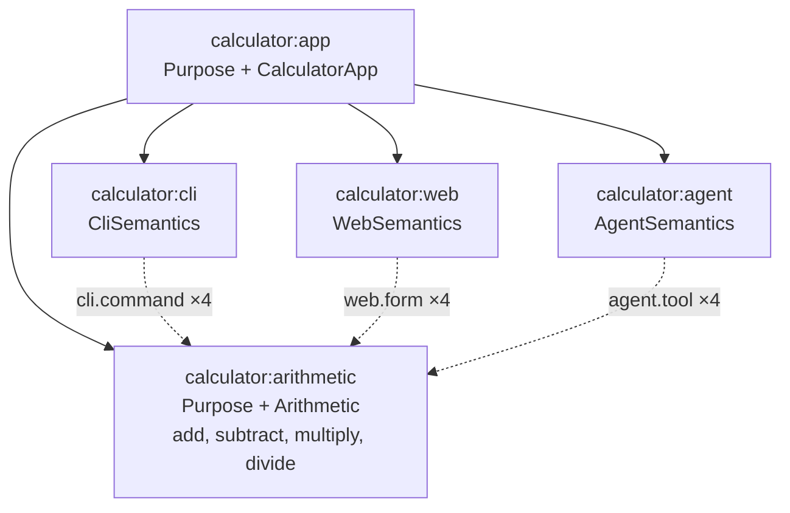

# Contract: `@telos/calculator`

Package `apps/calculator`, name `@telos/calculator`, private. Dependencies (exact, `workspace:*` for workspace packages): `@telos/kernel`, `@telos/cli`, `@telos/agent`, `@telos/web`, `effect` 4.0.4. Export map: `{ ".": "./src/index.ts", "./package.json": "./package.json" }`. The main entry is browser-safe. Only `bin/*.ts` import `@telos/cli/bun`, `@telos/agent/mcp` or `@telos/agent/client`.

## Semantic model



Solid lines are containment, dotted lines are relations to the four capabilities.

## errors.ts (WP13)

```ts
export class DivisionByZero extends Schema.TaggedError<DivisionByZero>()("DivisionByZero", { message: Schema.String }) {}
export class NonFiniteResult extends Schema.TaggedError<NonFiniteResult>()("NonFiniteResult", { message: Schema.String }) {}
export const DIVISION_BY_ZERO_MESSAGE = "Division by zero is not defined."
export const NON_FINITE_MESSAGE = "The result is not a finite number."
```

## arithmetic.ts (WP13)

```ts
export const Operands = Schema.Struct({ a: Schema.Finite, b: Schema.Finite })
export const Result = Schema.Struct({ result: Schema.Finite })
export const Arithmetic: Extension<"calculator.arithmetic", {}>
// description "Marks a Locus that performs binary arithmetic on finite numbers."; archetypes [ArithmeticBehavior]
export const add: Capability       // errors [NonFiniteResult]; effect "pure"; a + b
export const subtract: Capability  // errors [NonFiniteResult]; effect "pure"; a - b
export const multiply: Capability  // errors [NonFiniteResult]; effect "pure"; a * b
export const divide: Capability    // errors [DivisionByZero, NonFiniteResult]; effect "pure"; b === 0 -> DivisionByZero, else a / b
export const arithmetic: LocusDefinition  // id "calculator:arithmetic", kind Locus.extend(Purpose, Arithmetic)
```

- Each handler computes `r` and fails with `new NonFiniteResult({ message: NON_FINITE_MESSAGE })` when `!Number.isFinite(r)`. Otherwise it returns `{ result: r }`.
- `divide` checks `b === 0` first (this also covers `-0`).
- Descriptions: `"Adds b to a."`, `"Subtracts b from a."`, `"Multiplies a by b."`, `"Divides a by b."`.
- `arithmetic` properties:
  - `purpose: "Performs the four basic arithmetic operations on finite numbers."`
  - `responsibilities: ["add", "subtract", "multiply", "divide", "report division by zero and non-finite results"]`
  - `excluded: ["parsing text input", "presentation"]`
- NFR-008: the Extension, the four capabilities and the Locus definition fit in at most 80 lines, excluding comments and the arithmetic expressions. There are no explicit type annotations at call sites.

## archetypes.ts (WP13)

```ts
export const ArithmeticBehavior: Archetype   // id "calculator.arithmetic-behavior", appliesTo ["calculator.arithmetic"]
```

Rules. Execution rules call kernel `invoke(ctx.model, CapabilityRef.make(ctx.locus.id, name), input, { via: ctx.locus.id })`.

| Rule id | Method | Passes when |
| --- | --- | --- |
| `arithmetic.operations` | static | the Locus's capability names, sorted, are exactly `add, divide, multiply, subtract` |
| `arithmetic.pure` | static | every capability has effect `pure` |
| `arithmetic.examples` | execution | add {2,3} → 5; subtract {5,3} → 2; multiply {4,2.5} → 10; divide {7,2} → 3.5 |
| `arithmetic.division-by-zero` | execution | divide {1,0} fails with tag `DivisionByZero` and message `DIVISION_BY_ZERO_MESSAGE` |
| `arithmetic.non-finite` | execution | multiply {1e308,10} fails with tag `NonFiniteResult` |

## interfaces.ts (WP14)

```ts
export const calculatorCli: LocusDefinition    // id "calculator:cli", kind Locus.extend(CliSemantics), properties { program: "calculator" }
export const calculatorWeb: LocusDefinition    // id "calculator:web", kind Locus.extend(WebSemantics), properties { title: "Calculator" }
export const calculatorAgent: LocusDefinition  // id "calculator:agent", kind Locus.extend(AgentSemantics), properties { server: "telos-calculator" }
// each has 4 relations: <Type>.to(arithmetic.capability("add" | "subtract" | "multiply" | "divide")), in that order
export function interfaceLoci(target: LocusDefinition, names?: ReadonlyArray<string>): ReadonlyArray<LocusDefinition>
// builds the three interface Loci for any arithmetic-like target, exposing `names` (default all four); used by tests to build broken variants
```

The interface Loci declare **no** capabilities. The only implementation is on `calculator:arithmetic`.

## app.ts (WP14)

```ts
export const CalculatorApp: Extension<"calculator.app", {}>
// description "Marks the calculator application that groups the arithmetic Locus and its interfaces."; archetypes [CalculatorInterfaces]
export const CalculatorInterfaces: Archetype  // id "calculator.interfaces", appliesTo ["calculator.app"]
export const app: LocusDefinition             // id "calculator:app", Locus.extend(Purpose, CalculatorApp); contains [arithmetic, calculatorCli, calculatorWeb, calculatorAgent]
export const calculatorModel: SemanticModel   // buildModel(app)
export function makeApp(contains: ReadonlyArray<LocusDefinition>): LocusDefinition   // same kind and id; used by tests
```

`app` purpose: `"Proves that one arithmetic implementation serves a command line, a web page and agent tools."`.

CalculatorInterfaces rules. The arithmetic Locus is the contained Locus whose kind includes `calculator.arithmetic`, and the interface Loci are the contained Loci whose kind includes `telos.cli`, `telos.web` or `telos.agent`.

| Rule id | Method | Passes when |
| --- | --- | --- |
| `interfaces.complete` | static | each of the three interface Loci has a valid granting relation to every capability of the arithmetic Locus (checked with `describeCapability(...).exposedBy`) |
| `interfaces.single-implementation` | static | no Locus in the app other than the arithmetic Locus declares a capability |
| `interfaces.parity` | execution | for the four parity inputs below, `runCli` (text), `callTool` (JSON), `formModel(...).submit` (text) and `invoke` with `via` = the arithmetic Locus give the same normalized outcome |

Parity inputs: `add {a:"2",b:"3"}`, `divide {a:"1",b:"0"}`, `add {a:"x",b:"1"}`, `multiply {a:"1e308",b:"10"}`. The JSON form uses `Number(text)` when that is finite, and the text otherwise.

The normalized outcome is:

- `{ ok: true, output }`, or
- `{ ok: false, tag, message, paths }`, where `paths` is the sorted list of `issue.path.join(".")`.

For the CLI, it is parsed from the stdout or stderr line.

## index.ts (WP14)

Exports `Operands, Result, add, subtract, multiply, divide, DivisionByZero, NonFiniteResult, DIVISION_BY_ZERO_MESSAGE, NON_FINITE_MESSAGE, Arithmetic, ArithmeticBehavior, arithmetic, calculatorCli, calculatorWeb, calculatorAgent, interfaceLoci, CalculatorApp, CalculatorInterfaces, app, makeApp, calculatorModel`.

WP13 creates `index.ts` exporting only its own names, and WP14 extends it.

## Binaries (WP14)

| File | Behaviour |
| --- | --- |
| `bin/cli.ts` | `await runMain(calculatorModel, "calculator:cli", { version: <package.json version> })` |
| `bin/mcp.ts` | `await serveMcp(app, "calculator:agent", { version })` |
| `bin/agent-demo.ts` | the deterministic agent described below |

### Deterministic agent (`bin/agent-demo.ts`)

The agent needs no LLM and no credentials. It spawns `["bun", <absolute path of bin/mcp.ts>]` with `McpStdioClient.spawn`, then runs these steps. It prints one JSON line per step, `{ "step": <name>, "request": ..., "response": ... }`, to stdout:

1. `initialize`: server name `telos-calculator`.
2. `list-tools`: the names include `add, divide, multiply, subtract` and all six `telos_*` tools.
3. `discover`: `telos_capabilities {"id":"calculator:arithmetic"}`. It finds the capability named `add` and reads the required fields of its input schema (`a`, `b`).
4. `call-add`: `add` with `{a: 2, b: 3}` built from the discovered field names, using the fixed values a=2 and b=3. Expect `{ result: 5 }`.
5. `call-divide-by-zero`: `divide {a:1,b:0}`. Expect `isError` with tag `DivisionByZero`.
6. `call-invalid`: `add {a:"x",b:1}`. Expect `isError` with tag `InvalidInput`.
7. `impact`: `telos_impact {"target":"calculator:arithmetic#add"}`. Expect the affected set to include `calculator:cli`, `calculator:web` and `calculator:agent`.

The last line is `{"ok":true}` and the exit code is 0 when every expectation held. Otherwise the last line is `{"ok":false,"failed":[<step names>]}` and the exit code is 1. The client is always closed.

### Root scripts (WP14 adds to the root `package.json` `scripts`)

```json
"calculator": "bun apps/calculator/bin/cli.ts",
"calculator:mcp": "bun apps/calculator/bin/mcp.ts",
"calculator:agent-demo": "bun apps/calculator/bin/agent-demo.ts"
```

## Shared case table (`apps/calculator/test/cases.ts`, WP14)

```ts
export interface Case {
  readonly name: string
  readonly capability: "add" | "subtract" | "multiply" | "divide"
  readonly text: Readonly<Record<string, string>>     // CLI flags and web fields
  readonly json: Readonly<Record<string, unknown>>    // agent arguments and kernel input
  readonly expected: { readonly ok: true; readonly output: { readonly result: number } } | { readonly ok: false; readonly tag: string; readonly paths: ReadonlyArray<string> }
  readonly exitCode: 0 | 1 | 2
}
export const CASES: ReadonlyArray<Case>
```

| # | name | capability | text | json | expected | exit |
| --- | --- | --- | --- | --- | --- | --- |
| 1 | add integers | add | a=2 b=3 | {a:2,b:3} | 5 | 0 |
| 2 | subtract | subtract | a=5 b=3 | {a:5,b:3} | 2 | 0 |
| 3 | multiply decimal | multiply | a=4 b=2.5 | {a:4,b:2.5} | 10 | 0 |
| 4 | divide | divide | a=7 b=2 | {a:7,b:2} | 3.5 | 0 |
| 5 | add negatives | add | a=-1.5 b=0.5 | {a:-1.5,b:0.5} | -1 | 0 |
| 6 | divide negative | divide | a=-6 b=3 | {a:-6,b:3} | -2 | 0 |
| 7 | subtract zeros | subtract | a=0 b=0 | {a:0,b:0} | 0 | 0 |
| 8 | divide by zero | divide | a=1 b=0 | {a:1,b:0} | DivisionByZero | 1 |
| 9 | zero by zero | divide | a=0 b=0 | {a:0,b:0} | DivisionByZero | 1 |
| 10 | overflow | multiply | a=1e308 b=10 | {a:1e308,b:10} | NonFiniteResult | 1 |
| 11 | non-numeric | add | a=x b=1 | {a:"x",b:1} | InvalidInput, paths ["a"] | 2 |
| 12 | missing operand | add | a=1 | {a:1} | InvalidInput, paths ["b"] | 2 |
| 13 | empty operand | subtract | a="" b=1 | {a:"",b:1} | InvalidInput, paths ["a"] | 2 |
| 14 | divide quarter | divide | a=10 b=4 | {a:10,b:4} | 2.5 | 0 |

CLI argv for a case: `[capability, ...Object.entries(text).flatMap(([k, v]) => ["--" + k, v])]`.

## Tests (`apps/calculator/test/`)

| File | WP | Asserts |
| --- | --- | --- |
| `arithmetic.test.ts` | WP13 | each capability through `invoke` with `via` = `calculator:arithmetic`, including both errors; the kind has no composition conflicts |
| `archetypes.test.ts` | WP13 | each ArithmeticBehavior rule passes on `arithmetic` and fails on a broken variant (only `add`; a `write` capability; a handler returning a wrong result; `divide` without the zero check; `multiply` without the finite check) |
| `interfaces.test.ts` | WP14 | `buildModel(app).diagnostics` is `[]`; every CASE gives the same normalized outcome through `invoke`, `runCli` (in memory), `callTool` and `formModel` |
| `app.test.ts` | WP14 | each CalculatorInterfaces rule passes on `app` and fails on `makeApp(...)` variants (cli missing `divide`; web missing `divide`, whose failure message names `calculator:web` and `divide` (US5.2); the web Locus declaring its own `add`; a parity break built with a fake interface Locus whose relation targets a different arithmetic Locus that returns a different message) |
| `verification.test.ts` | WP14 | `verify(calculatorModel, { runner: "test" })` has `summary.failed === 0` and `summary.error === 0`, and contains a finding for every rule of the five Archetypes that apply (ArithmeticBehavior, CliInterface, WebInterface, AgentInterface, CalculatorInterfaces) |
| `impact.test.ts` | WP14 | `impact(calculatorModel, "calculator:arithmetic#add").affected` loci are exactly `calculator:agent, calculator:cli, calculator:web` at distance 1; `checks` include the rules of CliInterface, WebInterface, AgentInterface (on the interface Loci), ArithmeticBehavior and CalculatorInterfaces (container). `diffModels` between `app` and a variant whose `add` output is `{ sum }` yields one `contract-changed` for `calculator:arithmetic` / `add` with a non-empty patch. US6.3: a model built with `makeApp([...app.contains, extra])`, where `extra` is a new `calculator:extra` Locus of kind `Locus.extend(CliSemantics)` with one `CliCommand.to(arithmetic.capability("add"))` relation, lists `calculator:extra` among the affected Loci for `calculator:arithmetic#add`, with no change to any calculator source |
| `cli-binary.test.ts` | WP14 | every CASE through `Bun.spawn(["bun", "bin/cli.ts", ...argv])`: exit code, stdout JSON on success, stderr JSON on failure; `--help` exits 0 |
| `mcp.test.ts` | WP14 | `McpStdioClient` on `bin/mcp.ts`: `tools/list` contains 4 calculator tools plus 6 `telos_*` tools; each tool's `inputSchema` equals the capability's input JSON Schema; every CASE through `callTool` matches `expected`; `telos_inspect {"id":"calculator:arithmetic"}` returns `structuredContent.output` deep-equal to `describeLocus(calculatorModel, "calculator:arithmetic")` (US4.3); `tools/call` with name `secret` (no such tool) rejects with `MCP error -32602: Tool 'secret' not found` (US4.4, see packs.md) |
| `agent-demo.test.ts` | WP14 | spawning `bin/agent-demo.ts` exits 0, and the last stdout line is `{"ok":true}` |
