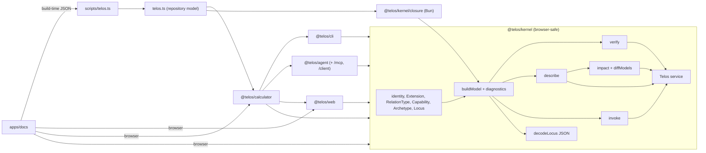
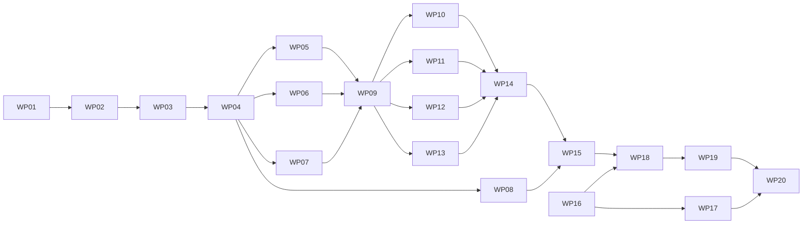

# Implementation Plan: Semantic Foundation Rebuild

**Branch**: `feat/semantic-foundation-rebuild` (planning base and merge target) | **Date**: 2026-10-22 | **Spec**: [spec.md](spec.md)
**Input**: Mission specification at `kitty-specs/semantic-foundation-rebuild-01M5JFR0/spec.md`

## Summary

Replace `@telos/locus` (fixed Locus, Charter, Fabric, closed relation kinds, spec runner) with:

- **`@telos/kernel`**: a minimal semantic kernel. It provides one universal `Locus` with composable `Extension`s, user-defined `RelationType`s, `Capability`s with Effect Schema contracts, `Archetype`s with static and execution rules, a checked `SemanticModel`, governed `invoke`, JSON descriptions with knowledge status, an Effect `Telos` introspection service, model comparison with change impact, JSON definition decoding, and a file-level Semantic Closure check.
- **Three Packs** built only on the kernel public API: `@telos/cli`, `@telos/agent` (MCP stdio server and a deterministic client) and `@telos/web` (form model).
- **`@telos/calculator`**: proves the design. One arithmetic Locus is exposed through three interface Loci, with calculator Archetypes.

The repository then describes itself in a root `telos.ts`. A `bun run telos` command and the review gate check that model: diagnostics, Archetype verification and closure. The documentation site gets a real inspector, a verification report, a kernel playground and the calculator page. The foundation documents, principles, terms and ADRs are rewritten or superseded.

All design choices that the directive leaves open are the defaults D1–D8 in the spec. The prototypes behind the risky choices are recorded in [research.md](research.md).

## Technical Context

**Language/Version**: TypeScript (TS 7 via `bun check -b`, project references), Bun 1.4.4-canary.1
**Primary Dependencies**: effect 4.0.4. Already installed modules used: `Schema`, `JsonPatch`, `Context`, `Layer`, `effect/cli`, `effect/ai` `McpServer`/`McpSchema`, and `effect/process` `ChildProcessSpawner`. The docs app keeps its pinned TanStack Start, React and Playwright. **No new or upgraded dependency.**
**Storage**: none. The model is built in memory from TypeScript definitions. Generated JSON for the docs site lives in `apps/docs/src/generated/` (git-ignored like today).
**Testing**: `bun test` for unit and integration tests, Playwright e2e for the site (`bun run test:e2e`), `grace lint --path . --assertions current`, and the new `bun run telos check`.
**Target Platform**: Bun (CLI, MCP server, closure, dev command). The kernel main entry, the Packs' main entries and the calculator main entry are also browser-safe (docs site).
**Project Type**: Bun workspace monorepo (`packages/*`, `apps/*`)
**Performance Goals**: NFR-003. Repository model build plus static rules under 2 s, and closure under 10 s.
**Constraints**: C-001..C-009. Every work package leaves `bun run verify` green. There are no compatibility aliases for removed names.
**Scale/Scope**: about 20 kernel and pack modules, 1 app, about 25 new or rewritten docs, and 20 work packages.

## Charter Check

| Charter directive / rule | Status | How the plan complies |
| --- | --- | --- |
| 001 architectural integrity, 032 conceptual alignment | Pass | One fundamental entity (Locus). The audit decisions in the spec are binding. Superseded ADRs are linked. |
| 003 decision documentation | Pass | New ADRs (WP17) record every design decision of this plan. |
| 010 specification fidelity | Pass | Every FR maps to work packages (see tasks). The contracts are quoted in the WP prompts. |
| 024 locality of change | Pass | Each WP owns a disjoint file set, with its own GRACE graph and verification documents. |
| 030 test and typecheck gate, 034 test-first, 041 tests as scaffold | Pass | Each WP writes its tests first, and `bun run verify` runs at the end of each WP. |
| 036 black-box integration testing | Pass | The calculator, MCP and CLI tests run real binaries and protocols (WP14). |
| 037 living documentation sync | Pass | Docs are derived from code (inspector, report, tool schemas). Prose docs are rewritten in WP16, WP17 and WP19. |
| 043 close defect classes by construction | Pass | Tool schemas and forms are derived, never written by hand, and the closure gate prevents unowned code. |
| 051 supply-chain install safety | Pass | No dependency is added or upgraded. WP01 runs `bun install` only to link workspaces, and `bun.lock` changes contain workspace entries only. |
| Model routing (AGENTS.md) | Pass | WPs are written for Haiku implementers, reviewed by Sonnet, with an Opus mission review after merge. |
| Owner decisions (AGENTS.md) | Pending owner | Spec decisions D1–D8, and approval of the spec and this plan before implementation. |

Re-checked after design: no violation. No complexity justification needed.

## Architecture



Key flows:

1. **Definition**: `Locus.extend(A, B).make({...})` decodes the properties against the merged schema. It is synchronous and never throws. Problems are recorded on the definition and appear as diagnostics.
2. **Model**: `buildModel(root)` traverses containment and reports diagnostics sorted by `compareDiagnostics`.
3. **Introspection**: `Telos.layer(root)` → `telos.resolve(id)` → `LocusView` methods return JSON descriptions.
4. **Invocation**: an interface calls `invoke(model, ref, rawInput, { via })`. The kernel checks the grant, decodes the input, runs the handler and encodes the output into an `InvocationOutcome`. The CLI, Web and Agent paths share it, so their errors are identical by construction.
5. **Verification**: `verify(model, options)` runs the rules of the applicable Archetypes (`appliesTo` ⊆ the Locus kind's extensions) and records a finding for each.
6. **Impact**: `diffModels(before, after)` compares contract digests and descriptions with `JsonPatch.get`. `impact(model, target)` follows incoming relations transitively and collects the rules that apply.
7. **Closure**: `checkClosure(model, options)` matches files to `Source` globs, resolves the most specific owner, scans imports with `Bun.Transpiler` and checks them against relations and `External` declarations.

## Project Structure

### Documentation (this mission)

```
kitty-specs/semantic-foundation-rebuild-01M5JFR0/
├── spec.md
├── plan.md
├── research.md
├── data-model.md
├── quickstart.md
├── contracts/
│   ├── kernel.md        # @telos/kernel and @telos/kernel/closure API
│   ├── packs.md         # @telos/cli, @telos/agent, @telos/web API
│   ├── calculator.md    # @telos/calculator Loci, Archetypes, binaries, test table
│   ├── repository.md    # telos.ts, scripts/telos.ts, gate wiring
│   ├── docs.md          # site data, routes, pages, documents to write
│   └── conventions.md   # GRACE markup, graph/verification layout, file and test conventions
├── research/owner-directive.md
└── tasks.md             # created by /spec-kitty.tasks
```

### Source Code (repository root)

```
telos.ts                          # repository root Locus (new)
scripts/
├── telos.ts                      # dev command: list | inspect | verify | closure | impact | check | report (new)
├── review-gate.ts                # gains the "telos:check" step
└── check-bun-version.ts          # unchanged
packages/
├── kernel/                       # @telos/kernel (new)
│   ├── src/{identity,freeze,canonical,digest,diagnostic,cycles,relation,capability,extension,archetype,locus,model,verify,describe,invoke,fields,impact,decode,introspection,closure,index}.ts
│   ├── src/extensions/{purpose,source}.ts
│   └── test/*.test.ts
├── cli/                          # @telos/cli Pack (new): src/{semantics,archetype,derive,run,environment,bun,index}.ts
├── agent/                        # @telos/agent Pack (new): src/{semantics,archetype,tools,introspection-tools,mcp,client,index}.ts
├── web/                          # @telos/web Pack (new): src/{semantics,archetype,form,index}.ts
└── locus/                        # REMOVED in WP19
apps/
├── calculator/                   # @telos/calculator (new)
│   ├── src/{arithmetic,errors,interfaces,archetypes,app,index}.ts
│   ├── bin/{cli,mcp,agent-demo}.ts
│   └── test/*.test.ts
└── docs/                         # existing site; playground, verification and inspector rebuilt
docs/                             # foundation, principles, terminology, decisions, guides rewritten
.grace/graph/*.xml, .grace/verification/*.xml   # split per area (WP01)
```

**Structure Decision**: a Bun workspace with one kernel package, three Pack packages and one app. Packs are ordinary packages (directive §7). The repository self-description is a root file, because it describes the repository rather than a package.

## Sequencing and parallelism

Every WP must leave `bun run verify` green, because the review gate runs the whole suite. Three rules follow from that:

- **WP01 creates every new workspace** (package manifests, tsconfig project references, export maps, workspace links in `bun.lock`) and splits `.grace/` into one graph document and one verification document per WP area. Later WPs then never edit the shared files `tsconfig.json`, `bun.lock` or the `.grace` index documents, except for their own `<Owns>` block. Parallel lanes therefore do not conflict.
- **Kernel modules are imported by relative path inside the kernel until WP09** writes the public `index.ts`. Parallel kernel WPs (WP05–WP08) never edit the same file.
- **The old package is removed last (WP19)**, after the docs site stops importing it. Until then the old tests keep passing unchanged.



WP16 (foundation docs) depends on nothing and runs alongside the code from the start. WP17 (decisions) follows WP16, because WP16 deletes the old terms and principles and fixes every link to them, including the links in ADRs; WP17 then rewrites the ADR content without touching the same lines in parallel.

## Implementation Concern Map

| Concern | Scope | Requirements |
| --- | --- | --- |
| IC-01 Workspace and knowledge layout | new workspaces, TS references, GRACE split per area | FR-030, NFR-006 |
| IC-02 Kernel foundations | identity, freeze, canonical JSON, digest, diagnostics, bounded cycle search (reused code) | FR-001, FR-008, NFR-002 |
| IC-03 Semantic definitions | Extension, RelationType, Capability, Archetype, Locus kinds, composition conflicts, Purpose/Source/External extensions | FR-001..FR-007, FR-009 |
| IC-04 Model and diagnostics | buildModel, containment, relation checks, cycles | FR-005, FR-006, FR-008 |
| IC-05 Verification | applicable Archetypes, rule execution, findings, report | FR-009, FR-010, FR-012 |
| IC-06 Description and invocation | JSON descriptions, contract digests, governed invoke | FR-007, FR-011..FR-013 |
| IC-07 JSON definitions | decodeLocus for playground and agents | FR-016 |
| IC-08 Semantic Closure | file ownership, imports, externals | FR-015 |
| IC-09 Introspection, impact, public API | Telos service, impact, diffModels, exports | FR-011, FR-014 |
| IC-10 Packs | CLI, Agent (MCP, client), Web | FR-017..FR-019 |
| IC-11 Calculator | arithmetic, interfaces, Archetypes, binaries, cross-interface tests | FR-020, FR-021, NFR-004 |
| IC-12 Self-description and gate | telos.ts, dev command, review gate | FR-022..FR-024 |
| IC-13 Documentation site | report, inspector, playground, calculator page, guides | FR-025, FR-026, FR-031 |
| IC-14 Doctrine and decisions | foundation docs, principles, terms, ADRs | FR-027, FR-028 |
| IC-15 Removal and coherence | delete the old package, sweep stale references | FR-029 |

## Verification strategy

- Each WP lists its own tests with exact names in its prompt. These are positive and negative cases for every diagnostic code and rule (NFR-005).
- Determinism tests build models with permuted declarations and compare JSON byte for byte (NFR-002).
- Interface parity: one shared table of 12+ cases in `apps/calculator/test/cases.ts`, run through the CLI binary (subprocess), the MCP server (subprocess with the deterministic client), the web form model and the kernel (NFR-004, SC-003).
- Browser: the playground e2e builds a model and runs static verification in Chromium (NFR-001, SC-008).
- Repository gate: `bun run telos check` in `verify` and in `scripts/review-gate.ts` CHECK_STEPS (FR-024, SC-007).
- GRACE: each WP registers its modules and verification entries in its own documents. `bun run grace:lint` runs inside verify.

## Risks

| Risk | Mitigation |
| --- | --- |
| Haiku misreads complex type-level composition | The exact generic signatures were prototyped and type-checked (research R2). They are quoted verbatim in contracts/kernel.md and in the WP03 prompt. |
| MCP library behavior | The low-level `McpServer.addTool` with a raw JSON Schema was prototyped. Plain objects must be used for `content` (research R6). |
| Lane merge conflicts on shared files | WP01 pre-creates every shared file. Each WP owns its own GRACE documents. |
| Docs e2e churn | Docs WPs are sequential (WP18 → WP19) and include their e2e updates. |
| `bun run verify` time grows | The closure and model checks are bounded by NFR-003. |

## Complexity Tracking

No charter violations.
