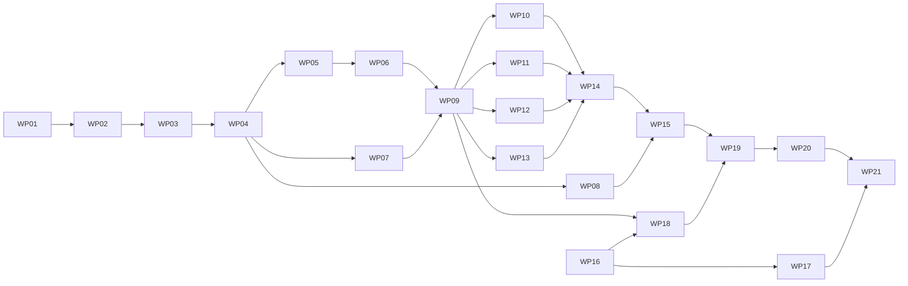

# Work Packages: Semantic Foundation Rebuild

**Inputs**: `kitty-specs/semantic-foundation-rebuild-01M5JFR0/` (spec.md, plan.md, research.md, data-model.md, contracts/, quickstart.md, research/owner-directive.md)
**Routing (AGENTS.md, owner rule)**: every WP is implemented by Claude Haiku (`claude-haiku-5-5`) in its own subagent, using the WP's `agent_profile`. Every WP is reviewed by `reviewer-renata` on Claude Sonnet. The mission review after merge runs on Claude Opus at high effort. After two rejections of one WP, the owner is asked before a stronger model is used.
**Rule**: each WP prompt is self-sufficient. It quotes the exact contracts, APIs, prototype code, file contents and acceptance tests it needs. The files in `contracts/` are authoritative: where a prompt and a contract disagree, the contract wins and the implementer reports the conflict.
**Branches**: planning base and merge target are both `feat/semantic-foundation-rebuild`. Execution worktrees come from `lanes.json`. Lanes never edit `kitty-specs/`.
**Gate**: every WP ends with `bun run verify` green (NFR-006). From WP15 on, `verify` also runs `bun run telos:check`. Every code WP keeps `.grace/` in sync inside its own area documents and passes `grace lint --path . --assertions current` (FR-030).

## Shared files

The ownership rule is no overlapping `owned_files`. A few files must be touched by more than one WP. Each has a single owner; the other WPs make a small, sanctioned edit that their prompt names and that they name in their commit body.

| File | Owner | Sanctioned edits by | Edit allowed |
| --- | --- | --- | --- |
| `package.json` (root) | WP01 | WP14, WP15 | WP14 adds the three `calculator*` scripts; WP15 adds `telos`, `telos:check` and appends `&& bun run telos:check` to `verify` |
| `tsconfig.json` (root), `bun.lock` | WP01 | WP20 | remove `packages/locus` references; `bun install` (workspace entries only) |
| `apps/docs/package.json` | WP01 | WP19, WP20 | WP19 the `semantic-report` and `build` scripts; WP20 removes `@telos/locus` |
| `apps/docs/test/manifest.test.ts` | WP01 | WP20 | remove `@telos/locus` from the approved list |
| `scripts/manifest.test.ts` | WP01 | WP20 | remove an `@telos/locus` entry from the package list only if one exists (WP01 lists the new packages only, so normally no edit) |
| `packages/{kernel,cli,agent,web}/src/index.ts`, `apps/calculator/src/index.ts` | WP09, WP10, WP11, WP12, WP14 | WP01, WP13 | WP01 creates each with `export {};`; WP13 writes the calculator index with its own names first |
| `packages/kernel/src/model.ts` | WP04 | WP03 | WP03 creates it with the three model interfaces only (needed by `archetype.ts` as `import type`) |
| `.grace/graph/<area>.xml`, `.grace/verification/<area>.xml` | the area WP (contracts/conventions.md table) | WP01; docs area: WP19, WP20; tooling area: WP20 | WP01 creates all 16 with the split script; WP19/WP20 add or rename their docs modules; WP20 drops legacy dependencies |
| `.grace/graph/index.xml`, `.grace/verification/index.xml` | WP01 | every code WP | change only the WP's own `GD-…` / `VD-…` `<Owns>` block; WP20 removes the legacy blocks |
| `telos.ts` | WP15 | WP19, WP20 | WP19 a relation only if a new cross-Locus import needs it; WP20 removes `telos:legacy-locus` and the relation to it |
| `apps/docs/src/routeTree.gen.ts` | WP18 | WP19, WP20 | regenerated by the router plugin during `bun run docs:build`; never hand-edited |
| `apps/docs/src/lib/content-types.ts`, `apps/docs/src/lib/prerender.ts`, `apps/docs/scripts/content.ts`, `apps/docs/e2e/machine-files.e2e.ts`, `apps/docs/e2e/navigation.e2e.ts`, `apps/docs/e2e/a11y.e2e.ts`, `apps/docs/e2e/provenance.e2e.ts` | WP19 | WP16, WP18, WP20 | WP16 ids of deleted documents in navigation.e2e.ts; WP18 removes the scenario pages and selectors and sets the Playground bullet; WP20 adds the calculator page |
| `apps/docs/test/content.test.ts`, `apps/docs/test/site.test.ts`, `apps/docs/test/search.test.ts` | WP16 | WP18, WP19, WP20 | the llms bullet of the WP's own page and its route rows |
| `apps/docs/e2e/search.e2e.ts`, `apps/docs/e2e/keyboard.e2e.ts` | WP18 | WP16 | WP16 ids of deleted documents in search.e2e.ts |
| `apps/docs/src/components/verification-view.tsx` | WP19 | WP18 | links to removed playground pages |
| `docs/foundation/**` | WP16 | WP17, WP21 | WP17 the ADR-0018 link sentences and `related` entries; WP21 the term `maturity` lines and sentences that call an existing module planned |
| `docs/decisions/**` | WP17 | WP16, WP21 | WP16 `related` ids and link targets to deleted documents only; WP21 two sentences of ADR-0015 |
| `docs/guides/**` | WP20 | WP16 | `related` ids and link targets to deleted documents only |
| `docs/research/**` | none (history) | WP16 | link targets to deleted documents only; never prose |
| any other file naming a removed concept | its owner | WP21 | the stale sentence only, outside research history, mission records, superseded ADRs and owner-only files |

**Deviations recorded during task generation**

- The plan's draft had 20 WPs; the docs site work is now three sequential WPs (WP18 playground, WP19 semantic report and inspector, WP20 calculator page, guides and removal), followed by the WP21 sweep. plan.md already shows the 21-WP graph.
- `packages/kernel/src/model.ts` is created by WP03 with the type interfaces only, because `archetype.ts` imports `SemanticModel` as a type. WP04 owns the file and adds the functions.
- Each package's `src/index.ts` is created by WP01 with `export {};`, because an empty TypeScript project fails with TS18003 (research R10). The content WP owns it.
- The 16 GRACE area documents are created empty by WP01 so that parallel lanes never edit the same XML file (research R8).
- `apps/docs/test/manifest.test.ts` pins the docs dependencies exactly, so WP01 adds `@telos/calculator`, `@telos/kernel` and `@telos/web` to it in the same commit as the manifest.
- `McpStdioClient` gets a public `readonly server` field holding the result of the `initialize` that `spawn` performs (WP11), because the agent demo (WP14) must report the server name and the contract's `spawn` already consumed that result. contracts/packs.md now shows the field.
- Where a contract names a rule or tool but not its description or violation message, the WP prompt fixes the exact text (Pack Archetypes, introspection tool descriptions), so tests can assert it.
- `telos:tooling` declares `packages: ["effect"]`, because `scripts/telos.ts` runs kernel Effects and the closure check would otherwise report `closure.unknown-external` (WP15). contracts/repository.md now shows this.
- Owner decision (2026-10-24, analysis finding I1): the root `package.json` declares `"effect": "4.0.4"` next to the three workspace links (WP01), because `scripts/telos.ts` imports `effect` and Bun's isolated installs do not expose a package to the root unless the root declares it. The version is the one already pinned in `bun.lock`.
- Owner decision (2026-10-24, analysis finding U1): every `ClosureFinding` carries `knowledge`: `"unknown"` for `closure.dynamic-import`, `"derived"` for every other code (WP08; WP19 shows the badge).
- Owner decision (2026-10-24, analysis finding C1): US4 AC4 now reads "MCP reports the tool as not found, and an in-process call through the agent is refused with `NotGranted`", which is what WP11 and WP14 test.
- WP01's sanctioned creations (the five `src/index.ts` files and the 16 GRACE area documents) stay out of WP01's `owned_files`: listing them there would make WP01 overlap with WP02–WP15 and WP18–WP20 and collapse those lanes into one. WP01 commits them itself before `move-task`, because the move-task auto-commit refuses files outside `owned_files`.
- The playground result union carries a `kind` discriminator (`"decode-error"` or `"built"`) so the UI and tests can switch on it (WP18). contracts/docs.md now shows it.
- WP16 changes link targets in `docs/research/**` that point to deleted documents (link integrity), but never research prose. WP18 changes one link in a docs test fixture.
- WP16 writes every term with `maturity: proposed`, because the code is not on its branch. WP21 raises the terms whose code exists to `implemented`, and lists the code file for each.
- The existing docs code has a `ci` provenance origin. The repository has no CI workflow, so WP19 removes it and the site shows two origins only: `bun-build` (the semantic report written at build time) and `browser` (the playground). plan.md records this. The CI origin can come back when the owner adds a workflow.
- The first-locus guide quotes `apps/docs/test/guide-snippets.ts`, a typed file with its own test (WP20), so every TypeScript block in the guides is compiled and run code. The guide tests run the calculator commands with `bun run --silent`, because `bun run` echoes the command to stderr.
- The unit-test semantic report fixture is `apps/docs/test/semantic-report-fixture.ts`, not under `test/fixtures/`, because the closure check excludes `test/fixtures/**` and an import into it would be unresolved (WP19).
- `README.md` is empty today. WP21 writes a short README (overview, links, workspace, commands).
- WP21 edits two sentences of the accepted ADR-0015 (the `@telos/locus` example and the Charter note), because SC-006 allows the removed names only in superseded ADRs.
- Owned paths that do not exist yet are listed literally (spec-kitty `create_intent`); globs are used only for directories that already exist.

## Subtask Index

| ID | Description | WP | Parallel |
| --- | --- | --- | --- |
| T001 | Write the five package scaffolds (package.json, tsconfig.json, test/tsconfig.json, src/index.ts) | WP01 |  |
| T002 | Update root package.json, root tsconfig.json, apps/docs/package.json and its manifest test; run bun install | WP01 |  |
| T003 | Add scripts/manifest.test.ts for the new workspace manifests | WP01 |  |
| T004 | Split .grace graph and verification into one document per area | WP01 |  |
| T005 | Run bun run verify and record the results | WP01 |  |
| T006 | Write failing tests for identity, freeze, canonical, digest, diagnostic and cycles | WP02 |  |
| T007 | Implement identity.ts and freeze.ts | WP02 | [P] |
| T008 | Implement canonical.ts and digest.ts | WP02 | [P] |
| T009 | Implement diagnostic.ts | WP02 | [P] |
| T010 | Implement cycles.ts (copied bounded cycle search plus elementaryCycles) | WP02 | [P] |
| T011 | Register M-KERNEL-IDENTITY, M-KERNEL-CANONICAL and M-KERNEL-DIAGNOSTIC in GRACE | WP02 |  |
| T012 | Write failing tests for relation, capability, archetype, extension, locus and the built-in extensions | WP03 |  |
| T013 | Implement relation.ts and capability.ts | WP03 |  |
| T014 | Implement archetype.ts, extension.ts and the model.ts type bootstrap | WP03 |  |
| T015 | Implement locus.ts (composition, conflicts, make) | WP03 |  |
| T016 | Implement extensions/purpose.ts and extensions/source.ts | WP03 |  |
| T017 | Add types.test.ts with compile-time @ts-expect-error checks | WP03 |  |
| T018 | Register M-KERNEL-DEFINITIONS in GRACE | WP03 |  |
| T019 | Write failing tests: one positive and one negative test per diagnostic code | WP04 |  |
| T020 | Implement traversal, identity and ownership checks | WP04 |  |
| T021 | Implement per-Locus checks: composition, properties, capability names | WP04 |  |
| T022 | Implement relation checks | WP04 |  |
| T023 | Implement cycle checks, maps, sorting, freezing, incoming, outgoing, ancestors, hasErrors | WP04 |  |
| T024 | Add the determinism test and register M-KERNEL-MODEL in GRACE | WP04 |  |
| T025 | Write failing verification tests | WP05 |  |
| T026 | Implement applicableArchetypes | WP05 |  |
| T027 | Implement rule execution and outcomes | WP05 |  |
| T028 | Implement report sorting, summary, provenance and the now option | WP05 |  |
| T029 | Register M-KERNEL-VERIFY in GRACE | WP05 |  |
| T030 | Write failing describe tests | WP06 |  |
| T031 | Implement describe.ts: toJsonSchema, describeCapability, describeLocus, describeModel | WP06 |  |
| T032 | Implement describeVerifications | WP06 |  |
| T033 | Implement invoke.ts with tests for every error tag | WP06 | [P] |
| T034 | Implement fields.ts with tests | WP06 | [P] |
| T035 | Register M-KERNEL-DESCRIBE and M-KERNEL-INVOKE in GRACE | WP06 |  |
| T036 | Write failing decode tests | WP07 |  |
| T037 | Implement LocusJsonSchema (recursive) | WP07 |  |
| T038 | Implement decodeLocus | WP07 |  |
| T039 | Implement decodeLocusText and issue paths | WP07 |  |
| T040 | Add the parity test: JSON and code definitions give the same diagnostics | WP07 |  |
| T041 | Register M-KERNEL-DECODE in GRACE | WP07 |  |
| T042 | Write failing closure tests with temporary fixture repositories | WP08 |  |
| T043 | Implement scope, claims and owners | WP08 |  |
| T044 | Implement import scanning and resolution | WP08 |  |
| T045 | Implement externals, the dependency rule and dynamic imports | WP08 |  |
| T046 | Add CLOSURE_LIMITS, sorting and hasClosureErrors | WP08 |  |
| T047 | Register M-KERNEL-CLOSURE in GRACE | WP08 |  |
| T048 | Write failing introspection tests | WP09 |  |
| T049 | Implement the Telos service | WP09 |  |
| T050 | Implement impact | WP09 | [P] |
| T051 | Implement diffModels | WP09 | [P] |
| T052 | Write index.ts and api.test.ts (exact export list, browser-safe imports) | WP09 |  |
| T053 | Register M-KERNEL-INTROSPECTION, M-KERNEL-IMPACT and M-KERNEL-API in GRACE | WP09 |  |
| T054 | Write the fixture model and failing tests | WP10 |  |
| T055 | Implement semantics.ts, derive.ts and environment.ts | WP10 |  |
| T056 | Implement run.ts | WP10 |  |
| T057 | Implement bun.ts | WP10 |  |
| T058 | Implement archetype.ts | WP10 |  |
| T059 | Write index.ts and register M-PACK-CLI in GRACE | WP10 |  |
| T060 | Write the fixture model, fixture server and failing tests | WP11 |  |
| T061 | Implement tools.ts | WP11 |  |
| T062 | Implement introspection-tools.ts | WP11 |  |
| T063 | Implement mcp.ts | WP11 |  |
| T064 | Implement client.ts | WP11 |  |
| T065 | Implement semantics.ts and archetype.ts | WP11 |  |
| T066 | Add grant.test.ts (discovery never grants invocation) | WP11 |  |
| T067 | Write index.ts and register M-PACK-AGENT and M-PACK-AGENT-MCP in GRACE | WP11 |  |
| T068 | Write the fixture model and failing tests | WP12 |  |
| T069 | Implement form.ts | WP12 |  |
| T070 | Implement semantics.ts and archetype.ts | WP12 |  |
| T071 | Write index.ts and register M-PACK-WEB in GRACE | WP12 |  |
| T072 | Write failing arithmetic and Archetype tests | WP13 |  |
| T073 | Implement errors.ts and arithmetic.ts with the ARITHMETIC_LOCUS block and the NFR-008 test | WP13 |  |
| T074 | Implement archetypes.ts | WP13 |  |
| T075 | Update index.ts and register M-CALC-ARITHMETIC in GRACE | WP13 |  |
| T076 | Write the shared case table and the in-memory interface test | WP14 |  |
| T077 | Implement interfaces.ts | WP14 |  |
| T078 | Implement app.ts with the CALCULATOR_APP block and CalculatorInterfaces | WP14 |  |
| T079 | Complete index.ts | WP14 |  |
| T080 | Add the binaries, root scripts and binary tests | WP14 |  |
| T081 | Implement bin/agent-demo.ts and its test | WP14 |  |
| T082 | Add verification and impact tests | WP14 |  |
| T083 | Register M-CALC-INTERFACES in GRACE | WP14 |  |
| T084 | Write failing tests for the telos command | WP15 |  |
| T085 | Write telos.ts with the docs externals procedure | WP15 |  |
| T086 | Implement the scripts/telos.ts commands | WP15 |  |
| T087 | Implement report and SemanticReport | WP15 |  |
| T088 | Wire telos:check into verify and the review gate | WP15 |  |
| T089 | Register M-REPOSITORY-MODEL and M-TELOS-COMMAND in GRACE | WP15 |  |
| T090 | Replace the 16 principles and the principles README | WP16 | [P] |
| T091 | Delete, rewrite and add terminology documents and the README | WP16 | [P] |
| T092 | Rewrite the other foundation documents and add future-semantic-evolution.md | WP16 | [P] |
| T093 | Fix every link and related id to deleted documents across docs/ | WP16 |  |
| T094 | Update docs tests and e2e ids that name removed documents | WP16 |  |
| T095 | Update .grace/context/principles.xml and requirements.xml | WP16 |  |
| T096 | Run bun run verify and record the results | WP16 |  |
| T097 | Write ADR-0018 (accepted) recording the owner directive | WP17 |  |
| T098 | Write ADR-0019 to ADR-0023 | WP17 | [P] |
| T099 | Write ADR-0024 to ADR-0028 | WP17 | [P] |
| T100 | Mark the superseded ADRs | WP17 |  |
| T101 | Update the decisions README and run bun run verify | WP17 |  |
| T102 | Rewrite registry.ts and add examples.ts | WP18 |  |
| T103 | Implement run.ts and its unit test | WP18 |  |
| T104 | Build the playground UI and the /playground route | WP18 |  |
| T105 | Delete the old scenario files, regenerate routeTree and update route lists | WP18 |  |
| T106 | Rewrite playground.e2e.ts, update other e2e selectors and delete equality.e2e.ts | WP18 |  |
| T107 | Update the Playground llms bullet everywhere | WP18 |  |
| T108 | Rewrite M-DOCS-PLAYGROUND in GRACE | WP18 |  |
| T109 | Run bun run verify and record the results | WP18 |  |
| T110 | Add the semantic-report script, package scripts and gitignore entry | WP19 |  |
| T111 | Rewrite build-data.ts, generated.ts, build.ts and provenance.ts for the semantic report | WP19 |  |
| T112 | Update check-verification.ts | WP19 |  |
| T113 | Add locus-slug.ts and update prerender.ts, vite.config.ts and the navigation | WP19 |  |
| T114 | Write the inspector and verification components | WP19 |  |
| T115 | Write the inspector and verification routes | WP19 |  |
| T116 | Write and update unit tests; delete the spec-report tests | WP19 |  |
| T117 | Update e2e tests and the llms bullets | WP19 |  |
| T118 | Rename M-DOCS-SPEC-REPORT and add M-DOCS-INSPECTOR in GRACE | WP19 |  |
| T119 | Run bun run verify and confirm no @telos/locus import outside the guides tests | WP19 |  |
| T120 | Add the /calculator page, navigation entry and e2e test | WP20 |  |
| T121 | Rewrite the four guides with checked examples | WP20 |  |
| T122 | Rewrite guide-examples.test.ts and guides.test.ts | WP20 |  |
| T123 | Delete packages/locus and every reference, then bun install | WP20 |  |
| T124 | Remove the legacy GRACE area and add M-DOCS-CALCULATOR | WP20 |  |
| T125 | Run bun run verify and the removal grep | WP20 |  |
| T126 | Run the stale-reference grep sweep | WP21 |  |
| T127 | Fix stale references | WP21 |  |
| T128 | Cross-check docs, GRACE and the telos model for consistency | WP21 |  |
| T129 | Run the full gate, grace lint and telos check; record SC-006 evidence | WP21 |  |

## Phase 1 – Foundations

### WP01 – Workspace scaffolds and GRACE area layout

**Prompt**: [tasks/WP01-workspace-and-grace-layout.md](tasks/WP01-workspace-and-grace-layout.md) · **Profile**: `implementer-ivan` · **Depends on**: none · **Requirements**: FR-030, NFR-006, C-002

**Goal**: Create every new workspace, the TypeScript project references, the workspace links in bun.lock and the per-area GRACE documents, so that later WPs never edit shared files.

**Independent test**: `bun run verify` passes; `bun test scripts/manifest.test.ts` passes; `grace lint --path . --assertions current` passes with 16 area documents and no main.xml.

**Subtasks** (completion is recorded with `spec-kitty agent tasks mark-status`):

T001 Write the five package scaffolds (package.json, tsconfig.json, test/tsconfig.json, src/index.ts) (WP01)
T002 Update root package.json, root tsconfig.json, apps/docs/package.json and its manifest test; run bun install (WP01)
T003 Add scripts/manifest.test.ts for the new workspace manifests (WP01)
T004 Split .grace graph and verification into one document per area (WP01)
T005 Run bun run verify and record the results (WP01)

**Sketch**: Write files exactly as quoted, run `bun run format`, `bun install`, run the split script, verify.

**Parallel**: Runs first. WP16 can run at the same time (no shared files).

**Risks**: bun.lock must change only by workspace entries (C-002). The split must move the 12 existing modules unchanged.

## Phase 2 – Kernel

### WP02 – Kernel foundations: identity, freeze, canonical JSON, digest, diagnostics, cycles

**Prompt**: [tasks/WP02-kernel-foundations.md](tasks/WP02-kernel-foundations.md) · **Profile**: `implementer-ivan` · **Depends on**: WP01 · **Requirements**: FR-001, FR-008, NFR-002

**Goal**: Provide the kernel's reused base modules with exact behaviour and tests.

**Independent test**: `bun test packages/kernel/test` passes; digestOf({a:1}) equals the quoted test vector; a complete 6-node digraph reports exceeded.

**Subtasks** (completion is recorded with `spec-kitty agent tasks mark-status`):

T006 Write failing tests for identity, freeze, canonical, digest, diagnostic and cycles (WP02)
T007 Implement identity.ts and freeze.ts (WP02)
T008 Implement canonical.ts and digest.ts (WP02)
T009 Implement diagnostic.ts (WP02)
T010 Implement cycles.ts (copied bounded cycle search plus elementaryCycles) (WP02)
T011 Register M-KERNEL-IDENTITY, M-KERNEL-CANONICAL and M-KERNEL-DIAGNOSTIC in GRACE (WP02)

**Sketch**: Tests first, then copy the legacy code where the contract says so, then GRACE.

**Parallel**: Sequential after WP01. Its four implementation subtasks touch different files.

**Risks**: Copying legacy code with its old names; the copied cycle search must keep its semantics.

### WP03 – Kernel definitions: relation types, capabilities, Archetypes, extensions, Locus

**Prompt**: [tasks/WP03-kernel-definitions.md](tasks/WP03-kernel-definitions.md) · **Profile**: `implementer-ivan` · **Depends on**: WP02 · **Requirements**: FR-001, FR-002, FR-003, FR-004, FR-006, FR-007, FR-009

**Goal**: Provide the definition API: Locus kinds composed from extensions, relation types, capabilities and Archetypes, with typed properties and composition conflicts.

**Independent test**: `bun test packages/kernel/test` and `bun run typecheck` pass, including every `@ts-expect-error` in types.test.ts.

**Subtasks** (completion is recorded with `spec-kitty agent tasks mark-status`):

T012 Write failing tests for relation, capability, archetype, extension, locus and the built-in extensions (WP03)
T013 Implement relation.ts and capability.ts (WP03)
T014 Implement archetype.ts, extension.ts and the model.ts type bootstrap (WP03)
T015 Implement locus.ts (composition, conflicts, make) (WP03)
T016 Implement extensions/purpose.ts and extensions/source.ts (WP03)
T017 Add types.test.ts with compile-time @ts-expect-error checks (WP03)
T018 Register M-KERNEL-DEFINITIONS in GRACE (WP03)

**Sketch**: Copy the type-checked prototype code quoted in the prompt, add the contract details, test.

**Parallel**: Sequential after WP02.

**Risks**: Type-level composition is subtle; the prototype is quoted verbatim and must not be simplified.

### WP04 – Kernel semantic model and structural diagnostics

**Prompt**: [tasks/WP04-kernel-model.md](tasks/WP04-kernel-model.md) · **Profile**: `implementer-ivan` · **Depends on**: WP03 · **Requirements**: FR-005, FR-006, FR-008, NFR-002, NFR-005

**Goal**: Build a checked, frozen SemanticModel from a root Locus with every structural diagnostic code.

**Independent test**: `bun test packages/kernel/test/model*.test.ts` passes; every diagnostic code has a reported and a not-reported test; permuted declarations give byte-identical JSON.

**Subtasks** (completion is recorded with `spec-kitty agent tasks mark-status`):

T019 Write failing tests: one positive and one negative test per diagnostic code (WP04)
T020 Implement traversal, identity and ownership checks (WP04)
T021 Implement per-Locus checks: composition, properties, capability names (WP04)
T022 Implement relation checks (WP04)
T023 Implement cycle checks, maps, sorting, freezing, incoming, outgoing, ancestors, hasErrors (WP04)
T024 Add the determinism test and register M-KERNEL-MODEL in GRACE (WP04)

**Sketch**: Tests per code first, then the algorithm steps 1-6 in order.

**Parallel**: Sequential after WP03. WP05, WP07 and WP08 start after it.

**Risks**: Message texts must match exactly; sort order must use code-unit comparison.

### WP05 – Kernel Archetype verification

**Prompt**: [tasks/WP05-kernel-verify.md](tasks/WP05-kernel-verify.md) · **Profile**: `implementer-ivan` · **Depends on**: WP04 · **Requirements**: FR-009, FR-010, NFR-005

**Goal**: Run applicable Archetype rules per Locus and report passed, failed and error findings with provenance.

**Independent test**: `bun test packages/kernel/test/verify.test.ts` passes, covering passed, failed, error (defect and thrown), method filters and Locus filters.

**Subtasks** (completion is recorded with `spec-kitty agent tasks mark-status`):

T025 Write failing verification tests (WP05)
T026 Implement applicableArchetypes (WP05)
T027 Implement rule execution and outcomes (WP05)
T028 Implement report sorting, summary, provenance and the now option (WP05)
T029 Register M-KERNEL-VERIFY in GRACE (WP05)

**Sketch**: Tests first; one sequential loop over sorted Loci, Archetypes and rules under Effect.exit.

**Parallel**: Parallel with WP07 and WP08 (different files).

**Risks**: A thrown exception inside a rule must become `error`, never stop the run.

### WP06 – Kernel descriptions, governed invocation and input fields

**Prompt**: [tasks/WP06-kernel-describe-invoke.md](tasks/WP06-kernel-describe-invoke.md) · **Profile**: `implementer-ivan` · **Depends on**: WP05 · **Requirements**: FR-007, FR-011, FR-012, FR-013

**Goal**: Describe Loci, capabilities and verification state as JSON with knowledge status, invoke capabilities only through grants, and derive input fields shared by every interface.

**Independent test**: `bun test packages/kernel/test/{describe,invoke,fields}.test.ts` passes; every invocation error tag has a test.

**Subtasks** (completion is recorded with `spec-kitty agent tasks mark-status`):

T030 Write failing describe tests (WP06)
T031 Implement describe.ts: toJsonSchema, describeCapability, describeLocus, describeModel (WP06)
T032 Implement describeVerifications (WP06)
T033 Implement invoke.ts with tests for every error tag (WP06)
T034 Implement fields.ts with tests (WP06)
T035 Register M-KERNEL-DESCRIBE and M-KERNEL-INVOKE in GRACE (WP06)

**Sketch**: Describe first (invoke and fields depend on CapabilityDescription), then invoke and fields.

**Parallel**: After WP05. Parallel with WP07 and WP08.

**Risks**: Digests must be computed over canonical JSON of exactly the documented objects.

### WP07 – Kernel JSON definition decoding

**Prompt**: [tasks/WP07-kernel-decode.md](tasks/WP07-kernel-decode.md) · **Profile**: `implementer-ivan` · **Depends on**: WP04 · **Requirements**: FR-016

**Goal**: Decode Locus definitions given as JSON against a registry of extensions, never evaluating them.

**Independent test**: `bun test packages/kernel/test/decode.test.ts` passes, including unknown extension, unknown relation type, JSON syntax error and the parity test.

**Subtasks** (completion is recorded with `spec-kitty agent tasks mark-status`):

T036 Write failing decode tests (WP07)
T037 Implement LocusJsonSchema (recursive) (WP07)
T038 Implement decodeLocus (WP07)
T039 Implement decodeLocusText and issue paths (WP07)
T040 Add the parity test: JSON and code definitions give the same diagnostics (WP07)
T041 Register M-KERNEL-DECODE in GRACE (WP07)

**Sketch**: Structural schema first, then mapping to Locus.extend(...).make, then the text entry point.

**Parallel**: Parallel with WP05/WP06 and WP08.

**Risks**: Recursive schema with Schema.suspend; issue paths must be strings like `contains/0/relations/1/type`.

### WP08 – Kernel Semantic Closure check (Bun)

**Prompt**: [tasks/WP08-kernel-closure.md](tasks/WP08-kernel-closure.md) · **Profile**: `implementer-ivan` · **Depends on**: WP04 · **Requirements**: FR-012, FR-015

**Goal**: Check that every managed file has exactly one Locus owner and that cross-Locus imports follow declared relations and externals.

**Independent test**: `bun test packages/kernel/test/closure.test.ts` passes; each of the seven closure codes has a fixture that triggers it and one that does not.

**Subtasks** (completion is recorded with `spec-kitty agent tasks mark-status`):

T042 Write failing closure tests with temporary fixture repositories (WP08)
T043 Implement scope, claims and owners (WP08)
T044 Implement import scanning and resolution (WP08)
T045 Implement externals, the dependency rule and dynamic imports (WP08)
T046 Add CLOSURE_LIMITS, sorting and hasClosureErrors (WP08)
T047 Register M-KERNEL-CLOSURE in GRACE (WP08)

**Sketch**: Fixtures in mkdtemp directories built by the test; Bun.Glob and Bun.Transpiler.scanImports.

**Parallel**: Parallel with WP05/WP06 and WP07.

**Risks**: Never commit fixture repositories; resolve paths with forward slashes.

### WP09 – Kernel introspection service, impact, model comparison and public API

**Prompt**: [tasks/WP09-kernel-introspection-api.md](tasks/WP09-kernel-introspection-api.md) · **Profile**: `implementer-ivan` · **Depends on**: WP06, WP07 · **Requirements**: FR-011, FR-014, NFR-001

**Goal**: Expose the kernel through the Telos Effect service, compute change impact and model differences, and publish the exact public API.

**Independent test**: `bun test packages/kernel/test` passes; api.test.ts proves the export list equals the contract and that the main entry imports no platform module.

**Subtasks** (completion is recorded with `spec-kitty agent tasks mark-status`):

T048 Write failing introspection tests (WP09)
T049 Implement the Telos service (WP09)
T050 Implement impact (WP09)
T051 Implement diffModels (WP09)
T052 Write index.ts and api.test.ts (exact export list, browser-safe imports) (WP09)
T053 Register M-KERNEL-INTROSPECTION, M-KERNEL-IMPACT and M-KERNEL-API in GRACE (WP09)

**Sketch**: Service over describe/verify/invoke; BFS for impact; JsonPatch.get for diffs; index last.

**Parallel**: Sequential after WP06 and WP07. WP10-WP13 and WP18 start after it.

**Risks**: The export list must match exactly; closure.ts must not be re-exported.

## Phase 3 – Packs

### WP10 – CLI Pack @telos/cli

**Prompt**: [tasks/WP10-pack-cli.md](tasks/WP10-pack-cli.md) · **Profile**: `implementer-ivan` · **Depends on**: WP09 · **Requirements**: FR-017

**Goal**: Derive command-line subcommands from the capabilities a CLI Locus exposes and run them through kernel invoke.

**Independent test**: `bun test packages/cli/test` passes; every CliInterface rule has a passing and a failing test.

**Subtasks** (completion is recorded with `spec-kitty agent tasks mark-status`):

T054 Write the fixture model and failing tests (WP10)
T055 Implement semantics.ts, derive.ts and environment.ts (WP10)
T056 Implement run.ts (WP10)
T057 Implement bun.ts (WP10)
T058 Implement archetype.ts (WP10)
T059 Write index.ts and register M-PACK-CLI in GRACE (WP10)

**Sketch**: Follow the module order rule; quote the in-memory environment prototype.

**Parallel**: Parallel with WP11, WP12 and WP13.

**Risks**: effect/cli help goes to Console; only assert exit codes for help.

### WP11 – Agent Pack @telos/agent (tools, MCP server, deterministic client)

**Prompt**: [tasks/WP11-pack-agent.md](tasks/WP11-pack-agent.md) · **Profile**: `implementer-ivan` · **Depends on**: WP09 · **Requirements**: FR-018, NFR-007

**Goal**: Derive agent tools from exposed capabilities, serve them with read-only introspection tools over MCP stdio, and provide a deterministic client.

**Independent test**: `bun test packages/agent/test` passes, including a subprocess MCP round trip and the grant test.

**Subtasks** (completion is recorded with `spec-kitty agent tasks mark-status`):

T060 Write the fixture model, fixture server and failing tests (WP11)
T061 Implement tools.ts (WP11)
T062 Implement introspection-tools.ts (WP11)
T063 Implement mcp.ts (WP11)
T064 Implement client.ts (WP11)
T065 Implement semantics.ts and archetype.ts (WP11)
T066 Add grant.test.ts (discovery never grants invocation) (WP11)
T067 Write index.ts and register M-PACK-AGENT and M-PACK-AGENT-MCP in GRACE (WP11)

**Sketch**: Pure derivation first, then the MCP layer from the prototype, then the client.

**Parallel**: Parallel with WP10, WP12 and WP13.

**Risks**: MCP content must be plain objects; never use McpServer.toolkit.

### WP12 – Web Pack @telos/web (form model)

**Prompt**: [tasks/WP12-pack-web.md](tasks/WP12-pack-web.md) · **Profile**: `implementer-ivan` · **Depends on**: WP09 · **Requirements**: FR-019

**Goal**: Derive a UI-independent form model from the capabilities a web Locus exposes, submitting through kernel invoke.

**Independent test**: `bun test packages/web/test` passes; every WebInterface rule has a passing and a failing test.

**Subtasks** (completion is recorded with `spec-kitty agent tasks mark-status`):

T068 Write the fixture model and failing tests (WP12)
T069 Implement form.ts (WP12)
T070 Implement semantics.ts and archetype.ts (WP12)
T071 Write index.ts and register M-PACK-WEB in GRACE (WP12)

**Sketch**: Form derivation over describeCapability and inputFields; Archetype rules.

**Parallel**: Parallel with WP10, WP11 and WP13.

**Risks**: No React or DOM import in the Pack.

## Phase 4 – Calculator

### WP13 – Calculator arithmetic Locus and behaviour Archetype

**Prompt**: [tasks/WP13-calculator-arithmetic.md](tasks/WP13-calculator-arithmetic.md) · **Profile**: `implementer-ivan` · **Depends on**: WP09 · **Requirements**: FR-020, FR-021, NFR-008

**Goal**: Define the one arithmetic implementation with its errors and behaviour rules.

**Independent test**: `bun test apps/calculator/test` passes; ergonomics.test.ts proves the definition block has at most 80 counted lines.

**Subtasks** (completion is recorded with `spec-kitty agent tasks mark-status`):

T072 Write failing arithmetic and Archetype tests (WP13)
T073 Implement errors.ts and arithmetic.ts with the ARITHMETIC_LOCUS block and the NFR-008 test (WP13)
T074 Implement archetypes.ts (WP13)
T075 Update index.ts and register M-CALC-ARITHMETIC in GRACE (WP13)

**Sketch**: Errors, then the Locus inside the named block, then rules.

**Parallel**: Parallel with WP10, WP11 and WP12 (kernel only).

**Risks**: Keep the definition inside START_BLOCK_ARITHMETIC_LOCUS; WP20 quotes it.

### WP14 – Calculator interfaces, app, binaries and cross-interface tests

**Prompt**: [tasks/WP14-calculator-interfaces.md](tasks/WP14-calculator-interfaces.md) · **Profile**: `implementer-ivan` · **Depends on**: WP10, WP11, WP12, WP13 · **Requirements**: FR-020, FR-021, NFR-004, NFR-007

**Goal**: Expose the arithmetic Locus through CLI, Web and Agent interface Loci and prove they agree.

**Independent test**: `bun test apps/calculator/test` passes; the 14 cases agree through kernel, CLI, MCP and web form; the agent demo exits 0.

**Subtasks** (completion is recorded with `spec-kitty agent tasks mark-status`):

T076 Write the shared case table and the in-memory interface test (WP14)
T077 Implement interfaces.ts (WP14)
T078 Implement app.ts with the CALCULATOR_APP block and CalculatorInterfaces (WP14)
T079 Complete index.ts (WP14)
T080 Add the binaries, root scripts and binary tests (WP14)
T081 Implement bin/agent-demo.ts and its test (WP14)
T082 Add verification and impact tests (WP14)
T083 Register M-CALC-INTERFACES in GRACE (WP14)

**Sketch**: Case table first; interfaces; app and Archetype; binaries; end-to-end tests.

**Parallel**: After WP10-WP13.

**Risks**: Subprocess tests need absolute paths and 20 s timeouts.

## Phase 5 – Repository gate

### WP15 – Repository self-description, telos command and gate

**Prompt**: [tasks/WP15-repository-gate.md](tasks/WP15-repository-gate.md) · **Profile**: `implementer-ivan` · **Depends on**: WP14, WP08 · **Requirements**: FR-022, FR-023, FR-024, NFR-003

**Goal**: Describe the repository as a Telos model and make the model, verification and closure part of the gate.

**Independent test**: `bun test scripts` passes; `bun run telos check` exits 0; `bun run verify` includes telos:check and passes.

**Subtasks** (completion is recorded with `spec-kitty agent tasks mark-status`):

T084 Write failing tests for the telos command (WP15)
T085 Write telos.ts with the docs externals procedure (WP15)
T086 Implement the scripts/telos.ts commands (WP15)
T087 Implement report and SemanticReport (WP15)
T088 Wire telos:check into verify and the review gate (WP15)
T089 Register M-REPOSITORY-MODEL and M-TELOS-COMMAND in GRACE (WP15)

**Sketch**: Model, command, report, wiring.

**Parallel**: After WP14 and WP08.

**Risks**: Closure findings on the real repository must be fixed by declarations, not by excluding files.

## Phase 6 – Doctrine

### WP16 – Foundation documents, principles and terminology

**Prompt**: [tasks/WP16-foundation-documents.md](tasks/WP16-foundation-documents.md) · **Profile**: `curator-carla` · **Depends on**: none · **Requirements**: FR-027

**Goal**: Rewrite the doctrine for the new model: 16 principles, the new terms, the foundation README, conceptual model and future concepts.

**Independent test**: `bun run verify` passes (content build checks every related id and link); `bun test apps/docs/test` passes.

**Subtasks** (completion is recorded with `spec-kitty agent tasks mark-status`):

T090 Replace the 16 principles and the principles README (WP16)
T091 Delete, rewrite and add terminology documents and the README (WP16)
T092 Rewrite the other foundation documents and add future-semantic-evolution.md (WP16)
T093 Fix every link and related id to deleted documents across docs/ (WP16)
T094 Update docs tests and e2e ids that name removed documents (WP16)
T095 Update .grace/context/principles.xml and requirements.xml (WP16)
T096 Run bun run verify and record the results (WP16)

**Sketch**: Write documents from the spec's Domain Language and the contract tables, then fix links, then tests.

**Parallel**: Starts at once, in parallel with all code WPs.

**Risks**: Never write 'verified' or 'passing' in Status or Maturity front matter; never edit content inside apps/docs.

### WP17 – Architecture decision records ADR-0018 to ADR-0028

**Prompt**: [tasks/WP17-decisions.md](tasks/WP17-decisions.md) · **Profile**: `curator-carla` · **Depends on**: WP16 · **Requirements**: FR-028

**Goal**: Record the new design decisions and mark every replaced ADR as superseded with a link.

**Independent test**: `bun run verify` passes; every superseded ADR has `status: superseded` and the link line.

**Subtasks** (completion is recorded with `spec-kitty agent tasks mark-status`):

T097 Write ADR-0018 (accepted) recording the owner directive (WP17)
T098 Write ADR-0019 to ADR-0023 (WP17)
T099 Write ADR-0024 to ADR-0028 (WP17)
T100 Mark the superseded ADRs (WP17)
T101 Update the decisions README and run bun run verify (WP17)

**Sketch**: One ADR per row of the decisions table.

**Parallel**: After WP16; parallel with all code WPs and WP18-WP20.

**Risks**: Do not change the text of superseded ADRs except the status and the link line.

## Phase 7 – Documentation site

### WP18 – Documentation playground on the real kernel

**Prompt**: [tasks/WP18-docs-playground.md](tasks/WP18-docs-playground.md) · **Profile**: `frontend-freddy` · **Depends on**: WP09, WP16 · **Requirements**: FR-026, NFR-001

**Goal**: Replace the old scenario playground with one page where readers run JSON Locus definitions through the real kernel in the browser.

**Independent test**: `bun run verify` passes; playground.e2e.ts runs every example in Chromium.

**Subtasks** (completion is recorded with `spec-kitty agent tasks mark-status`):

T102 Rewrite registry.ts and add examples.ts (WP18)
T103 Implement run.ts and its unit test (WP18)
T104 Build the playground UI and the /playground route (WP18)
T105 Delete the old scenario files, regenerate routeTree and update route lists (WP18)
T106 Rewrite playground.e2e.ts, update other e2e selectors and delete equality.e2e.ts (WP18)
T107 Update the Playground llms bullet everywhere (WP18)
T108 Rewrite M-DOCS-PLAYGROUND in GRACE (WP18)
T109 Run bun run verify and record the results (WP18)

**Sketch**: Registry and examples, run function, UI, deletions, tests.

**Parallel**: After WP09 and WP16; parallel with WP10-WP15 and WP17.

**Risks**: The playground safety scan forbids innerHTML, eval and dynamic import in src/playground.

### WP19 – Documentation semantic report, inspector and verification page

**Prompt**: [tasks/WP19-docs-semantic-report.md](tasks/WP19-docs-semantic-report.md) · **Profile**: `frontend-freddy` · **Depends on**: WP15, WP18 · **Requirements**: FR-012, FR-025

**Goal**: Show the real repository model and verification on the site, built from `bun run telos report` at build time.

**Independent test**: `bun run verify` passes; inspector.e2e.ts and navigation.e2e.ts pass.

**Subtasks** (completion is recorded with `spec-kitty agent tasks mark-status`):

T110 Add the semantic-report script, package scripts and gitignore entry (WP19)
T111 Rewrite build-data.ts, generated.ts, build.ts and provenance.ts for the semantic report (WP19)
T112 Update check-verification.ts (WP19)
T113 Add locus-slug.ts and update prerender.ts, vite.config.ts and the navigation (WP19)
T114 Write the inspector and verification components (WP19)
T115 Write the inspector and verification routes (WP19)
T116 Write and update unit tests; delete the spec-report tests (WP19)
T117 Update e2e tests and the llms bullets (WP19)
T118 Rename M-DOCS-SPEC-REPORT and add M-DOCS-INSPECTOR in GRACE (WP19)
T119 Run bun run verify and confirm no @telos/locus import outside the guides tests (WP19)

**Sketch**: Pipeline, data reader, slug and routes, components, tests.

**Parallel**: After WP15 and WP18; parallel with WP17.

**Risks**: Do not import root scripts from the app; spawn the command.

### WP20 – Calculator page, guides and removal of @telos/locus

**Prompt**: [tasks/WP20-docs-calculator-guides-removal.md](tasks/WP20-docs-calculator-guides-removal.md) · **Profile**: `frontend-freddy` · **Depends on**: WP19 · **Requirements**: FR-026, FR-029, FR-031

**Goal**: Add the calculator web page, rewrite the guides with checked examples, and remove the old package completely.

**Independent test**: `bun run verify` passes; `git grep -n '@telos/locus'` finds nothing outside the allowed history paths.

**Subtasks** (completion is recorded with `spec-kitty agent tasks mark-status`):

T120 Add the /calculator page, navigation entry and e2e test (WP20)
T121 Rewrite the four guides with checked examples (WP20)
T122 Rewrite guide-examples.test.ts and guides.test.ts (WP20)
T123 Delete packages/locus and every reference, then bun install (WP20)
T124 Remove the legacy GRACE area and add M-DOCS-CALCULATOR (WP20)
T125 Run bun run verify and the removal grep (WP20)

**Sketch**: Page, guides, tests, removal, GRACE.

**Parallel**: After WP19; parallel with WP17.

**Risks**: The Vite browser bundle must not pull Bun-only entries; stop and report if the calculator main entry fails to bundle.

## Phase 8 – Coherence

### WP21 – Final coherence sweep

**Prompt**: [tasks/WP21-coherence-sweep.md](tasks/WP21-coherence-sweep.md) · **Profile**: `curator-carla` · **Depends on**: WP20, WP17 · **Requirements**: FR-029, FR-030, NFR-006

**Goal**: Leave a coherent repository: no stale names, consistent docs, GRACE and model, and a green gate.

**Independent test**: `bun run verify` passes; the SC-006 grep finds nothing outside allowed paths.

**Subtasks** (completion is recorded with `spec-kitty agent tasks mark-status`):

T126 Run the stale-reference grep sweep (WP21)
T127 Fix stale references (WP21)
T128 Cross-check docs, GRACE and the telos model for consistency (WP21)
T129 Run the full gate, grace lint and telos check; record SC-006 evidence (WP21)

**Sketch**: Grep, fix, cross-check, verify.

**Parallel**: Last.

**Risks**: Do not rewrite history documents; do not edit owner-only files.

## Dependency graph

## Parallel groups

| Group | Runs together | Starts after |
| --- | --- | --- |
| A | WP01 (code chain) and WP16 (doctrine) | nothing |
| B | WP17 | WP16; runs alongside all code and docs-site WPs |
| C | WP05 → WP06, WP07, WP08 | WP04 |
| D | WP10, WP11, WP12, WP13 | WP09 |
| E | WP18 | WP09 and WP16; runs alongside group D, WP14 and WP15 |
| F | WP19 → WP20 | WP15 and WP18 |
| G | WP21 | WP20 and WP17 |

Critical path: WP01 → WP02 → WP03 → WP04 → WP05 → WP06 → WP09 → (WP10…WP13) → WP14 → WP15 → WP19 → WP20 → WP21.

**MVP**: WP01 to WP09 deliver User Stories 1, 2 and 5 at kernel level (definitions, introspection, verification). WP10 to WP14 deliver User Stories 3, 4 and 6 (the calculator through three interfaces and its impact). WP15 delivers User Story 7 and the gate. WP16 to WP21 deliver User Stories 8 and 9.

## Requirement coverage

| Requirement | Work packages |
| --- | --- |
| FR-001 | WP02, WP03 |
| FR-002, FR-003, FR-004 | WP03 |
| FR-005 | WP04 |
| FR-006 | WP03, WP04 |
| FR-007 | WP03, WP06 |
| FR-008 | WP02, WP04 |
| FR-009 | WP03, WP05 |
| FR-010 | WP05 |
| FR-011 | WP06, WP09 |
| FR-012 | WP06, WP08 (`unknown` on closure findings), WP19 (knowledge badges) |
| FR-013 | WP06 |
| FR-014 | WP09 |
| FR-015 | WP08 |
| FR-016 | WP07 |
| FR-017 | WP10 |
| FR-018 | WP11 |
| FR-019 | WP12 |
| FR-020, FR-021 | WP13, WP14 |
| FR-022, FR-023, FR-024 | WP15 |
| FR-025 | WP19 |
| FR-026 | WP18, WP20 |
| FR-027 | WP16 |
| FR-028 | WP17 |
| FR-029 | WP20, WP21 |
| FR-030 | WP01, WP21 (and every code WP's GRACE subtask) |
| FR-031 | WP20 |
| NFR-001 | WP09, WP18 |
| NFR-002 | WP02, WP04 |
| NFR-003 | WP15 |
| NFR-004 | WP14 |
| NFR-005 | WP04, WP05 |
| NFR-006 | WP01, WP21 (every WP ends green) |
| NFR-007 | WP11, WP14 |
| NFR-008 | WP13 |
| C-001 | WP01 (stack and pinned versions); every code WP (conventions.md "Code": TypeScript, Effect 4.0.4 APIs only, Bun) |
| C-002 | WP01 (the root `effect` 4.0.4 dependency is owner-approved and already pinned in `bun.lock`); every WP (rule "No new dependencies") |
| C-003 | WP03, WP04 (every specialization is a Locus with extensions); WP20 (removes `packages/locus`) |
| C-004 | WP20, WP21 (removed names deleted, no aliases); every code WP (conventions.md "Code") |
| C-005 | WP06, WP11, WP12 (descriptions, tool schemas and forms derived from definitions); WP15, WP19 (semantic report and inspector derived from `telos.ts`) |
| C-006 | WP16, WP17, WP20 (content written in `docs/`); WP19 (site reads generated data only) |
| C-007 | every WP (Spec Kitty lifecycle, GRACE subtask, Conventional Commits without AI attribution) |
| C-008 | WP11, WP14 (the agent pack serves tools and introspection only; no autonomous change agent or authority delegation) |
| C-009 | every WP (conventions.md "Code": comments and messages in English); WP16, WP17, WP20 (documentation) |

## Owner decisions before implementation

The owner approves the spec (with D1–D8), the plan and these work packages before WP01 starts. Open questions with recommendations are listed in the planning report to the owner; none of them blocks the task structure.
