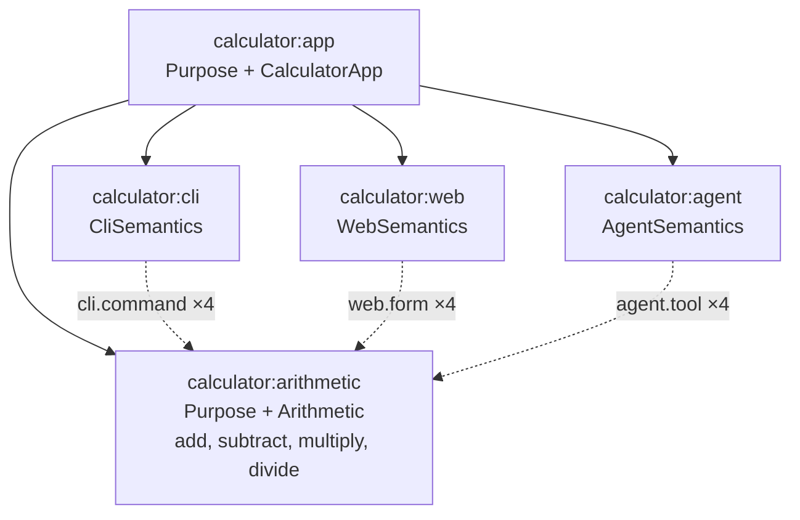

# Work Package Prompt: WP13 – Calculator arithmetic Locus and behaviour Archetype

## Do This First: Load Agent Profile

Use the `/ad-hoc-profile-load` skill to load the agent profile named in the frontmatter, and behave according to its guidance before you read the rest of this prompt.

- **Profile**: `implementer-ivan`
- **Role**: `implementer`
- **Agent/tool**: `claude` (model `claude-haiku-5-5`)

If the profile cannot be loaded, run `spec-kitty agent profile list` and pick the closest implementer profile.

---

## Important: Review Feedback

Check `spec-kitty agent tasks status --mission semantic-foundation-rebuild-01M5JFR0` and the review feedback of this WP before you start. If the WP was rejected before, address every point of the feedback first.

---

## Objective

Write the one arithmetic implementation of the calculator app (`apps/calculator`, `@telos/calculator`): its errors, the `calculator:arithmetic` Locus with four pure capabilities, and the `ArithmeticBehavior` Archetype that checks it. The definition is the showcase of the authoring API (NFR-008): it must stay short and need no type annotations.

The app scaffold (`package.json`, `tsconfig.json`, `test/tsconfig.json`, `src/index.ts` containing `export {};`) exists from WP01. This WP imports only `@telos/kernel` and `effect`; the Packs come in WP14.

## Context

> Quoted from `kitty-specs/semantic-foundation-rebuild-01M5JFR0/contracts/calculator.md` (authoritative).

# Contract: `@telos/calculator`

Package `apps/calculator`, name `@telos/calculator`, private. Dependencies (exact, `workspace:*` for workspace packages): `@telos/kernel`, `@telos/cli`, `@telos/agent`, `@telos/web`, `effect` 4.0.4. Export map: `{ ".": "./src/index.ts", "./package.json": "./package.json" }`. The main entry is browser-safe. Only `bin/*.ts` import `@telos/cli/bun`, `@telos/agent/mcp` or `@telos/agent/client`.

## Semantic model



Solid lines are containment, dotted lines are relations to the four capabilities.

## errors.ts (WP13)

```ts
export class DivisionByZero extends Schema.TaggedError<DivisionByZero>()("DivisionByZero", { message: Schema.String }) {}
export class NonFiniteResult extends Schema.TaggedError<NonFiniteResult>()("NonFiniteResult", { message: Schema.String }) {}
export const DIVISION_BY_ZERO_MESSAGE = "Division by zero is not defined."
export const NON_FINITE_MESSAGE = "The result is not a finite number."
```

## arithmetic.ts (WP13)

```ts
export const Operands = Schema.Struct({ a: Schema.Finite, b: Schema.Finite })
export const Result = Schema.Struct({ result: Schema.Finite })
export const Arithmetic: Extension<"calculator.arithmetic", {}>
// description "Marks a Locus that performs binary arithmetic on finite numbers."; archetypes [ArithmeticBehavior]
export const add: Capability       // errors [NonFiniteResult]; effect "pure"; a + b
export const subtract: Capability  // errors [NonFiniteResult]; effect "pure"; a - b
export const multiply: Capability  // errors [NonFiniteResult]; effect "pure"; a * b
export const divide: Capability    // errors [DivisionByZero, NonFiniteResult]; effect "pure"; b === 0 -> DivisionByZero, else a / b
export const arithmetic: LocusDefinition  // id "calculator:arithmetic", kind Locus.extend(Purpose, Arithmetic)
```

- Each handler computes `r` and fails with `new NonFiniteResult({ message: NON_FINITE_MESSAGE })` when `!Number.isFinite(r)`. Otherwise it returns `{ result: r }`.
- `divide` checks `b === 0` first (this also covers `-0`).
- Descriptions: `"Adds b to a."`, `"Subtracts b from a."`, `"Multiplies a by b."`, `"Divides a by b."`.
- `arithmetic` properties:
  - `purpose: "Performs the four basic arithmetic operations on finite numbers."`
  - `responsibilities: ["add", "subtract", "multiply", "divide", "report division by zero and non-finite results"]`
  - `excluded: ["parsing text input", "presentation"]`
- NFR-008: the Extension, the four capabilities and the Locus definition fit in at most 80 lines, excluding comments and the arithmetic expressions. There are no explicit type annotations at call sites.

## archetypes.ts (WP13)

```ts
export const ArithmeticBehavior: Archetype   // id "calculator.arithmetic-behavior", appliesTo ["calculator.arithmetic"]
```

Rules. Execution rules call kernel `invoke(ctx.model, CapabilityRef.make(ctx.locus.id, name), input, { via: ctx.locus.id })`.

| Rule id | Method | Passes when |
| --- | --- | --- |
| `arithmetic.operations` | static | the Locus's capability names, sorted, are exactly `add, divide, multiply, subtract` |
| `arithmetic.pure` | static | every capability has effect `pure` |
| `arithmetic.examples` | execution | add {2,3} → 5; subtract {5,3} → 2; multiply {4,2.5} → 10; divide {7,2} → 3.5 |
| `arithmetic.division-by-zero` | execution | divide {1,0} fails with tag `DivisionByZero` and message `DIVISION_BY_ZERO_MESSAGE` |
| `arithmetic.non-finite` | execution | multiply {1e308,10} fails with tag `NonFiniteResult` |

> Quoted from `kitty-specs/semantic-foundation-rebuild-01M5JFR0/contracts/calculator.md` (authoritative).

## Tests (`apps/calculator/test/`)

| File | WP | Asserts |
| --- | --- | --- |
| `arithmetic.test.ts` | WP13 | each capability through `invoke` with `via` = `calculator:arithmetic`, including both errors; the kind has no composition conflicts |
| `archetypes.test.ts` | WP13 | each ArithmeticBehavior rule passes on `arithmetic` and fails on a broken variant (only `add`; a `write` capability; a handler returning a wrong result; `divide` without the zero check; `multiply` without the finite check) |
| `interfaces.test.ts` | WP14 | `buildModel(app).diagnostics` is `[]`; every CASE gives the same normalized outcome through `invoke`, `runCli` (in memory), `callTool` and `formModel` |
| `app.test.ts` | WP14 | each CalculatorInterfaces rule passes on `app` and fails on `makeApp(...)` variants (cli missing `divide`; web missing `divide`, whose failure message names `calculator:web` and `divide` (US5.2); the web Locus declaring its own `add`; a parity break built with a fake interface Locus whose relation targets a different arithmetic Locus that returns a different message) |
| `verification.test.ts` | WP14 | `verify(calculatorModel, { runner: "test" })` has `summary.failed === 0` and `summary.error === 0`, and contains a finding for every rule of the five Archetypes that apply (ArithmeticBehavior, CliInterface, WebInterface, AgentInterface, CalculatorInterfaces) |
| `impact.test.ts` | WP14 | `impact(calculatorModel, "calculator:arithmetic#add").affected` loci are exactly `calculator:agent, calculator:cli, calculator:web` at distance 1; `checks` include the rules of CliInterface, WebInterface, AgentInterface (on the interface Loci), ArithmeticBehavior and CalculatorInterfaces (container). `diffModels` between `app` and a variant whose `add` output is `{ sum }` yields one `contract-changed` for `calculator:arithmetic` / `add` with a non-empty patch. US6.3: a model built with `makeApp([...app.contains, extra])`, where `extra` is a new `calculator:extra` Locus of kind `Locus.extend(CliSemantics)` with one `CliCommand.to(arithmetic.capability("add"))` relation, lists `calculator:extra` among the affected Loci for `calculator:arithmetic#add`, with no change to any calculator source |
| `cli-binary.test.ts` | WP14 | every CASE through `Bun.spawn(["bun", "bin/cli.ts", ...argv])`: exit code, stdout JSON on success, stderr JSON on failure; `--help` exits 0 |
| `mcp.test.ts` | WP14 | `McpStdioClient` on `bin/mcp.ts`: `tools/list` contains 4 calculator tools plus 6 `telos_*` tools; each tool's `inputSchema` equals the capability's input JSON Schema; every CASE through `callTool` matches `expected`; `telos_inspect {"id":"calculator:arithmetic"}` returns `structuredContent.output` deep-equal to `describeLocus(calculatorModel, "calculator:arithmetic")` (US4.3); `tools/call` with name `secret` (no such tool) rejects with `MCP error -32602: Tool 'secret' not found` (US4.4, see packs.md) |
| `agent-demo.test.ts` | WP14 | spawning `bin/agent-demo.ts` exits 0, and the last stdout line is `{"ok":true}` |

Kernel authoring API you use (from `@telos/kernel`): `Capability.make`, `Extension.make`, `Locus.extend(...).make`, `Purpose`, `Archetype.make`, `Rule.make`, `violation`, `invoke`, `CapabilityRef.make`, `buildModel`, `verify`.

> Quoted from `kitty-specs/semantic-foundation-rebuild-01M5JFR0/contracts/kernel.md` (authoritative).

## capability.ts (WP03)

```ts
export type EffectClass = "pure" | "read" | "write"
/** A TaggedError class schema with a `message: string` field, e.g. Schema.TaggedError<X>()("X", { message: Schema.String }). */
export type ErrorSchema = Schema.Codec<{ readonly _tag: string; readonly message: string }, any> & { readonly identifier: string }
export interface Capability<I = any, O = any, E = any> {
  readonly _tag: "Capability"
  readonly description: string
  readonly input: Schema.Codec<I, any>
  readonly output: Schema.Codec<O, any>
  readonly errors: ReadonlyArray<ErrorSchema>
  readonly effect: EffectClass
  readonly handler: ((input: I) => Effect.Effect<O, E>) | null
}
export const Capability: {
  make: <I, IE, O, OE, const Errs extends ReadonlyArray<ErrorSchema> = readonly []>(options: {
    readonly description: string
    readonly input: Schema.Codec<I, IE>
    readonly output: Schema.Codec<O, OE>
    readonly errors?: Errs
    readonly effect: EffectClass
    readonly handler: (input: I) => Effect.Effect<O, Errs[number]["Type"]>
  }) => Capability<I, O, Errs[number]["Type"]>
  /** A declared capability without implementation, used by decodeLocus; handler is null. */
  declare: (options: { readonly description: string; readonly input: Schema.Codec<any, any>; readonly output: Schema.Codec<any, any>; readonly errors?: ReadonlyArray<ErrorSchema>; readonly effect: EffectClass }) => Capability
}
export function errorTag(schema: ErrorSchema): string // schema.identifier
```

## archetype.ts (WP03)

```ts
export class RuleViolation extends Schema.TaggedError<RuleViolation>()("RuleViolation", { message: Schema.String }) {}
export type RuleMethod = "static" | "execution"
export interface RuleContext {
  readonly locus: LocusDefinition       // the Locus the rule is applied to
  readonly model: SemanticModel         // the whole model (for cross-Locus rules)
}
export interface Rule {
  readonly id: string                   // matches EXTENSION_ID_PATTERN, unique within its Archetype
  readonly description: string
  readonly method: RuleMethod
  readonly check: (ctx: RuleContext) => Effect.Effect<void, RuleViolation>
}
export interface Archetype {
  readonly _tag: "Archetype"
  readonly id: string                   // matches EXTENSION_ID_PATTERN
  readonly description: string
  readonly appliesTo: ReadonlyArray<string>   // extension ids, non-empty
  readonly rules: ReadonlyArray<Rule>
}
export const Rule: { make: (rule: Rule) => Rule }
export const Archetype: { make: (options: Omit<Archetype, "_tag">) => Archetype }
export const violation: (message: string) => Effect.Effect<never, RuleViolation> // Effect.fail(new RuleViolation({ message }))
```

`archetype.ts` imports `LocusDefinition` and `SemanticModel` with `import type` only, to avoid runtime cycles.

> Quoted from `kitty-specs/semantic-foundation-rebuild-01M5JFR0/contracts/kernel.md` (authoritative).

## invoke.ts (WP06)

```ts
export interface InvocationIssue { readonly path: ReadonlyArray<PropertyKey>; readonly message: string }
export interface InvocationError {
  readonly tag: string
  readonly message: string
  readonly issues: ReadonlyArray<InvocationIssue>   // [] unless tag is InvalidInput or InvalidOutput
}
export type InvocationOutcome =
  | { readonly ok: true; readonly output: unknown }          // encoded output (JSON-compatible)
  | { readonly ok: false; readonly error: InvocationError }
export interface InvokeOptions { readonly via: string }       // the Locus id performing the invocation
export function isGranted(model: SemanticModel, ref: CapabilityRef, via: string): boolean
export const invoke: (model: SemanticModel, ref: CapabilityRef | string, input: unknown, options: InvokeOptions) => Effect.Effect<InvocationOutcome>
```

Steps, in this order (messages are exact):

1. Parse `ref`. If it is a string without `#` → `CapabilityNotFound` `"Not a capability reference: <ref>."`.
2. Unknown Locus → `LocusNotFound` `"No Locus <locus> in the model."`.
3. Unknown capability → `CapabilityNotFound` `"Locus <locus> has no capability <name>."`.
4. `!isGranted` → `NotGranted` `"<via> is not granted to invoke <locus>#<name>."`. Granted when `via === ref.locus`, or some valid model relation has `from === via`, `type.grantsInvocation`, `target.locus === ref.locus` and `target.capability === ref.capability`.
5. Decode the input with `{ errors: "all" }`. On failure → `InvalidInput` `"Invalid input for <locus>#<name>."`, with `issues` from the standard-schema formatter.
6. `handler === null` → `NotImplemented` `"<locus>#<name> has no implementation."`.
7. Run the handler under `Effect.exit` (wrap it in `Effect.suspend` so synchronous throws become defects):
   - A `Fail` value matched by `Schema.is(errorSchema)` → `{ tag: value._tag, message: value.message, issues: [] }`.
   - Any other `Fail`, and any `Die` → `Defect` `"<locus>#<name> failed unexpectedly: <String(cause value)>."`.
8. Encode the output with `Schema.encodeUnknownExit(output)`. On failure → `InvalidOutput` `"<locus>#<name> returned output that does not match its contract."` with issues.
9. Return `{ ok: true, output: encoded }`.

## Rules for this work package

Read these rules before you write anything. They are part of the acceptance criteria.

1. **Baseline first.** Before you change a file, run `bun run verify` in your worktree and note the result of each step. If the baseline is not green, stop and report it; do not fix unrelated failures.
2. **Only your files.** Edit only the files in `owned_files` (frontmatter) and the sanctioned edits listed below. If you need any other change, stop and report it. Never edit `kitty-specs/**`, `AGENTS.md`, `CLAUDE.md`, `.kittify/**` or the charter.
3. **Contracts are exact.** Names, signatures, messages, ids and sort orders are copied from the quoted contracts. If an Effect API in a contract does not exist or behaves differently, stop and report it. Do not invent a replacement.
4. **Tests first.** Write the tests of a subtask before its implementation, run them and see them fail, then implement.
5. **No new dependencies** and no global installs. Do not run `bun add`. `bun install` is allowed only where this prompt says so.
6. **No fake work.** No placeholder code, no `TODO`, no skipped tests, no test that asserts nothing, no hard-coded counts of things that grow.
7. **Shell.** The shell is fish. Use `echo '-----'` as a separator, and pass paths explicitly instead of shell globs with `--include=*.ts`.
8. **Report exactly.** In your final message, list every check you ran and its exact result. Never claim a check passed that you did not run.

> Quoted from `kitty-specs/semantic-foundation-rebuild-01M5JFR0/contracts/conventions.md` (authoritative).

## Commands

| Purpose | Command |
| --- | --- |
| Full gate (run before handing a WP to review, and it must pass) | `bun run verify` |
| Fast loop while working | `bun run typecheck`, `bun test <paths>`, `bun run lint`, `bun run format` (writes), `bun run grace:lint` |
| One package's tests | `bun test packages/kernel/test` (example) |

`bun run verify` = `check:bun && format:check && lint && typecheck && test && docs:build && test:e2e && grace:lint`, plus `&& telos:check` from WP15 on. Report each step's result exactly. Never claim a step passed that you did not run.

## Code

- TypeScript, strict, using the repository `tsconfig.base.json`. Imports have **no** `.ts` extension. Use `import type` for types only.
- Format: run `bun run format` and follow its output. The repository uses double quotes, semicolons and trailing commas.
- Effect 4.0.4 APIs only, as quoted in the contracts. If an API in a contract does not exist, stop and report it. Do not invent a replacement.
- No new dependency, no upgrade, no global install (C-002). Workspace links already exist from WP01.
- No placeholder code, no `TODO` stubs, no tests that assert nothing, no skipped tests.
- No compatibility aliases for removed names (C-004).
- Comments and messages are in English (C-009). Diagnostic and error messages are exactly as written in the contracts.
- Determinism (NFR-002): sort with plain code-unit comparison (`a < b ? -1 : a > b ? 1 : 0`), never `localeCompare`. Never depend on object key insertion order from user input. Never use `Date.now()` or randomness in output except the `now` option of `verify`.

## Tests

- `bun:test` (`describe`, `test`, `expect`). Test files are `test/<module>.test.ts` next to the package's `src/`.
- Every diagnostic code, closure code and Archetype rule has at least one test where it is reported or fails, and one where it is not reported or passes (NFR-005). The test name names the code or rule id.
- Never hard-code counts of documents, files, Loci or findings that change as the repository grows. Assert membership, or compare with a value computed from the same source.
- No network and no credentials (NFR-007). Subprocess tests use `Bun.spawn(["bun", <absolute path>], ...)` with a 20 s test timeout.
- Fixtures are built in the test file or in `test/fixture.ts`. Never import another package's `test/` files.

> Quoted from `kitty-specs/semantic-foundation-rebuild-01M5JFR0/contracts/conventions.md` (authoritative).

## Git

- Spec Kitty creates your worktree and branch. Commit only inside it.
- Commit messages follow Conventional Commits 1.0.0: `feat(kernel): build the semantic model`, `docs(foundation): ...`, `test(cli): ...`.
- No AI names, and no author, co-author or session lines. The `.githooks/commit-msg` hook enforces this. Never use `--no-verify`.
- Never edit files that another WP owns (see each WP's "Owned files"). If a needed change falls outside your files, stop and report it.

**Sanctioned edits outside `owned_files`** (name each one in your commit body):

- Replace `apps/calculator/src/index.ts` (owned by WP14) with re-exports of this WP's names only.

## GRACE synchronisation (part of this WP)

Every source and test file you create carries GRACE markup, and your modules are registered in **your own** area documents in the same commit as the code. `bun run grace:lint` (`grace lint --path . --assertions current`) must pass.

> Quoted from `kitty-specs/semantic-foundation-rebuild-01M5JFR0/contracts/conventions.md` (authoritative).

## GRACE file markup

Every new `src/*.ts`, `bin/*.ts` and `scripts/*.ts` file starts with this header. Copy the shape from `scripts/review-gate.ts`:

```ts
// START_MODULE_CONTRACT
//   PURPOSE: <one sentence>
//   SCOPE: <what the file contains and what it never does>
//   DEPENDS: <module ids, comma-separated, or none>
//   LINKS: <M-ID>, <V-M-ID>
//   ROLE: RUNTIME
//   MAP_MODE: EXPORTS
// END_MODULE_CONTRACT
//
// START_MODULE_MAP
//   <exportName> - <short description>      (one line per export, every export, in file order)
// END_MODULE_MAP
```

Each exported function, constant or class has a contract block right above it:

```ts
// START_CONTRACT: <exportName>
//   PURPOSE: ...
//   INPUTS: { name: type - meaning, ... }
//   OUTPUTS: { type - meaning }
//   SIDE_EFFECTS: none | <what>
//   LINKS: <M-ID>
// END_CONTRACT: <exportName>
```

Exported types and interfaces need only the MODULE_MAP line. Test files use `ROLE: TEST` and `MAP_MODE: LOCALS`, and list their local helpers (or "none") in the map. Optional named regions use `// START_BLOCK_<NAME>` / `// END_BLOCK_<NAME>`. The guides quote these regions (contracts/docs.md).

## GRACE graph and verification layout (created by WP01)

WP01 replaces `graph/main.xml` and `verification/main.xml` with one document per area:

- It moves the existing modules unchanged into `tooling`, `legacy` and `docs`.
- It creates the other documents empty with `<Owns />`.
- It rewrites both index files to list every document.

A WP edits **only** its own area documents and its own `<GD-…>` / `<VD-…>` block in `graph/index.xml` and `verification/index.xml`.

| Area | Graph doc / id | Verification doc / id | Owner WP | Modules (graph id → paths) |
| --- | --- | --- | --- | --- |
| tooling | `graph/tooling.xml` `GD-TOOLING` | `verification/tooling.xml` `VD-TOOLING` | WP01 (move), WP15, WP20 | `M-BUN-VERSION-GUARD`, `M-REVIEW-GATE` (moved); WP15: `M-REPOSITORY-MODEL` → `telos.ts`, `M-TELOS-COMMAND` → `scripts/telos.ts` |
| legacy | `graph/legacy.xml` `GD-LEGACY` | `verification/legacy.xml` `VD-LEGACY` | WP01 (move), WP20 (delete) | the six `M-LOCUS-*` modules (moved) |
| docs | `graph/docs.xml` `GD-DOCS` | `verification/docs.xml` `VD-DOCS` | WP01 (move), WP18, WP19, WP20 | `M-DOCS-CONTENT`, `M-DOCS-SPEC-REPORT`, `M-DOCS-SITE`, `M-DOCS-PLAYGROUND` (moved); WP18: rewrite `M-DOCS-PLAYGROUND`; WP19: `M-DOCS-SPEC-REPORT` → `M-DOCS-SEMANTIC-REPORT`, add `M-DOCS-INSPECTOR`; WP20: add `M-DOCS-CALCULATOR` |
| kernel-base | `graph/kernel-base.xml` `GD-KERNEL-BASE` | `verification/kernel-base.xml` `VD-KERNEL-BASE` | WP02 | `M-KERNEL-IDENTITY` → identity.ts, freeze.ts; `M-KERNEL-CANONICAL` → canonical.ts, digest.ts; `M-KERNEL-DIAGNOSTIC` → diagnostic.ts, cycles.ts |
| kernel-definitions | `GD-KERNEL-DEFINITIONS` | `VD-KERNEL-DEFINITIONS` | WP03 | `M-KERNEL-DEFINITIONS` → relation.ts, capability.ts, extension.ts, archetype.ts, locus.ts, extensions/purpose.ts, extensions/source.ts |
| kernel-model | `GD-KERNEL-MODEL` | `VD-KERNEL-MODEL` | WP04 | `M-KERNEL-MODEL` → model.ts |
| kernel-verify | `GD-KERNEL-VERIFY` | `VD-KERNEL-VERIFY` | WP05 | `M-KERNEL-VERIFY` → verify.ts |
| kernel-describe | `GD-KERNEL-DESCRIBE` | `VD-KERNEL-DESCRIBE` | WP06 | `M-KERNEL-DESCRIBE` → describe.ts, fields.ts; `M-KERNEL-INVOKE` → invoke.ts |
| kernel-decode | `GD-KERNEL-DECODE` | `VD-KERNEL-DECODE` | WP07 | `M-KERNEL-DECODE` → decode.ts |
| kernel-closure | `GD-KERNEL-CLOSURE` | `VD-KERNEL-CLOSURE` | WP08 | `M-KERNEL-CLOSURE` → closure.ts |
| kernel-api | `GD-KERNEL-API` | `VD-KERNEL-API` | WP09 | `M-KERNEL-INTROSPECTION` → introspection.ts; `M-KERNEL-IMPACT` → impact.ts; `M-KERNEL-API` → index.ts |
| pack-cli | `GD-PACK-CLI` | `VD-PACK-CLI` | WP10 | `M-PACK-CLI` → all `packages/cli/src/*.ts` |
| pack-agent | `GD-PACK-AGENT` | `VD-PACK-AGENT` | WP11 | `M-PACK-AGENT` → semantics, archetype, tools, introspection-tools, index; `M-PACK-AGENT-MCP` → mcp.ts, client.ts |
| pack-web | `GD-PACK-WEB` | `VD-PACK-WEB` | WP12 | `M-PACK-WEB` → all `packages/web/src/*.ts` |
| calculator-core | `GD-CALCULATOR-CORE` | `VD-CALCULATOR-CORE` | WP13 | `M-CALC-ARITHMETIC` → errors.ts, arithmetic.ts, archetypes.ts (index.ts until WP14 takes it) |
| calculator-interfaces | `GD-CALCULATOR-INTERFACES` | `VD-CALCULATOR-INTERFACES` | WP14 | `M-CALC-INTERFACES` → interfaces.ts, app.ts, index.ts, bin/cli.ts, bin/mcp.ts, bin/agent-demo.ts |

The file name of a graph or verification document is the area name, e.g. `graph/kernel-model.xml`. Kernel paths are under `packages/kernel/src/`, and calculator paths under `apps/calculator/`.

### Graph entry

Each module lists its dependency modules as empty child elements, as in the existing documents:

```xml
<M-KERNEL-MODEL>
  <Summary>Builds a checked semantic model from a root Locus and reports structural diagnostics.</Summary>
  <Path>packages/kernel/src/model.ts</Path>
  <M-KERNEL-DEFINITIONS />
  <M-KERNEL-DIAGNOSTIC />
</M-KERNEL-MODEL>
```

### Verification entry

```xml
<V-M-KERNEL-MODEL>
  <TestFiles>
    <File>packages/kernel/test/model.test.ts</File>
  </TestFiles>
  <Command>bun test packages/kernel/test/model.test.ts</Command>
  <Scenario>One sentence per tested behaviour.</Scenario>
  <TraceAssertion>Names the tests that prove the scenarios.</TraceAssertion>
</V-M-KERNEL-MODEL>
```

Register a module **only together with** its verification entry, and only once the listed test files exist. Otherwise `grace lint` reports `missing-module-coverage` or `invalid-test-file` (research R8). Add the ids to your `<Owns>` blocks in both index files.

### How to edit the area documents (exact shapes)

WP01 created your area documents empty. Replace the empty element with the filled one. Example for the area `kernel-base` (use your own area name and ids):

```xml
<GraceGraphDocument graceVersion="4.0">
  <GD-KERNEL-BASE>
    <M-KERNEL-IDENTITY>
      <Summary>One sentence.</Summary>
      <Path>packages/kernel/src/identity.ts</Path>
      <Path>packages/kernel/src/freeze.ts</Path>
    </M-KERNEL-IDENTITY>
  </GD-KERNEL-BASE>
</GraceGraphDocument>
```

```xml
<GraceVerificationDocument graceVersion="4.0">
  <VD-KERNEL-BASE>
    <V-M-KERNEL-IDENTITY>
      <TestFiles>
        <File>packages/kernel/test/identity.test.ts</File>
      </TestFiles>
      <Command>bun test packages/kernel/test/identity.test.ts</Command>
      <Scenario>One sentence per tested behaviour.</Scenario>
      <TraceAssertion>Names the tests that prove the scenarios.</TraceAssertion>
    </V-M-KERNEL-IDENTITY>
  </VD-KERNEL-BASE>
</GraceVerificationDocument>
```

In `.grace/graph/index.xml` change only your block, from `<Owns />` to:

```xml
    <GD-KERNEL-BASE>
      <Path>graph/kernel-base.xml</Path>
      <Owns>
        <M-KERNEL-IDENTITY />
      </Owns>
    </GD-KERNEL-BASE>
```

and in `.grace/verification/index.xml` the same with `<VD-…>` and `<V-M-… />`. Editing your own `GD-`/`VD-` block of the two index files is a sanctioned edit for every WP.

Lint rules that were confirmed while planning (they fail the gate when ignored):

- `START_MODULE_MAP` lists **every** export of the file, one line each (types and interfaces too), in file order.
- Test files use `ROLE: TEST`, `MAP_MODE: LOCALS`, and a **non-empty** map: list the local helpers, or one line `none - no local helpers`.
- Every `<File>` in a verification entry must exist. Register a module only together with its verification entry, after the test files exist.
- A module's dependency modules are empty child elements (`<M-KERNEL-DIAGNOSTIC />`) and must be registered ids.

## Branch Strategy

- **Planning base branch**: `feat/semantic-foundation-rebuild`
- **Merge target branch**: `feat/semantic-foundation-rebuild`

Execution worktrees are allocated per computed lane from `lanes.json`. Start with `spec-kitty agent action implement WP13 --agent claude`, and commit only inside the worktree it gives you.

## Subtasks

### T072 – Failing tests

`apps/calculator/test/arithmetic.test.ts` (GRACE test markup). `const m = buildModel(arithmetic)`; every call is `Effect.runPromise(invoke(m, arithmetic.capability(name), input, { via: "calculator:arithmetic" }))`:

- `m.diagnostics` is `[]` and `arithmetic.kind.conflicts` is `[]`.
- add `{ a: 2, b: 3 }` → `{ ok: true, output: { result: 5 } }`; subtract `{ a: 5, b: 3 }` → 2; multiply `{ a: 4, b: 2.5 }` → 10; divide `{ a: 7, b: 2 }` → 3.5.
- divide `{ a: 1, b: 0 }` and `{ a: 0, b: 0 }` and `{ a: 1, b: -0 }` → `{ ok: false, error: { tag: "DivisionByZero", message: "Division by zero is not defined.", issues: [] } }`.
- multiply `{ a: 1e308, b: 10 }` and add `{ a: 1e308, b: 1e308 }` → `NonFiniteResult`, message `The result is not a finite number.`.
- add `{ a: "x", b: 1 }` → `InvalidInput` with issue path `["a"]`; add `{ a: 1 }` → issue path `["b"]`.
- `arithmetic.properties` equals the contract values; the four capabilities have the contract descriptions and `effect: "pure"`.

`apps/calculator/test/archetypes.test.ts`: each `ArithmeticBehavior` rule passes on `arithmetic` (`verify(buildModel(arithmetic), { runner: "test" })`, every finding `passed`) and fails on the broken variant of the table. Build each variant in the test with `Locus.extend(Purpose, Arithmetic).make({ id: "calculator:arithmetic", properties: arithmetic.properties as never, capabilities: { ... } })`, reusing the exported capabilities and replacing one:

| Rule | Broken variant | Expected `message` |
| --- | --- | --- |
| `arithmetic.operations` | capabilities `{ add }` only | `Locus calculator:arithmetic offers add instead of add, divide, multiply, subtract.` |
| `arithmetic.pure` | `add` replaced by the same capability with `effect: "write"` | `Capability calculator:arithmetic#add is not pure.` |
| `arithmetic.examples` | `add` whose handler returns `{ result: a + b + 1 }` | `add {"a":2,"b":3} did not give {"result":5}.` |
| `arithmetic.division-by-zero` | `divide` without the zero check | `divide {"a":1,"b":0} did not fail with DivisionByZero.` |
| `arithmetic.non-finite` | `multiply` without the finite check (its output then fails the `Result` schema) | `multiply {"a":1e+308,"b":10} did not fail with NonFiniteResult.` |

Messages are built with `JSON.stringify(input)` and `JSON.stringify(expectedOutput)`; `JSON.stringify(1e308)` is `"1e+308"`.

`apps/calculator/test/ergonomics.test.ts` (NFR-008): read `apps/calculator/src/arithmetic.ts` with `Bun.file(join(import.meta.dir, "../src/arithmetic.ts")).text()`, take the lines strictly between `// START_BLOCK_ARITHMETIC_LOCUS` and `// END_BLOCK_ARITHMETIC_LOCUS`, and assert:

- both markers exist exactly once;
- the number of lines that are not blank and do not start with `//` after trimming is at most 80;
- the block text does not match `/\.make\s*</` (no explicit type arguments at call sites), and no counted line matches `/\bas\s+[A-Z]/` (no casts).

Run the tests and see them fail.

### T073 – `errors.ts` and `arithmetic.ts`

`errors.ts` exactly as the contract. `arithmetic.ts` puts `Operands`, `Result`, `Arithmetic`, `add`, `subtract`, `multiply`, `divide` and `arithmetic` inside one region:

```ts
// START_BLOCK_ARITHMETIC_LOCUS
...
// END_BLOCK_ARITHMETIC_LOCUS
```

Each exported constant still has its `START_CONTRACT` block (comments do not count). Shape of one capability:

```ts
export const add = Capability.make({
  description: "Adds b to a.",
  input: Operands,
  output: Result,
  errors: [NonFiniteResult],
  effect: "pure",
  handler: ({ a, b }) => finite(a + b),
});
```

where `finite` is a module-local helper above the block: `const finite = (r: number) => (Number.isFinite(r) ? Effect.succeed({ result: r }) : Effect.fail(new NonFiniteResult({ message: NON_FINITE_MESSAGE })));`. `divide` checks `b === 0` first and fails with `new DivisionByZero({ message: DIVISION_BY_ZERO_MESSAGE })`. `Arithmetic = Extension.make("calculator.arithmetic", { description: "Marks a Locus that performs binary arithmetic on finite numbers.", archetypes: [ArithmeticBehavior] })`. `arithmetic = Locus.extend(Purpose, Arithmetic).make({ id: "calculator:arithmetic", description: "The single arithmetic implementation of the calculator.", properties: { purpose, responsibilities, excluded }, capabilities: { add, subtract, multiply, divide } })`.

### T074 – `archetypes.ts`

`ArithmeticBehavior = Archetype.make({ id: "calculator.arithmetic-behavior", description: "Checks that an arithmetic Locus offers the four pure operations with correct results and errors.", appliesTo: ["calculator.arithmetic"], rules: [...] })`, rules in table order:

| Rule | Method | Description |
| --- | --- | --- |
| `arithmetic.operations` | static | `The Locus offers exactly add, divide, multiply and subtract.` |
| `arithmetic.pure` | static | `Every arithmetic capability is pure.` |
| `arithmetic.examples` | execution | `The four operations give the documented example results.` |
| `arithmetic.division-by-zero` | execution | `Dividing by zero fails with DivisionByZero and its message.` |
| `arithmetic.non-finite` | execution | `A result that is not finite fails with NonFiniteResult.` |

- `arithmetic.operations` sorts `Object.keys(ctx.locus.capabilities)` (code-unit order) and joins them with `", "` in the message.
- `arithmetic.pure` reports the first capability (in sorted name order) whose effect is not `pure`.
- Execution rules call `invoke(ctx.model, CapabilityRef.make(ctx.locus.id, name), input, { via: ctx.locus.id })` and compare outcomes with `jsonEqual` from `@telos/kernel`. `arithmetic.examples` checks the four examples in contract order and reports the first mismatch. `arithmetic.division-by-zero` passes only when the error tag is `DivisionByZero` and the message is `DIVISION_BY_ZERO_MESSAGE`.
- `archetypes.ts` imports `./errors` and `@telos/kernel`, never `./arithmetic` (that would be an import cycle).

### T075 – `index.ts` and GRACE

Sanctioned edit: replace `apps/calculator/src/index.ts` (owned by WP14) with GRACE module markup and `export { ... }` of exactly this WP's names: `Operands, Result, add, subtract, multiply, divide, Arithmetic, arithmetic` from `./arithmetic`; `DivisionByZero, NonFiniteResult, DIVISION_BY_ZERO_MESSAGE, NON_FINITE_MESSAGE` from `./errors`; `ArithmeticBehavior` from `./archetypes`.

Area `calculator-core`: `M-CALC-ARITHMETIC` with paths `apps/calculator/src/errors.ts`, `apps/calculator/src/arithmetic.ts`, `apps/calculator/src/archetypes.ts`, `apps/calculator/src/index.ts` and child `<M-KERNEL-API />`; `V-M-CALC-ARITHMETIC` with the three test files and the command `bun test apps/calculator/test`. (WP14 later moves `index.ts` to `M-CALC-INTERFACES`.) Add the ids to your `<Owns>` blocks. Run `bun run grace:lint`.

## Definition of Done

- [ ] Every subtask of this WP is done, and its tests were written first.
- [ ] Every new or changed source and test file carries GRACE markup; your modules and verification entries are registered in your own area documents and index blocks.
- [ ] `bun run format`, then `bun run verify` passes in the worktree (report each step exactly). From WP15 on, `verify` includes `telos:check`.
- [ ] `bun run grace:lint` passes.
- [ ] Only owned files and the sanctioned edits changed (`git diff --stat` against the base shows nothing else).
- [ ] Commits follow Conventional Commits with a scope, with no AI names and no author, co-author or session lines.
- [ ] Mark each subtask done with `spec-kitty agent tasks mark-status <Txxx> --status done --mission semantic-foundation-rebuild-01M5JFR0`, then move the WP to review with `spec-kitty agent tasks move-task WP13 --to for_review --mission semantic-foundation-rebuild-01M5JFR0 --note "<one line>"`.

## Risks

- Keep the whole definition inside `START_BLOCK_ARITHMETIC_LOCUS`; the guides (WP20) quote that region.
- `-0 === 0` is true in JavaScript, so `b === 0` covers `-0`.

## Reviewer guidance

- The ergonomics test counts real lines and rejects explicit type arguments.
- Each Archetype rule has a passing and a failing test with the exact message.
- `src/index.ts` is browser-safe (imports only `@telos/kernel`, `effect` and local files).
