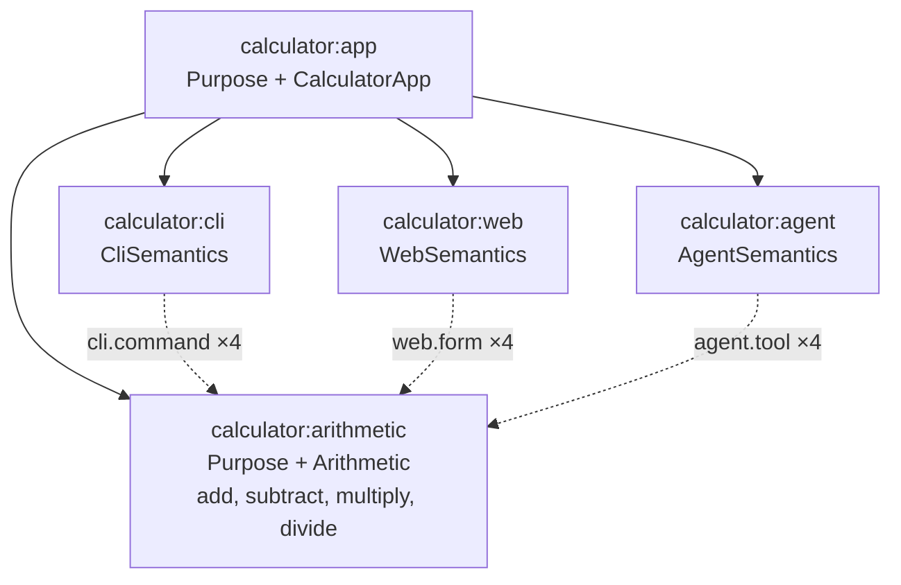

# Work Package Prompt: WP14 – Calculator interfaces, app, binaries and cross-interface tests

## Do This First: Load Agent Profile

Use the `/ad-hoc-profile-load` skill to load the agent profile named in the frontmatter, and behave according to its guidance before you read the rest of this prompt.

- **Profile**: `implementer-ivan`
- **Role**: `implementer`
- **Agent/tool**: `claude` (model `claude-haiku-5-5`)

If the profile cannot be loaded, run `spec-kitty agent profile list` and pick the closest implementer profile.

---

## Important: Review Feedback

Check `spec-kitty agent tasks status --mission semantic-foundation-rebuild-01M5JFR0` and the review feedback of this WP before you start. If the WP was rejected before, address every point of the feedback first.

---

## Resume: the remaining work (added 2026-10-24)

WP14 is `in_progress`. Its worktree is `.worktrees/semantic-foundation-rebuild-01M5JFR0-lane-n` (branch `kitty/mission-semantic-foundation-rebuild-01M5JFR0-lane-n`). Nearly all of T076–T082 is already written there and is **not committed yet**:

- modified: `apps/calculator/src/index.ts`, `package.json`
- new: `apps/calculator/bin/` (`cli.ts`, `mcp.ts`, `agent-demo.ts`), `apps/calculator/src/app.ts`, `apps/calculator/src/interfaces.ts`, and `apps/calculator/test/` (`agent-demo.test.ts`, `app.test.ts`, `cases.ts`, `cli-binary.test.ts`, `impact.test.ts`, `interfaces.test.ts`, `mcp.test.ts`, `verification.test.ts`)

Work only in that worktree. Run `git status --short` first and check that it shows these files. **Keep this work.** Do not delete, rewrite or `git checkout`/`git restore` any of these files, and do not stash them. Change them only as R3 says. Then do R1 to R7 in order. Do not run `spec-kitty agent action implement` again: the WP is already claimed.

### R1 – Regression test for the MCP startup race (write it first, see it fail)

**The defect.** `serveMcp` (`packages/agent/src/mcp.ts`, WP11) builds `McpServer.layerStdio`, which starts reading stdin, *before* `registerTools` adds the tools. When a request is already waiting on stdin, the server answers it with no tools: `tools/list` is `[]`, and `tools/call add` fails with "Tool 'add' not found". That is why `apps/calculator/test/mcp.test.ts` and `agent-demo.test.ts` fail at random. The fix is a sanctioned edit of WP11's files (tasks.md Shared files table; contracts/packs.md, "Startup order").

Edit `packages/agent/test/mcp.test.ts` (sanctioned edit):

1. In its `START_MODULE_MAP`, add two lines directly after the `spawnFixture` line:

```ts
//   STARTUP_RUNS - how many fresh fixture servers the startup-order test starts
//   STARTUP_REQUESTS - initialize, notifications/initialized and tools/list as one newline-delimited stdin payload
```

2. Directly after the line `const spawnFixture = () => McpStdioClient.spawn(["bun", fixtureServer]);`, add:

```ts
const STARTUP_RUNS = 10;
const STARTUP_REQUESTS = [
  {
    jsonrpc: "2.0",
    id: 1,
    method: "initialize",
    params: {
      protocolVersion: "2025-06-18",
      capabilities: {},
      clientInfo: { name: "telos-startup-test", version: "0.0.0" },
    },
  },
  { jsonrpc: "2.0", method: "notifications/initialized" },
  { jsonrpc: "2.0", id: 2, method: "tools/list", params: {} },
]
  .map((message) => JSON.stringify(message) + "\n")
  .join("");
```

3. Inside the `describe`, directly before the test named `"tools/call double returns the output as text and structured content"`, add:

```ts
  test(
    "tools/list is complete when it is already waiting on stdin as the first request after initialize",
    async () => {
      const expected = ["double", ...INTROSPECTION_TOOL_NAMES].sort();
      for (let run = 0; run < STARTUP_RUNS; run++) {
        const proc = Bun.spawn(["bun", fixtureServer], {
          stdin: new TextEncoder().encode(STARTUP_REQUESTS),
          stdout: "pipe",
          stderr: "pipe",
        });
        const stdout = await new Response(proc.stdout).text();
        expect(await proc.exited).toBe(0);
        const response = stdout
          .split("\n")
          .filter((line) => line.trim() !== "")
          .map(
            (line) =>
              JSON.parse(line) as {
                id?: unknown;
                result?: { tools?: ReadonlyArray<{ name: string }> };
              },
          )
          .find((message) => message.id === 2);
        const names = (response?.result?.tools ?? [])
          .map((tool) => tool.name)
          .sort();
        expect(names).toEqual(expected);
      }
    },
    TIMEOUT,
  );
```

Run `bun test packages/agent/test/mcp.test.ts`. The new test must **fail** before R2, because `names` is `[]`. When this was planned, 18 of 20 runs failed this way. Note the failure for your report.

### R2 – Fix `serveMcp` (sanctioned edit of `packages/agent/src/mcp.ts`)

Make exactly these changes and nothing else:

1. Module contract `SCOPE` line. Replace `//   SCOPE: BunStdio, registerTools and serveMcp. Out:` with `//   SCOPE: BunStdio, registerTools, serveMcp and the module-local stdin gate that holds back every request until all tools are registered. Out:`. Keep the rest of the line.
2. Add `Deferred,` to the `import { ... } from "effect";` list, between `Context,` and `Effect,`.
3. Directly before `interface Served {`, add this module-local helper. Do not export it and do not add it to the MODULE_MAP: the map lists exports only (`MAP_MODE: EXPORTS`).

```ts
// Holds back every stdin byte until `ready` is done, so the server reads no request before all tools are registered.
const gateStdin = (
  ready: Deferred.Deferred<void>,
): Layer.Layer<Stdio.Stdio, never, Stdio.Stdio> =>
  Layer.effect(
    Stdio.Stdio,
    Effect.gen(function* () {
      const stdio = yield* Stdio.Stdio;
      return Stdio.make({
        args: stdio.args,
        stdout: (options) => stdio.stdout(options),
        stderr: (options) => stdio.stderr(options),
        stdin: Stream.unwrap(Effect.as(Deferred.await(ready), stdio.stdin)),
      });
    }),
  );
```

4. In the `serveMcp` contract block:
   - Replace the PURPOSE line with `//   PURPOSE: Serve the agent Locus of a root Locus over MCP stdio, naming the server after its server property. All tools are registered before the server reads its first request, so tools/list is complete and every tool is callable from the first request on.`
   - Replace the SIDE_EFFECTS line with `//   SIDE_EFFECTS: reads stdin (only after registerTools has finished) and writes the protocol to stdout; sets process.exitCode 1 on a failure that is not an interrupt`.
5. In the body of `serveMcp`, replace the `const exit = await Effect.runPromiseExit(...)` statement with:

```ts
  const ready = Deferred.makeUnsafe<void>();
  const exit = await Effect.runPromiseExit(
    Layer.launch(
      Layer.effectDiscard(Deferred.succeed(ready, undefined)).pipe(
        Layer.provide(registerTools(telos, agentLocusId)),
        Layer.provide(
          McpServer.layerStdio({
            name,
            version: options.version,
            protocols: [McpProtocol.v2025_06_18],
          }),
        ),
        Layer.provide(gateStdin(ready)),
        Layer.provide(BunStdio),
      ),
    ) as Effect.Effect<never, unknown, never>,
  );
```

`Layer.provide` builds the provided layer first. So the build order is `BunStdio`, then the gate, then the server (its stdin reader waits on `ready`), then `registerTools`, then the layer that completes `ready`. `BunStdio`, `registerTools`, the exit handling after this statement and every export stay unchanged.

6. In `.grace/verification/pack-agent.xml` (sanctioned edit), change only the `V-M-PACK-AGENT-MCP` sentences:
   - In `<Scenario>`, replace `answers tools/call round trips with tool results, and a server` with `answers tools/call round trips with tool results, lists every tool even when tools/list is the first request after initialize and is already waiting on stdin when the server starts, and a server`.
   - In `<TraceAssertion>`, replace `mcp.test.ts names the initialize, tools/list, tools/call` with `mcp.test.ts names the initialize, tools/list, startup-order tools/list, tools/call`.

   The graph entry `M-PACK-AGENT-MCP` (`.grace/graph/pack-agent.xml`) does not change.

Acceptance for R1 and R2:

- `bun test packages/agent/test` passes, including the new test.
- Run `bun test apps/calculator/test/mcp.test.ts apps/calculator/test/agent-demo.test.ts packages/agent/test/mcp.test.ts` **five times** in a row. Every run must report `0 fail`. When this was planned, 8 of 8 runs passed with the fix, and the calculator server listed all 10 tools in 30 of 30 fresh starts.

If an API above does not exist or does not typecheck, stop and report it. Do not change the design.

### R3 – Open GRACE markup items in the calculator files

Run `bun run grace:lint`. At planning time it reported these 11 errors. Fix each one exactly as described:

1. `apps/calculator/src/app.ts`, `markup.overlapping-markers` / `markup.mismatched-marker` (8 errors). A contract marker may not sit inside a `START_BLOCK_`. Move the four contract blocks `START_CONTRACT: CalculatorApp`, `makeApp`, `app` and `calculatorModel` (each from its `// START_CONTRACT:` line to its `// END_CONTRACT:` line) out of the block. Put them directly above `// START_BLOCK_CALCULATOR_APP`, in the same order, with one blank line between them. Inside the block keep only the code: `export const CalculatorApp = ...`, `export function makeApp(...)`, `export const app = ...` and `export const calculatorModel = buildModel(app);`, each separated by one blank line, and then `// END_BLOCK_CALCULATOR_APP`. This is the same shape WP13 used for `ARITHMETIC_LOCUS` in `apps/calculator/src/arithmetic.ts`. Do not change any code line.
2. `apps/calculator/test/cases.ts`, `markup.module-map-mismatch`. Replace the MODULE_MAP body with these lines in this order (file order):

```ts
//   Case - one row of the shared case table
//   Normalized - the comparable outcome of one interface
//   byCodeUnit - plain code-unit comparison of two strings
//   pathsOf - the sorted issue paths of an invocation error
//   CASES - the fourteen shared cases in table order
//   argvOf - the CLI argv of a case
//   normalizeOutcome - normalizes a kernel invocation outcome
//   normalizeCli - normalizes a CLI result
//   normalizeTool - normalizes a tool result
//   matchesExpected - whether a normalized outcome matches a case's expectation
```

3. `apps/calculator/test/mcp.test.ts`, `markup.module-map-mismatch`. Add the line `//   ARITHMETIC_ID - the id of the arithmetic Locus` directly after the `//   MCP - ...` map line.
4. `apps/calculator/test/verification.test.ts`, `markup.module-map-mismatch`. Add the line `//   ARCHETYPES - the five archetypes that apply to the calculator` directly before the `//   APPLICABLE - ...` map line.

The next item is not reported by lint, but it is required.

5. `apps/calculator/bin/agent-demo.ts` has local helpers, but its map says `(none) - no local helpers`. It is a script with no exports. In its module contract, change `ROLE: RUNTIME` to `ROLE: SCRIPT` and `MAP_MODE: EXPORTS` to `MAP_MODE: LOCALS`: grace requires `MAP_MODE EXPORTS` for `RUNTIME` and `LOCALS` for `SCRIPT`. Then replace its MODULE_MAP body with these lines (file order):

```ts
//   MCP - the absolute path of bin/mcp.ts
//   ARITHMETIC_ID - the id of the arithmetic Locus
//   OPERATION_NAMES - the names of the four calculator tools
//   EXPECTED_AFFECTED - the interface Loci the impact step expects
//   FIXED_VALUES - the fixed operand values of the call-add step
//   CallResponse - the part of a tools/call result the steps read
//   outputOf - the output of a successful tool result
//   errorTagOf - the error tag of a failed tool result
//   CapabilityEntry - one capability of the telos_capabilities output
//   addEntryOf - the add capability of a telos_capabilities response
//   requiredOf - the required field names of an input schema
//   failed - the names of the steps whose expectation did not hold
//   printStep - prints one step line to stdout
//   runStep - runs one step, records whether it held and prints it
//   client - the deterministic MCP client of the run
```

If `grace lint` reports errors that are not in this list, fix them with the rules in "GRACE file markup" below, and name each one in your report. `bin/cli.ts` and `bin/mcp.ts` keep `ROLE: RUNTIME`, `MAP_MODE: EXPORTS` and `(none) - no local helpers`; lint accepts them.

### R4 – Register `M-CALC-INTERFACES` (T083)

Write `.grace/graph/calculator-interfaces.xml` exactly as:

```xml
<GraceGraphDocument graceVersion="4.0">
  <GD-CALCULATOR-INTERFACES>
    <M-CALC-INTERFACES>
      <Summary>Exposes the calculator arithmetic Locus through CLI, web and agent interface Loci inside the calculator application Locus, checks them with the CalculatorInterfaces archetype, and provides the CLI, MCP server and deterministic agent demo binaries.</Summary>
      <Path>apps/calculator/src/interfaces.ts</Path>
      <Path>apps/calculator/src/app.ts</Path>
      <Path>apps/calculator/src/index.ts</Path>
      <Path>apps/calculator/bin/cli.ts</Path>
      <Path>apps/calculator/bin/mcp.ts</Path>
      <Path>apps/calculator/bin/agent-demo.ts</Path>
      <M-CALC-ARITHMETIC />
      <M-PACK-CLI />
      <M-PACK-WEB />
      <M-PACK-AGENT />
      <M-PACK-AGENT-MCP />
      <M-KERNEL-API />
    </M-CALC-INTERFACES>
  </GD-CALCULATOR-INTERFACES>
</GraceGraphDocument>
```

Write `.grace/verification/calculator-interfaces.xml` exactly as:

```xml
<GraceVerificationDocument graceVersion="4.0">
  <VD-CALCULATOR-INTERFACES>
    <V-M-CALC-INTERFACES>
      <TestFiles>
        <File>apps/calculator/test/interfaces.test.ts</File>
        <File>apps/calculator/test/app.test.ts</File>
        <File>apps/calculator/test/verification.test.ts</File>
        <File>apps/calculator/test/impact.test.ts</File>
        <File>apps/calculator/test/cli-binary.test.ts</File>
        <File>apps/calculator/test/mcp.test.ts</File>
        <File>apps/calculator/test/agent-demo.test.ts</File>
      </TestFiles>
      <Command>bun test apps/calculator/test</Command>
      <Scenario>The model builds without diagnostics; every shared case gives the same normalized outcome through invoke, the CLI in memory, callTool and the web form; each CalculatorInterfaces rule passes on the app and fails on a broken variant; verify reports no failed or errored finding and a finding for every rule of the five applicable archetypes; the impact of the add contract reaches exactly the three interface Loci and a newly added interface without source changes; the CLI binary, the MCP server and the agent demo give the expected exit codes and outputs.</Scenario>
      <TraceAssertion>interfaces.test.ts names one test per case; app.test.ts names one passing and one failing test per rule; verification.test.ts and impact.test.ts name the verify and impact assertions; cli-binary.test.ts names one test per case and --help; mcp.test.ts names the server name, tools/list, schemas, cases, telos_inspect and unknown tool tests; agent-demo.test.ts names the seven-step run.</TraceAssertion>
    </V-M-CALC-INTERFACES>
  </VD-CALCULATOR-INTERFACES>
</GraceVerificationDocument>
```

In `.grace/graph/index.xml`, change only the `GD-CALCULATOR-INTERFACES` block: replace its `<Owns />` with

```xml
      <Owns>
        <M-CALC-INTERFACES />
      </Owns>
```

In `.grace/verification/index.xml`, change only the `VD-CALCULATOR-INTERFACES` block: replace its `<Owns />` with

```xml
      <Owns>
        <V-M-CALC-INTERFACES />
      </Owns>
```

In `.grace/graph/calculator-core.xml` (sanctioned edit), delete only the line `      <Path>apps/calculator/src/index.ts</Path>` from `M-CALC-ARITHMETIC`.

`bun run grace:lint` must then report `Errors: 0`. When this was planned, R1 to R4 together gave `No issues found.`

### R5 – Format and the full gate

1. `bun run format` (it writes). At planning time, nine of the new calculator files needed formatting.
2. `bun run verify`. Report each step exactly: `check:bun`, `format:check`, `lint`, `typecheck`, `test`, `docs:build`, `test:e2e`, `grace:lint`. Lint warnings that already existed are not failures; lint must exit 0.
3. Run the five-times loop from R2 once more after formatting.

If a step fails and the fix is outside your owned files and the sanctioned edits, stop and report it.

### R6 – Commit in the lane worktree

Stage paths explicitly. Never use `git add -A` or `git add .`, never `--no-verify`, and add no AI names or author, co-author or session lines. The shell is fish: pass the body with a second `-m`.

1. The agent fix, in one commit:
   `git add packages/agent/src/mcp.ts packages/agent/test/mcp.test.ts .grace/verification/pack-agent.xml`
   `git commit -m "fix(agent): register every MCP tool before the server reads stdin" -m "Sanctioned edit by WP14 (tasks.md Shared files): packages/agent/src/mcp.ts, packages/agent/test/mcp.test.ts and .grace/verification/pack-agent.xml. serveMcp now gates stdin until registerTools has finished, so tools/list is complete from the first request."`
2. The calculator work, in one commit:
   `git add apps/calculator package.json .grace/graph/calculator-interfaces.xml .grace/verification/calculator-interfaces.xml .grace/graph/index.xml .grace/verification/index.xml .grace/graph/calculator-core.xml`
   `git commit -m "feat(calculator): expose arithmetic through CLI, web and agent interfaces" -m "Sanctioned edits: root package.json (three calculator scripts), .grace/graph/calculator-core.xml (index.ts path removed from M-CALC-ARITHMETIC), own GD-/VD-CALCULATOR-INTERFACES blocks of the two GRACE index files."`
3. `git status --short` must now show nothing outside `kitty-specs/`. `git diff --stat HEAD~2 HEAD` (your two commits) must list only your owned files and the sanctioned edits named in this prompt. Do not compare against `feat/semantic-foundation-rebuild`: lane-n also contains the merged dependency lanes, so that diff is larger.

The pre-commit hook runs checks. If it fails, fix the cause and commit again. Never bypass it.

### R7 – Clean the lane's planning files, then hand over to review

1. In the lane worktree, run `git restore --source feat/semantic-foundation-rebuild --staged --worktree -- kitty-specs/`. If `git status --short -- kitty-specs/` then shows changes, commit them: `git commit -m "chore(workspace): remove planning artifacts from lane branch"`. Finally `git diff --stat feat/semantic-foundation-rebuild -- kitty-specs/` must print nothing.
2. Mark T076 to T083 done: `spec-kitty agent tasks mark-status T076 --status done --mission semantic-foundation-rebuild-01M5JFR0`, and the same for T077, T078, T079, T080, T081, T082 and T083.
3. `spec-kitty agent tasks move-task WP14 --to for_review --mission semantic-foundation-rebuild-01M5JFR0 --note "Calculator interfaces, binaries and tests; MCP startup-order fix in @telos/agent (sanctioned)"`.
4. If `mark-status` or `move-task` refuses, stop and report the exact message. Do not use `--force` or any skip flag.

Your final message is the reviewer's evidence. Report:

- the R1 failure before the fix;
- the five-run loop results;
- each `verify` step;
- `grace lint`;
- both commit hashes;
- the move-task result.

---

## Objective

Expose the one arithmetic implementation (`calculator:arithmetic`, WP13) through three interface Loci (CLI, Web, Agent) inside the `calculator:app` Locus, check them with the `CalculatorInterfaces` Archetype, add the three binaries (CLI, MCP server, deterministic agent demo), and prove with tests that all interfaces agree on a shared case table.

## Context

> Quoted from `kitty-specs/semantic-foundation-rebuild-01M5JFR0/contracts/calculator.md` (authoritative).

# Contract: `@telos/calculator`

Package `apps/calculator`, name `@telos/calculator`, private. Dependencies (exact, `workspace:*` for workspace packages): `@telos/kernel`, `@telos/cli`, `@telos/agent`, `@telos/web`, `effect` 4.0.4. Export map: `{ ".": "./src/index.ts", "./package.json": "./package.json" }`. The main entry is browser-safe. Only `bin/*.ts` import `@telos/cli/bun`, `@telos/agent/mcp` or `@telos/agent/client`.

## Semantic model



Solid lines are containment, dotted lines are relations to the four capabilities.

> Quoted from `kitty-specs/semantic-foundation-rebuild-01M5JFR0/contracts/calculator.md` (authoritative).

## interfaces.ts (WP14)

```ts
export const calculatorCli: LocusDefinition    // id "calculator:cli", kind Locus.extend(CliSemantics), properties { program: "calculator" }
export const calculatorWeb: LocusDefinition    // id "calculator:web", kind Locus.extend(WebSemantics), properties { title: "Calculator" }
export const calculatorAgent: LocusDefinition  // id "calculator:agent", kind Locus.extend(AgentSemantics), properties { server: "telos-calculator" }
// each has 4 relations: <Type>.to(arithmetic.capability("add" | "subtract" | "multiply" | "divide")), in that order
export function interfaceLoci(target: LocusDefinition, names?: ReadonlyArray<string>): ReadonlyArray<LocusDefinition>
// builds the three interface Loci for any arithmetic-like target, exposing `names` (default all four); used by tests to build broken variants
```

The interface Loci declare **no** capabilities. The only implementation is on `calculator:arithmetic`.

## app.ts (WP14)

```ts
export const CalculatorApp: Extension<"calculator.app", {}>
// description "Marks the calculator application that groups the arithmetic Locus and its interfaces."; archetypes [CalculatorInterfaces]
export const CalculatorInterfaces: Archetype  // id "calculator.interfaces", appliesTo ["calculator.app"]
export const app: LocusDefinition             // id "calculator:app", Locus.extend(Purpose, CalculatorApp); contains [arithmetic, calculatorCli, calculatorWeb, calculatorAgent]
export const calculatorModel: SemanticModel   // buildModel(app)
export function makeApp(contains: ReadonlyArray<LocusDefinition>): LocusDefinition   // same kind and id; used by tests
```

`app` purpose: `"Proves that one arithmetic implementation serves a command line, a web page and agent tools."`.

CalculatorInterfaces rules. The arithmetic Locus is the contained Locus whose kind includes `calculator.arithmetic`, and the interface Loci are the contained Loci whose kind includes `telos.cli`, `telos.web` or `telos.agent`.

| Rule id | Method | Passes when |
| --- | --- | --- |
| `interfaces.complete` | static | each of the three interface Loci has a valid granting relation to every capability of the arithmetic Locus (checked with `describeCapability(...).exposedBy`) |
| `interfaces.single-implementation` | static | no Locus in the app other than the arithmetic Locus declares a capability |
| `interfaces.parity` | execution | for the four parity inputs below, `runCli` (text), `callTool` (JSON), `formModel(...).submit` (text) and `invoke` with `via` = the arithmetic Locus give the same normalized outcome |

Parity inputs: `add {a:"2",b:"3"}`, `divide {a:"1",b:"0"}`, `add {a:"x",b:"1"}`, `multiply {a:"1e308",b:"10"}`. The JSON form uses `Number(text)` when that is finite, and the text otherwise.

The normalized outcome is:

- `{ ok: true, output }`, or
- `{ ok: false, tag, message, paths }`, where `paths` is the sorted list of `issue.path.join(".")`.

For the CLI, it is parsed from the stdout or stderr line.

## index.ts (WP14)

Exports `Operands, Result, add, subtract, multiply, divide, DivisionByZero, NonFiniteResult, DIVISION_BY_ZERO_MESSAGE, NON_FINITE_MESSAGE, Arithmetic, ArithmeticBehavior, arithmetic, calculatorCli, calculatorWeb, calculatorAgent, interfaceLoci, CalculatorApp, CalculatorInterfaces, app, makeApp, calculatorModel`.

WP13 creates `index.ts` exporting only its own names, and WP14 extends it.

## Binaries (WP14)

| File | Behaviour |
| --- | --- |
| `bin/cli.ts` | `await runMain(calculatorModel, "calculator:cli", { version: <package.json version> })` |
| `bin/mcp.ts` | `await serveMcp(app, "calculator:agent", { version })` |
| `bin/agent-demo.ts` | the deterministic agent described below |

### Deterministic agent (`bin/agent-demo.ts`)

The agent needs no LLM and no credentials. It spawns `["bun", <absolute path of bin/mcp.ts>]` with `McpStdioClient.spawn`, then runs these steps. It prints one JSON line per step, `{ "step": <name>, "request": ..., "response": ... }`, to stdout:

1. `initialize`: server name `telos-calculator`.
2. `list-tools`: the names include `add, divide, multiply, subtract` and all six `telos_*` tools.
3. `discover`: `telos_capabilities {"id":"calculator:arithmetic"}`. It finds the capability named `add` and reads the required fields of its input schema (`a`, `b`).
4. `call-add`: `add` with `{a: 2, b: 3}` built from the discovered field names, using the fixed values a=2 and b=3. Expect `{ result: 5 }`.
5. `call-divide-by-zero`: `divide {a:1,b:0}`. Expect `isError` with tag `DivisionByZero`.
6. `call-invalid`: `add {a:"x",b:1}`. Expect `isError` with tag `InvalidInput`.
7. `impact`: `telos_impact {"target":"calculator:arithmetic#add"}`. Expect the affected set to include `calculator:cli`, `calculator:web` and `calculator:agent`.

The last line is `{"ok":true}` and the exit code is 0 when every expectation held. Otherwise the last line is `{"ok":false,"failed":[<step names>]}` and the exit code is 1. The client is always closed.

### Root scripts (WP14 adds to the root `package.json` `scripts`)

```json
"calculator": "bun apps/calculator/bin/cli.ts",
"calculator:mcp": "bun apps/calculator/bin/mcp.ts",
"calculator:agent-demo": "bun apps/calculator/bin/agent-demo.ts"
```

## Shared case table (`apps/calculator/test/cases.ts`, WP14)

```ts
export interface Case {
  readonly name: string
  readonly capability: "add" | "subtract" | "multiply" | "divide"
  readonly text: Readonly<Record<string, string>>     // CLI flags and web fields
  readonly json: Readonly<Record<string, unknown>>    // agent arguments and kernel input
  readonly expected: { readonly ok: true; readonly output: { readonly result: number } } | { readonly ok: false; readonly tag: string; readonly paths: ReadonlyArray<string> }
  readonly exitCode: 0 | 1 | 2
}
export const CASES: ReadonlyArray<Case>
```

| # | name | capability | text | json | expected | exit |
| --- | --- | --- | --- | --- | --- | --- |
| 1 | add integers | add | a=2 b=3 | {a:2,b:3} | 5 | 0 |
| 2 | subtract | subtract | a=5 b=3 | {a:5,b:3} | 2 | 0 |
| 3 | multiply decimal | multiply | a=4 b=2.5 | {a:4,b:2.5} | 10 | 0 |
| 4 | divide | divide | a=7 b=2 | {a:7,b:2} | 3.5 | 0 |
| 5 | add negatives | add | a=-1.5 b=0.5 | {a:-1.5,b:0.5} | -1 | 0 |
| 6 | divide negative | divide | a=-6 b=3 | {a:-6,b:3} | -2 | 0 |
| 7 | subtract zeros | subtract | a=0 b=0 | {a:0,b:0} | 0 | 0 |
| 8 | divide by zero | divide | a=1 b=0 | {a:1,b:0} | DivisionByZero | 1 |
| 9 | zero by zero | divide | a=0 b=0 | {a:0,b:0} | DivisionByZero | 1 |
| 10 | overflow | multiply | a=1e308 b=10 | {a:1e308,b:10} | NonFiniteResult | 1 |
| 11 | non-numeric | add | a=x b=1 | {a:"x",b:1} | InvalidInput, paths ["a"] | 2 |
| 12 | missing operand | add | a=1 | {a:1} | InvalidInput, paths ["b"] | 2 |
| 13 | empty operand | subtract | a="" b=1 | {a:"",b:1} | InvalidInput, paths ["a"] | 2 |
| 14 | divide quarter | divide | a=10 b=4 | {a:10,b:4} | 2.5 | 0 |

CLI argv for a case: `[capability, ...Object.entries(text).flatMap(([k, v]) => ["--" + k, v])]`.

## Tests (`apps/calculator/test/`)

| File | WP | Asserts |
| --- | --- | --- |
| `arithmetic.test.ts` | WP13 | each capability through `invoke` with `via` = `calculator:arithmetic`, including both errors; the kind has no composition conflicts |
| `archetypes.test.ts` | WP13 | each ArithmeticBehavior rule passes on `arithmetic` and fails on a broken variant (only `add`; a `write` capability; a handler returning a wrong result; `divide` without the zero check; `multiply` without the finite check) |
| `interfaces.test.ts` | WP14 | `buildModel(app).diagnostics` is `[]`; every CASE gives the same normalized outcome through `invoke`, `runCli` (in memory), `callTool` and `formModel` |
| `app.test.ts` | WP14 | each CalculatorInterfaces rule passes on `app` and fails on `makeApp(...)` variants (cli missing `divide`; web missing `divide`, whose failure message names `calculator:web` and `divide` (US5.2); the web Locus declaring its own `add`; a parity break built with a fake interface Locus whose relation targets a different arithmetic Locus that returns a different message) |
| `verification.test.ts` | WP14 | `verify(calculatorModel, { runner: "test" })` has `summary.failed === 0` and `summary.error === 0`, and contains a finding for every rule of the five Archetypes that apply (ArithmeticBehavior, CliInterface, WebInterface, AgentInterface, CalculatorInterfaces) |
| `impact.test.ts` | WP14 | `impact(calculatorModel, "calculator:arithmetic#add").affected` loci are exactly `calculator:agent, calculator:cli, calculator:web` at distance 1; `checks` include the rules of CliInterface, WebInterface, AgentInterface (on the interface Loci), ArithmeticBehavior and CalculatorInterfaces (container). `diffModels` between `app` and a variant whose `add` output is `{ sum }` yields one `contract-changed` for `calculator:arithmetic` / `add` with a non-empty patch. US6.3: a model built with `makeApp([...app.contains, extra])`, where `extra` is a new `calculator:extra` Locus of kind `Locus.extend(CliSemantics)` with one `CliCommand.to(arithmetic.capability("add"))` relation, lists `calculator:extra` among the affected Loci for `calculator:arithmetic#add`, with no change to any calculator source |
| `cli-binary.test.ts` | WP14 | every CASE through `Bun.spawn(["bun", "bin/cli.ts", ...argv])`: exit code, stdout JSON on success, stderr JSON on failure; `--help` exits 0 |
| `mcp.test.ts` | WP14 | `McpStdioClient` on `bin/mcp.ts`: `tools/list` contains 4 calculator tools plus 6 `telos_*` tools; each tool's `inputSchema` equals the capability's input JSON Schema; every CASE through `callTool` matches `expected`; `telos_inspect {"id":"calculator:arithmetic"}` returns `structuredContent.output` deep-equal to `describeLocus(calculatorModel, "calculator:arithmetic")` (US4.3); `tools/call` with name `secret` (no such tool) rejects with `MCP error -32602: Tool 'secret' not found` (US4.4, see packs.md) |
| `agent-demo.test.ts` | WP14 | spawning `bin/agent-demo.ts` exits 0, and the last stdout line is `{"ok":true}` |

### Pack APIs you use (quoted from `contracts/packs.md`)

```ts
// @telos/cli (main entry, browser-safe)
export const CliCommand: RelationType<"cli.command">
export const CliSemantics: Extension<"telos.cli", { program: typeof Schema.String }>
export const CliInterface: Archetype
export interface CliResult { readonly exitCode: 0 | 1 | 2; readonly stdout: string; readonly stderr: string }
export const runCli: (model: SemanticModel, cliLocusId: string, argv: ReadonlyArray<string>, options?: { readonly version?: string }) => Effect.Effect<CliResult>
// @telos/cli/bun (Bun only; bin files only)
export const runMain: (model: SemanticModel, cliLocusId: string, options?: { readonly version?: string; readonly argv?: ReadonlyArray<string> }) => Promise<void>

// @telos/agent (main entry, browser-safe)
export const AgentTool: RelationType<"agent.tool">
export const AgentSemantics: Extension<"telos.agent", { server: typeof Schema.String }>
export const AgentInterface: Archetype
export interface ToolResult { readonly isError: boolean; readonly text: string; readonly structured: Readonly<Record<string, unknown>> } // { ok: true, output } | { ok: false, error }
export const callTool: (model: SemanticModel, agentLocusId: string, name: string, args: unknown) => Effect.Effect<ToolResult>
export function toolInputSchema(input: JsonSchemaDocument): Readonly<Record<string, unknown>>
export const INTROSPECTION_TOOL_NAMES: ReadonlyArray<string>
// @telos/agent/mcp (Bun only; bin files only)
export const serveMcp: (root: LocusDefinition, agentLocusId: string, options: { readonly version: string }) => Promise<void>
// registers every tool before it reads the first request: tools/list is complete from the first request on (contracts/packs.md "Startup order"; WP14 applies this fix, R2)
// @telos/agent/client (Bun only; bin files and tests only)
export class McpStdioClient {
  static spawn(command: ReadonlyArray<string>, options?: { readonly cwd?: string; readonly timeoutMs?: number }): Promise<McpStdioClient> // performs initialize
  readonly server: { readonly serverName: string; readonly protocolVersion: string }   // result of that initialize
  listTools(): Promise<ReadonlyArray<{ readonly name: string; readonly description: string; readonly inputSchema: unknown; readonly annotations?: unknown; readonly _meta?: unknown }>>
  callTool(name: string, args: unknown): Promise<{ readonly isError: boolean; readonly text: string; readonly structuredContent: unknown }>
  close(): Promise<number>
}
// JSON-RPC errors reject with Error("MCP error <code>: <message>").

// @telos/web (main entry, browser-safe)
export const WebForm: RelationType<"web.form">
export const WebSemantics: Extension<"telos.web", { title: typeof Schema.String }>
export const WebInterface: Archetype
export const formModel: (model: SemanticModel, webLocusId: string) => Effect.Effect<WebFormModel, LocusNotFound>
// WebFormModel { locus, title, forms: WebFormDefinition[] }; WebFormDefinition { name, ref, description, fields, submit(raw: Record<string, string | undefined>) => Effect<InvocationOutcome> }
```

From WP13 (`./arithmetic`, `./errors`, `./archetypes`): `Operands, Result, add, subtract, multiply, divide, Arithmetic, arithmetic, DivisionByZero, NonFiniteResult, DIVISION_BY_ZERO_MESSAGE, NON_FINITE_MESSAGE, ArithmeticBehavior`.

## Rules for this work package

Read these rules before you write anything. They are part of the acceptance criteria.

1. **Baseline first.** Before you change a file, run `bun run verify` in your worktree and note the result of each step. If the baseline is not green, stop and report it; do not fix unrelated failures.
2. **Only your files.** Edit only the files in `owned_files` (frontmatter) and the sanctioned edits listed below. If you need any other change, stop and report it. Never edit `kitty-specs/**`, `AGENTS.md`, `CLAUDE.md`, `.kittify/**` or the charter.
3. **Contracts are exact.** Names, signatures, messages, ids and sort orders are copied from the quoted contracts. If an Effect API in a contract does not exist or behaves differently, stop and report it. Do not invent a replacement.
4. **Tests first.** Write the tests of a subtask before its implementation, run them and see them fail, then implement.
5. **No new dependencies** and no global installs. Do not run `bun add`. `bun install` is allowed only where this prompt says so.
6. **No fake work.** No placeholder code, no `TODO`, no skipped tests, no test that asserts nothing, no hard-coded counts of things that grow.
7. **Shell.** The shell is fish. Use `echo '-----'` as a separator, and pass paths explicitly instead of shell globs with `--include=*.ts`.
8. **Report exactly.** In your final message, list every check you ran and its exact result. Never claim a check passed that you did not run.

> Quoted from `kitty-specs/semantic-foundation-rebuild-01M5JFR0/contracts/conventions.md` (authoritative).

## Commands

| Purpose | Command |
| --- | --- |
| Full gate (run before handing a WP to review, and it must pass) | `bun run verify` |
| Fast loop while working | `bun run typecheck`, `bun test <paths>`, `bun run lint`, `bun run format` (writes), `bun run grace:lint` |
| One package's tests | `bun test packages/kernel/test` (example) |

`bun run verify` = `check:bun && format:check && lint && typecheck && test && docs:build && test:e2e && grace:lint`, plus `&& telos:check` from WP15 on. Report each step's result exactly. Never claim a step passed that you did not run.

## Code

- TypeScript, strict, using the repository `tsconfig.base.json`. Imports have **no** `.ts` extension. Use `import type` for types only.
- Format: run `bun run format` and follow its output. The repository uses double quotes, semicolons and trailing commas.
- Effect 4.0.4 APIs only, as quoted in the contracts. If an API in a contract does not exist, stop and report it. Do not invent a replacement.
- No new dependency, no upgrade, no global install (C-002). Workspace links already exist from WP01.
- No placeholder code, no `TODO` stubs, no tests that assert nothing, no skipped tests.
- No compatibility aliases for removed names (C-004).
- Comments and messages are in English (C-009). Diagnostic and error messages are exactly as written in the contracts.
- Determinism (NFR-002): sort with plain code-unit comparison (`a < b ? -1 : a > b ? 1 : 0`), never `localeCompare`. Never depend on object key insertion order from user input. Never use `Date.now()` or randomness in output except the `now` option of `verify`.

## Tests

- `bun:test` (`describe`, `test`, `expect`). Test files are `test/<module>.test.ts` next to the package's `src/`.
- Every diagnostic code, closure code and Archetype rule has at least one test where it is reported or fails, and one where it is not reported or passes (NFR-005). The test name names the code or rule id.
- Never hard-code counts of documents, files, Loci or findings that change as the repository grows. Assert membership, or compare with a value computed from the same source.
- No network and no credentials (NFR-007). Subprocess tests use `Bun.spawn(["bun", <absolute path>], ...)` with a 20 s test timeout.
- Fixtures are built in the test file or in `test/fixture.ts`. Never import another package's `test/` files.

> Quoted from `kitty-specs/semantic-foundation-rebuild-01M5JFR0/contracts/conventions.md` (authoritative).

## Git

- Spec Kitty creates your worktree and branch. Commit only inside it.
- Commit messages follow Conventional Commits 1.0.0: `feat(kernel): build the semantic model`, `docs(foundation): ...`, `test(cli): ...`.
- No AI names, and no author, co-author or session lines. The `.githooks/commit-msg` hook enforces this. Never use `--no-verify`.
- Never edit files that another WP owns (see each WP's "Owned files"). If a needed change falls outside your files, stop and report it.

**Sanctioned edits outside `owned_files`** (name each one in your commit body):

- Root `package.json` (owned by WP01): add the three `calculator*` scripts only.
- `.grace/graph/calculator-core.xml` (WP13): remove the `apps/calculator/src/index.ts` `<Path>` from `M-CALC-ARITHMETIC` only.
- `packages/agent/src/mcp.ts` (WP11): the MCP startup-order fix exactly as R2. Add the module-local `gateStdin`, the new `serveMcp` composition, and the SCOPE, PURPOSE and SIDE_EFFECTS lines. Nothing else.
- `packages/agent/test/mcp.test.ts` (WP11): the startup-order test with `STARTUP_RUNS`, `STARTUP_REQUESTS` and their two map lines, exactly as R1.
- `.grace/verification/pack-agent.xml` (WP11): the two `V-M-PACK-AGENT-MCP` sentence changes of R2 step 6.

## GRACE synchronisation (part of this WP)

Every source and test file you create carries GRACE markup, and your modules are registered in **your own** area documents in the same commit as the code. `bun run grace:lint` (`grace lint --path . --assertions current`) must pass.

> Quoted from `kitty-specs/semantic-foundation-rebuild-01M5JFR0/contracts/conventions.md` (authoritative).

## GRACE file markup

Every new `src/*.ts`, `bin/*.ts` and `scripts/*.ts` file starts with this header. Copy the shape from `scripts/review-gate.ts`:

```ts
// START_MODULE_CONTRACT
//   PURPOSE: <one sentence>
//   SCOPE: <what the file contains and what it never does>
//   DEPENDS: <module ids, comma-separated, or none>
//   LINKS: <M-ID>, <V-M-ID>
//   ROLE: RUNTIME
//   MAP_MODE: EXPORTS
// END_MODULE_CONTRACT
//
// START_MODULE_MAP
//   <exportName> - <short description>      (one line per export, every export, in file order)
// END_MODULE_MAP
```

Each exported function, constant or class has a contract block right above it:

```ts
// START_CONTRACT: <exportName>
//   PURPOSE: ...
//   INPUTS: { name: type - meaning, ... }
//   OUTPUTS: { type - meaning }
//   SIDE_EFFECTS: none | <what>
//   LINKS: <M-ID>
// END_CONTRACT: <exportName>
```

Exported types and interfaces need only the MODULE_MAP line. Test files use `ROLE: TEST` and `MAP_MODE: LOCALS`, and list their local helpers in the map. A test file with no local helpers has exactly one map line `(none) - no local helpers`, with the parentheses. Never write `none - no local helpers`: `grace lint` reads the leading identifier of each map line as a symbol name, so a bare `none` counts as a helper that does not exist and fails with `markup.module-map-mismatch`. `(none)` does not start with an identifier, so it keeps the map non-empty (no `markup.module-map-missing`) without naming a symbol. Optional named regions use `// START_BLOCK_<NAME>` / `// END_BLOCK_<NAME>`. The guides quote these regions (contracts/docs.md).

## GRACE graph and verification layout (created by WP01)

WP01 replaces `graph/main.xml` and `verification/main.xml` with one document per area:

- It moves the existing modules unchanged into `tooling`, `legacy` and `docs`.
- It creates the other documents empty with `<Owns />`.
- It rewrites both index files to list every document.

A WP edits **only** its own area documents and its own `<GD-…>` / `<VD-…>` block in `graph/index.xml` and `verification/index.xml`.

| Area | Graph doc / id | Verification doc / id | Owner WP | Modules (graph id → paths) |
| --- | --- | --- | --- | --- |
| tooling | `graph/tooling.xml` `GD-TOOLING` | `verification/tooling.xml` `VD-TOOLING` | WP01 (move), WP15, WP20 | `M-BUN-VERSION-GUARD`, `M-REVIEW-GATE` (moved); WP15: `M-REPOSITORY-MODEL` → `telos.ts`, `M-TELOS-COMMAND` → `scripts/telos.ts` |
| legacy | `graph/legacy.xml` `GD-LEGACY` | `verification/legacy.xml` `VD-LEGACY` | WP01 (move), WP20 (delete) | the six `M-LOCUS-*` modules (moved) |
| docs | `graph/docs.xml` `GD-DOCS` | `verification/docs.xml` `VD-DOCS` | WP01 (move), WP18, WP19, WP20 | `M-DOCS-CONTENT`, `M-DOCS-SPEC-REPORT`, `M-DOCS-SITE`, `M-DOCS-PLAYGROUND` (moved); WP18: rewrite `M-DOCS-PLAYGROUND`; WP19: `M-DOCS-SPEC-REPORT` → `M-DOCS-SEMANTIC-REPORT`, add `M-DOCS-INSPECTOR`; WP20: add `M-DOCS-CALCULATOR` |
| kernel-base | `graph/kernel-base.xml` `GD-KERNEL-BASE` | `verification/kernel-base.xml` `VD-KERNEL-BASE` | WP02 | `M-KERNEL-IDENTITY` → identity.ts, freeze.ts; `M-KERNEL-CANONICAL` → canonical.ts, digest.ts; `M-KERNEL-DIAGNOSTIC` → diagnostic.ts, cycles.ts |
| kernel-definitions | `GD-KERNEL-DEFINITIONS` | `VD-KERNEL-DEFINITIONS` | WP03 | `M-KERNEL-DEFINITIONS` → relation.ts, capability.ts, extension.ts, archetype.ts, locus.ts, extensions/purpose.ts, extensions/source.ts |
| kernel-model | `GD-KERNEL-MODEL` | `VD-KERNEL-MODEL` | WP04 (WP22: adds a path and test files) | `M-KERNEL-MODEL` → model.ts; WP22 adds readonly-map.ts |
| kernel-verify | `GD-KERNEL-VERIFY` | `VD-KERNEL-VERIFY` | WP05 | `M-KERNEL-VERIFY` → verify.ts |
| kernel-describe | `GD-KERNEL-DESCRIBE` | `VD-KERNEL-DESCRIBE` | WP06 | `M-KERNEL-DESCRIBE` → describe.ts, fields.ts; `M-KERNEL-INVOKE` → invoke.ts |
| kernel-decode | `GD-KERNEL-DECODE` | `VD-KERNEL-DECODE` | WP07 | `M-KERNEL-DECODE` → decode.ts |
| kernel-closure | `GD-KERNEL-CLOSURE` | `VD-KERNEL-CLOSURE` | WP08 (WP22: adds a test file) | `M-KERNEL-CLOSURE` → closure.ts |
| kernel-api | `GD-KERNEL-API` | `VD-KERNEL-API` | WP09 | `M-KERNEL-INTROSPECTION` → introspection.ts; `M-KERNEL-IMPACT` → impact.ts; `M-KERNEL-API` → index.ts |
| pack-cli | `GD-PACK-CLI` | `VD-PACK-CLI` | WP10 | `M-PACK-CLI` → all `packages/cli/src/*.ts` |
| pack-agent | `GD-PACK-AGENT` | `VD-PACK-AGENT` | WP11 | `M-PACK-AGENT` → semantics, archetype, tools, introspection-tools, index; `M-PACK-AGENT-MCP` → mcp.ts, client.ts |
| pack-web | `GD-PACK-WEB` | `VD-PACK-WEB` | WP12 | `M-PACK-WEB` → all `packages/web/src/*.ts` |
| calculator-core | `GD-CALCULATOR-CORE` | `VD-CALCULATOR-CORE` | WP13 | `M-CALC-ARITHMETIC` → errors.ts, arithmetic.ts, archetypes.ts (index.ts until WP14 takes it) |
| calculator-interfaces | `GD-CALCULATOR-INTERFACES` | `VD-CALCULATOR-INTERFACES` | WP14 | `M-CALC-INTERFACES` → interfaces.ts, app.ts, index.ts, bin/cli.ts, bin/mcp.ts, bin/agent-demo.ts |

The file name of a graph or verification document is the area name, e.g. `graph/kernel-model.xml`. Kernel paths are under `packages/kernel/src/`, and calculator paths under `apps/calculator/`.

### Graph entry

Each module lists its dependency modules as empty child elements, as in the existing documents:

```xml
<M-KERNEL-MODEL>
  <Summary>Builds a checked semantic model from a root Locus and reports structural diagnostics.</Summary>
  <Path>packages/kernel/src/model.ts</Path>
  <M-KERNEL-DEFINITIONS />
  <M-KERNEL-DIAGNOSTIC />
</M-KERNEL-MODEL>
```

### Verification entry

```xml
<V-M-KERNEL-MODEL>
  <TestFiles>
    <File>packages/kernel/test/model.test.ts</File>
  </TestFiles>
  <Command>bun test packages/kernel/test/model.test.ts</Command>
  <Scenario>One sentence per tested behaviour.</Scenario>
  <TraceAssertion>Names the tests that prove the scenarios.</TraceAssertion>
</V-M-KERNEL-MODEL>
```

Register a module **only together with** its verification entry, and only once the listed test files exist. Otherwise `grace lint` reports `missing-module-coverage` or `invalid-test-file` (research R8). Add the ids to your `<Owns>` blocks in both index files.

### How to edit the area documents (exact shapes)

WP01 created your area documents empty. Replace the empty element with the filled one. Example for the area `kernel-base` (use your own area name and ids):

```xml
<GraceGraphDocument graceVersion="4.0">
  <GD-KERNEL-BASE>
    <M-KERNEL-IDENTITY>
      <Summary>One sentence.</Summary>
      <Path>packages/kernel/src/identity.ts</Path>
      <Path>packages/kernel/src/freeze.ts</Path>
    </M-KERNEL-IDENTITY>
  </GD-KERNEL-BASE>
</GraceGraphDocument>
```

```xml
<GraceVerificationDocument graceVersion="4.0">
  <VD-KERNEL-BASE>
    <V-M-KERNEL-IDENTITY>
      <TestFiles>
        <File>packages/kernel/test/identity.test.ts</File>
      </TestFiles>
      <Command>bun test packages/kernel/test/identity.test.ts</Command>
      <Scenario>One sentence per tested behaviour.</Scenario>
      <TraceAssertion>Names the tests that prove the scenarios.</TraceAssertion>
    </V-M-KERNEL-IDENTITY>
  </VD-KERNEL-BASE>
</GraceVerificationDocument>
```

In `.grace/graph/index.xml` change only your block, from `<Owns />` to:

```xml
    <GD-KERNEL-BASE>
      <Path>graph/kernel-base.xml</Path>
      <Owns>
        <M-KERNEL-IDENTITY />
      </Owns>
    </GD-KERNEL-BASE>
```

and in `.grace/verification/index.xml` the same with `<VD-…>` and `<V-M-… />`. Editing your own `GD-`/`VD-` block of the two index files is a sanctioned edit for every WP.

Lint rules that were confirmed while planning (they fail the gate when ignored):

- `START_MODULE_MAP` lists **every** export of the file, one line each (types and interfaces too), in file order.
- Test files use `ROLE: TEST`, `MAP_MODE: LOCALS`, and a **non-empty** map: list the local helpers, or exactly one line `(none) - no local helpers` (with the parentheses; a bare `none` fails `grace lint` with `markup.module-map-mismatch`).
- Every `<File>` in a verification entry must exist. Register a module only together with its verification entry, after the test files exist.
- A module's dependency modules are empty child elements (`<M-KERNEL-DIAGNOSTIC />`) and must be registered ids.

## Branch Strategy

- **Planning base branch**: `feat/semantic-foundation-rebuild`
- **Merge target branch**: `feat/semantic-foundation-rebuild`

Execution worktrees are allocated per computed lane from `lanes.json`. Start with `spec-kitty agent action implement WP14 --agent claude`, and commit only inside the worktree it gives you.

## Subtasks

### T076 – Case table and the in-memory interface test

`apps/calculator/test/cases.ts` (GRACE test markup, `ROLE: TEST`): `Case` and `CASES` exactly as the table (14 rows, in order). `text` uses string values (`"1e308"`, `""` for row 13); row 12 has no `b` key in `text` or `json`. Also export these test helpers:

```ts
export type Normalized = { readonly ok: true; readonly output: unknown } | { readonly ok: false; readonly tag: string; readonly message: string; readonly paths: ReadonlyArray<string> };
export function normalizeOutcome(outcome: InvocationOutcome): Normalized   // paths = issues.map((i) => i.path.join(".")).sort()
export function normalizeCli(result: CliResult): Normalized                // exit 0: { ok: true, output: JSON.parse(stdout) }; otherwise normalize JSON.parse(stderr) as an error
export function normalizeTool(result: { readonly structured: unknown } | { readonly structuredContent: unknown }): Normalized
export function argvOf(c: Case): ReadonlyArray<string>                     // [c.capability, ...Object.entries(c.text).flatMap(([k, v]) => ["--" + k, v])]
export function matchesExpected(n: Normalized, c: Case): boolean           // ok: output deep-equals expected.output; error: tag and paths equal
```

`apps/calculator/test/interfaces.test.ts`: `buildModel(app).diagnostics` is `[]`; then one test per CASE (named after `case.name`) that computes the normalized outcome through

1. `invoke(calculatorModel, arithmetic.capability(c.capability), c.json, { via: "calculator:arithmetic" })`,
2. `runCli(calculatorModel, "calculator:cli", argvOf(c))` (also assert `exitCode === c.exitCode`),
3. `callTool(calculatorModel, "calculator:agent", c.capability, c.json)`,
4. `formModel(calculatorModel, "calculator:web")` → the form named `c.capability` → `submit(c.text)`,

and asserts `matchesExpected` for each and that all four normalized values deep-equal each other (including `message`).

### T077 – `interfaces.ts`

```ts
export function interfaceLoci(target: LocusDefinition, names: ReadonlyArray<string> = ["add", "subtract", "multiply", "divide"]): ReadonlyArray<LocusDefinition>
// [cli, web, agent], each built with its kind and properties from the contract, relations <Type>.to(CapabilityRef.make(target.id, name)) for each name in order
```

Write three module-local builders `cliFor(target, names)`, `webFor(target, names)` and `agentFor(target, names)`; `interfaceLoci` returns `[cliFor(...), webFor(...), agentFor(...)]`, and the three named exports are `export const calculatorCli = cliFor(arithmetic, ALL_OPERATIONS);` (and the same for web and agent), where `ALL_OPERATIONS = ["add", "subtract", "multiply", "divide"] as const` is module-local.

Interface Loci declare no capabilities. Descriptions: `"The calculator command line."`, `"The calculator web page."`, `"The calculator agent tools."`.

### T078 – `app.ts`: `CalculatorApp`, `CalculatorInterfaces`, `app`, `makeApp`, `calculatorModel`

Put `CalculatorApp`, `app` and `calculatorModel` inside `// START_BLOCK_CALCULATOR_APP` / `// END_BLOCK_CALCULATOR_APP` (the guides quote it). `makeApp(contains) = Locus.extend(Purpose, CalculatorApp).make({ id: "calculator:app", description: "The calculator application.", properties: { purpose: <contract text> }, contains })`; `app = makeApp([arithmetic, calculatorCli, calculatorWeb, calculatorAgent])`; `calculatorModel = buildModel(app)`.

`CalculatorInterfaces = Archetype.make({ id: "calculator.interfaces", description: "Checks that the calculator's interfaces are complete, share one implementation and agree with each other.", appliesTo: ["calculator.app"], rules })`:

| Rule | Method | Description | Violation message |
| --- | --- | --- | --- |
| `interfaces.complete` | static | `Every interface exposes every arithmetic capability.` | `Interface <interface id> does not expose <capability key>.` (first missing; interfaces in id order, capabilities in name order) |
| `interfaces.single-implementation` | static | `Only the arithmetic Locus implements capabilities.` | `Locus <id> declares a capability, but only <arithmetic id> may implement capabilities.` (first such Locus in id order) |
| `interfaces.parity` | execution | `Every interface gives the same outcome as the kernel for the parity inputs.` | `Interfaces disagree on <capability> <JSON.stringify(text input)>: <differing interface ids, sorted, joined ", ">.` |

- The arithmetic Locus and the interface Loci are found among `ctx.locus.contains` by extension id (`calculator.arithmetic`; `telos.cli`, `telos.web`, `telos.agent`). Without an arithmetic Locus every rule fails with `The app contains no arithmetic Locus.`
- `interfaces.complete` uses `describeCapability(ctx.model, arithmeticId, name)` and its `exposedBy` locus ids.
- `interfaces.parity`: for each parity input (`add {a:"2",b:"3"}`, `divide {a:"1",b:"0"}`, `add {a:"x",b:"1"}`, `multiply {a:"1e308",b:"10"}`), the JSON input maps each text value `t` to `Number(t)` when `Number.isFinite(Number(t))`, else `t`. The kernel outcome is `invoke(ctx.model, CapabilityRef.make(arithmeticId, name), json, { via: arithmeticId })`. Compare with `jsonEqual` against: `runCli(ctx.model, cliId, argv)` (parsed), `callTool(ctx.model, agentId, name, json).structured`, and `formModel(ctx.model, webId)` → form `name` → `submit(text)`, each normalized as in the contract (module-local helper; do not import test files).
- `CalculatorApp = Extension.make("calculator.app", { description: <contract>, archetypes: [CalculatorInterfaces] })`.

`apps/calculator/test/app.test.ts`: each rule passes on `calculatorModel` and fails on a `makeApp(...)` variant, asserting `outcome: "failed"` and the message:

| Rule | Variant | Message |
| --- | --- | --- |
| `interfaces.complete` | cli from `interfaceLoci(arithmetic, ["add", "subtract", "multiply"])[0]` | `Interface calculator:cli does not expose calculator:arithmetic#divide.` |
| `interfaces.complete` (US5.2) | web from the same call's `[1]` | `Interface calculator:web does not expose calculator:arithmetic#divide.` |
| `interfaces.single-implementation` | a web Locus `calculator:web` of kind `Locus.extend(WebSemantics)` that also declares `capabilities: { add }` | `Locus calculator:web declares a capability, but only calculator:arithmetic may implement capabilities.` |
| `interfaces.parity` | add a plain Locus `calculator:fake` with `add, subtract, multiply` from WP13 and a `divide` whose zero case fails with `new DivisionByZero({ message: "Nope." })`; replace the cli with `interfaceLoci(fake)[0]` | `Interfaces disagree on divide {"a":"1","b":"0"}: calculator:cli.` |

Find findings with `verify(m, { runner: "test", loci: ["calculator:app"] })`.

### T079 – Complete `index.ts`

Export exactly the contract list: WP13's names plus `calculatorCli, calculatorWeb, calculatorAgent, interfaceLoci, CalculatorApp, CalculatorInterfaces, app, makeApp, calculatorModel`. Nothing from `bin/`, `@telos/cli/bun` or `@telos/agent/*`.

### T080 – Binaries, root scripts and binary tests

- `bin/cli.ts`: `const pkg = await Bun.file(join(import.meta.dir, "../package.json")).json(); await runMain(calculatorModel, "calculator:cli", { version: pkg.version });`
- `bin/mcp.ts`: the same version read; `await serveMcp(app, "calculator:agent", { version: pkg.version });`
- Sanctioned edit of the root `package.json`: add the three `calculator*` scripts exactly as the contract, nothing else.

`apps/calculator/test/cli-binary.test.ts`: one test per CASE (20 s timeout): `Bun.spawn(["bun", join(import.meta.dir, "../bin/cli.ts"), ...argvOf(c)], { stdout: "pipe", stderr: "pipe" })`; `await proc.exited` equals `c.exitCode`; on success `JSON.parse(stdout)` deep-equals `expected.output` and stderr is empty; on failure stdout is empty and the stderr JSON has `expected.tag` and `expected.paths`. Plus `--help` exits 0.

`apps/calculator/test/mcp.test.ts` (20 s timeouts; `close()` in `finally`), with `McpStdioClient.spawn(["bun", join(import.meta.dir, "../bin/mcp.ts")])`:

- `client.server.serverName` is `telos-calculator`.
- `listTools()` names equal `["add", "divide", "multiply", "subtract", ...INTROSPECTION_TOOL_NAMES].sort()`.
- each calculator tool's `inputSchema` deep-equals `toolInputSchema((await Effect.runPromise(describeCapability(calculatorModel, "calculator:arithmetic", name))).input)`.
- every CASE through `callTool(c.capability, c.json)` satisfies `matchesExpected(normalizeTool(result), c)`.
- `telos_inspect {"id":"calculator:arithmetic"}` → `structuredContent.output` deep-equals `describeLocus(calculatorModel, "calculator:arithmetic")` (US4.3).
- `callTool("secret", {})` rejects with exactly `MCP error -32602: Tool 'secret' not found` (US4.4).

### T081 – `bin/agent-demo.ts` and its test

Implement the deterministic agent exactly as the contract's seven steps, using `McpStdioClient.spawn(["bun", join(import.meta.dir, "mcp.ts")])`. Print one line per step: `JSON.stringify({ step, request, response })` (for `initialize` the request is `null` and the response `client.server`). Each step records whether its expectation held; a thrown error in a step counts as failed and the remaining steps still run when the client is usable. Always `close()` in `finally`. The last line is `{"ok":true}` (exit 0) or `{"ok":false,"failed":[...]}` (exit 1, set `process.exitCode`). In step 3, read the required field names from `inputSchema.required` of the `add` capability description in `structuredContent.output.capabilities`, and build the step-4 arguments from those names with `a = 2`, `b = 3`.

`bin/agent-demo.ts` exports nothing and has local helpers, so its header uses `ROLE: SCRIPT` and `MAP_MODE: LOCALS` and lists every top-level declaration (R3 item 5).

`apps/calculator/test/agent-demo.test.ts` (20 s): spawn `bin/agent-demo.ts`; exit code 0; the last non-empty stdout line is `{"ok":true}`; there are 8 lines and their `step` values are the seven step names in order.

### T082 – Verification and impact tests

`apps/calculator/test/verification.test.ts` and `apps/calculator/test/impact.test.ts` exactly as the contract's test table. For "a finding for every rule of the five Archetypes", build the expected `(archetype, rule)` pairs from `ArithmeticBehavior.rules`, `CliInterface.rules`, `WebInterface.rules`, `AgentInterface.rules` and `CalculatorInterfaces.rules` (do not hard-code a count). For the `diffModels` case, build the variant arithmetic Locus with an `add` whose output is `Schema.Struct({ sum: Schema.Finite })` and a handler returning `{ sum: a + b }`, then `makeApp([variant, ...interfaceLoci(variant)])`.

### T083 – GRACE

Area `calculator-interfaces`: `M-CALC-INTERFACES` with paths `apps/calculator/src/interfaces.ts`, `apps/calculator/src/app.ts`, `apps/calculator/src/index.ts`, `apps/calculator/bin/cli.ts`, `apps/calculator/bin/mcp.ts`, `apps/calculator/bin/agent-demo.ts`; children `<M-CALC-ARITHMETIC />`, `<M-PACK-CLI />`, `<M-PACK-WEB />`, `<M-PACK-AGENT />`, `<M-PACK-AGENT-MCP />`, `<M-KERNEL-API />`; `V-M-CALC-INTERFACES` with the seven test files of this WP and `bun test apps/calculator/test`. Sanctioned edit: remove the `index.ts` `<Path>` from `M-CALC-ARITHMETIC` in `.grace/graph/calculator-core.xml`. Add the ids to your `<Owns>` blocks. Run `bun run grace:lint`. R4 gives the exact XML of both documents and both index blocks.

## Definition of Done

- [ ] Every subtask of this WP is done, and its tests were written first.
- [ ] R1–R7 are done. The startup-order test failed before the fix and passes after it. The five-run MCP loop shows `0 fail` every time.
- [ ] Every new or changed source and test file carries GRACE markup; your modules and verification entries are registered in your own area documents and index blocks.
- [ ] `bun run format`, then `bun run verify` passes in the worktree (report each step exactly). From WP15 on, `verify` includes `telos:check`.
- [ ] `bun run grace:lint` passes.
- [ ] Only owned files and the sanctioned edits changed (`git diff --stat` against the base shows nothing else).
- [ ] Commits follow Conventional Commits with a scope, with no AI names and no author, co-author or session lines.
- [ ] Mark each subtask done with `spec-kitty agent tasks mark-status <Txxx> --status done --mission semantic-foundation-rebuild-01M5JFR0`, then move the WP to review with `spec-kitty agent tasks move-task WP14 --to for_review --mission semantic-foundation-rebuild-01M5JFR0 --note "<one line>"`.

## Risks

- Subprocess tests need absolute paths (`join(import.meta.dir, ...)`) and 20 s timeouts.
- `src/` must stay browser-safe: only `bin/*.ts` import `@telos/cli/bun`, `@telos/agent/mcp` or `@telos/agent/client`.
- `effect/cli` prints help through `Console`; assert only exit codes for `--help`.

## Reviewer guidance

- The 14 cases agree through kernel, CLI (in memory and binary), MCP and the web form.
- Each `CalculatorInterfaces` rule has a passing and a failing test; the web variant's message names `calculator:web` and `divide`.
- The agent demo uses no network and no credentials.
- The `@telos/agent` change matches R2 exactly. `gateStdin` is not exported. The startup-order test (R1) exists, and the implementer's report shows it failing before the fix. The MCP tests pass in five runs in a row.
- `bun run grace:lint` reports no issues. `bin/agent-demo.ts` is `ROLE: SCRIPT` / `MAP_MODE: LOCALS` with real entries. The CALCULATOR_APP block contains no contract marker.
