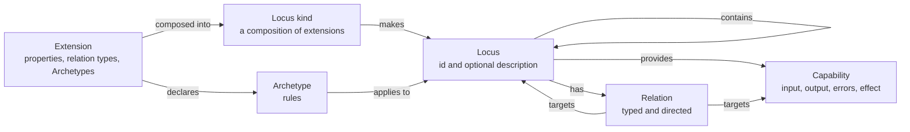
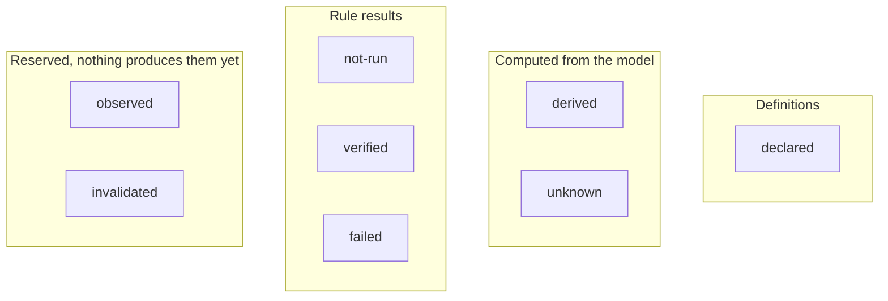

# Work Package Prompt: WP16 – Foundation documents, principles and terminology

## ⚡ Do This First: Load Agent Profile

Use the `/ad-hoc-profile-load` skill to load the agent profile specified in the frontmatter, and behave according to its guidance before parsing the rest of this prompt.

- **Profile**: `curator-carla`
- **Role**: `implementer`
- **Agent/tool**: `claude`

If no profile is specified, run `spec-kitty agent profile list` and select the best match for this work package's `task_type` and `authoritative_surface`.

---

## Objective

Rewrite the Telos doctrine for the new semantic model: the 16 new principles, the new terminology, the foundation README, conceptual model, capability map, technical direction, roadmap, open questions and philosophy, plus a new Future Semantic Evolution page. Repoint every link and `related` id in `docs/` that names a deleted document, update the docs tests and e2e ids that name removed documents, and update the two GRACE context files. When you finish, `bun run verify` passes.

## Context

- **Why this WP exists**: the owner directive (`kitty-specs/semantic-foundation-rebuild-01M5JFR0/research/owner-directive.md`, section 14 lists the 16 principles) replaces the old model (mandatory Charter, Fabric, Facets, Laws, Acts, Revisions) with one entity, the **Locus**, composed from **semantic extensions**. The doctrine in `docs/foundation/` still describes the old model. Spec FR-027 and decision D2 order the rewrite.
- **Who depends on you**: WP17 (ADRs) starts after you and edits the same ADR files. WP18 to WP20 (docs site) read the ids you create. WP21 (final sweep) flips term `maturity` to `implemented` when the code exists.
- **You run in parallel with the code WPs.** On your branch **no new code exists** (no `packages/kernel`, no `telos.ts`). Therefore:
  - Every principle and term has `maturity: proposed`. Never write `implemented`.
  - Name code files only inside backticks. **Never write a Markdown link to a file that does not exist yet** (the content build fails with "broken link"). Do not link `/inspector` or `/calculator` either: those routes do not exist yet. `/playground` and `/verification` exist and may be linked.
  - **ADR-0018 to ADR-0028 do not exist on your branch.** Never link them, never list them in `related`. WP17 adds the ADR-0018 sentences and `related` entries to `docs/foundation/**` afterwards.
- **Authoritative inputs** (read them; all in the repository):
  - `kitty-specs/semantic-foundation-rebuild-01M5JFR0/contracts/docs.md`, sections "Document content", "Principles", "Terms", "Other foundation documents", "Link integrity". It wins over this prompt on any conflict: report the conflict.
  - `kitty-specs/semantic-foundation-rebuild-01M5JFR0/spec.md`, section "Domain Language" (term meanings and "Avoid" words) and "Open owner decisions" (D1 to D8).
  - `kitty-specs/semantic-foundation-rebuild-01M5JFR0/data-model.md` (invariants and diagnostic codes) and `contracts/kernel.md` (module and export names).
  - The existing documents in `docs/foundation/` (structure and tone to keep).

### What the content build enforces (`apps/docs/scripts/content.ts`)

Check yourself with `bun run --cwd apps/docs content` (prints every problem; exit 1 on any).

| Rule | Consequence for you |
| --- | --- |
| Front matter has exactly the fields of its `kind`; **extra fields are an error** | Principle: `id, title, kind, number, code, status, maturity, summary, related`. Term: `id, title, kind, order, classification, fundamental, engine, stage0, status, maturity, summary, related`. Other kinds: `id, title, kind, status, maturity, summary, related`. |
| `status` is one of `provisional, proposed, accepted, open, superseded, deprecated`; `maturity` one of `vision, proposed, implemented` | Use `status: provisional` everywhere you write, `status: open` only for `open-questions`. |
| The words `verified`, `passing` and `all tests pass` (any case, whole word) are **forbidden in every front matter string** (title, summary, related) and in cells of table columns headed `Status` or `Maturity` | Do not use them in front matter. In `knowledge-status.md`, head the table columns `Value` and `Meaning`, never `Status`. The word is allowed in prose and in other columns. The one exempt table is under the heading "Maturity vocabulary" in `docs/foundation/README.md`: keep that heading text exactly. |
| `id` is unique across `docs/foundation`, `docs/decisions`, `docs/research`, `docs/guides` and equals the file name without `.md` for principles and terms | No renames of kept ids: `foundation`, `principles`, `terminology`, `conceptual-model`, `capabilities`, `technical-direction`, `roadmap`, `open-questions`, `evolution-of-determinism`, `locus`, `identity`, `relation`, `archetype`. |
| Every `related` id resolves to a document | Use only ids that exist after your WP (listed below). |
| Every relative Markdown link resolves, including `#fragment` against the real heading slugs (lower-case, spaces become hyphens, punctuation removed) | Link only to headings that exist. `[Definition](x.md#definition)` is safe. |
| YAML: a `title` or `summary` containing `: ` must be quoted | Example: `title: "One Fundamental Entity: Locus"`. |

### Sanctioned edits outside your owned files

- `docs/decisions/**`, `docs/guides/**`: change **only** `related` ids and Markdown link targets (path and `#fragment`). Never change prose, link text or status. WP17 (ADRs) and WP20 (guides) own those files.
- `docs/research/**`: change **only** link targets that point at deleted documents or headings. Never change prose or `related`-free text.
- `apps/docs/e2e/navigation.e2e.ts` (owner WP19) and `apps/docs/e2e/search.e2e.ts` (owner WP18): change **only** ids and routes of deleted documents (T094).
- `apps/docs/test/fixtures/**` are self-contained fixture trees for the compiler tests. **Do not touch them.**
- **Commit rule**: the `move-task` auto-commit takes only `owned_files`. Commit the sanctioned edits above yourself first, as a separate commit `docs(foundation): repoint links to the new model`, and say in the commit body which sanctioned files you edited. Conventional Commits only; no AI names, no author or co-author lines; never `--no-verify`.
- Never edit `kitty-specs/`, `AGENTS.md`, `CLAUDE.md`, `.kittify/`, or anything under `apps/docs/src/`.

### Open questions (a planner will answer; apply the default until then)

1. **Open-question anchors.** Contract says "rewrite `open-questions.md`", but 20 anchors `open-questions.md#oq-001` to `#oq-020` are linked ~64 times from ADRs and research notes whose prose you may not change, and the file says ids are never reused. *Default:* keep all 20 `## OQ-0xx` headings; for each question that the new model closes or removes (Fabric, Facet, Charter, Revision, Witness, Mandate, Law questions), keep the heading and question line and replace the body with one paragraph starting `**Closed by the semantic foundation rebuild.**` that says why; rewrite the still-valid ones in the new vocabulary; append `OQ-021` onward for the new questions (T092).
2. **Anchors into rewritten documents.** Kept ADRs, research and guides link to headings such as `conceptual-model/README.md#5-invariants` and `capabilities.md#cap-06-agents` that will not exist. The contract only mentions deleted documents. *Default:* treat a deleted heading as a deleted target: in files you may not rewrite, change the `#fragment` to the closest new heading, or drop the fragment, so the link opens the document top. Never change link text.
3. **`.grace/context/principles.xml` holds GRACE process principles, not the Telos principles.** The contract says "update to the new principles". *Default:* keep the four existing `<Principle>` lines and add one `<Principle>` line: `The Telos principles are defined in docs/foundation/principles/ (P01 to P16); this file does not copy them (P12).` Update `requirements.xml` (T095).
4. **Term classes and order.** The contract fixes the new terms' order only relative to each other and gives no `classification` values. *Default:* the 25-term order and the classes in the table of T091.
5. **Bare principle codes.** After renumbering, a link label such as `[P09]` or prose such as "(P10)" in files you may not rewrite points at the wrong principle. *Default:* change only link targets; list every such label or mention in your final report (file and line) for WP21.

---

### Subtask T090: Replace the 16 principles and the principles README

**Purpose**: the principles are the directive's 16 (section 14), each with its own file, replacing the old P01 to P16.

**Steps**

1. Delete the 16 old files `docs/foundation/principles/P01-everything-is-code.md` … `P16-self-application.md`.
2. Create the 16 files below. Every file uses this template (replace `<…>`); title in the H1 is `# Pnn — <Title>` (em dash, as the old files):

```markdown
---
id: P01-one-fundamental-entity
title: "One Fundamental Entity: Locus"
kind: principle
number: 1
code: P01
status: provisional
maturity: proposed
summary: <one sentence, no forbidden words>
related: [locus, containment, P02-composable-extensions]
---

# P01 — One Fundamental Entity: Locus

## Definition
<2 to 4 sentences, from the table below>

## Motivation
<2 to 4 sentences: why, from the directive>

## In practice
<bullets that name real modules from contracts/kernel.md, in backticks>

## Limits
<bullets: what the principle does not guarantee>
```

The four section headings are exact (`## Definition`, `## Motivation`, `## In practice`, `## Limits`); T094 tests them. File name = `<id>.md`. In `related`, `Pnn` below means the full id of that principle (the file name without `.md`, table in step 3). Every term id in `related` is created in T091.

3. Content per principle. Write full sentences from these facts. Do not add claims beyond them and the spec.

| File id (number) | Title | Definition (directive section 14) | In practice (modules) | Limits | related |
| --- | --- | --- | --- | --- | --- |
| `P01-one-fundamental-entity` (1) | One Fundamental Entity: Locus | Locus is the only fundamental semantic entity. An application, a component, an agent or an interface is a Locus with extensions. Only `id` is mandatory. | `packages/kernel/src/locus.ts` (`Locus.make({ id })` needs nothing else); the kernel exports no Fabric, Node, Component or Agent type; the repository is a root Locus in `telos.ts`. | One entity does not mean one shape: extensions can still make kinds complex. Containment allows one container per Locus. | locus, containment, semantic-extension, P02 |
| `P02-composable-extensions` (2) | Extensions Are Composable | Semantic extensions are defined independently, reused, and combined with `Locus.extend`. Composition detects incompatible definitions and never overwrites silently. | `extension.ts`, `locus.ts` (`LocusKind.conflicts`), `model.ts` (`composition.*` diagnostics). Property names share one flat namespace per Locus (spec D5). | Conflicts are found only for equal property names, relation type ids, extension ids and Archetype ids. Two extensions with clashing meaning but different names are not detected. | semantic-extension, composition, locus-kind, P01, P06 |
| `P03-no-code-outside-semantics` (3) | No Code Outside Semantics | Every managed code file belongs to an identifiable Locus. Functions need no Locus of their own. Important cross-boundary dependencies are represented or reported as unknown. | `Source` and `External` extensions (`extensions/source.ts`); `checkClosure` in `closure.ts` (`@telos/kernel/closure`); `bun run telos closure` inside `telos:check` and `bun run verify`. | File and module granularity only. Type-only imports are not seen. A computed `import(...)` is reported as unknown. Generated files and `node_modules` are excluded by the scope globs. | semantic-closure, locus, P12, ADR-0017 |
| `P04-code-is-the-source-of-truth` (4) | Executable Code Is the Source of Semantic Truth | Canonical semantic definitions live in executable TypeScript. Documents, diagrams, agent context, tool schemas and verification plans are derived from them or programmatically linked to them. Specs and ADRs record intent and rationale; runs are evidence; neither redefines semantics. | Agent tool schemas come from capability contracts (`packages/agent/src/tools.ts`), CLI flags from `packages/cli/src/derive.ts`, web forms from `packages/web/src/form.ts`; the site inspector reads the output of `bun run telos report`. | Prose documents, including these, are not derived and can drift. Only facts in the model are derived. `.grace/` overlaps with the model (see P12). | semantic-model, capability, contract, P05, P12 |
| `P05-agents-use-semantic-apis` (5) | Agents Access Knowledge Through Semantic APIs | An agent resolves a Locus and inspects it, its relations, capabilities and verification state without opening implementation files. | The `Telos` service in `introspection.ts` (`resolve`, then `inspect`, `relations`, `capabilities`, `verifications`); the six read-only `telos_*` MCP tools in `packages/agent/src/introspection-tools.ts`. | Covers only what the model declares. An agent still reads files to change code. No natural-language query. | executable-introspection, agent-native-development, capability, P15 |
| `P06-archetypes-specialize-verification` (6) | Archetypes Provide Specialized Verification | Verification comes from Archetypes: named rule sets that apply to Loci whose composition includes given extensions. The kernel selects the applicable rules and runs them. Different Archetypes may use different mechanisms. | `Archetype.make` with `appliesTo`; `applicableArchetypes` and `verify` in `verify.ts`; the calculator Archetypes `ArithmeticBehavior` and `CalculatorInterfaces`; the Archetypes of `@telos/cli`, `@telos/agent`, `@telos/web`. | A rule checks only what it checks. A Locus with no applicable Archetype has no checks, and the report shows none rather than a pass. | archetype, rule, finding, P07 |
| `P07-no-universal-correctness` (7) | No Universal Correctness Algorithm | Telos offers no algorithm that proves arbitrary software correct. A passed rule means only that this rule passed. | A finding names its Archetype, rule, Locus and method; the report has per-outcome counts and no overall "correct" flag; `ok` in `bun run telos check` means no error diagnostics, no failed or errored finding and no closure error. | Reproducible is not correct (see Evolution of Determinism, section 5). Undecidable questions stay outside. | archetype, finding, knowledge-status, evolution-of-determinism, P06 |
| `P08-no-mandatory-architecture` (8) | No Mandatory Application Architecture | Telos imposes no layers or patterns on applications. Architecture is expressed by the extensions and Archetypes a developer chooses. | The kernel defines no architecture; Packs are optional ordinary packages; the calculator is one example, not a template. | The kernel itself fixes: the identity grammar, one container per Locus, a flat property namespace. | pack, semantic-extension, P10 |
| `P09-no-duplicated-frameworks` (9) | No Duplication of Existing Frameworks | Telos describes and governs existing technologies and does not rebuild them. Effect stays the substrate for effects, schemas and services. | Contracts are Effect Schemas; `effect/cli` derives commands; Effect `McpServer` serves tools; the `External` extension declares third-party packages without modelling their internals; the web Pack has no UI library dependency. | Where Effect gives no Bun layer, a small hand-built adapter exists (`packages/cli/src/environment.ts`). | pack, capability, P10, ADR-0004 |
| `P10-no-unnecessary-layers` (10) | No Unnecessary Abstraction Layers | No wrapper, alias or layer without a clear purpose. An abstraction with no purpose is removed. | One entity; Packs are ordinary packages; no compatibility namespace; `deepFreeze`, `makeDiagnostic` and the cycle search stay internal to the kernel. | Whether a layer is unnecessary is a judgement, made again in review. | P09, P11, P01 |
| `P11-no-compatibility-for-mistakes` (11) | No Compatibility for Obsolete Mistakes | Obsolete concepts are removed, not wrapped. History stays in superseded decision records. | `@telos/locus`, Fabric, Charter, Facets and the specification runner are removed in this mission with no alias; superseded ADRs keep their text and link to the replacement. | A concrete migration requirement can justify a compatibility path; none exists today. | P10, P16, future-semantic-evolution |
| `P12-no-duplicate-semantic-models` (12) | No Manually Synchronized Duplicate Models | One source per semantic fact. No parallel model kept in step by hand. | `telos.ts` is the repository model; the inspector and verification report are built from it. **Known limit (spec D4):** `.grace/` keeps a hand-written module graph that overlaps with `telos.ts`. This mission keeps the two in step by hand. Whether to derive `.grace/` from Telos or retire parts of it is a later owner decision that changes `AGENTS.md`. | State this overlap plainly. The principle is not yet fully met. | semantic-model, P04, open-questions |
| `P13-no-unverified-guarantees` (13) | No Unverified Claims as Guarantees | Declared, derived, verified, failed, not-run and unknown facts stay distinguishable. "Verified" is used only for a rule result produced by a real run in this repository. | The `knowledge` field on every description (`describe.ts`); rules default to `not-run`; a closure finding the analysis cannot decide is `unknown`; the docs build rejects the words verified or passing in front matter and in Status or Maturity table columns. | `observed` and `invalidated` are reserved status values; nothing produces them yet. | knowledge-status, finding, diagnostic, P07 |
| `P14-no-ai-in-the-kernel` (14) | No AI Dependency in the Semantic Kernel | The kernel runs without any AI. Agents are clients of its interfaces. | The kernel main entry imports no AI, UI, CLI or platform module (`packages/kernel/test/api.test.ts`); MCP lives in `@telos/agent`; the deterministic agent client needs no network or credentials. | The design is shaped for agent use; only the dependency is excluded. | semantic-model, pack, agent-native-development, P15, ADR-0004 |
| `P15-no-arbitrary-agent-privileges` (15) | No Arbitrary Agent Privileges | Discovering a relation does not authorise acting on the target. A capability is invoked only by its own Locus or through a relation whose type grants invocation. | `invoke` and `isGranted` in `invoke.ts` return `NotGranted` otherwise; the `agent.tool` relation grants; the MCP server lists only exposed capabilities; introspection tools are read-only. | In-process rule only: no runtime isolation, authority delegation or revocation (constraint C-008). | grant, capability, executable-introspection, P05, P14 |
| `P16-no-speculative-implementation` (16) | No Speculative Implementation | Nothing is built without a clear purpose. Vision stays in documents. | Mandate, Variant, Witness, Verdict, Evolution and Revision live only in `future-semantic-evolution.md` and have no code; the revision history service was removed (spec D1). | The two reserved knowledge values `observed` and `invalidated` are the one deliberate allowance. | future-semantic-evolution, P10, ADR-0016 |

   Motivation text: one or two sentences per principle taken from the directive (sections 1 to 14 of `research/owner-directive.md`); e.g. P05 "Agents that reconstruct architecture from files and grep guess; software that exposes its own structure can be asked." Do not invent statistics or quotes.
4. Rewrite `docs/foundation/principles/README.md`: keep `id: principles`, `kind: index`, the sections "Front matter" (link `../README.md#front-matter-schema`) and "Versioning"; update the intro (sixteen principles, version 0.2, derived from the owner directive); a table `| # | Principle | Enforced today |` listing P01 to P16 in order with links; write `No` in every "Enforced today" cell (nothing is enforced on this branch) and keep the sentence that the column is updated by the change that adds enforcement, never in advance. State in one sentence that the closing work package of the semantic foundation rebuild updates it.

**Files**: 16 new principle files (~45 lines each), `principles/README.md` (~45 lines); delete 16.

**Validation**: `for f in docs/foundation/principles/P??-*.md; do for h in "Definition" "Motivation" "In practice" "Limits"; do grep -q "^## $h\$" "$f" || echo "$f: missing $h"; done; done` prints nothing. Exactly 16 `P??-*.md` files exist.

---

### Subtask T091: Delete, rewrite and add terminology documents and the README

**Purpose**: terminology matches the spec's Domain Language (25 terms).

**Steps**

1. Delete: `fabric.md facet.md lens.md law.md act.md charter.md mandate.md variant.md witness.md verdict.md evolution.md revision.md` in `docs/foundation/terminology/`.
2. Rewrite `locus.md`, `identity.md`, `relation.md`, `archetype.md`; add the 21 other files. Template (headings in this order; omit `## Avoid` when the table has no Avoid words):

```markdown
---
id: semantic-extension
title: Semantic extension
kind: term
order: 3
classification: definition-model
fundamental: false
engine: false
stage0: in-scope
status: provisional
maturity: proposed
summary: <one sentence>
related: [composition, locus-kind, P02-composable-extensions]
---

# Semantic extension

## Definition
<the Meaning cell of spec.md "Domain Language" for this term>

## Meaning in Telos
<2 to 5 sentences: what it is for, its boundaries, with one example from the calculator or the kernel>

## Avoid
<the spec "Avoid" words and what to say instead>

## Relationships
<bullets with links to other terms, e.g. [Composition](composition.md)>

## Implementation
Planned module: `packages/kernel/src/extension.ts`.
```

   `## Implementation` has exactly one line starting `Planned module:` (or `Planned modules:` with comma-separated backticked paths). WP21 searches for it and replaces it with `Module:`. Never write "implemented", "exists" or "ships" in these files.
3. The 25 terms. `fundamental: true` only for `locus`; all others false. `engine: false` and `stage0: in-scope` for all.

| order | id (= file name) | Title | classification | Planned module(s) | related (besides each other term you link) |
| --- | --- | --- | --- | --- | --- |
| 1 | `locus` | Locus | semantic-primitive | `packages/kernel/src/locus.ts` | P01 |
| 2 | `identity` | Identity | semantic-primitive | `packages/kernel/src/identity.ts` | ADR-0003 |
| 3 | `semantic-extension` | Semantic extension | definition-model | `packages/kernel/src/extension.ts` | P02 |
| 4 | `composition` | Composition | definition-model | `packages/kernel/src/locus.ts` | P02 |
| 5 | `locus-kind` | Locus kind | definition-model | `packages/kernel/src/locus.ts` | P02 |
| 6 | `containment` | Containment | semantic-primitive | `packages/kernel/src/model.ts` | P01 |
| 7 | `relation-type` | Relation type | definition-model | `packages/kernel/src/relation.ts` | P02 |
| 8 | `relation` | Relation | semantic-primitive | `packages/kernel/src/relation.ts` | P02 |
| 9 | `capability` | Capability | definition-model | `packages/kernel/src/capability.ts` | P05 |
| 10 | `contract` | Contract | definition-model | `packages/kernel/src/describe.ts` | P04 |
| 11 | `archetype` | Archetype | verification-model | `packages/kernel/src/archetype.ts` | P06 |
| 12 | `rule` | Rule | verification-model | `packages/kernel/src/archetype.ts` | P06 |
| 13 | `diagnostic` | Diagnostic | verification-model | `packages/kernel/src/diagnostic.ts` | P13 |
| 14 | `finding` | Finding | verification-model | `packages/kernel/src/verify.ts` | P13 |
| 15 | `knowledge-status` | Knowledge status | verification-model | `packages/kernel/src/describe.ts` | P13 |
| 16 | `semantic-model` | Semantic model | analysis-model | `packages/kernel/src/model.ts` | P04 |
| 17 | `semantic-closure` | Semantic Closure | analysis-model | `packages/kernel/src/closure.ts` | P03 |
| 18 | `pack` | Pack | distribution-model | `packages/cli/src/index.ts`, `packages/agent/src/index.ts`, `packages/web/src/index.ts` | P08 |
| 19 | `interface-locus` | Interface Locus | distribution-model | `packages/cli/src/semantics.ts`, `packages/agent/src/semantics.ts`, `packages/web/src/semantics.ts` | P05 |
| 20 | `impact` | Impact | analysis-model | `packages/kernel/src/impact.ts` | P05 |
| 21 | `grant` | Grant | execution-model | `packages/kernel/src/invoke.ts` | P15 |
| 22 | `purpose` | Purpose | definition-model | `packages/kernel/src/extensions/purpose.ts` | P01 |
| 23 | `semantic-first-programming` | Semantic-first programming | topic | `packages/kernel/src/index.ts`, `apps/calculator/src/app.ts` | P04 |
| 24 | `agent-native-development` | Agent-native development | topic | `packages/agent/src/mcp.ts`, `packages/agent/src/client.ts` | P05 |
| 25 | `executable-introspection` | Executable introspection | topic | `packages/kernel/src/introspection.ts` | P05 |

   `related` entries Pnn use full principle ids (T090 table). Terms 23 to 25 are the directive section 12 topics that are not single model terms; `pack`, `semantic-closure` and the calculator guide cover the rest.
4. Definitions: terms 1 to 21 copy the "Meaning in this mission" cell and the "Avoid" cell of the matching row of `spec.md` "Domain Language" (tidy only grammar; `Semantic Closure` row is "Semantic Closure"; `Interface Locus`, `Pack`, `Impact`, `Grant` as written). Terms with no spec row, or whose row needs more:
   - `identity`: keep the grammar of ADR-0003: `<namespace>:<name>`, each part lowercase kebab case (starts with a letter, then letters, digits and single hyphens), at most 128 characters; independent of file paths and of the container; examples `calculator:arithmetic`, `telos:kernel`. Avoid: path, key.
   - `relation`: one typed, directed statement from a Locus to a Locus or to a capability; its type is a [Relation type](relation-type.md) declared by an extension of the source Locus's kind. The old closed kinds `depends-on`, `refines`, `satisfies`, `verifies` do not exist. Avoid: edge, link.
   - `purpose`: "An optional extension (`telos.purpose`) that states why a Locus exists, what it is responsible for and what it excludes." Properties: `purpose` (required text), `responsibilities` and `excluded` (optional lists). It replaces the old mandatory Charter. Avoid: Charter (the removed mandatory record; not Spec Kitty's project charter in `.kittify/charter/`).
   - `knowledge-status`: eight values, in a table headed `Value` / `Meaning` (never `Status`): declared (written in a definition), derived (computed from the model), verified (a rule passed in a real run in this repository), failed (a rule failed or errored), not-run (a rule applies and has not run), observed and invalidated (reserved; nothing produces them yet), unknown (the analysis cannot decide, e.g. a computed import). Include the sentence: "Verified is never used for something a person or a definition declares."
   - `semantic-first-programming`: "Programming in which a system's meaning, structure, relationships, operations and verification are declared in executable definitions that the system itself exposes, instead of being reconstructed from source files."
   - `agent-native-development`: "Development in which an agent works through a system's executable semantic model: it discovers Loci, relations, capabilities, contracts and verification state, and invokes only what a granted relation allows."
   - `executable-introspection`: "Querying a system's semantic model by running code: resolve a Locus by id, then ask for its description, relations, capabilities and verifications, so the answer comes from the same definitions the software uses."
   - `semantic-closure`: also state the limits: file and module granularity; type-only imports not seen; computed `import(...)` reported as unknown; generated files excluded.
5. Rewrite `terminology/README.md`: keep `id: terminology`, `kind: index`; version 0.2; a table `| Term | One-line definition | Class | Stage 0 |` of all 25 in order (Stage 0 column `In scope`); a "Classes" list of the seven classes used (`semantic-primitive`, `definition-model`, `verification-model`, `analysis-model`, `execution-model`, `distribution-model`, `topic`) with one sentence each; the "Front matter" table (`order` 1 to 25, `classification` the seven values, `fundamental` true only for Locus, `engine`, `stage0`); a "Words to avoid" table built from the spec "Avoid" column plus Charter/Fabric/Facet/Lens/Law/Act with the term to use instead (Fabric → semantic model, Facet → semantic extension, Lens and Law → Archetype, Act → capability, Charter → Purpose extension). The "Words to avoid" and "Avoid" sections may name the removed words; no other place may use them as live concepts except `future-semantic-evolution.md`.

**Files**: 25 term files (~35 to 60 lines each), README (~70 lines); delete 12.

**Validation**: `ls docs/foundation/terminology/*.md | wc -l` prints 26 (25 terms plus README). `grep -c "^Planned module" docs/foundation/terminology/*.md` is 1 for every term file. `bun run --cwd apps/docs content` has no problem for these files (it will still report links elsewhere until T093).

---

### Subtask T092: Rewrite the other foundation documents and add future-semantic-evolution.md

**Purpose**: the rest of the doctrine describes the new model and states its limits.

**Steps** (keep each document's `id`, `kind` and file; update `related`; link only to existing documents; backtick every code path)

1. `docs/foundation/README.md` (`id: foundation`): Telos is a semantic-first programming system for agent-native software engineering (directive section 1; not a web framework, AI framework, graph database or workflow engine). Sections: what Telos is; the three levels (semantic programming, agent-native development, frameworks and applications); the Locus and extension model in five sentences; introspection; Packs; Semantic Closure; the calculator proof (one arithmetic implementation through a CLI, a web page and agent tools); **what this mission delivers and what is future** (future concepts are in [Future Semantic Evolution](future-semantic-evolution.md)); reading order (philosophy, principles, terminology, conceptual model, capability map, technical direction, roadmap, open questions, decisions, research). **Keep verbatim, with only the P-links and term links updated**: the heading `## Maturity vocabulary` and its four-row table (including the `verified` row and the paragraph after it, whose two principle links both go to P13 now), `## Who owns which artifact` (replace the sentences about Evolution, Revision and Witness by one sentence pointing to Future Semantic Evolution), `## Front matter schema` (add `guide` to the kinds list; say terms have 25 orders). Do not link or mention ADR-0018.
2. `docs/foundation/conceptual-model/README.md` (`id: conceptual-model`, `kind: model`): sections 1 Concept map; 2 Locus and composition; 3 Relations and capabilities; 4 Archetypes and verification; 5 Knowledge statuses; 6 Invariants; 7 Limits; 8 Open questions. Section 6 lists the 10 invariants of `data-model.md` (Minimality, Unique identity, Single container, Composition integrity, Relation validity, Acyclicity, Grant, Total invocation, Knowledge, Determinism) in your own words, naming diagnostic codes (e.g. `identity.malformed`, `ownership.multiple`, `relation.cycle`). Section 7: no universal correctness; closure at file level; observed and invalidated reserved. Include these two diagrams verbatim:

````markdown

````

````markdown

````

3. `docs/foundation/architecture/capabilities.md` (`id: capabilities`, `kind: capability-map`, `maturity: proposed`): the capability map of this repository. Table `| ID | Capability | Maturity | Modules | Depends on |`, all `proposed`: CAP-01 Semantic definitions (`locus.ts`, `extension.ts`, `relation.ts`, `capability.ts`, `archetype.ts`); CAP-02 Semantic model and diagnostics (`model.ts`, `diagnostic.ts`, `cycles.ts`); CAP-03 Verification (`verify.ts`); CAP-04 Description and introspection (`describe.ts`, `fields.ts`, `introspection.ts`); CAP-05 Governed invocation (`invoke.ts`); CAP-06 JSON definitions (`decode.ts`); CAP-07 Change impact (`impact.ts`); CAP-08 Semantic Closure (`closure.ts`); CAP-09 CLI Pack (`packages/cli`); CAP-10 Agent Pack (`packages/agent`); CAP-11 Web Pack (`packages/web`); CAP-12 Calculator (`apps/calculator`); CAP-13 Repository self-description and gate (`telos.ts`, `scripts/telos.ts`); CAP-14 Documentation site (`apps/docs`). Kernel files are under `packages/kernel/src/`. One `## CAP-nn <name>` section per row (what it provides, module names, limits). End with a "Future" paragraph linking Future Semantic Evolution. Link `../README.md#maturity-vocabulary`.
4. `docs/foundation/architecture/technical-direction.md` (`id: technical-direction`, `kind: direction`): TypeScript and Effect as authoring model; `## Runtime and toolchain: Bun` (heading text exactly this so the slug stays `runtime-and-toolchain-bun`); kernel main entry is browser-safe (no `bun`, `node:`, `effect/cli`, `effect/ai`, `effect/process`, React or Pack import) and `@telos/kernel/closure` is Bun-only; Packs are ordinary packages built on the kernel public API; derived artifacts (C-005); no new dependencies without owner approval (C-002). **It must keep a link to `../../tooling.md`**: `apps/docs/test/content.test.ts` asserts the compiled page contains `https://github.com/unknownlab/telos/blob/main/docs/tooling.md`. Keep `related: [capabilities, ADR-0004, ADR-0003, ADR-0013, P09-no-duplicated-frameworks]` only if all resolve (ADR-0013 is superseded but exists); drop P15-engine-independence.
5. `docs/foundation/roadmap/README.md` (`id: roadmap`, `kind: roadmap`): north star ADR-0017 (link `../../decisions/ADR-0017-north-star-telos-built-with-telos.md`); "Done in this mission" (kernel, three Packs, calculator, repository self-description and gate, living documentation, doctrine); "Next candidates" (derive `.grace/` from Telos or retire parts, spec D4; revisioning on top of digests and `diffModels`; runtime observation; an autonomous change workflow; more Archetypes and Packs); say these are direction only (ADR-0016). Write nothing as done that is not in the mission's scope.
6. `docs/foundation/open-questions.md` (`id: open-questions`, `status: open`): apply open question 1 above. New entries (heading `## OQ-021` and so on, plus a table row): OQ-021 GRACE overlap (D4); OQ-022 closure limits (function-level ownership, type-only imports, computed imports); OQ-023 revisioning on digests and model comparison (D1); OQ-024 autonomous change workflow out of scope (C-008); OQ-025 observed and invalidated knowledge sources. Keep the intro rules ("closed by an architecture decision record"), update the table.
7. `docs/foundation/philosophy/evolution-of-determinism.md` (`id: evolution-of-determinism`, `kind: doctrine`): keep the argument and the section numbers (anchors such as `#4-assumptions` stay). Replace old terms by the new ones: Law becomes Archetype rule; Witness becomes Finding with provenance; Act becomes capability; Charter becomes Purpose; Fabric becomes semantic model; Variant, Verdict, Revision and Evolution as mechanisms become links to `future-semantic-evolution.md`; old principle links become the new ones with the closest meaning (use the mapping of T093). Rewrite the table in section 8 "Philosophy and mechanisms": Maturity cells `proposed` for mechanisms this mission designs (Locus identity, Purpose and containment; digests and model comparison; Archetype verification with knowledge status; impact analysis) and `vision` for the rest. Update `related`.
8. New `docs/foundation/future-semantic-evolution.md` (`id: future-semantic-evolution`, `title: Future Semantic Evolution`, `kind: direction`, `status: provisional`, `maturity: vision`). One `##` section for each of Mandate, Variant, Witness, Verdict, Evolution and Revision. Each section has two paragraphs: **As an extension of the current model** (how it would sit on Locus, extensions, capabilities, Archetypes, digests and `diffModels`; e.g. a Witness would be a stored Finding with provenance; a Mandate would be a bounded grant beyond the current relation grant) and **Why it is not built now** (no consumer today; principle P16; constraint C-008 for autonomy). End with a note that these are not terms of the current model. Related: `evolution-of-determinism, P16-no-speculative-implementation, knowledge-status, grant`.

**Validation**: after T093, `bun run --cwd apps/docs content` reports no problem in `docs/foundation/`. `grep -rn "Planned\|planned" docs/foundation/architecture/capabilities.md` may show only the word as part of "Planned module" lines; `capabilities.md` itself uses the `proposed` maturity.

---

### Subtask T093: Fix every link and related id to deleted documents across docs/

**Purpose**: the content build must pass for the whole `docs/` tree (link integrity, contract "Link integrity").

**Steps**

1. Run `bun run --cwd apps/docs content`. It lists every `related id "X" does not resolve to a document`, `broken link`, `no heading` and `no such file` problem, sorted by file. Repeat until it prints `content: <N> documents` and exits 0.
2. Replacement for a deleted **term**: `fabric` becomes `semantic-model`; `facet` becomes `semantic-extension`; `lens` and `law` become `archetype`; `act` becomes `capability`; `charter` becomes `purpose`; `mandate`, `variant`, `witness`, `verdict`, `evolution`, `revision` become `future-semantic-evolution`. Link path form: `terminology/<new>.md`, except `future-semantic-evolution` whose path is `foundation/future-semantic-evolution.md` (relative to the linking file). After replacing, remove duplicates in a `related` list.
3. Replacement for a deleted **principle** (judgement calls are fixed here; do not invent new ids):

| Old id | New id |
| --- | --- |
| `P01-everything-is-code` | `P04-code-is-the-source-of-truth` |
| `P02-everything-has-meaning` | `P01-one-fundamental-entity` |
| `P03-semantic-ownership` | `P03-no-code-outside-semantics` |
| `P04-explicit-composition` | `P02-composable-extensions` |
| `P05-capabilities-instead-of-arbitrary-tools` | `P05-agents-use-semantic-apis` |
| `P06-authority-is-explicit` | `P15-no-arbitrary-agent-privileges` |
| `P07-evolution-is-fundamental` | `P16-no-speculative-implementation` |
| `P08-preserve-the-baseline` | `P11-no-compatibility-for-mistakes` |
| `P09-evidence-before-acceptance` | `P13-no-unverified-guarantees` |
| `P10-uncertainty-must-be-explicit` | `P13-no-unverified-guarantees` |
| `P11-verification-is-contextual` | `P06-archetypes-specialize-verification` |
| `P12-independent-governance` | `P15-no-arbitrary-agent-privileges` |
| `P13-human-as-strategic-authority` | `P15-no-arbitrary-agent-privileges` |
| `P14-incremental-formalization` | `P08-no-mandatory-architecture` |
| `P15-engine-independence` | `P09-no-duplicated-frameworks` |
| `P16-self-application` | `P03-no-code-outside-semantics` |

4. Files outside `docs/foundation/` (ADRs, guides, research): change only the `related` list and link targets (path and fragment), per "Sanctioned edits". For a link whose `#fragment` names a deleted heading, apply open question 2. Never edit link text or any sentence. Record in your notes each place where the visible label (for example `[P09]` or `[Revisions]`) no longer matches the new target; list them in the final report.
5. In `docs/foundation/` files you rewrite, write correct links directly.
6. Also check: `git grep -nE "terminology/(fabric|facet|lens|law|act|charter|mandate|variant|witness|verdict|evolution|revision)\.md" -- docs ':!docs/research'` prints nothing, and the same for `docs/research` shows only intended retargets (it should print nothing too).

**Validation**: `bun run --cwd apps/docs content` exits 0. `bun test apps/docs/test/guides.test.ts` still passes (it compiles `docs/` and checks guide routes).

---

### Subtask T094: Update docs tests and e2e ids that name removed documents

**Purpose**: tests that named removed documents or fixed counts must describe the new documents.

**Steps**

1. `apps/docs/test/content.test.ts` (real-docs tests near the end of the file):
   - In "counts match the files on disk": keep the 16-principle assertion. Replace `expect(ofKind("term").length).toBe(16)` by a count computed from disk: `const termFiles = (await Array.fromAsync(new Bun.Glob("docs/foundation/terminology/*.md").scan({ cwd: REPO_ROOT }))).filter((f) => !f.endsWith("/README.md"))` and `expect(ofKind("term").length).toBe(termFiles.length)`.
   - In "principles and terms sort by number and order": keep the principle numbers (1 to 16). Replace the fixed `length: 16` for the term orders by `Array.from({ length: termFiles.length }, (_, i) => i + 1)` (compute `termFiles` the same way). Orders must be unique and consecutive; that is the fix if it fails.
   - Replace the test "searching for baseline finds P08 and revision" by "searching for closure finds P03 and semantic closure": query `"closure"`; expect an id starting with `/principles/P03-no-code-outside-semantics` and one starting with `/terminology/semantic-closure`.
   - Add one new `describe("real docs: foundation structure", …)` with two tests. Reuse the `REPO_ROOT`, `GIT` constants and the `compileContent` import already in the file. Pattern:

```ts
test("every principle has the four required sections", async () => {
  const result = await compileContent({ root: REPO_ROOT, git: GIT });
  if (!result.ok) throw new Error("real docs must compile");
  const required = ["Definition", "Motivation", "In practice", "Limits"];
  const missing = result.output.content.documents
    .filter((d) => d.kind === "principle")
    .flatMap((d) =>
      required
        .filter((name) => !d.outline.some((h) => h.text === name))
        .map((name) => `${d.id}: ${name}`),
    );
  expect(missing).toEqual([]);
});
```

   The second test does the same for terms with `["Definition"]` and also asserts every term document has `maturity` in `proposed` or `implemented` (never `vision`). Do not assert counts of terms there.
2. `apps/docs/test/site.test.ts` (the test that checks `prerenderPaths` over the real docs): replace the routes `"/principles/P08-preserve-the-baseline"` by `"/principles/P08-no-mandatory-architecture"` and `"/terminology/revision"` by `"/terminology/locus"`. Keep `"/architecture/foundation"` and `"/decisions/ADR-0012"`. The principle count 17 (16 plus the index) stays. Do not touch the fixture ids `act` and `witness` used in the local fixtures of that file.
3. `apps/docs/test/search.test.ts`: in "createSearch over the real docs index" replace the test "baseline finds the principle and the term" by "closure finds the principle and the term" (query `"closure"`; routes contain `/principles/P03-no-code-outside-semantics` and `/terminology/semantic-closure`) and use the query `"closure"` in "baseline results name each route once" (rename it). Keep "a prefix finds the philosophy page".
4. `apps/docs/e2e/navigation.e2e.ts` (sanctioned edit): in the list `kinds` replace `"P01-everything-is-code"` by `"P01-one-fundamental-entity"` and `"revision"` by `"locus"`. Keep `"introduction"` and `"ADR-0005"`.
5. `apps/docs/e2e/search.e2e.ts` (sanctioned edit): replace each typed query `"baseline"` by `"closure"`; rename the first test to "a search for closure finds the Semantic Closure term and P03"; expect `a[data-search-result="/terminology/semantic-closure"]` and `a[data-search-result="/principles/P03-no-code-outside-semantics"]`. Update the file's header comment (SCOPE line) to say "closure". If the browser results list does not show the term within its visible results, type `semantic closure` instead and say so in your report.
6. Search the rest of `apps/docs/test` and `apps/docs/e2e` for removed ids with `git grep -nE "P0[1-9]-|P1[0-6]-|/terminology/(fabric|facet|lens|law|act|charter|mandate|variant|witness|verdict|evolution|revision)" -- apps/docs/test apps/docs/e2e ':!apps/docs/test/fixtures'`. Fixture-local ids (for example `P01-first`, `P02-x`, `P01-fixture` in `components.test.tsx` and `site.test.ts`) are not real documents: leave them.

**Validation**: `bun test apps/docs/test/content.test.ts apps/docs/test/site.test.ts apps/docs/test/search.test.ts` passes. The e2e files are exercised by `bun run test:e2e` inside T096.

---

### Subtask T095: Update .grace/context/principles.xml and requirements.xml

**Purpose**: GRACE context describes the new product and points at the new principles (FR-030 context; `.grace/` stays in sync).

**Steps**

1. `.grace/context/principles.xml`: keep the four existing `<Principle>` lines unchanged. Add after them one line (open question 3): `<Principle>The Telos principles are defined in docs/foundation/principles/ (P01 to P16); this file does not copy them (P12).</Principle>`. Keep `graceVersion="4.0"` and the root element.
2. `.grace/context/requirements.xml`: change `<Annotation>` to `Telos by UnknownLab: a semantic-first programming system for agent-native software engineering, developed as a Bun workspaces monorepo.`; `<Keywords>` to `bun, typescript, effect, monorepo, workspaces, semantic-first, agent-native, locus, archetype`; replace the single `<Goal>` by two: keep the monorepo goal and add `Expose software meaning, structure, capabilities and verification through executable semantic interfaces that people and agents query.` Leave `<Users>` and `<Constraints>` unchanged.
3. Run `bun run grace:lint`.

**Validation**: `bun run grace:lint` passes. `git diff --stat .grace` shows only these two files.

---

### Subtask T096: Run bun run verify and record the results

**Steps**

1. `bun run format` (writes), then `bun run format:check` (must pass; Markdown tables are re-aligned by the formatter).
2. `bun run verify`. It runs `check:bun`, `format:check`, `lint`, `typecheck`, `test`, `docs:build`, `test:e2e`, `grace:lint` in order and stops at the first failure. Fix in-scope failures. A failure in a file you do not own: stop and report it.
3. Commit in two commits: first the sanctioned edits to files outside your `owned_files` (T093 and T094 e2e), then your own files. Messages: `docs(foundation): repoint links to the new model` and `docs(foundation): rewrite principles, terminology and foundation for the semantic model`. Then `spec-kitty agent tasks mark-status T090 --status done` and so on for T091 to T096, and move the WP to review.
4. In your final message report each `verify` step and its exact result (passed, failed, not run), the number of documents the content build printed, the list of mismatched labels from T093 step 4, and any conflict you found between this prompt and `contracts/docs.md`.

Implementation command: `spec-kitty agent action implement WP16 --agent claude`

## Definition of Done

- [ ] Exactly 16 new principle files exist with the ids, numbers and codes of T090; the 16 old files are gone; each has the four exact section headings; the principles README lists them with "Enforced today" `No`. (T090)
- [ ] 25 term files plus the README exist; the 12 old terms are deleted; every term has `maturity: proposed`, exactly one `Planned module` line, and `fundamental: true` only for `locus`; orders are 1 to 25 without gaps. (T091)
- [ ] The seven foundation documents of T092 are rewritten and `future-semantic-evolution.md` is added with six concept sections; the README keeps `## Maturity vocabulary`; `technical-direction.md` links `tooling.md`; no document links ADR-0018 or code files. (T092)
- [ ] `bun run --cwd apps/docs content` exits 0; no link or `related` id in `docs/` names a deleted document or heading. (T093)
- [ ] The three unit-test files and the two e2e files name only existing documents; the structure tests exist and pass. (T094)
- [ ] `.grace/context/principles.xml` and `requirements.xml` updated; `bun run grace:lint` passes. (T095)
- [ ] `bun run verify` passes, results reported exactly. Per-subtask completion is recorded with `spec-kitty agent tasks mark-status <Txxx> --status done`. (T096)
- [ ] Commits follow Conventional Commits with no AI names and no author lines; the sanctioned edits are in their own commit and named in its body.

## Risks

| Risk | Mitigation |
| --- | --- |
| Forbidden words (`verified`, `passing`) in a front matter field or a Status/Maturity column fail the build. | Check with `bun run --cwd apps/docs content` after each document. Use `Value`/`Meaning` headers in `knowledge-status.md`. |
| Extra front matter fields or a missing quote around a title with a colon fail validation. | Copy the templates; quote `title` and `summary` when they contain `: `. |
| Broken anchors from kept ADRs, research and guides into rewritten documents. | Open question 2: retarget the fragment or drop it; keep the `OQ-001` to `OQ-020` headings (open question 1). |
| Linking code files or routes that do not exist yet. | Backticks only; no `/inspector`, `/calculator`, ADR-0018 or later. |
| Claiming more than the branch holds. | `maturity: proposed` everywhere you write; `Planned module` lines; no "implemented", "exists", "passing". |
| Search tests depend on words in the docs. | The word `closure` must appear in `semantic-closure.md` and `P03-no-code-outside-semantics.md`; run the search unit tests. |
| Large mechanical edit across ADRs and guides touching prose by accident. | Review `git diff` of `docs/decisions docs/guides docs/research`: only front matter `related` lines and link targets may change. |

## Reviewer Guidance

- Compare each principle against the table in T090 and `contracts/docs.md` ("Principles"): id, number, code, title, four sections, real module names in "In practice", honest "Limits" (P12 states the GRACE overlap).
- Check the 25 terms against `spec.md` "Domain Language": definitions and Avoid words match; only `locus` is fundamental; no term claims `implemented`.
- Confirm no document links to a file or route that does not exist on this branch, and none mentions ADR-0018.
- Confirm `git diff` for `docs/decisions`, `docs/guides` and `docs/research` shows only `related` lines and link targets, and that `apps/docs/test/fixtures` and `apps/docs/src` are untouched.
- Confirm the tests no longer hard-code 16 terms, search for "closure", and `bun run verify` output is quoted exactly.
- Check that the open-question defaults were applied (OQ headings kept and closed entries marked) and that the report lists mismatched labels for WP21.
